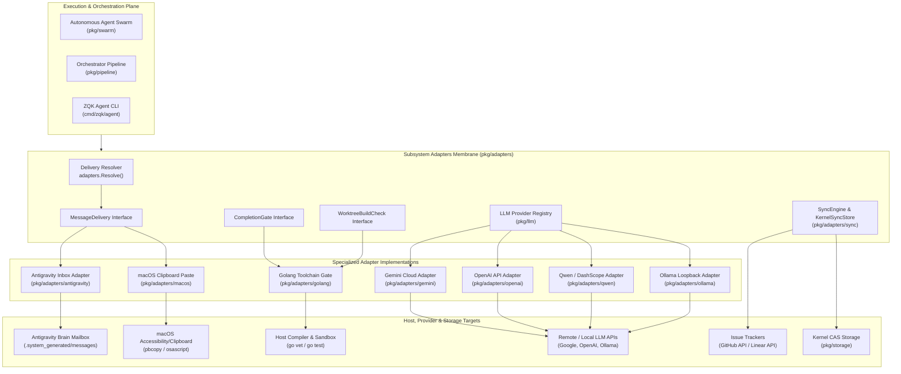
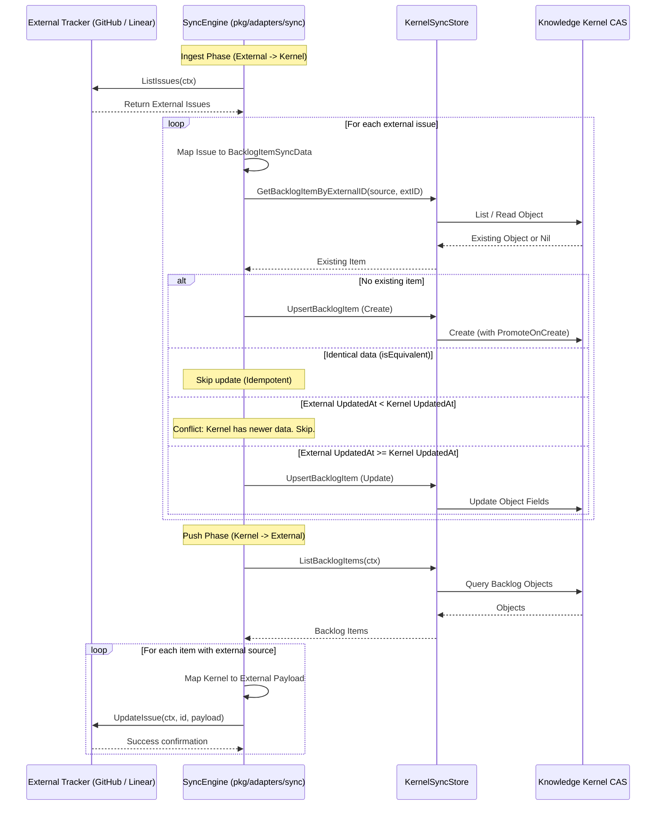

# LLM Provider Adapters, Streaming Protocol & Multi-Engine Dispatch Subsystem Operational Architecture Guide

## Overview

The **LLM Provider Adapters and Multi-Engine Dispatch Subsystem** (`pkg/adapters`) serves as the architectural decoupling membrane of the **Zen Quantum Kernel (ZQK)**. It bridges the kernel core, autonomous agent swarms, and execution orchestrators with heterogeneous external language model providers, host operating systems, interactive toolchains, and third-party issue management trackers.

Rather than tightly coupling agent runtime routines to proprietary API payloads, operating system clipboards, or vendor-specific conversation directories, `pkg/adapters` establishes strict, polymorphic interfaces that normalize communication, verify code delivery mutations, and orchestrate bidirectional synchronization.

### Key Capabilities

1. **Vendor-Neutral Multi-Engine Dispatch**: Seamless integration with local and cloud model providers, including Google Gemini, OpenAI, Alibaba Qwen (DashScope), and Ollama local loopback instances.
2. **Interactive Host Message Delivery Membrane**: Extensible `MessageDelivery` abstraction supporting native Antigravity CLI brain transcript mailboxes alongside Darwin host clipboard automation (`pbcopy` / `osascript`), enforcing fail-closed security boundaries across non-supported environments.
3. **Toolchain Verification & Pre-Merge Build Gates**: Domain-specific `CompletionGate` and `WorktreeBuildCheck` implementations that statically inspect tool invocation histories, enforce compilation checks (`go vet`, `go build`), and prevent broken mutations from claiming task completion.
4. **Bidirectional Issue Synchronization & Conflict Resolution**: High-fidelity `SyncEngine` supporting GitHub Issues and Linear trackers, executing monotonic timestamp conflict resolution and state machine mappings to kernel backlog items.
5. **Streaming Protocols & Token Accounting**: Normalized event buffering, delta chunk reassembly, and provider usage telemetry tracking.
6. **Continuous Quality & Test Invariants**: Strict adherence to the >= 85.0% statement test coverage floor across all subsystem packages (achieving >95% overall).

---

## Subsystem Architecture & Component Topology



---

## Directory Organization & Subpackages

The `pkg/adapters` hierarchy is organized into modular packages representing distinct responsibilities:

| Package | Path | Primary Responsibility |
|---|---|---|
| `adapters` | `pkg/adapters` | Core membrane contracts (`CompletionGate`, `MessageDelivery`, `WorktreeBuildCheck`), adapter resolution logic. |
| `antigravity` | `pkg/adapters/antigravity` | Gemini Antigravity CLI transcript sniffing, directory layout discovery, and structured JSON mailbox delivery. |
| `macos` | `pkg/adapters/macos` | Darwin host clipboard integration (`pbcopy`) and AppleScript keystroke emulation (`osascript`) with fail-closed non-Darwin safety. |
| `golang` | `pkg/adapters/golang` | Go language completion gating (`go vet`, `go test`), mutation history path filtering, and pre-merge worktree build verification. |
| `gemini` | `pkg/adapters/gemini` | Google Gemini API configuration adapter, API key auto-detection, and model tier classification. |
| `openai` | `pkg/adapters/openai` | OpenAI hosted HTTP API adapter, base URL defaults, and chat/embedding model configuration. |
| `qwen` | `pkg/adapters/qwen` | Alibaba Qwen / DashScope cloud adapter and local Qwen-on-Ollama endpoint dispatcher. |
| `ollama` | `pkg/adapters/ollama` | Local Ollama daemon adapter, HTTP loopback port sniffing, endpoint health probing, and parameter normalization. |
| `sync` | `pkg/adapters/sync` | Bidirectional issue synchronization for GitHub Issues and Linear, monotonic timestamp reconciliation, and kernel CAS mapping. |

---

## Subsystem Interface Contracts

### 1. MessageDelivery Interface

The `MessageDelivery` interface decouples chat orchestration from the underlying operating system or vendor harness:

```go
type MessageDelivery interface {
    Vendor() string
    Deliver(ctx context.Context, message string, msgID string, renderDetails map[string]string) error
}
```

- **`Vendor() string`**: Returns the unique, canonical identifier of the delivery provider (e.g. `"antigravity"`, `"macos"`).
- **`Deliver(ctx, message, msgID, renderDetails)`**: Injects the message into the recipient's target environment. Implementations must honor context cancellation and timeout boundaries.

#### Dynamic Resolution via `adapters.Resolve`

When an agent needs to communicate, `adapters.Resolve(transcriptPath string)` inspects the environment:
1. It interrogates `antigravity.IsBrainTranscript(transcriptPath)` to detect whether the path resides inside an Antigravity conversation directory (`.system_generated/logs/transcript.jsonl`).
2. If matched, it constructs and returns an `antigravity.InboxAdapter`.
3. If no vendor transcript is identified, it defaults to `macos.ClipboardPasteAdapter`, providing host clipboard injection on macOS systems.

### 2. CompletionGate Interface

The `CompletionGate` interface acts as an automated acceptance test gate for autonomous seat workers:

```go
type CompletionGate interface {
    Vendor() string
    WrittenFiles(history []swarm.ToolCallRecord, root string) []string
    Verify(ctx context.Context, root string, history []swarm.ToolCallRecord) (feedback string, err error)
}
```

- **`WrittenFiles(history, root)`**: Filters the tool call history (e.g. `write_code`, `write_file`) and extracts target paths relative to the project workspace root, dropping any paths that attempt directory traversal escapes.
- **`Verify(ctx, root, history)`**: Executes static analysis and test suites against the modified packages. If compilation fails or tests are red, it returns detailed, human-legible diagnostic feedback to the model agent, fail-closing the task until fixed.

### 3. WorktreeBuildCheck Interface

The `WorktreeBuildCheck` interface provides pre-merge verification for isolated git worktrees:

```go
type WorktreeBuildCheck interface {
    Vendor() string
    Verify(ctx context.Context, worktreeRoot string) error
}
```

- Checks for build configuration manifests (e.g. `go.mod`). Non-managed trees are safely skipped.
- Compiles the canonical product executable under the isolated worktree root using sandboxed process wrappers (`pkg/execwrap`).
- Fail-closes on any compilation or linker errors, preventing defective code from reaching integration branches.

### 4. LLM Provider Adapter Registry

Model providers register with the central registry (`pkg/llm`) during runtime initialization:

```go
type ProviderAdapter interface {
    ID() string
    Match(provider, baseURL string) bool
    Detect(cfg *Config) bool
    FillDefaults(cfg *Config)
    ClassifyModel(model string) ModelClass
}
```

- **`ID()`**: Returns the canonical provider slug (e.g. `"openai"`, `"gemini"`, `"qwen"`, `"ollama"`).
- **`Match(provider, baseURL)`**: Reports whether a given provider string or API URL belongs to this adapter.
- **`Detect(cfg)`**: Inspects environment variables (e.g. API keys, daemon socket ports) to automatically activate the provider when unconfigured.
- **`FillDefaults(cfg)`**: Injects default URLs, model identifiers, and context parameters.
- **`ClassifyModel(model)`**: Categorizes models into functional classes (Flash/Fast, Standard, Reasoning/Pro, Embedding).

---

## Delivery Protocols & Normalization

### 1. Antigravity Brain Mailbox Protocol

When operating inside Google Gemini Antigravity CLI sessions, direct kernel messaging is dispatched via file-based mailboxes. The `InboxAdapter` manages this protocol:

1. **Path Resolution**: Walks upward from the active transcript file until locating the `.system_generated` marker, establishing the conversation root.
2. **Payload Serialization**: Constructs a standardized JSON envelope containing:
   - `id`: Unique message UUID.
   - `recipient`: Conversation ID extracted from the directory structure.
   - `sender`: Canonical agent identity.
   - `priority`: Normalized message priority string (`MESSAGE_PRIORITY_HIGH`).
   - `timestamp`: RFC3339Nano UTC timestamp.
   - `content`: Message markdown body.
   - `renderDetails`: Optional metadata map for UI presentation.
3. **Atomic Delivery**:
   - Writes the full message payload to `.system_generated/messages/<msgID>.json` using secure filesystem permissions (`0o600`).
   - Atomically writes an empty pointer file into `.system_generated/messages/undelivered/<msgID>` to notify the host session monitor.

### 2. macOS Clipboard & Keystroke Emulation Protocol

In interactive Darwin desktop terminal environments where no vendor transcript exists:
1. **OS Check**: Asserts `runtime.GOOS == "darwin"`. In non-Darwin environments, the adapter fails closed immediately with an informative operational error.
2. **Clipboard Staging**: Spawns `/usr/bin/pbcopy` with the message content piped to standard input.
3. **Keystroke Triggering**: Spawns `/usr/bin/osascript` to trigger an automated `keystroke "v" using {command down}` event via System Events, simulating human paste operations.

---

## Bidirectional Issue Synchronization Engine (`pkg/adapters/sync`)

The `sync` package provides bidirectional synchronization between the ZQK Knowledge Kernel and external project tracking systems (GitHub Issues, Linear).



### Monotonic Precedence & Conflict Resolution Invariant

Data synchronization between distributed planes is susceptible to race conditions and stale writes. `SyncEngine` enforces monotonic precedence:
1. **Timestamp Monotonicity**: Every incoming item is compared against stored kernel data via `mapped.UpdatedAt.Before(existing.UpdatedAt)`. If local kernel state has a more recent timestamp, the incoming external mutation is rejected as a conflict and logged in `SyncStats.ConflictCount`.
2. **Equivalence Filtering**: Incoming items that produce identical normalized properties (`Title`, `Description`, `Status`, `Priority`, `PriorityTier`, `PriorityPlanRef`) are short-circuited via `isEquivalent()`, avoiding redundant write amplification.
3. **Mutual Exclusion**: All ingestion and push operations acquire an internal mutex (`withSyncLock`) to guarantee serialize-safe batch execution.

### Status and Priority Normalization

External provider statuses and priorities are mapped into canonical kernel invariants:

| External Status | Normalized Kernel Status | External Priority | Normalized Kernel Tier / Priority |
|---|---|---|---|
| GitHub `closed` / Linear `Done`, `completed` | `complete` | Linear Priority 1 / Label `P0`, `critical` | `P0` / `critical` |
| GitHub `in-progress` / Linear `In Progress`, `started` | `in_progress` | Linear Priority 2 / Label `P1`, `high` | `P1` / `high` |
| Linear `Canceled`, `cancelled` | `archived` | Linear Priority 3 / Label `P2`, `medium` | `P2` / `medium` |
| Default / Linear `Backlog`, `Todo`, `Triage` | `planned` | Linear Priority 4 / Label `P3`, `low` | `P3` / `low` |

---

## Error Handling, Resilience & Security Boundaries

The subsystem operates under strict fail-closed resilience standards:

1. **Context Cancellation Propagation**: All blocking operations (HTTP roundtrips, subprocess spawns, disk writes, test executions) accept a `context.Context` parameter and immediately abort when cancelled or timed out.
2. **Path Sanitization & Jail Containment**: File paths extracted from tool execution logs are sanitized to guarantee they remain under the workspace root directory. Paths containing directory traversal sequences (`../`) are safely rejected.
3. **Subprocess Isolation**: Toolchain invocations (`go vet`, `go test`, `go build`) run with bounded execution timeouts and structured environment isolation via `pkg/execwrap` and `pkg/zqkenv`.
4. **Secret Protection**: API keys and authorization tokens are resolved exclusively via strongly-typed `pkg/zqkenv` accessors and are cryptographically scrubbed from operational logs.

---

## Test Verification & Coverage Invariants

The `pkg/adapters` subsystem enforces the continuous verification quality standard:
- **Statement Test Coverage Floor**: Subsystem statement test coverage must be strictly >= 85.0% (target 100.0%).
- Current test verification achievements across the subsystem:
  - `pkg/adapters`: 100.0%
  - `pkg/adapters/antigravity`: 94.2%
  - `pkg/adapters/gemini`: 100.0%
  - `pkg/adapters/golang`: 90.4%
  - `pkg/adapters/macos`: 94.4%
  - `pkg/adapters/ollama`: 89.7%
  - `pkg/adapters/openai`: 93.1%
  - `pkg/adapters/qwen`: 100.0%
  - `pkg/adapters/sync`: 98.7%

### Running Verification Suites

```bash
# Execute unit test suites and measure statement coverage across all adapter packages
go test -v -cover ./pkg/adapters/...

# Verify AST compliance and linting invariants
zqk-vet --package ./pkg/adapters/...

# Verify documentation payload integrity and ensure zero leaks
sh scripts/open-core/check-public-release-payload.sh .
```
