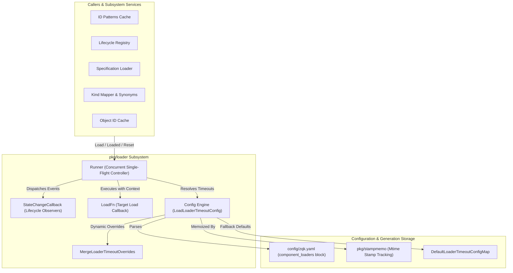
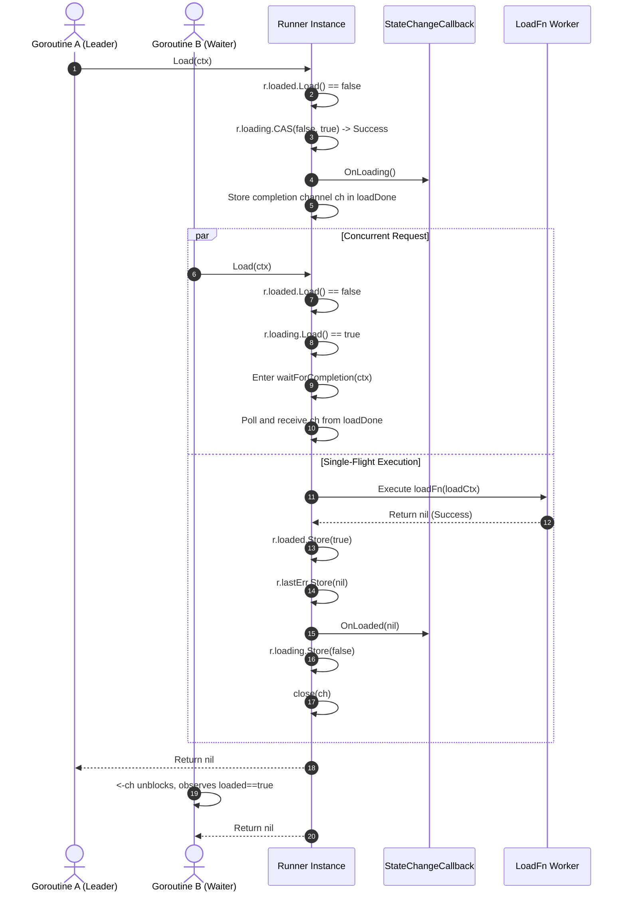

# Component Loader Pattern, Atomic State Transitions & Timeout Envelope Subsystem Guide

## 1. Executive Architectural Summary

The **Component Loader Subsystem** (`pkg/loader`) implements an abstracted, high-concurrency component and service loader pattern for the **ZQK Knowledge Kernel**. In high-frequency CLI workflows, swarm coordination loops, and background daemon operations, multiple concurrent goroutines frequently request access to foundational kernel caches and registry services simultaneously (such as entity ID pattern matchers, kind schemas, spec definitions, and object ID indexes).

Without a coordinated single-flight loading membrane, concurrent requests trigger the "thundering herd" problem—initiating redundant disk reads, duplicate YAML parsing, and uncoordinated lock contention. 

The `pkg/loader` subsystem resolves these challenges through four foundational invariants:
- **Lock-Free Atomic State Transitions:** Utilizes hardware-level atomic primitives (`atomic.Bool`, `atomic.Value`, `atomic.Pointer`) to achieve zero-overhead fast-path reads for already loaded components without acquiring locks.
- **Single-Flight CAS Execution:** Employs atomic Compare-And-Swap (`CompareAndSwap(false, true)`) to guarantee that exactly one worker goroutine executes the expensive loading operation while all concurrent peers safely park on a synchronization channel.
- **Granular Multi-Stage Timeout Envelopes:** Enforces decoupled timeout envelopes across three distinct phases: channel publication, wait-for-completion, and actual I/O load execution.
- **Generational Stamp Memoization & Profile Overrides:** Integrates with `pkg/stampmemo` to cache and dynamically reload configuration from project configuration files upon disk modification, while supporting dynamic runtime profile overrides.

---

## 2. Component Topology & Structural Model

The subsystem consists of tightly coupled primitives structured across configuration, execution runner, and state lifecycle layers:



### Component Breakdown

1. **`Runner` (`runner.go`):** The core single-flight orchestrator. Maintains atomic flags for `loaded` and `loading`, an atomic completion channel `loadDone`, and an atomic error pointer `lastErr`. Coordinates concurrent callers so only one executes `loadFn` while others wait for completion.
2. **`LoaderTimeoutConfig` (`types.go`, `config.go`):** Strongly typed configuration defining three duration envelopes:
   - `WaitForCompletion`: Maximum duration a waiter waits for a concurrent load to finish.
   - `PublishChannel`: Maximum duration a waiter polls for the completion channel to appear.
   - `LoadOperation`: Optional bounded execution duration for the actual `loadFn` via child context.
3. **`StateChangeCallback` (`types.go`):** Lifecycle hook interface notifying observers on state transitions: `OnLoading()`, `OnLoaded(value any)`, `OnError(err error)`, and `OnTimeout()`. Includes `NoOpStateChangeCallback` for zero-overhead defaults.
4. **`LoadLoaderTimeoutConfig` & `MergeLoaderTimeoutOverrides` (`config.go`):** Reads loader timeout configuration from `config/zqk.yaml` with filesystem stamp-memoized caching and merges dynamic profile overrides.

---

## 3. Configuration Invariants & Defaults

### Subsystem Default Envelopes

The subsystem establishes sensible, production-tested timeout configurations tailored to the operational complexity of each kernel component:

| Component Loader | Wait For Completion | Publish Channel | Load Operation Limit | Operational Rationale |
| :--- | :--- | :--- | :--- | :--- |
| `id_patterns` | 15s | 1s | No limit (wait-bound) | Validates entity ID regex and prefix definitions. |
| `lifecycle` | 10s | 1s | No limit (wait-bound) | Loads state machine schemas and transition rules. |
| `bucketing_config` | 5s | 1s | No limit (wait-bound) | Fast in-memory storage shard allocation schemas. |
| `bucket_strategy_loader`| 15s | 2s | No limit (wait-bound) | Resolves storage volume partition layouts. |
| `spec_loader` | 10s | 2s | No limit (wait-bound) | Discovers and compiles YAML specification schemas. |
| `kind_synonym_resolver` | 10s | 2s | No limit (wait-bound) | Compiles pluralization and synonym mapping tables. |
| `kind_mapper` | 15s | 2s | No limit (wait-bound) | Builds cross-kind relational adjacency definitions. |
| `object_id_cache` | 900s (15m) | 5s | 900s (15m) | Rebuilds and warms the complete repository object index. |
| *Default / Unregistered*| 5s | 1s | No limit (wait-bound) | Generic fallback for arbitrary custom runners. |

### Configuration File Schema

Timeouts are configured in `config/zqk.yaml` under the `component_loaders` mapping key:

```yaml
component_loaders:
  id_patterns:
    wait_for_completion_seconds: 15
    publish_channel_seconds: 1
    load_operation_seconds: 10
  object_id_cache:
    timeout_seconds: 900 # Shorthand: sets both wait_for_completion and load_operation to 900s
  spec_loader:
    wait_for_completion_seconds: 12
    publish_channel_seconds: 2
```

### Dynamic Profile Overrides

Runtime profiles (such as resource-constrained CI environments or high-throughput swarm seats) can programmatically override static defaults using `MergeLoaderTimeoutOverrides`:

```go
baseConfig := loader.GetGlobalLoaderTimeoutConfigMap()
overrides := map[string]map[string]any{
    "spec_loader": {
        "wait_for_completion_seconds": 30,
        "load_operation_seconds": 25,
    },
}
customConfig := loader.MergeLoaderTimeoutOverrides(baseConfig, overrides)
```

---

## 4. Runner Execution Lifecycle & Error Semantics

The `Runner` orchestrates concurrent execution through a deterministic three-way dispatch:



### Detailed Execution Sequence

1. **Fast-Path Verification:** `r.loaded.Load()` checks the atomic boolean. If `true`, returns `nil` immediately without allocating contexts or acquiring locks.
2. **In-Flight Detection:** If `r.loading.Load()` is `true`, the caller branches into `waitForCompletion(ctx)`.
3. **CAS Winner Elect:** The caller attempts `r.loading.CompareAndSwap(false, true)`.
   - If the CAS succeeds, the caller becomes the leader and enters `runLoad(ctx)`.
   - If the CAS fails (lost race to a concurrent peer), it recurses into `Load(ctx)`, routing cleanly into `waitForCompletion(ctx)`.
4. **Channel Publication & Cleanup:**
   - The leader creates a non-buffered completion channel `ch := make(chan struct{})` and publishes it via `r.loadDone.Store(ch)`.
   - The leader invokes `r.callback.OnLoading()`.
   - Cleanup is guaranteed via `defer`: `loading` is cleared to `false` and `close(ch)` unblocks all waiting goroutines simultaneously.
5. **Execution & Context Isolation:**
   - If `cfg.LoadOperation > 0`, a child context with deadline is derived (`context.WithTimeout(ctx, cfg.LoadOperation)`).
   - If `loadFn` fails, `r.lastErr` stores a pointer to the error, `r.callback.OnError(err)` is fired, and the error returns to the leader.
   - If `loadFn` succeeds, `r.loaded.Store(true)`, `r.lastErr.Store(nil)`, and `r.callback.OnLoaded(nil)` is triggered.
6. **Waiter Synchronization:**
   - Waiters poll for `ch` up to `PublishChannel` duration (polling every 10ms with `ctx.Done()` checks).
   - Once `ch` is acquired, the waiter selects between `<-ch`, `<-ctx.Done()`, and `<-time.After(cfg.WaitForCompletion)`.
   - If `WaitForCompletion` expires first, the waiter triggers `r.callback.OnTimeout()` and returns a descriptive timeout error.
   - When `ch` closes, waiters verify `r.loaded.Load()`. If false, any error stored in `r.lastErr` is returned to the waiter.

---

## 5. Concurrency, Timeouts & Resource Management

### Lock-Free Memory Invariants

The `Runner` maintains strict memory safety without relying on global mutexes:
- **`atomic.Bool` (`loaded`, `loading`):** Guarantees sequentially consistent visibility across CPU cores.
- **`atomic.Value` (`loadDone`):** Holds the completion channel reference. In Go, `atomic.Value` panics if stored with `nil`. Therefore, `loadDone` is never stored with `nil`; instead, new channels replace older references across reload cycles.
- **`atomic.Pointer[error]` (`lastErr`):** Provides safe atomic storage and retrieval of pointers to errors, allowing `nil` to represent clean loads and non-nil pointers to propagate failures to waiters.

### Cache Reset Semantics

When underlying specification or pattern files change on disk, callers invoke `ResetLoaded()`:
```go
runner.ResetLoaded()
```
This resets `loaded` to `false` and clears `lastErr`. The next call to `Load(ctx)` transparently triggers a fresh execution of `loadFn`.

---

## 6. Verification, Troubleshooting & Operational Runbook

### Health Verification Commands

To verify that the component loader subsystem is functioning cleanly:

```bash
# Execute unit and race detection suite
go test -v -race -cover ./pkg/loader/...

# Validate statement test coverage meets or exceeds 85.0% threshold
go test -coverprofile=coverage.out ./pkg/loader/... && go tool cover -func=coverage.out
```

### Operational Troubleshooting

| Symptom | Probable Cause | Remediation Procedure |
| :--- | :--- | :--- |
| `timeout waiting for load channel (max ...)` | Leader goroutine stalled or blocked before storing `loadDone` in `runLoad`. | Inspect goroutine dumps for deadlocks in callbacks prior to channel publication. Increase `publish_channel_seconds` in `config/zqk.yaml` if initialization involves heavy thread contention. |
| `timeout waiting for load to complete (max ...)` | `loadFn` takes longer than `wait_for_completion_seconds` configured for the loader. | For heavy caches like `object_id_cache`, configure adequate completion headroom (e.g. 900s). Check disk I/O performance and repo scale. |
| `context deadline exceeded` during load | `load_operation_seconds` is set lower than required by `loadFn`. | Increase `load_operation_seconds` in `config/zqk.yaml` or set to `0` to allow the load operation to run until `wait_for_completion` expires. |
| Waiter receives stale error after transient outage | Runner was not reset after a transient load failure. | Ensure callers invoke `runner.ResetLoaded()` before retrying failed loads, or instantiate fresh runners on reload events. |

---

## 7. Subsystem Registration

This guide is registered in the Knowledge Kernel operational manifest at `docs/guides/README.md` under **Knowledge Graph & Data Plane Operations**.
