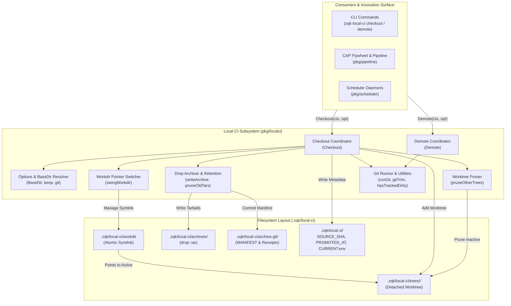
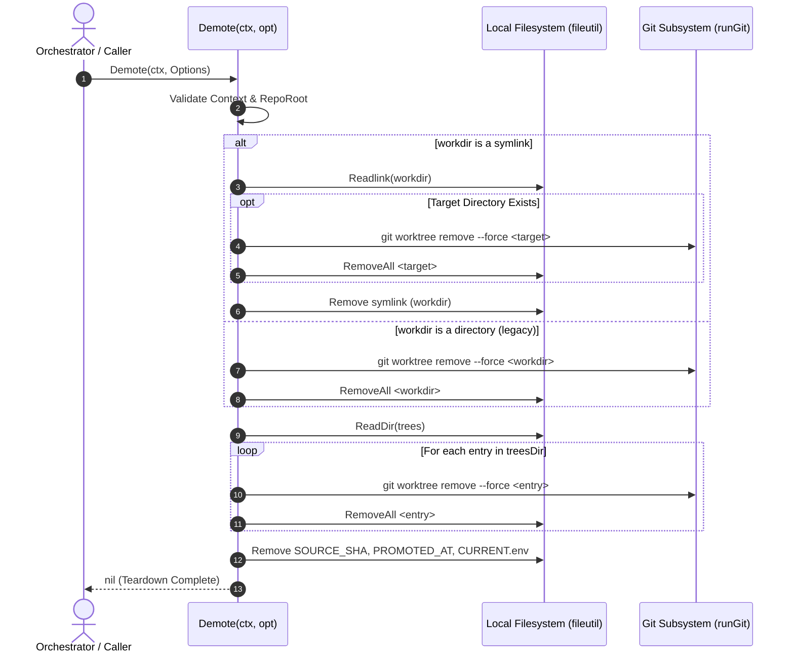

# Local CI Engine, Worktree Isolation & Git Fast-Forward Subsystem Operational Architecture Guide

## 1. Executive Architectural Summary

The **Local CI Engine & Worktree Isolation Subsystem** (`pkg/localci`) provides a pure Go implementation of studio-local continuous integration checkout, isolated git worktree management, tarball artifact archiving, and environment demotion across the **ZQK Knowledge Kernel**.

When autonomous AI agents, multi-agent swarms, or human engineers run continuous integration, test verification, or automated code compilation locally, running directly against the active developer working tree introduces critical hazards:
- Uncommitted, dirty working tree state can contaminate verification runs, producing false positives or misleading test passes.
- Compiling code or writing transient build artifacts directly into the developer worktree risks contaminating repository tracking and colliding with concurrent agent file operations.
- Previous shell-based implementations (`scripts/local-ci-*.sh`) relied on external shell processes, platform-dependent POSIX shell utilities, and unmanaged background execution pipelines prone to zombie processes and unhandled error states.

`pkg/localci` replaces shell scripts with a robust, pure Go subsystem built upon five foundational architectural invariants:

1. **Pure Go Plumbing & Process Hardening:** Replaces all legacy shell scripts with programmatic Go execution via `execwrap.CommandContext`, strictly managing stdout/stderr streams, context cancellations, and process group isolation.
2. **Fail-Closed Dirty Studio Protection:** Enforces strict working tree cleanliness by verifying `git status --porcelain`. Tracked modifications strictly block promotion unless explicitly permitted via `AllowDirty` or pinned to an immutable committed SHA via `SHAPinned`.
3. **Detached Worktree Isolation:** Promotes commits into detached git worktrees under `.zqk/local-ci/trees/<short_sha>`, decoupling verification execution completely from developer branch heads and preventing branch lock contention.
4. **Atomic Workdir Pointer Swinging:** Maintains an atomic symlink (`.zqk/local-ci/workdir`) pointing to the active promoted tree, supporting zero-downtime switching between commits and safe legacy directory migration.
5. **Cryptographic Drop Archiving & Retention:** Packages promoted commits into standalone tarballs (`drop-<short_sha>.tar`), generates SHA-256 cryptographic digests, registers entries in an internal `archive-git` manifest, and enforces retention limits.
6. **Static Floor Coverage Invariant:** Enforces a strict statement test coverage invariant ($\ge 85.0\%$, verified at $98.3\%$) across all checkout, demote, git plumbing, and worktree isolation lifecycles.

---

## 2. Component Topology & Structural Model

The subsystem provides clean boundaries separating options resolution, checkout coordination, workdir pointer manipulation, worktree pruning, tarball archiving, and teardown demotion:



### Component Responsibilities

| Component | Primary Function | Core Responsibility |
| :--- | :--- | :--- |
| **Options Resolver** | `BaseDir`, `Options.git()`, `Options.keep()` | Resolves base directories, applies environment overrides (`LOCAL_CI_DIR`, `LOCAL_CI_ARCHIVE_KEEP`), and injects custom git runners for testing. |
| **Checkout Coordinator** | `Checkout(ctx, opt)` | Orchestrates git SHA verification, dirty checks, worktree addition, workdir pointer swinging, metadata recording, and archiving. |
| **Workdir Switcher** | `swingWorkdir(base, workdir, short, git, ctx, root)` | Atomically creates or updates the `workdir` symlink to target the active short-SHA tree directory, safely migrating legacy directories if encountered. |
| **Worktree Pruner** | `pruneOtherTrees(ctx, git, root, trees, keepShort)` | Scans the `trees/` directory and removes all stale worktrees via `git worktree remove --force` and directory removal. |
| **Drop Archiver** | `writeArchive(...)`, `pruneOldTars(...)` | Generates tarball drops from the committed SHA, records SHA-256 hashes, maintains the `archive-git` commit log and `MANIFEST`, and enforces retention. |
| **Demote Coordinator** | `Demote(ctx, opt)` | Tears down all local CI state: unlinks `workdir`, removes all worktrees, cleans tree directories, and deletes metadata files. |
| **Git Runner & Plumbing** | `runGit`, `gitTrim`, `hasTrackedDirty` | Wraps external git execution via `execwrap`, parses porcelain status lines, and handles error string construction. |

---

## 3. Checkout, Demote & Git Plumbing Lifecycles

The Local CI Subsystem guarantees deterministic, fail-closed transitions across both the promotion (checkout) and teardown (demote) workflows.

### Checkout Lifecycle

```mermaid
sequenceDiagram
    autonumber
    actor Caller as Orchestrator / Caller
    participant CI as Checkout(ctx, opt)
    participant Git as Git Subsystem (runGit)
    participant FS as Local Filesystem (fileutil)
    participant Arch as writeArchive

    Caller->>CI: Checkout(ctx, Options)
    CI->>CI: Validate Context & RepoRoot
    CI->>Git: git rev-parse --verify <sha>^{commit}
    Git-->>CI: Full SHA (40 hex chars)
    CI->>Git: git rev-parse --short <sha>
    Git-->>CI: Short SHA (7 hex chars)

    alt Dirty Check Required (!AllowDirty && !SHAPinned)
        CI->>Git: git status --porcelain --untracked-files=no
        Git-->>CI: Porcelain Output
        opt Tracked Modifications Detected
            CI-->>Caller: Error: "studio has tracked changes; commit first..."
        end
    end

    CI->>FS: Check SOURCE_SHA and dirExists(workdir)
    opt Cache Hit (Current SHA matches & workdir exists)
        CI-->>Caller: Result{Skipped: true, SHA, Short, Workdir, Tree}
    end

    CI->>FS: MkdirAll trees/ and archives/
    CI->>Git: git worktree remove --force <tree>
    CI->>FS: RemoveAll <tree>
    CI->>Git: git worktree add --detach <tree> <sha>
    Git-->>CI: Worktree Added Successfully

    CI->>CI: swingWorkdir(base, workdir, short, git, ctx, root)
    CI->>CI: pruneOtherTrees(ctx, git, root, trees, short)

    CI->>FS: Write SOURCE_SHA, PROMOTED_AT, CURRENT.env

    opt Archive Requested (opt.Archive == true)
        CI->>Arch: writeArchive(...)
        Arch->>Git: git archive --format=tar -o drop-<short>.tar <sha>
        Arch->>FS: Calculate SHA-256 Checksum
        Arch->>Git: Commit to archive-git repo & update MANIFEST
        Arch->>Arch: pruneOldTars(archives, keep)
    end

    CI-->>Caller: Result{SHA, Short, Workdir, Tree}
```

### Demote Lifecycle



---

## 4. Worktree Isolation, Branch Tracking & Cleanliness Invariants

The subsystem maintains four fundamental invariants that guarantee complete safety across local CI operations:

### 1. Fail-Closed Dirty Studio Invariant
Developers frequently have unstaged or staged modifications in their studio workspaces. Running a verification pipeline against a modified state produces non-deterministic results that do not reflect git history.
- `hasTrackedDirty` inspects lines returned by `git status --porcelain --untracked-files=no`.
- Untracked files (`??`) and ignored files (`!!`) are explicitly ignored to allow local developer notes or scratchpads.
- Any modified (`M`), added (`A`), deleted (`D`), renamed (`R`), or copied (`C`) tracked file immediately halts `Checkout` with an actionable diagnostic.
- Operators may override this gate using `--allow-dirty` (for experimental checks) or `--sha <commit>` (to pin explicitly to a known historical commit).

### 2. Detached Worktree Isolation
When a worktree is created, attaching it to an existing branch can block checkouts on that branch in other worktrees (git error: `fatal: '<branch>' is already checked out at '...'`).
- `Checkout` always executes `git worktree add --detach <tree> <sha>`.
- The worktree is detached at the specific commit, guaranteeing that concurrent work on local branches (`main`, `integration/*`, or feature branches) is never locked or blocked.

### 3. Atomic Symlink Workdir Invariant
To ensure continuous operation without broken file paths, `swingWorkdir` operates via atomic filesystem primitives:
- If `workdir` does not exist: creates a relative symlink `trees/<short_sha>`.
- If `workdir` is already a symlink: removes the old symlink and creates the new relative symlink.
- If `workdir` is an existing directory (from legacy setups prior to symlink architecture): safely renames `workdir` to `workdir.legacy.<pid>`, creates the new symlink, cleans up the legacy worktree via git, and removes the legacy directory.
- If `workdir` is an unexpected regular file: fails closed with an error refusing to clobber unexpected non-directory files.

### 4. Tarball Archiving & Retention Invariant
When `opt.Archive` is enabled:
- `writeArchive` invokes `git archive` to produce a bit-for-bit clean tarball free of untracked files or `.git` overhead.
- Generates a SHA-256 cryptographic digest of the tarball for integrity verification.
- Initializes and maintains a private git repository under `.zqk/local-ci/archive-git/` with drop metadata and a sorted `MANIFEST`.
- `pruneOldTars` sorts existing tarballs by nanosecond modification timestamp in descending order and removes any archives exceeding the retention threshold (`keep`, default 5).

---

## 5. Verification, Troubleshooting, and Runbook

### Subsystem Verification Matrix

The test suite validates every operational path, boundary condition, error branch, and filesystem transition:

| Test Group | Functions / Test Cases | Invariant Verified |
| :--- | :--- | :--- |
| **Context & Validation** | `TestCheckout_ContextCancellationAndMissingRoot`, `TestDemote_ContextCancellationAndMissingRoot` | Immediate cancellation honoring `context.Canceled` and validation of empty `RepoRoot`. |
| **Git Failure Handling** | `TestCheckout_GitFailures` | Resilient error propagation when `rev-parse`, `status`, or `worktree add` commands fail. |
| **Dirty Studio Protection** | `TestCheckout_DirtyStudioAndBypasses`, `TestHasTrackedDirty_Table` | Rejection of dirty working trees; validation of `AllowDirty` and `SHAPinned` bypasses; comprehensive porcelain line parsing. |
| **Cache Hit Skipping** | `TestCheckout_SkipWhenCurrentAndDirExists` | Fast-path skip (`Skipped: true`) when `SOURCE_SHA` matches requested commit and `workdir` exists. |
| **Filesystem Safety** | `TestCheckout_DirectoryAndFileCreationFailures` | Fail-closed error handling when directories (`trees/`, `archives/`) or metadata files (`SOURCE_SHA`, `PROMOTED_AT`, `CURRENT.env`) cannot be created. |
| **Workdir Pointer Transitions** | `TestSwingWorkdir_AllTransitions` | Comprehensive symlink creation, symlink update, legacy directory migration, invalid regular file refusal, and path error handling. |
| **Worktree Pruning** | `TestPruneOtherTrees_Boundaries` | Correct retention of `keepShort` tree, removal of older trees, and handling of missing directory paths. |
| **Archive & Retention** | `TestWriteArchive_FullLifecycleAndErrorBranches`, `TestPruneOldTars_Comprehensive` | Full tarball archiving, SHA-256 calculation, `archive-git` commit log, `MANIFEST` tracking, retention pruning, and non-matching file preservation. |
| **Manifest & Digests** | `TestListDropManifest_Comprehensive`, `TestSha256File_Comprehensive` | Deterministic alphabetical manifest formatting and accurate SHA-256 hash calculation. |
| **Demote Teardown** | `TestDemote_ComprehensiveBranches` | Complete cleanup of symlinks, absolute targets, missing targets, legacy directories, multi-tree folders, and metadata files. |
| **Git Plumbing & Helpers** | `TestRunGit_And_GitTrim_Failures`, `TestLocalCIOptions_And_Helpers`, `TestFirstLine_Table`, `TestWorktreeListContains_Table` | Context handling, whitespace trimming, environment variable resolution, and string parsing helpers. |

### Running the Subsystem Test Suite

Execute the test suite with race condition detection and statement coverage reporting:

```bash
go test -race -coverprofile=coverage.out ./pkg/localci/...
go tool cover -func=coverage.out
```

Expected output:
```text
ok      github.com/zqk-os/zqk/pkg/localci   coverage: 98.3% of statements
total:                                      (statements) 98.3%
```

---

### Operational Runbook & Troubleshooting

#### Issue 1: Dirty Studio Rejection
**Symptom:** `Checkout` returns error:
```text
studio has tracked changes; commit first or pass --allow-dirty / --sha <committed>
```
**Diagnosis:** The developer worktree has tracked modifications (staged or unstaged) that have not been committed.
**Remedy:**
1. Commit the changes: `git commit -m "wip: save changes"`
2. Or stash changes: `git stash`
3. Or pass `--allow-dirty` if executing a one-off local check.
4. Or pass `--sha HEAD` to verify the latest committed state regardless of unstaged work.

#### Issue 2: Dangling Symlink or Stale Worktree References
**Symptom:** Git complains `worktree ... is already registered` or `workdir` points to a missing directory.
**Diagnosis:** An external process killed the test runner before cleanup, leaving orphaned worktree metadata in `.git/worktrees`.
**Remedy:**
1. Execute subsystem demotion:
   ```bash
   zqk local-ci demote
   ```
2. Clean up git internal worktree references:
   ```bash
   git worktree prune
   ```

#### Issue 3: Refusing to Clobber Unexpected Workdir
**Symptom:** `Checkout` returns error:
```text
local-ci: refusing to clobber unexpected workdir at .../workdir
```
**Diagnosis:** `.zqk/local-ci/workdir` exists as a regular file rather than a directory or symlink.
**Remedy:**
Inspect the file to ensure no critical data is present, then remove it:
```bash
rm .zqk/local-ci/workdir
```
Re-run the checkout command.

#### Issue 4: Disk Consumption from Archive Drops
**Symptom:** `.zqk/local-ci/archives` consumes excessive disk space after prolonged CI runs.
**Diagnosis:** Archive retention threshold is set too high or default retention has accumulated multiple large builds.
**Remedy:**
1. Configure lower retention via environment variable:
   ```bash
   export LOCAL_CI_ARCHIVE_KEEP=3
   ```
2. Alternatively, demote and purge old archives:
   ```bash
   rm -rf .zqk/local-ci/archives/*
   ```
