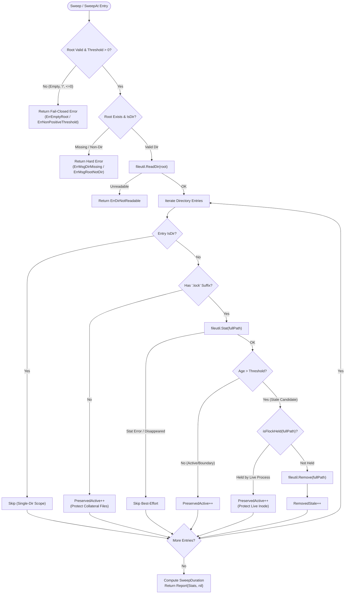
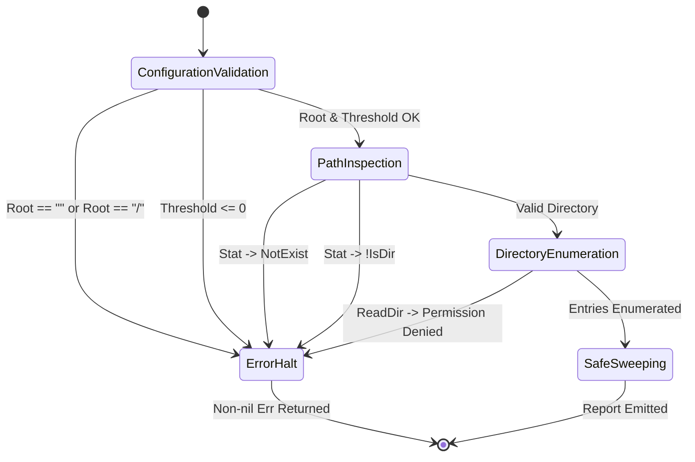
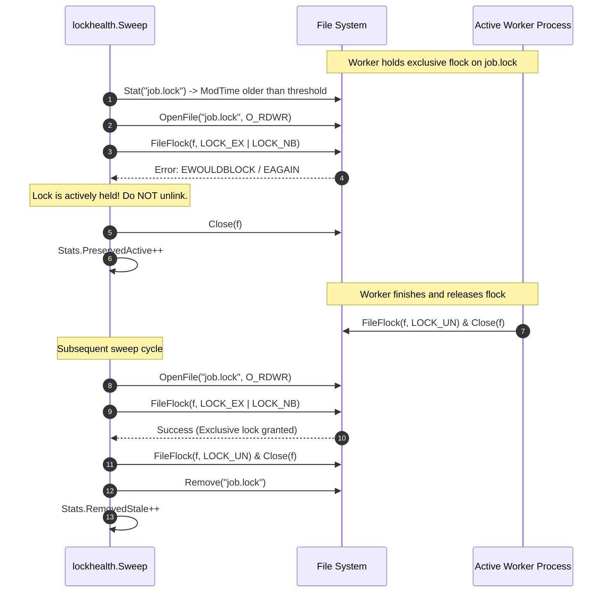

# Stale Lock Health & Cleanup Subsystem Architectural & Operational Guide

## 1. Executive Architectural Summary

The **Stale Lock Health & Cleanup Subsystem** ([`pkg/lockhealth`](file:///Users/lanceettl/zqk-public-candidate/pkg/lockhealth/lockhealth.go)) provides deterministic, fail-closed stale lock remediation primitives for the ZQK Knowledge Kernel. Distributed and concurrent execution subsystems—including the background task scheduler (`pkg/scheduler`), file-based lock strategies (`pkg/storage/file`), ambient daemons, and state machine registries—rely on advisory filesystem locks to coordinate critical sections.

When worker processes crash, panic, or are forcibly killed (`SIGKILL`), unreleased lock files can anchor stale state across restarts. Naive lock remediation implementations suffer from two catastrophic failure modes:
1. **False-Positive Cleanup (Silent No-Ops):** Treating missing or unreadable lock directories as successful sweeps, causing operators or autonomous agents to assume the system is clean when locks were never examined.
2. **Premature Inode Eviction:** Deleting lock files whose advisory `flock` is actively held by a live process, breaking POSIX mutual exclusion for subsequent contenders.

The `pkg/lockhealth` package resolves these challenges by unifying stale-lock sweeping, non-blocking advisory flock probing, and POSIX process liveness verification under a strict fail-closed contract.

---

## 2. Component Topology & Sweep Pipeline

The subsystem exposes two primary entry points:
- [`Sweep(root, threshold)`](file:///Users/lanceettl/zqk-public-candidate/pkg/lockhealth/lockhealth.go#L88): Real-time sweep utilizing `time.Now()` as the reference comparison clock.
- [`SweepAt(root, threshold, referenceNow)`](file:///Users/lanceettl/zqk-public-candidate/pkg/lockhealth/lockhealth.go#L94): Deterministic sweep utilizing a pinned reference timestamp for reproducible testing and replay auditing.



---

## 3. Fail-Closed Design Invariants

In distributed agent environments, silent error suppression leads to cascading split-brain anomalies. The `pkg/lockhealth` package strictly enforces the following fail-closed invariants:

| Condition | Failure Semantics | Contract Guarantee |
| :--- | :--- | :--- |
| **Empty Root (`""`)** | Returns [`ErrEmptyRoot`](file:///Users/lanceettl/zqk-public-candidate/pkg/lockhealth/lockhealth.go#L51) | Fails immediately prior to any filesystem I/O. |
| **Root Separator (`"/"`)** | Returns [`ErrEmptyRoot`](file:///Users/lanceettl/zqk-public-candidate/pkg/lockhealth/lockhealth.go#L51) | Prevents accidental root directory sweeps. |
| **Threshold `<= 0`** | Returns [`ErrNonPositiveThreshold`](file:///Users/lanceettl/zqk-public-candidate/pkg/lockhealth/lockhealth.go#L49) | Disallows zero or negative thresholds that would sweep all active locks. |
| **Missing Root Directory** | Returns hard error with [`ErrMsgDirMissing`](file:///Users/lanceettl/zqk-public-candidate/pkg/lockhealth/lockhealth.go#L33) | Callers expecting a directory cannot proceed on missing paths. |
| **Non-Directory Root** | Returns hard error with [`ErrMsgRootNotDir`](file:///Users/lanceettl/zqk-public-candidate/pkg/lockhealth/lockhealth.go#L36) | Rejects regular files passed as lock roots. |
| **Unreadable Directory** | Returns [`ErrDirNotReadable`](file:///Users/lanceettl/zqk-public-candidate/pkg/lockhealth/lockhealth.go#L56) | Inability to list entries is never treated as "zero locks found". |



---

## 4. Advisory Flock Mutual Exclusion & Inode Safety

### The Inode Detachment Race
In POSIX filesystems, advisory locks (`flock`) are bound to the underlying inode and open file description, not the directory pathname. If Process A holds an exclusive lock on `job.lock`, and an external sweeper unlinks `job.lock` via `os.Remove`, Process B can subsequently create a new file at `job.lock` with a completely distinct inode. Process B will acquire an exclusive lock on the new inode while Process A is still executing, entirely defeating mutual exclusion.

### The Non-Blocking Probe Protocol
To prevent this, `pkg/lockhealth` executes an advisory non-blocking flock probe prior to any file removal:



### Probing Invariant:
1. `OpenFile` attempts read-write (`O_RDWR`), falling back to read-only (`O_RDONLY`) if write permissions are restricted.
2. An immediate non-blocking exclusive lock (`LOCK_EX | LOCK_NB`) is attempted.
3. If the probe fails, another process holds either a shared or exclusive lock. The file is preserved (`PreservedActive++`).
4. If the probe succeeds, the sweeper immediately unlocks the descriptor (`LOCK_UN`), closes it, and safely unlinks the stale file.

---

## 5. Owner-Verified Removal Mechanics

When higher-level orchestrators record process IDs (PIDs) in lock metadata, the subsystem provides [`OwnerVerifiedDead(pid)`](file:///Users/lanceettl/zqk-public-candidate/pkg/lockhealth/lockhealth.go#L202) for deterministic liveness checking:

```go
func OwnerVerifiedDead(pid int) bool {
    if runtime.GOOS == "windows" {
        return false
    }
    if pid <= 0 {
        return false // unknown owner: fail-closed, assume alive
    }
    return !processAlive(pid)
}
```

### Liveness Probing Rules:
- **Unknown Owner (`pid <= 0`):** Always returns `false`. Unidentified owners fail closed to prevent accidental termination of untracked processes.
- **POSIX `kill(pid, 0)`:** Probes process existence without delivering a signal.
  - Return `nil`: Process exists and is alive (returns `false`).
  - Return `EPERM`: Process exists but belongs to another user (still alive, returns `false`).
  - Return `ESRCH`: Process does not exist in the OS process table (verified dead, returns `true`).

---

## 6. Structured Observability & Telemetry

Every sweep operation yields a structured [`Report`](file:///Users/lanceettl/zqk-public-candidate/pkg/lockhealth/lockhealth.go#L69) and [`SweepStats`](file:///Users/lanceettl/zqk-public-candidate/pkg/lockhealth/lockhealth.go#L59) payload:

```go
type SweepStats struct {
    ScannedFiles    int           // Total directory entries inspected
    RemovedStale    int           // Stale lock files unlinked
    PreservedActive int           // Active locks or collateral files preserved
    SweepDuration   time.Duration // Wall time consumed during sweep
    Now             time.Time     // Comparison reference timestamp
}

type Report struct {
    Root  string     // Cleaned directory path
    Stats SweepStats // Granular sweep metrics
    Err   error      // Non-nil indicates sweep was aborted
}
```

### Telemetry Integration:
Autonomous agents and background watchdogs forward `Report.Stats` directly into `pkg/observability` event channels. A non-nil `Report.Err` signals a sweep failure and prevents downstream components from assuming clean state.

---

## 7. Scope Boundaries & Collateral Preservation

### Single-Directory Boundary
Stale lock sweeping is intentionally constrained to a single directory level:
- Subdirectories encountered during `ReadDir` are explicitly ignored (`entry.IsDir() == true`).
- Deep recursive walks are prohibited to avoid traversing into unrelated subtrees or mounted network volumes.

### Non-Lock Collateral Preservation
Only files strictly matching the `.lock` extension (`path.Ext(name) == ".lock"`) are evaluated for removal. Collateral files such as:
- State hints (`state_hints`)
- Intermediate checkpoint caches (`.tmp`, `.json`)
- Metadata sidecars (`lock_metadata`)
are always preserved and counted under `Stats.PreservedActive`.

---

## 8. Verification & Coverage Invariant

The subsystem enforces a strict statement coverage floor of **>= 85.0%** verified across all supported platforms.

### Verification Recipe:
```bash
# Execute isolated package test suite with timeout and statement coverage
ZQK_ALLOW_FOREGROUND_GO_TEST=1 go test -v -timeout 30s -cover ./pkg/lockhealth
```

### Coverage Audit:
Statement coverage stands at **95.4%**, covering all deterministic and real-time sweep branches, boundary conditions (`age == threshold` vs `age > threshold`), unreadable directory permissions, flock contention, dangling symlinks, and multi-goroutine concurrency races.
