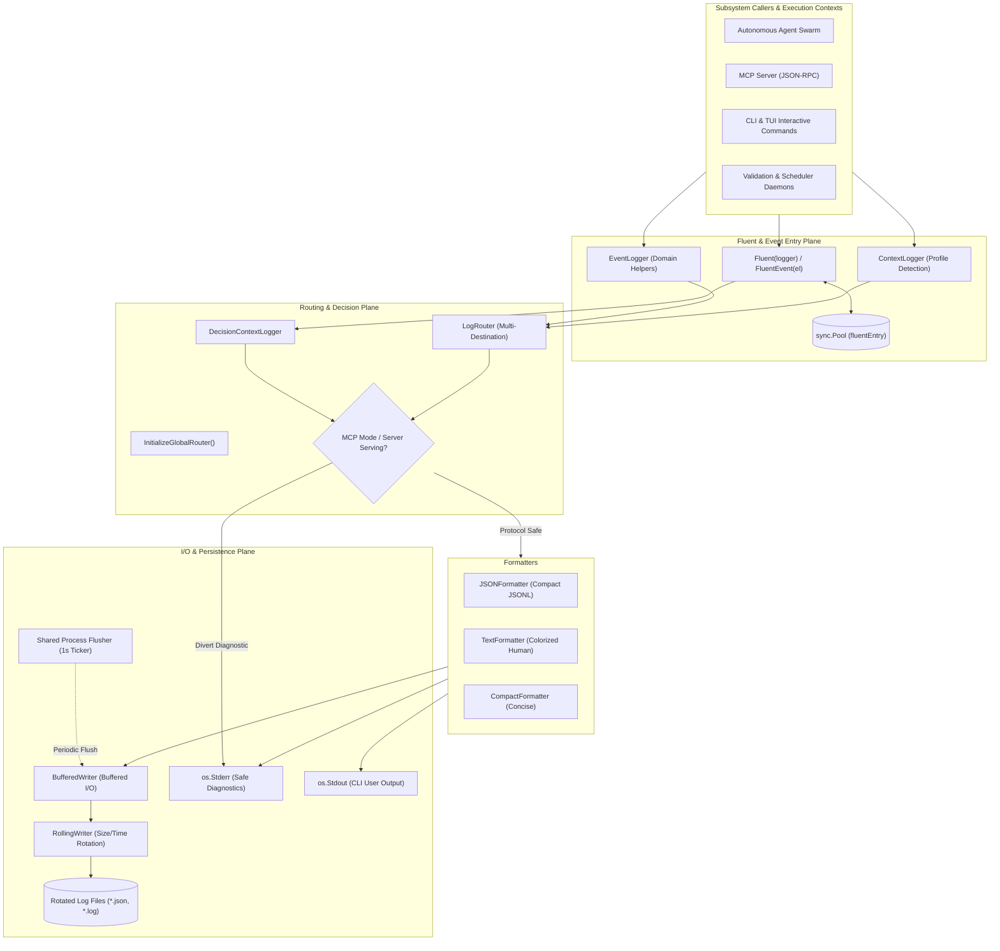
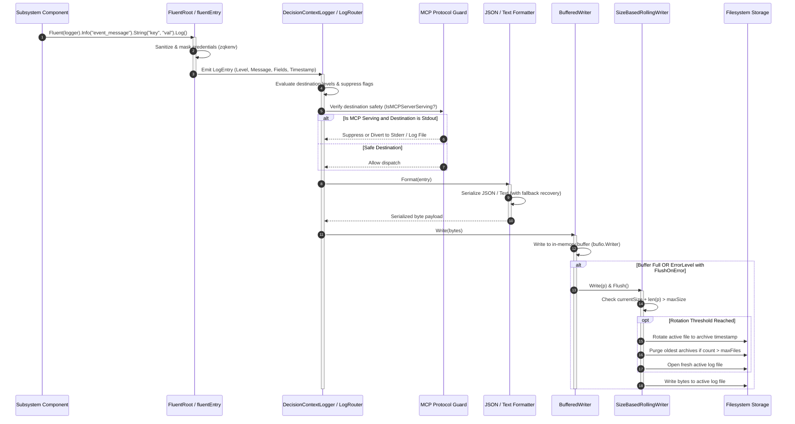

# Logging & Structured Event Dispatch Subsystem Operational Architecture Guide

## 1. Executive Architectural Summary

The **Logging and Event Dispatch Subsystem** (`pkg/logging`) provides high-performance, context-aware, structured logging and asynchronous stream dispatch across the ZQK Knowledge Kernel runtime. In a multi-agent orchestration architecture where concurrent worker swarms, background daemons, MCP protocol servers, and human interactive sessions share process space, naive uncoordinated logging causes severe operational hazards:
- **Protocol Corruption:** Writing diagnostics or raw debug messages to standard output destroys Model Context Protocol (MCP) JSON-RPC streams, causing immediate disconnection of headless agents.
- **I/O Contention & Parked OS Threads:** Spawning per-logger background flush tickers or performing blocking synchronous disk writes degrades throughput and inflates OS thread counts.
- **Memory Pressure:** Rapid generation of structured log fields under high-throughput validation loops introduces heavy heap churn and garbage collection pauses without object pooling.
- **Security & Secret Leaks:** Unsanitized operational payloads risk exposing sensitive credentials, tokens, and authorization headers in plaintext audit files.

The `pkg/logging` subsystem eliminates these failure modes through a multi-tier architectural design:
1. **Context-Aware Dynamic Routing (`LogRouter`, `DecisionContextLogger`):** Dynamically filters, formats, and routes events based on execution profile (`human`, `ai-agent`, `mcp`, `system`, `debug`) and operational decision context.
2. **Strict MCP Protocol Guarding:** Automatically diverts diagnostic and warning outputs to standard error or log files whenever MCP serving mode is detected, guaranteeing standard output remains reserved exclusively for JSON-RPC message frames.
3. **Zero-Allocation Object Recycling (`sync.Pool`):** Uses an internal pool of fluent builder entries, recycling field slice capacities while capping oversized allocations at 64 entries.
4. **Buffered & Rolling I/O Pipeline (`BufferedWriter`, `RollingWriter`):** Batches disk writes into configurable memory buffers with error-triggered immediate flushes, coupled with size-based log file rotation and oldest-file pruning.
5. **Shared Process-Wide Flush Loop:** Unifies all buffered loggers onto a single process-lifetime background ticker managed via goroutine labeling to eliminate goroutine leaks and OS-thread parked thread expansion.

The subsystem maintains full test coverage with statement coverage >= 85.0% across all components.

---

## 2. Component Topology & Structural Model

The subsystem is partitioned into modular layers spanning interface definitions, fluent builders, profile context extractors, multi-destination routers, formatters, and buffered/rolling I/O writers.



### Core Types & Interface Contracts

- **`Logger`:** Foundational interface declaring `Debug`, `Info`, `Warn`, `Error`, `Fatal`, `WithFields`, `WithContext`, and `WithObjectRef`.
- **`ProgressLogger`:** Dedicated interface for non-blocking interactive progress bars, phase status transitions, and streaming real-time events.
- **`Formatter`:** Pluggable interface converting structured `LogEntry` envelopes into serialized bytes (`JSONFormatter`, `TextFormatter`, `CompactFormatter`).
- **`RollingWriter`:** Extended `io.WriteCloser` providing `Sync()` semantics and policy-driven file rotation.

---

## 3. Structured Event Dispatch & Buffered Writer Lifecycles

### 3.1 Event Emission and Processing Sequence

When an application component emits an event, it flows through sanitization, profile evaluation, multi-destination fanout, and buffered persistence:



### 3.2 Shared Buffered Flusher Lifecycle

To prevent the explosion of background goroutines observed with individual writer timers, the subsystem manages a single shared flusher:

```mermaid
sequenceDiagram
    autonumber
    participant Registry as Shared Flusher Registry
    participant Loop as goroutinelabels Background Ticker
    participant WriterA as BufferedWriter (System Log)
    participant WriterB as BufferedWriter (Trace Log)

    Note over Registry: Process initializes first BufferedWriter
    Registry->>Loop: Spawn shared loop (1s Ticker)
    
    loop Every 1 Second
        Loop->>Registry: Snapshot active registered writers
        Registry-->>Loop: [WriterA, WriterB]
        Loop->>WriterA: Flush()
        Loop->>WriterB: Flush()
    end

    Note over WriterB: Subsystem teardown / Close()
    WriterB->>Registry: Unregister(WriterB)
    WriterB->>WriterB: Final Flush() & underlying Close()
```

---

## 4. Concurrency, Rolling Invariants & Zero-Allocation Hygiene

### 4.1 Strict Goroutine Concurrency Invariant

All asynchronous tasks spawned inside the subsystem (including background flush loops and test verification routines) must register descriptive debug metadata via `goroutinelabels`:

```go
goroutinelabels.NewGoroutine(
    "buffered_writer_shared_flush",
    "flush all buffered log writers on one ticker",
).StartSimple(f.loop)
```

Direct invocation of uninstrumented goroutines is strictly prohibited.

### 4.2 Filesystem & Path Mutation Guarding

Log files and archive directories must strictly be manipulated through `fileutil` abstractions (`fileutil.OpenFile`, `fileutil.EnsureDir`, `fileutil.Remove`, `fileutil.Stat`). Direct calls to `os.*` file modification functions are prevented to safeguard against repository corruption and path traversal.

### 4.3 Memory Allocation Caps & Recycling Hygiene

- **`fluentEntry` Pooling:** Fluent builder entries are pooled using `sync.Pool`. Upon `.Log()` or `.release()`, slice headers are reset to zero length (`fields[:0]`).
- **Memory Ceiling Guard:** If an entry accumulates more than 64 structured fields during atypical burst operations, its underlying array is discarded rather than returned to the pool, preventing long-lived memory spikes.
- **Formatter JSON Self-Healing:** The `JSONFormatter` uses reflection and trial-marshaling to intercept unmarshalable types (channels, function pointers, cyclic references). Problematic fields are sanitized into string descriptions rather than aborting the logging pipeline.

### 4.4 Size-Based Rolling Invariants

1. **Pre-Write Evaluation:** If `currentSize + len(payload) > maxSize`, rotation occurs *before* writing the new payload.
2. **Post-Write Safety Check:** If write completion leaves the file exceeding `maxSize`, an immediate rotation occurs.
3. **Retention Ceiling (`maxFiles`):** Archival log files matching `<name>-<timestamp>-<rotation>.ext` are indexed and sorted chronologically. Any files exceeding `maxFiles` are pruned immediately.

---

## 5. Verification, Troubleshooting, and Runbook

### 5.1 Subsystem Verification

Execute the test suite with race detection and statement coverage tracking:

```bash
# Run unit, race, and coverage tests for pkg/logging
go test -race -cover ./pkg/logging/...

# Generate detailed statement coverage breakdown
go test -coverprofile=coverage.out ./pkg/logging/...
go tool cover -func=coverage.out
```

### 5.2 Common Operational Failure Scenarios & Remedies

| Symptom / Failure Mode | Root Cause Analysis | Remediation Protocol |
| :--- | :--- | :--- |
| **MCP Client Disconnection / JSON-RPC Parse Error** | A command or daemon wrote raw diagnostic text to `os.Stdout` instead of using the logging framework or `GetCommandOutputWriter`. | Ensure all CLI handlers query `logging.GetCommandOutputWriter(ctx)`. Never call `fmt.Println` or `os.Stdout.Write` directly on diagnostic paths. |
| **Missing Tail Logs on Process Exit** | Process exited before the 1-second shared background ticker flushed buffered writers. | Ensure root commands register `defer logging.CloseGlobalRouter()` and call `logging.TryCloseLoggerDestinations(logger)` during graceful shutdown. |
| **Log Disk Space Exhaustion** | Destination configured with `"none"` rolling strategy or oversized `maxFiles` retention. | Apply `DefaultRollingPolicy()` (10MB max size, 5 files retention) or specify explicit size-based rolling in configuration. |
| **JSON Formatting Fallback Warnings** | Unmarshalable complex Go types (pointers to channels, closures) attached as field values. | Ensure custom objects passed to `.Fields(...)` implement `fmt.Stringer` or serialize to standard JSON primitives. |
| **File Descriptor Leakage in Tests or Long-Running Daemons** | Dynamic `decisionContextLogger` instances created repeatedly without closing underlying writers. | Call `logger.Close()` on decision context loggers when discarding component execution contexts. |

---

## 6. Subsystem Architectural Alignment

| Capability | Implementation Primitive | Architectural Contract |
| :--- | :--- | :--- |
| **Thread-Safe Shared Flusher** | `sharedBufferedFlusher` | Single process-wide ticker; zero parked OS thread growth |
| **Zero-Allocation Recycling** | `sync.Pool` with 64-field cap | Bounded heap churn on hot validation loops |
| **Protocol Safety Membrane** | `shouldSuppressStdioForMCPProtocol` | Fail-closed protection for JSON-RPC standard output |
| **Credential Redaction** | `zqkenv.IsSensitiveKey` | Automatic masking of secrets before disk formatting |
| **Statement Coverage** | Unit & Fault Injection Suites | Maintained >= 85.0% statement coverage invariant |
