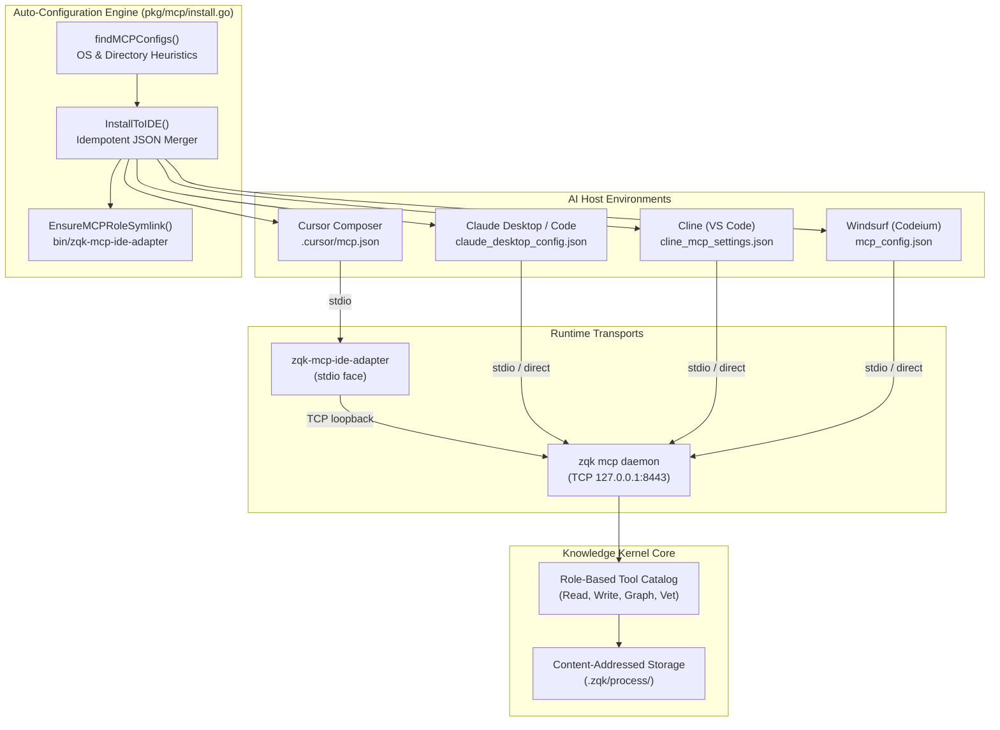

# MCP Auto-Configuration & Host Integration Guide

Operational architecture, single-command onboarding, and host IDE configuration for Cursor, Claude Code, Cline, and Windsurf within the **ZQK Knowledge Kernel**.

---

## 1. Architectural Overview & Design Philosophy

The **Model Context Protocol (MCP)** subsystem within ZQK bridges external Large Language Model hosts and IDEs (Cursor Composer, Claude Code, Cline, Windsurf) to the persistent Knowledge Kernel graph.

Rather than forcing developers to manually craft JSON configuration files, locate machine-specific absolute binary paths, or deal with split-brain background processes, ZQK provides a **zero-friction single-command auto-configuration engine**:

```sh
# Single command to discover and configure all installed AI hosts
zqk mcp install

# Ensure background daemon and role symlinks are active
zqk mcp ensure
```

### Core Design Invariants

1. **Non-Destructive Merge (No Config Clobbering):** When writing to host IDE configuration files (`mcp.json`, `cline_mcp_settings.json`, `claude_desktop_config.json`), existing third-party MCP servers are preserved completely intact.
2. **Workspace Interpolation (`${workspaceFolder}`):** Workspace configuration files emit interpolated path variables rather than absolute machine paths. This ensures git-committed `.cursor/mcp.json` or `.ide/mcp.json` configurations are portable across team members and containerized environments.
3. **Decoupled Stdio Adapter Bridge:** IDEs communicating via stdio launch a lightweight proxy (`zqk-mcp-ide-adapter`) that routes JSON-RPC messages over TCP to the centralized, long-lived host daemon (`zqk mcp daemon`). This prevents multiple IDE terminal splits from spinning up heavyweight duplicate kernel processes.
4. **Fail-Closed Security & Role Enforcement:** All tool calls received over MCP are authenticated against the Kernel security context, enforcing role boundaries and preventing path traversal outside the project root.

---

## 2. Architecture & Data Flow



---

## 3. Host IDE Discovery & Configuration Matrix

When `zqk mcp install` runs, `AutoInstall` queries `findMCPConfigs` across platform-specific standard directories:

| AI Host / IDE | Scope | Configuration File Path | Transport Model | Command Configured |
| :--- | :--- | :--- | :--- | :--- |
| **Cursor** | Workspace | `<projectRoot>/.cursor/mcp.json` | `stdio` | `${workspaceFolder}/bin/zqk-mcp-ide-adapter` |
| **Cursor** | Global | `~/.cursor/mcp.json` | `stdio` | `${workspaceFolder}/bin/zqk-mcp-ide-adapter` |
| **Claude Code** | Workspace | `<projectRoot>/.claude.json` | `stdio` | `zqk mcp serve` |
| **Claude Code** | Global | `~/.claude.json` | `stdio` | `zqk mcp serve` |
| **Windsurf** | Workspace | `<projectRoot>/.codeium/windsurf/mcp_config.json` | `stdio` | `zqk mcp serve` |
| **Windsurf** | Global | `~/.codeium/windsurf/mcp_config.json` | `stdio` | `zqk mcp serve` |
| **Cline** | Workspace | `<projectRoot>/.cline/mcp_settings.json` | `stdio` | `zqk mcp serve` |
| **Cline** | Global | `~/Library/Application Support/Code/User/globalStorage/saoudrizwan.claude-dev/settings/cline_mcp_settings.json` | `stdio` | `zqk mcp serve` |
| **Claude Desktop** | Global | `~/Library/Application Support/Claude/claude_desktop_config.json` | `stdio` | `zqk mcp serve` |
| **IDE Generic** | Workspace | `<projectRoot>/.ide/mcp.json` | `stdio` | `${workspaceFolder}/bin/zqk-mcp-ide-adapter` |

---

## 4. Single-Command Recipes

### Interactive & Headless Multi-Host Onboarding Wizard

Run the top-level onboarding wizard to detect all active agent hosts, seed default personas, and prime directive files:

```sh
# Interactive multi-host onboarding
zqk onboard

# Headless / CI automated onboarding
zqk onboard --headless --format json

# Scan only without disk writes
zqk onboard --detect-only --format json
```

### Automatic MCP Server Installation Across All Hosts

Run the unified installer to configure MCP servers across all supported hosts:

```sh
# Discover and install MCP configuration into active IDE
zqk mcp install

# Explicitly install into all supported hosts (Cursor, Claude Code, Cline, Windsurf)
zqk mcp install --all
```

**Console Output:**
```text
✓ ZQK MCP server configuration applied; restart IDE(s) for changes to take effect
```

### Daemon Verification & Health Check

Ensure the background TCP daemon is active and listening:

```sh
# Start or verify the daemon
zqk mcp ensure

# Check active MCP proxy status
zqk mcp proxy --status
```

---

## 5. Manual Fallback Configurations

If using an environment where auto-discovery cannot access user configuration directories (e.g., locked enterprise sandboxes), paste the appropriate JSON snippet below:

### Cursor (`.cursor/mcp.json`)

```json
{
  "mcpServers": {
    "zqk": {
      "type": "stdio",
      "command": "${workspaceFolder}/bin/zqk-mcp-ide-adapter",
      "args": ["mcp", "ide-adapter", "--tcp", "127.0.0.1:8443"],
      "cwd": "${workspaceFolder}",
      "env": {
        "ZQK_PROJECT_ROOT": "${workspaceFolder}",
        "ZQK_MCP_CONFIG_PATH": "${workspaceFolder}/.zqk/mcp/config.yaml"
      },
      "envFile": "${workspaceFolder}/.zqk/mcp/cursor-stdio.env"
    }
  }
}
```

### Claude Desktop (`claude_desktop_config.json`)

```json
{
  "mcpServers": {
    "zqk": {
      "command": "zqk",
      "args": ["mcp", "serve"],
      "env": {
        "ZQK_PROJECT_ROOT": "/absolute/path/to/your/project"
      }
    }
  }
}
```

### Cline (`cline_mcp_settings.json`)

```json
{
  "mcpServers": {
    "zqk": {
      "command": "zqk",
      "args": ["mcp", "serve"],
      "env": {
        "ZQK_PROJECT_ROOT": "/absolute/path/to/your/project"
      }
    }
  }
}
```

---

## 6. Failure Modes, Diagnostics & Troubleshooting

| Failure Signature | Probable Root Cause | Resolution Protocol |
| :--- | :--- | :--- |
| `zqk mcp install must be run inside a project (no project root detected)` | Command executed outside a directory containing `.zqk` or `go.mod`. | `cd` into the project repository root and re-run `zqk mcp install`. |
| `no supported IDE configurations found or updated` | No supported IDE configuration files or directories exist on the system. | Create `.cursor` or `.ide` in the project root (`mkdir .cursor`), or launch the IDE once to generate global configs. |
| Cursor shows red connector status for ZQK | Global `~/.cursor/mcp.json` is missing or daemon on TCP 8443 is stopped. | Run `zqk mcp ensure` to spawn the background daemon and verify `bin/zqk-mcp-ide-adapter` exists. |
| Existing custom MCP servers disappeared | Config was overwritten instead of merged. | ZQK `InstallToIDE` explicitly preserves existing keys; restore from backup and verify file permissions. |
| `config directory does not exist: ...` | Target host application directory does not exist. | Install the target host IDE application before attempting to register global configs. |
