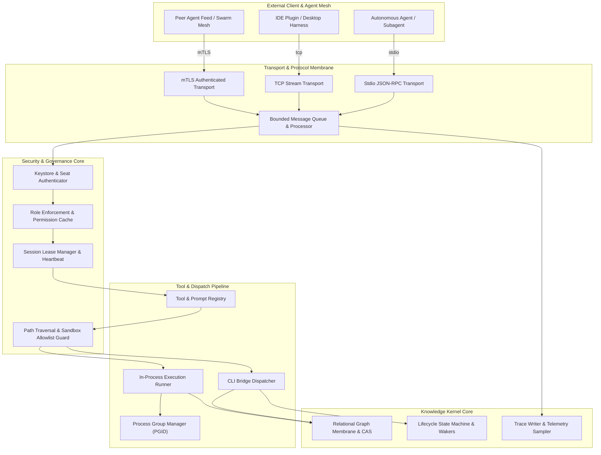
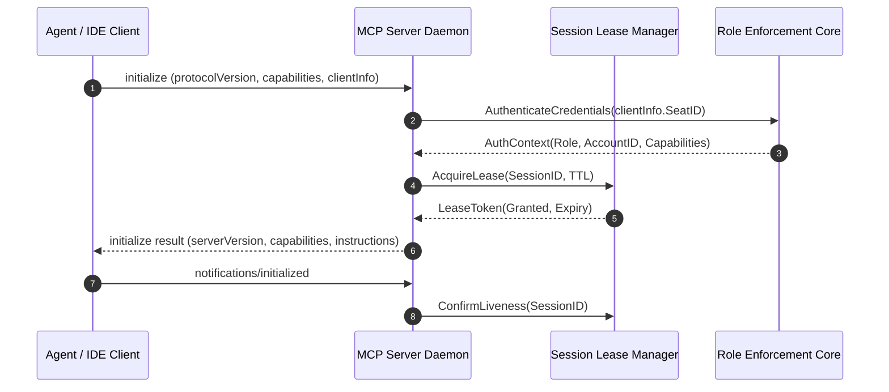
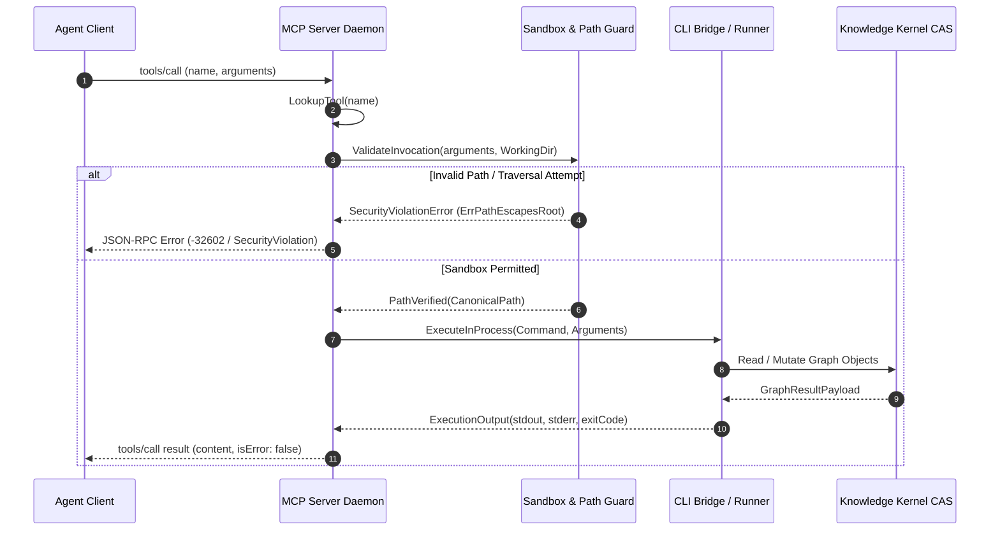

# Model Context Protocol (MCP) Subsystem & Tool Execution Architecture Guide

## Executive Architectural Summary

The **Model Context Protocol (MCP) Subsystem** (`pkg/mcp`) serves as the primary bidirectional control and execution plane for the **Zen Quantum Kernel (ZQK)**. It bridges external Large Language Model (LLM) agents, Integrated Development Environments (IDEs), and multi-agent swarms with ZQK's sovereign Knowledge Kernel and underlying operating system primitives.

Rather than exposing an unconstrained remote shell or monolithic CLI proxy, the subsystem enforces a multi-layered, zero-trust execution sandbox:
1. **Protocol Negotiation & Multiplexing**: Implements standard JSON-RPC 2.0 communication over high-throughput Standard I/O (`stdio`), raw TCP, and cryptographically authenticated Mutual TLS (`mTLS`) transports.
2. **Dynamic Tool Catalog & Role Enforcement**: Discovers and exposes capability tools (graph traversals, object CRUD, pipeline triggers, diagnostics) dynamically filtered by agent role profiles and seating permissions.
3. **Defense-in-Depth Path Traversal Guards**: Validates all file operations against sovereign project root jails, lexical path normalizers, symlink dereferencing checks, and Unix permission masks.
4. **Session Leases & Process Isolation**: Manages time-bounded agent session leases with heartbeat renewal, clean disconnection teardown, and process group isolation (`pgid`) to eliminate orphaned subprocesses.
5. **AST & Concurrency Invariants**: Strictly adheres to the kernel's labeled concurrency mandate (`pkg/goroutinelabels`), preventing naked goroutines, resource leaks, and lock inversion deadlocks.

---

## Component Topology & Structural Model

The subsystem is architected around modular components separating transport ingestion, authentication, role-based filtering, tool execution, and knowledge graph persistence.



### Core Subsystem Components

| Component | Package / Module | Responsibility |
| :--- | :--- | :--- |
| `Server` | `pkg/mcp/server.go` | Top-level daemon coordinator; initializes transports, registers tool handlers, and orchestrates graceful drain hooks. |
| `Client` | `pkg/mcp/client.go` | Lightweight, bidirectional client adapter for subagent runners and integration test suites. |
| `CLIBridge` | `pkg/mcp/cli_bridge.go` | Translates incoming JSON-RPC tool invocations into in-process Cobra CLI commands without spawning external processes. |
| `SessionLeaseManager` | `pkg/mcp/session_lease.go` | Tracks active agent connections, manages lease TTLs, refreshes heartbeats, and evicts abandoned resources. |
| `SandboxGuard` | `pkg/mcp/tools_sandbox.go` | Validates file access, working directory boundaries, and executable allowlists before tool dispatch. |
| `RoleEnforcer` | `pkg/mcp/role_enforcement.go` | Filters available tool catalogs and prompt templates according to authenticated agent roles. |
| `ProcessGroupManager` | `pkg/mcp/process_group_manager.go` | Manages external subprocess trees, ensuring strict group isolation and deterministic termination. |

---

## Protocol Serialization & Tool Execution Lifecycles

All interactions follow the standard JSON-RPC 2.0 envelope specification, extended with kernel trace contexts and error codes.

### 1. Client Session Handshake & Lease Acquisition



### 2. Tool Execution & Sandbox Verification Pipeline



---

## Path Traversal Guards, Session Leases & Concurrency Invariants

### 1. Defense-in-Depth Path Traversal Guards

The sandbox layer enforces rigid boundary checks on any tool receiving filesystem paths:
- **Lexical Cleaning & Root Jail Validation**: All paths are cleaned using `filepath.Clean` and checked against the sovereign project root. Any relative navigation containing `..` that resolves outside the jail is immediately rejected with a deterministic error.
- **Symlink Evaluation Gate**: Symlinks are resolved using filesystem inspection prior to execution. If the target of a symlink points outside the project root jail, access is denied.
- **Forbidden Subdirectory Protections**: Sovereign metadata directories (e.g., `.git/`, `.zqk/keys/`) are protected by explicit path filters, preventing agents from corrupting repository history or cryptographic material.
- **Unix Permission Masks**: All filesystem mutations initiated by the tool executor enforce default secure permission masks (`0755` for directories, `0644` for files).

### 2. Session Leases & Heartbeat Management

To support distributed agent swarms and multi-threaded worker pools without resource exhaustion:
- **Heartbeat Leases**: Active sessions acquire a time-bounded lease. Workers must periodically renew their lease via heartbeat pings or subsequent tool calls.
- **Automatic Eviction**: Sessions that miss their renewal deadline are marked expired. Background cleanup sweepers release ephemeral scratch files and detach active log channels.
- **Idempotent Disconnection**: Calling disconnect or terminating standard I/O streams triggers orderly shutdown hooks without panicking or double-freeing resources.

### 3. Concurrency & Goroutine Safety Invariants

- **Labeled Goroutines Mandate**: Every asynchronous worker, subscriber stream, and background timeout daemon must use `goroutinelabels.NewGoroutine(...)`. Naked `go func()` invocations are strictly prohibited across the codebase.
- **File System Abstraction Mandate**: Standard library `os.*` direct calls are replaced with `fileutil.*` abstractions (`fileutil.WriteFile`, `fileutil.ReadFile`, `fileutil.MkdirAll`) to ensure uniform test hermeticity and cross-platform compatibility.
- **Deadlock Isolation & Timeout Mutexes**: Synchronized registries and session caches use fine-grained `sync.RWMutex` locks, paired with channel select statements and context timeouts to prevent deadlocks during high-load swarm contention.

---

## Verification, Troubleshooting, and Runbook

### Coverage & Verification Targets

The MCP subsystem enforces a strict test coverage invariant:
- **Statement Test Coverage Floor**: `>= 85.0%` (targeting comprehensive coverage across all protocol and execution paths).
- **Race Detection Mandate**: All test suites must execute cleanly under `go test -race`.

### Running the Subsystem Test Suite

Execute the dedicated MCP test harness with race detection and statement coverage profiling:

```bash
# Run unit and boundary test suites
go test -v -race -coverprofile=coverage.out ./pkg/mcp/...

# Inspect statement coverage report
go tool cover -func=coverage.out | grep total
```

### Operational Troubleshooting Guide

| Symptom | Diagnostic Root Cause | Remediation Procedure |
| :--- | :--- | :--- |
| `Tool execution returned ErrPathEscapesRoot` | Agent provided a relative path traversing above workspace root. | Verify tool arguments; pass paths relative to the sovereign project root or canonical subdirectories. |
| `Session lease expired / invalid lease token` | Agent connection was idle longer than the configured lease TTL. | Ensure the client issues periodic heartbeat calls or configure larger lease windows in server config. |
| `Mutual TLS handshake failure (unknown CA)` | Client or server certificates were generated by an untrusted CA. | Verify the CA certificate matches the issuer and check certificate expiration with `openssl x509 -in cert.crt -text`. |
| `Address already in use on TCP listener` | Previous server instance did not exit cleanly or port collision. | Check active listeners (`lsof -i :8443`), terminate stale processes, or configure an alternate listen port. |
| `Tool execution timeout exceeded` | Tool operation blocked on external lock or network IO. | Inspect tool execution logs, increase timeout envelopes, or verify project directory locks are released. |

### Emergency Recovery Runbook

1. **Stale Lock Cleanup**: If an MCP server daemon crashes abruptly, check for residual lock files:
   ```bash
   zqk system check --auto-remedy
   ```
2. **Interactive Server Diagnostic**: Launch the server in interactive diagnostic mode to verify JSON-RPC pipe communication:
   ```bash
   zqk mcp-simple
   ```
3. **Session Reset**: Evict all stale agent leases and clear temporary buffers:
   ```bash
   zqk utility cleanup
   ```
