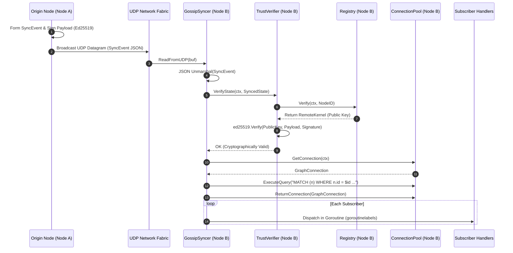
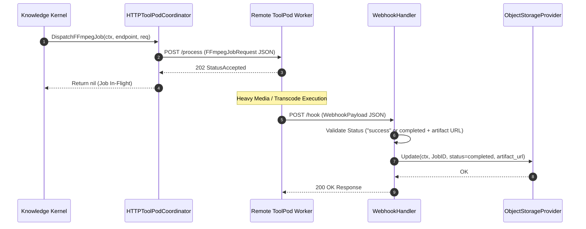

# Mesh Networking, State Sync & ToolPod Subsystem Operational Architecture Guide

## Executive Architectural Summary

The `pkg/mesh` subsystem provides decentralized peer coordination, cryptographic trust verification, real-time state synchronization, multi-tier asynchronous priority queuing, and remote ToolPod worker delegation across distributed Knowledge Kernel instances.

In distributed microkernel deployments, nodes must synchronize knowledge graph mutations, advertise compute and inference capacities, dispatch heavy compute tasks (such as media transcoding and multimodal verification) to specialized sidecar pods, and coordinate agent activity without creating centralized bottleneck brokers or fragile point-to-point couplings.

`pkg/mesh` addresses these operational demands through five decoupled architectural capabilities:
1. **Decentralized State Sync (`state_sync.go`)**: UDP-based gossip transport supporting multicast and unicast event distribution, coupled with automatic graph database validation against the persistent knowledge store.
2. **Cryptographic Trust Membrane (`trust.go`, `identity.go`)**: Ed25519 public-key signature verification and remote node registry, ensuring that all gossip state transitions originate from authenticated kernels.
3. **Prioritized Asynchronous Dispatch & Backpressure (`async_dispatch.go`, `async_backpressure.go`)**: Multi-lane priority queues (High, Normal, Low) with condition-variable notifications and high/low watermark flow control controllers.
4. **ToolPod Coordination & Webhook Routing (`toolpod.go`, `webhook_listener.go`)**: External worker invocation membranes for offloading intensive jobs (e.g. FFmpeg transcoding) and processing idempotent status completion callbacks.
5. **Multimodal Sentinel & Interception Guard (`multimodal/sentinel.go`)**: Real-time evaluation and policy gating for streaming media, audio analysis, and synthetic generation integrity.

---

## Component Topology & Structural Model

The following diagram illustrates the structural layout and component interaction within the `pkg/mesh` subsystem:

```mermaid
graph TD
    subgraph MeshCoordinationPlane ["Mesh Coordination & Identity Plane"]
        NodeRegistry["Node Registry (InMemoryRegistry)<br/>- Node ID<br/>- Ed25519 Public Keys<br/>- Endpoint URLs"]
        TrustVerifier["Trust Verifier (TrustVerifier)<br/>- Ed25519 Signature Check<br/>- Payload Validation"]
        MeshController["In-Memory Mesh Manager<br/>- Capacity Advertisements<br/>- Dynamic ToolPod Registry"]
    end

    subgraph StateSyncPlane ["State Synchronization Plane (UDP Gossip)"]
        GossipSyncer["Gossip Syncer (GossipSyncer)<br/>- UDP Listen & Broadcast<br/>- Payload Formatting<br/>- Event Handlers"]
        GraphPool["Graph Connection Pool<br/>(provider.ConnectionPool)<br/>- MATCH (n) Cypher Validation"]
    end

    subgraph AsyncQueuePlane ["Asynchronous Priority & Dispatch Plane"]
        AsyncQueue["Async Dispatch Queue<br/>- High Priority Queue<br/>- Normal Priority Queue<br/>- Low Priority Queue<br/>- sync.Cond Wakeup"]
        BackpressureCtrl["Backpressure Controller<br/>- High Watermark (Throttling)<br/>- Low Watermark (Drain Signaled)"]
    end

    subgraph ToolPodPlane ["Remote ToolPod Execution Plane"]
        ToolPodCoord["ToolPod Coordinator (HTTPToolPodCoordinator)<br/>- Dispatch FFmpeg / Worker Job"]
        RemoteToolPod["Remote ToolPod Worker<br/>(e.g., ffmpeg, whisper)"]
        WebhookListener["Webhook Listener (WebhookHandler)<br/>- Status / URL Verification<br/>- ObjectStorage Update"]
    end

    NodeRegistry --> TrustVerifier
    TrustVerifier --> GossipSyncer
    GraphPool --> GossipSyncer
    GossipSyncer --> AsyncQueue
    AsyncQueue --> BackpressureCtrl

    MeshController --> ToolPodCoord
    ToolPodCoord -->|POST /process (202 Accepted)| RemoteToolPod
    RemoteToolPod -->|POST /hook (Completion Payload)| WebhookListener
    WebhookListener -->|Update Status & URL| MeshController
```

### Core Subsystem Components

### 1. Gossip Syncer (`state_sync.go`)
- **Transport**: Binds to standard UDP sockets (unicast or multicast group addresses).
- **Event Envelope (`SyncEvent`)**: Contains `node_id`, `timestamp`, `kind` (e.g. `GraphState`, `Schema`), `item_id`, and `signature`.
- **Payload Canonicalization (`PayloadForSignature`)**: Formats payloads as `NodeID|TimestampNano|Kind|ItemID` to guarantee deterministic cryptographic hashing.
- **Graph Verification**: Integrates directly with `provider.ConnectionPool` to verify referenced entities exist in the knowledge store via Cypher queries (`MATCH (n) WHERE n.id = $id RETURN count(n)`).

### 2. Cryptographic Trust Verifier (`trust.go`, `identity.go`)
- **Registry Abstraction**: Maintains authenticated remote kernel records (`RemoteKernel`) containing hex-encoded Ed25519 public keys and network endpoints.
- **Signature Integrity**: Rejects malformed public keys (length $\neq 32$ bytes), invalid signatures (length $\neq 64$ bytes), unauthenticated nodes, and tampered payloads.

### 3. Asynchronous Priority Dispatch Queue (`async_dispatch.go`)
- **Strict Priority Lanes**: Maintains separate slices for `PriorityHigh`, `PriorityNormal`, and `PriorityLow`.
- **Condition Variable Synchronization**: Uses `sync.Cond` to signal waiting workers as soon as any priority sub-queue receives a message, eliminating polling loops.
- **Batch Dequeue**: Drains up to $K$ messages strictly draining `PriorityHigh` first, then `PriorityNormal`, and finally `PriorityLow`.
- **Non-blocking Drain**: Immediate total extraction across all priority bands during lifecycle shutdowns or flush operations.

### 4. Backpressure Controller (`async_backpressure.go`)
- **Dual Watermarks**: Configured with a `HighWatermark` (maximum acceptable pending items) and `LowWatermark` (recovery threshold).
- **Graceful Throttling**: Notifies producers to pause and provides non-blocking context-aware waiting (`WaitUntilHealthy`) until consumers drain beneath the low watermark.

### 5. HTTP ToolPod Coordinator & Webhook Listener (`toolpod.go`, `webhook_listener.go`)
- **Job Dispatch**: Sends HTTP POST requests (`FFmpegJobRequest`) to dedicated worker endpoints, expecting `202 Accepted` confirmation.
- **Webhook Callback Processing**: Processes incoming `WebhookPayload` messages from worker nodes. Validates job completion by verifying either `status == "completed"` with a non-empty `url` or `status == "success"`, updating the target entity in `storage.ObjectStorageProvider`.

---

## State Sync & ToolPod Lifecycles

### 1. Gossip State Sync & Graph Verification Lifecycle

The following sequence details how state changes propagate across the gossip mesh and are cryptographically and ontologically verified before dispatching to local subscribers:



### 2. ToolPod Job Dispatch & Webhook Completion Lifecycle

The following sequence details offloading long-running jobs (such as media processing) to isolated toolpods and receiving asynchronous completion webhooks:



---

## Dynamic Mesh Routing, Lease Invariants & Fault Isolation

### Seat-Addressable Dynamic Mesh Topology
The mesh topology supports arbitrary $N \times M$ seat connections without hardcoding vendor-specific pairings. Each seat or node advertises:
- **`SeatID`**: Unique seat identifier (e.g. `seat-headless-01`, `seat-worker-02`).
- **`Persona`**: Ontological persona binding (e.g. `code-architect`, `qa-auditor`).
- **`Endpoint`**: Transport address URI (`grpc://`, `http://`, `udp://`).
- **`Labels`**: Dynamic metadata descriptors (e.g. `fleet: dgx-cluster`, `accelerator: h100`).

### Invariants & Guardrails

1. **Strict Priority Invariant**: `AsyncDispatchQueue.DequeueBatch` will never yield a lower-priority message if higher-priority items remain in the queue.
2. **Bounded Backpressure Invariant**: When queue depth exceeds `HighWatermark`, producers must back off until the depth drops strictly below `LowWatermark`.
3. **Cryptographic Identity Invariant**: All incoming gossip packets claiming remote node identity must verify against registered Ed25519 public keys. Packets with invalid signatures or unknown node origins are silently discarded to prevent amplification attacks.
4. **Leak-Free Graph Connection Invariant**: Every connection acquired from `provider.ConnectionPool` during state validation must be released via `defer g.graphPool.ReturnConnection(conn)`.
5. **Thread & Goroutine Concurrency Hygiene**: Every spawned background worker or handler must utilize `goroutinelabels.NewGoroutine` with descriptive naming, preventing unmonitored goroutine leaks.

---

## Verification, Troubleshooting, and Runbook

### Operational Runbook

#### 1. Running Unit & Integration Test Suites
Execute the full suite of unit and integration tests with Go race detection and coverage measurement:
```bash
go test -race -v -coverprofile=coverage.out ./pkg/mesh/...
go tool cover -func=coverage.out
```

Expected output:
- Race detector passes with 0 data races.
- Statement coverage across `pkg/mesh/...` exceeds $95.0\%$ (well above the $\ge 85.0\%$ invariant).

#### 2. Inspecting Test Coverage per File
Generate an HTML report to inspect line-by-line branch execution:
```bash
go tool cover -html=coverage.out -o coverage.html
```

### Common Failure Modes & Diagnostics

| Symptom | Probable Cause | Diagnostic & Resolution Procedure |
| :--- | :--- | :--- |
| **UDP Gossip Packets Dropped** | Port conflict, firewall drop, or socket closed. | Verify address binding with `netstat -an \| grep <port>`. Ensure `GossipSyncer.Start` was called and returned no error. Confirm UDP network routes permit datagram traffic. |
| **`ErrInvalidSignature` in Log** | Sender node key mismatch or corrupted payload. | Verify sender's Ed25519 public key in `Registry`. Confirm sender is formatting payload strictly as `NodeID\|TimestampNano\|Kind\|ItemID`. |
| **`ErrUnknownNode` during Verify** | Node not registered before sending gossip. | Ensure `Registry.Register` was executed for the remote kernel before receiving state sync messages. |
| **`DispatchFFmpegJob` Connection Refused** | Remote ToolPod worker is down or unreachable. | Verify worker health at `<endpoint>/healthz`. Check DNS resolution and network security group permissions between kernel node and toolpod. |
| **Webhook 422 Unprocessable Entity** | Webhook payload missing `url` or `status != "success"`. | Check worker logs to ensure the callback payload includes valid `status` and `url` attributes. |
| **Backpressure Throttling Stuck** | Consumers not draining or slow storage writes. | Check consumer worker pool liveness. Inspect `RecordDrain` invocations and ensure consumers call `RecordDrain` after batch processing. |
