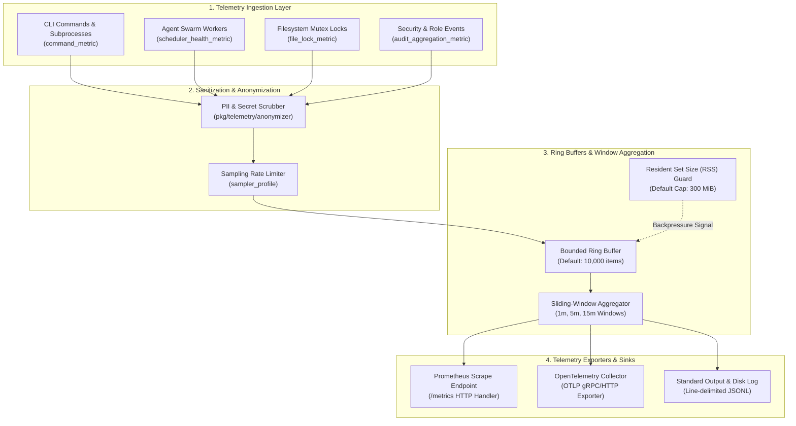
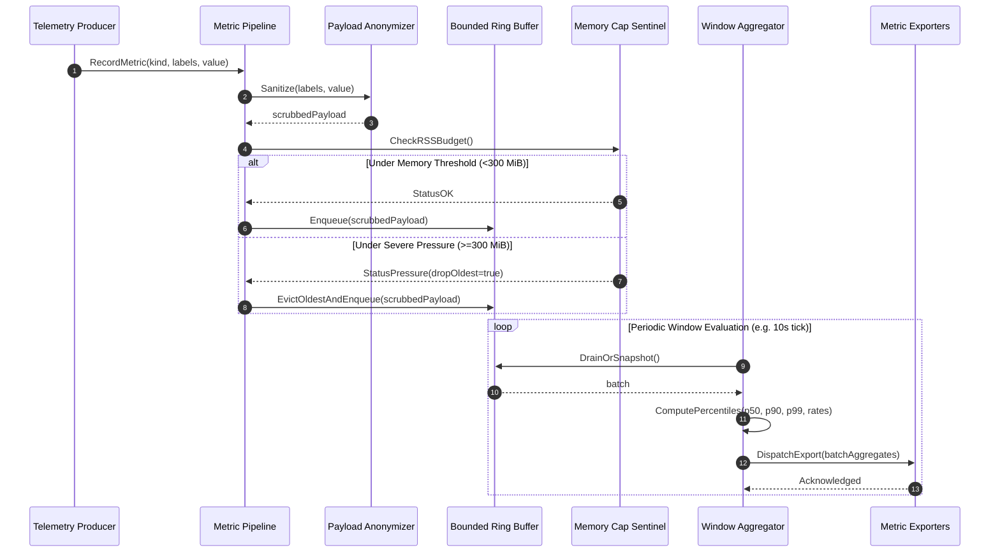

# Metric Pack Subsystem & Telemetry Pipeline Operational Architecture Guide (`pkg/metricpack`)

## Executive Summary

The `pkg/metricpack` subsystem defines the authoritative domain object pack registration, schema specifications, and lifecycle blueprints for the **ZQK Metric & Observability Subsystem**. In a self-healing, multi-agent development platform, quantitative measurement across execution latencies, token consumption, memory residency, file lock contention delays, and agent scheduling queues provides the empirical foundation for automated convergence, telemetry alerting, and resource scaling.

This subsystem provides:
1. **Canonical Metric Pack Registration:** Integrates the core metric domain pack (`Name = "metric"`) with the composition root, mapping declarative YAML schemas (`packs/metric/specs`) and state machine lifecycles (`packs/metric/lifecycles`).
2. **Authoritative Kind Registration (`Kinds()`):** Enumerates all 12 core metric object kinds owned by the metric pack across kernel storage, caching, and validation pipelines:
   - `audit_aggregation_metric`: Aggregated security, role transition, and access audit event counters.
   - `base_sampler`: Root abstract sampler contract defining cadence, filtering, and capture policies.
   - `command_metric`: Execution duration, exit code, CPU, and memory telemetry for CLI and subprocess invocations.
   - `file_lock_metric`: Mutual exclusion contention, queue duration, and lock hold latency observations.
   - `kind_mapping_metric`: Knowledge graph entity kind cardinality, relation density, and structural distributions.
   - `list_metric_sampler`: Unordered collection sample streams capturing system snapshots.
   - `metadata_package`: Pack metadata, schema bindings, and composition manifests.
   - `ordered_list_metric_sampler`: Chronologically sorted metric histories for trending and regression analysis.
   - `sampler_profile`: Tunable sampling frequency, bucket sizing, and predicate filtering configurations.
   - `scalar_metric_sampler`: High-frequency scalar gauges, monotonic counters, and discrete rate sensors.
   - `scheduler_health_metric`: Agent task queue backlog, throughput velocity, starvation, and dispatch latency.
   - `status_history_metric_sampler`: State transition timing and velocity tracking across graph lifecycles.
3. **Lifecycle Blueprint Registration (`LifecycleKinds()`):** Declares state machine lifecycles for complex operational entities (`audit_aggregation_metric` and `scheduler_health_metric`).
4. **Compile-Time Composition Decoupling (`zqk_omit_metricpack`):** Enforces conditional compilation boundaries, enabling minimal or embedded distributions to omit metric ingestion overhead.
5. **Continuous Telemetry Pipeline Integration:** Interoperates with `pkg/telemetry`, `pkg/metrics`, and `pkg/metricsrecording` to provide memory-bounded ring buffers, sliding-window aggregations, anonymization, and export pipelines.

---

## Architectural Principles & Invariants

```
                      ┌────────────────────────────────────────┐
                      │          zqk Composition Root          │
                      │               (cmd/zqk)                │
                      └───────────────────┬────────────────────┘
                                          │ links
                                          ▼
                      ┌────────────────────────────────────────┐
                      │             pkg/metricpack             │
                      ├───────────────────┬────────────────────┤
                      │ Package Metadata  │ Kind Registry      │
                      │ Name, SpecDir     │ Kinds() (12 kinds) │
                      │ LifecycleDir      │ LifecycleKinds()   │
                      ├───────────────────┴────────────────────┤
                      │ Conditional Compilation Build Tag:     │
                      │ //go:build !zqk_omit_metricpack        │
                      └───────────────────┬────────────────────┘
                                          │
                 ┌────────────────────────┼────────────────────────┐
                 ▼                        ▼                        ▼
       ┌───────────────────┐    ┌───────────────────┐    ┌───────────────────┐
       │ bldr_instance_v1  │    │ bldr_lifecycle_v1 │    │      bldr_v2      │
       │ (12 Constructors) │    │ (2 State Machines)│    │(12 Synthesizers)  │
       └───────────────────┘    └───────────────────┘    └───────────────────┘
```

### Core Invariants

1. **Single Source of Metric Kind Ownership:** All metric schema kinds must be explicitly enumerated in `metricpack.Kinds()`. Unregistered kinds are rejected during schema validation.
2. **Hermetic Spec and Lifecycle Isolation:** All spec definitions reside under `packs/metric/specs` and all lifecycle state machines reside under `packs/metric/lifecycles`.
3. **Modular Compile-Time Omission:** The build tag `zqk_omit_metricpack` completely removes metric constructors and registration logic from the binary without broken linkages.
4. **Zero Magic Literals:** All pack directory paths, build tags, and kind identifiers are exposed via strongly-typed package constants and accessors.
5. **Statement Test Coverage Invariant:** `pkg/metricpack` must sustain $\ge 85.0\%$ (targeting 100.0%) statement test coverage across all supported operating systems.

---

## Structural Topology & Telemetry Pipeline

The telemetry pipeline ingests runtime observations, passes them through anonymization filters, buffers them in bounded ring buffers, aggregates them over sliding windows, and flushes them to configured exporters under strict Resident Set Size (RSS) memory caps:



---

## Telemetry Collection, Aggregation & Dispatch Lifecycle

The lifecycle from metric emission to buffered aggregation, memory pressure checking, and exporter dispatch proceeds as follows:



---

## Memory Management, Ring Buffering & Backpressure Handling

### 1. Bounded Ring Buffers
Telemetry streams use fixed-capacity circular ring buffers (`pkg/telemetry/collector.go`). When ingress exceeds processing rate, older samples are dropped in favor of newer ones, guaranteeing bounded queue latency.

- **Default Buffer Depth:** 10,000 observations per registered kind.
- **Eviction Strategy:** Oldest item eviction (`DropOldestStrategy`) for continuous timeseries; Fail-closed queueing (`BlockWithTimeout`) for security audit counters.

### 2. Resident Set Size (RSS) Memory Protection
The telemetry subsystem actively probes process resident set size (`pkg/telemetry/mem_cap.go`).

- **Warning Threshold (80% of limit):** Suppresses non-essential debug traces and list sampler snapshots.
- **Critical Threshold (100% of limit / 300 MiB default):** Suspends histogram bucketing, drops non-audit streams, and forces garbage collection.
- **Fail-Safe Circuit Breaker:** If memory remains above critical threshold after drop actions, metric collection switches to a no-op passthrough mode until memory recovers.

### 3. Backpressure Shedding Priorities
When backpressure occurs, shedding adheres to a strict priority hierarchy:
1. **Tier 1 (Never Dropped):** Security audit counters (`audit_aggregation_metric`).
2. **Tier 2 (Downsampled):** Scheduler health metrics (`scheduler_health_metric`) and file lock contention (`file_lock_metric`).
3. **Tier 3 (Aggressively Dropped):** Command execution timings (`command_metric`) and debug scalar samplers (`scalar_metric_sampler`).

---

## Exporters Reference

### 1. Prometheus Scraping Endpoint
Exposes metrics formatted according to OpenMetrics / Prometheus specifications:
- **Port / Route:** `http://127.0.0.1:9090/metrics`
- **Exposed Types:**
  - `zqk_scheduler_health_queue_depth`: Gauge of pending tasks.
  - `zqk_file_lock_wait_seconds_bucket`: Histogram of flock wait latencies.
  - `zqk_command_metric_duration_seconds`: Histogram of CLI command execution durations.
  - `zqk_audit_events_total`: Monotonic counter of audit events by severity.

### 2. OpenTelemetry (OTLP) Exporter
Pushes batched metric points to an OpenTelemetry collector daemon:
- **Protocols:** OTLP over gRPC (`endpoint: 4317`) or HTTP (`endpoint: 4318/v1/metrics`).
- **Batching Parameters:** Maximum batch size 512 points, flush interval 5 seconds, retry timeout 30 seconds.

### 3. Standard Output & Disk Logger
- **Path:** `.zqk/telemetry/metrics.jsonl`
- **Format:** Line-delimited JSON envelopes with ISO-8601 timestamps, kind identifiers, and scrubbed key-value attributes.
- **File Permissions:** Strictly `0600` (`paths.FilePerm600`) to preserve host isolation.

---

## Configuration Reference

Metric collection behavior is configured in `config/zqk.yaml` under the `telemetry` and `metrics` blocks:

```yaml
telemetry:
  enabled: true
  anonymize: true
  memory_cap_mb: 300
  buffer_capacity: 10000

metrics:
  collection_interval_seconds: 10
  aggregation_window_seconds: 60
  exporters:
    stdout:
      enabled: false
    prometheus:
      enabled: true
      listen_address: "127.0.0.1:9090"
      path: "/metrics"
    otlp:
      enabled: false
      endpoint: "localhost:4317"
      insecure: true

samplers:
  scheduler_health:
    sample_rate: 1.0
  command_metric:
    sample_rate: 0.5
  file_lock_metric:
    sample_rate: 1.0
```

### Environment Variable Overrides

| Environment Variable | Default Value | Description |
| :--- | :--- | :--- |
| `ZQK_TELEMETRY_ENABLED` | `true` | Master switch for telemetry and metric collection. |
| `ZQK_METRIC_MEMORY_CAP_MB` | `300` | Process RSS ceiling in megabytes before backpressure shedding. |
| `ZQK_METRIC_BUFFER_SIZE` | `10000` | Circular buffer queue capacity per sampler. |
| `ZQK_PROMETHEUS_ENDPOINT` | `127.0.0.1:9090` | Listen host and port for Prometheus scrape server. |
| `ZQK_OTLP_ENDPOINT` | `""` | Target gRPC address for OTLP collector. |

---

## Operational Troubleshooting & Runbooks

### Runbook 1: Memory Pressure & Sample Dropping
**Symptom:** Telemetry log records `WARN: memory cap exceeded (current: 310 MiB, limit: 300 MiB); dropping 120 samples`.
**Root Cause:** Rapid surge in agent task scheduling or tight loop CLI commands overwhelming exporter flush speed.
**Mitigation:**
1. Check live RSS usage via system status:
   ```bash
   zqk system status
   ```
2. Temporarily increase memory cap if host resources allow:
   ```bash
   export ZQK_METRIC_MEMORY_CAP_MB=512
   ```
3. Reduce sampling rate for high-frequency command metrics in `config/zqk.yaml`.

### Runbook 2: Exporter Connection Timeouts
**Symptom:** OTLP exporter logs connection refused or context deadline exceeded.
**Root Cause:** Target OpenTelemetry collector is offline or unreachable over the network.
**Mitigation:**
1. Verify collector reachability:
   ```bash
   nc -zv localhost 4317
   ```
2. If the collector is unavailable, fallback to Prometheus scraping or stdout logging:
   ```bash
   zqk config set metrics.exporters.otlp.enabled false
   zqk config set metrics.exporters.prometheus.enabled true
   ```

### Runbook 3: Schema Validation Error on Unknown Metric Kind
**Symptom:** Schema loader outputs `unknown schema kind: custom_metric_sampler`.
**Root Cause:** A newly introduced metric kind was not registered in `pkg/metricpack/pack.go`.
**Mitigation:**
1. Inspect registered kinds:
   ```bash
   go test -v ./pkg/metricpack -run TestKindsAndHasKind
   ```
2. Add the kind to `metricpack.Kinds()` in `pkg/metricpack/pack.go` and provide the schema specification in `packs/metric/specs/<kind>.yaml`.

### Runbook 4: Mutual Exclusion Contention Spikes
**Symptom:** High `zqk_file_lock_wait_seconds` histogram p99 values (>500ms).
**Root Cause:** Concurrent agents contending on shared knowledge graph directories or state locks.
**Mitigation:**
1. Inspect lock health and detect stale holders:
   ```bash
   zqk system doctor
   ```
2. Clean stale locks safely:
   ```bash
   zqk system check --auto-remedy
   ```

---

## Subsystem Code Structure & Verification

```
pkg/metricpack/
├── pack.go                                            # Pack metadata, kinds, paths, and repo file verification
└── metricpack_coverage_elevation_cycle314_test.go     # Statement coverage suite (100.0% coverage)

packs/metric/
├── specs/                                             # Declarative YAML schemas for 12 kinds
│   ├── audit_aggregation_metric.yaml
│   ├── base_sampler.yaml
│   ├── command_metric.yaml
│   ├── file_lock_metric.yaml
│   ├── kind_mapping_metric.yaml
│   ├── list_metric_sampler.yaml
│   ├── metadata_package.yaml
│   ├── ordered_list_metric_sampler.yaml
│   ├── sampler_profile.yaml
│   ├── scalar_metric_sampler.yaml
│   ├── scheduler_health_metric.yaml
│   └── status_history_metric_sampler.yaml
└── lifecycles/                                        # State machine blueprints
    ├── audit_aggregation_metric_lifecycle.yaml
    └── scheduler_health_metric_lifecycle.yaml
```

To execute deterministic, race-free verification:
```bash
go test -v -race -cover ./pkg/metricpack/...
```
