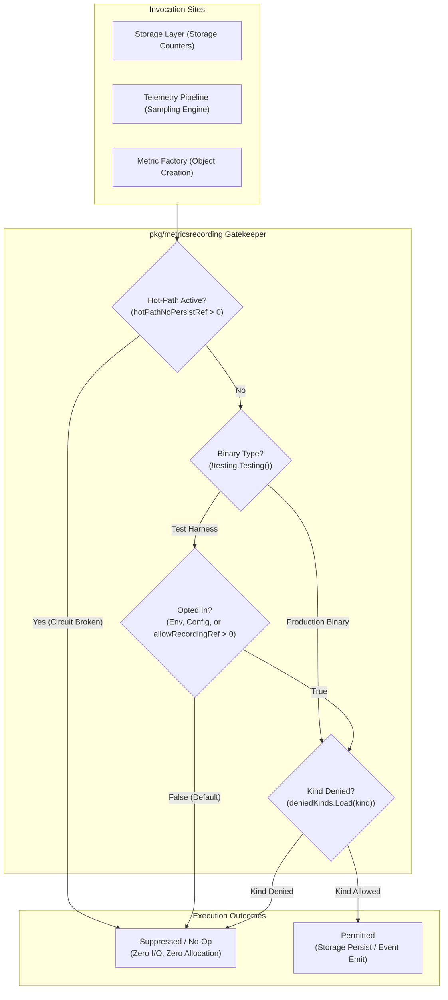
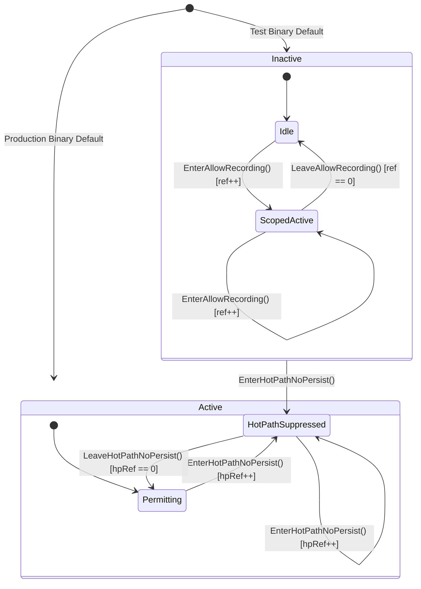
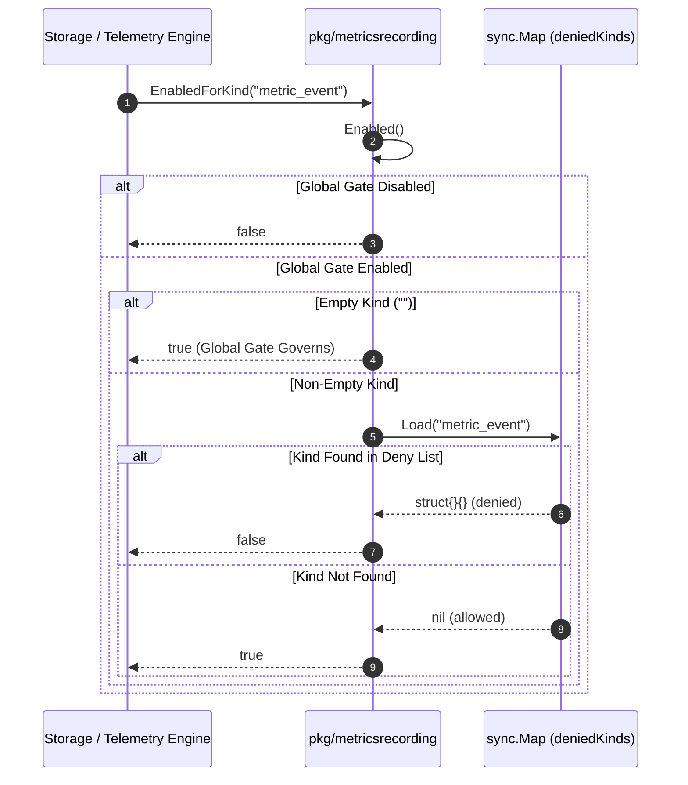

# Metrics Recording Subsystem & Recorder Pipeline Operational Architecture Guide (`pkg/metricsrecording`)

## 1. Subsystem Architecture & Philosophy

The **Metrics Recording Subsystem** (`pkg/metricsrecording`) acts as the central gatekeeper and decision authority across the **ZQK Knowledge Kernel** for all metrics recording, storage counters, pipeline sampling, and metric object creation.

In a high-throughput, multi-agent autonomous runtime, recording metrics naively introduces acute systemic risks:
1. **I/O Contention & File Lock Exhaustion:** In test suites and continuous verification loops, generating metric objects on disk for thousands of simulated transactions floods Content-Addressed Storage (CAS) with ephemeral entities, creating disk churn and lock serialization.
2. **Hot-Path Timeout Regression:** Heavy analytical commands—such as deep tree integrity audits and workspace validations—can trigger hundreds of background event routers that serialize on file storage creation if left unthrottled, tripping CLI execution floor timeouts.
3. **Production Telemetry Rigor:** Conversely, long-running production daemons, CLI command invocations, and multi-agent swarms require uninterrupted, high-fidelity metric observability for capacity tracking, agent token consumption, and failure diagnostics.

To resolve these competing constraints, `pkg/metricsrecording` establishes an explicit separation between production runtime binaries and test harness execution environments, governed by lock-free atomic reference counting, circuit-breaking overrides, and synchronized kind filtering.



---

## 2. Metrics Recording Policies & Sampling Invariants

The subsystem enforces four inviolable operational invariants:

### Invariant 1: Production Always-On Invariant
In production binaries (`testing.Testing() == false`), metrics recording is permanently active by default unless explicitly suppressed by the hot-path circuit breaker. This ensures operators and daemons always retain operational telemetry without needing manual configuration flags.

### Invariant 2: Test Harness Fail-Silent Invariant
In binaries compiled and executed by `go test`, metrics recording defaults to inactive (`false`). This ensures hermetic, high-speed unit and regression test execution without unintended filesystem writes, background goroutine leaks, or CAS storage pollution.

Test scopes may opt into recording through three distinct, composable mechanisms:
- **Environment Variable Opt-In:** Setting `ZQK_TEST_METRICS_RECORDING=1` or `true` (case-insensitive) globally opts in the entire test process.
- **Config Property Opt-In:** Dynamic configuration property `Testing.MetricsRecording` configured to `true`.
- **Atomic Refcounted Scope:** Programmatic test activation via `EnterAllowRecording()` and paired `LeaveAllowRecording()` inside test functions (typically managed via `t.Cleanup`).

### Invariant 3: Hot-Path Circuit Breaker Invariant
`EnterHotPathNoPersist` establishes a hard, non-negotiable override. Regardless of production binary mode, environment variables, config properties, or active `EnterAllowRecording` scopes:
$$\text{hotPathNoPersistRef} > 0 \implies \text{Enabled()} = \text{false}$$
This circuit breaker protects critical batched routines (such as integrity checks and bulk validations) from spawning serializing storage goroutines.

### Invariant 4: Zero Underflow Invariant
Reference counts for both recording scopes and hot-path suppression employ a Compare-And-Swap (CAS) decrement loop that clamps at zero:
$$\forall \text{calls to decRef}, \quad \text{refcount} \ge 0$$
Calling `LeaveAllowRecording()` or `LeaveHotPathNoPersist()` in excess of `Enter*` calls is safe and will never decrement into negative values.



---

## 3. Kind Registration & Storage Sink Integration

Beyond the global `Enabled()` gate, the subsystem provides fine-grained object and metric kind filtering via `sync.Map`. This allows test fixtures and pipeline samplers to selectively deny recording for noisy or problematic object kinds while keeping general telemetry enabled.

### Kind Filtering Sequence



### Kind API Contract
- `DenyKind(kind string)`: Registers a kind in the deny map. Empty string is ignored.
- `AllowKind(kind string)`: Removes a kind from the deny map. Safe to invoke on unregistered kinds.
- `ClearDeniedKinds()`: Removes all entries from the deny map, resetting kind filtering to allow-all.
- `EnabledForKind(kind string) bool`: Evaluates `Enabled()`, returning `false` immediately if global recording is disabled. If global recording is enabled, returns `true` for empty string or if `kind` has not been registered via `DenyKind`.

### Transactional Extraction: `CollectAndReset`

For storage counters and aggregation buffers, `CollectAndReset` wraps telemetry extraction in a single, safe invocation pattern:

```go
metricID, err := metricsrecording.CollectAndReset(func() (string, error) {
    // 1. Gather accumulated counters and persist snapshot
    return storageSink.PersistSnapshot()
}, func() {
    // 2. Reset counters only after successful collection
    storageSink.ResetLocalCounters()
})
```

- If `Enabled()` is `false`, neither `collect` nor `reset` is called, returning `("", nil)` immediately.
- If `collect()` returns an error, `reset` is **not** called, preserving internal counters for subsequent retries.

---

## 4. Concurrency Guarantees & Thread-Safety

The `pkg/metricsrecording` package is fully thread-safe and designed for high-concurrency environments:

| Primitive | Synchronization Mechanism | Concurrency Guarantee |
| :--- | :--- | :--- |
| `allowRecordingRef` | `sync/atomic` (AddInt32, LoadInt32, CAS loop) | Lock-free, wait-free read; linearizable increments and decrements. |
| `hotPathNoPersistRef` | `sync/atomic` (AddInt32, LoadInt32, CAS loop) | Lock-free, wait-free read; linearizable increments and decrements. |
| `deniedKinds` | `sync.Map` | Safe for concurrent read, write, and range delete operations across goroutines. |
| `CollectAndReset` | Caller function encapsulation | Evaluates `Enabled()` atomically before invoking callbacks. |

### Concurrency Stress Characteristics
- The atomic CAS decrement loop guarantees zero data races even when hundreds of worker goroutines enter and leave recording scopes concurrently.
- No mutexes or channel operations are employed in the hot path, ensuring sub-nanosecond gate evaluation overhead.

---

## 5. Operational Runbook & Troubleshooting Matrix

### Diagnostic Procedures

#### Check Active Recording State in Go Tests
```go
// Verify whether the current scope allows metric recording
if metricsrecording.Enabled() {
    // Recording active
}
```

#### Opt In for a Specific Unit Test
```go
func TestFeatureMetrics(t *testing.T) {
    metricsrecording.EnterAllowRecording()
    t.Cleanup(metricsrecording.LeaveAllowRecording)

    // Execute logic and assert metrics created
}
```

#### Suppress Persistence During Bulk Sweeps
```go
func RunBulkWorkspaceAudit() error {
    metricsrecording.EnterHotPathNoPersist()
    defer metricsrecording.LeaveHotPathNoPersist()

    // Execute heavy scan with zero metric persistence overhead
    return performScan()
}
```

### Troubleshooting Matrix

| Symptom / Error | Root Cause | Remediation Procedure |
| :--- | :--- | :--- |
| **System Check Timeout / Latency Spike**<br>`CLI execution floor exceeded (5m)` | Bulk validation is generating hundreds of metric router goroutines serializing on CAS file creation. | Wrap the batch validation entry point with `EnterHotPathNoPersist()` and ensure deferred `LeaveHotPathNoPersist()`. |
| **Unit Test Fails: "No metrics emitted"** | Test harness runs in `go test` mode where recording is disabled by default. | Add `metricsrecording.EnterAllowRecording()` with `t.Cleanup(metricsrecording.LeaveAllowRecording)` or run with `ZQK_TEST_METRICS_RECORDING=1`. |
| **Specific Kind Metrics Missing in Tests** | The object kind was added to the deny list via `DenyKind` in a prior test without cleanup. | Call `metricsrecording.ClearDeniedKinds()` in test setup or ensure each `DenyKind` is matched with an `AllowKind` in `t.Cleanup`. |
| **Metric Counters Reset Despite Storage Failure** | Custom collection logic wiped counters before confirming persistence. | Use `metricsrecording.CollectAndReset` to guarantee the reset callback only fires when collection succeeds. |
| **Spurious Metrics in CI Logs** | Environment variable `ZQK_TEST_METRICS_RECORDING` is set to `1` across all CI pipelines. | Remove the global environment variable and rely on scoped `EnterAllowRecording()` per individual test case. |
