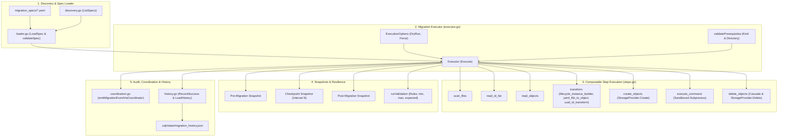
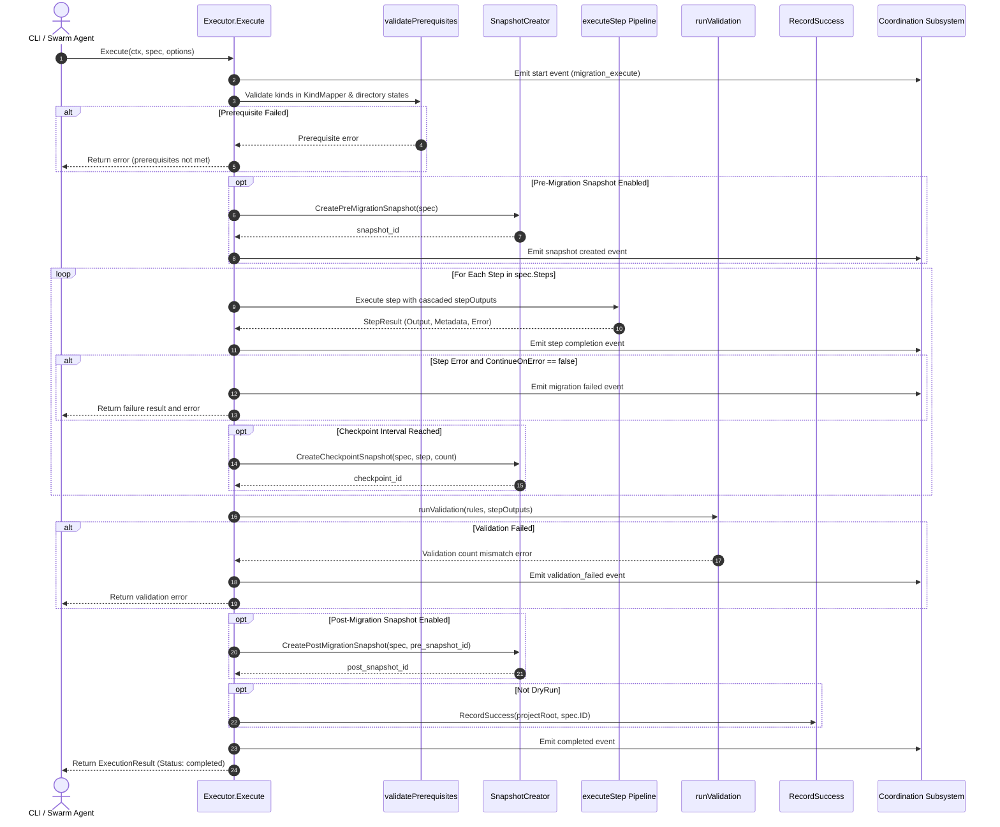

# Migration Subsystem & Schema Evolution Operational Architecture Guide

## Overview

The **Migration Subsystem** (`pkg/migration`) provides a declarative, deterministic, and snapshot-backed framework for schema migrations, data transformations, format evolutions, lifecycle and UUID identifier transitions, and CAS storage model upgrades within the **Zen Quantum Kernel (ZQK)** platform.

As the knowledge kernel evolves—introducing new ontological domains, transitioning legacy object formats, standardizing Content-Addressed Storage (CAS) identifiers, or shifting data planes from file-backed stores to graph databases—data structures on disk and in memory must be upgraded safely without downtime, data loss, or schema drift.

The `pkg/migration` package encapsulates this operational capability into a composable step execution engine (`Executor`) that executes declarative migration specifications (`Spec`). The subsystem incorporates fail-closed prerequisite validation, snapshot-backed rollback points, atomic multi-object creations, cascade-aware deletions, structured event coordination, and an append-only migration history ledger.

---

## Architectural Purpose & Policy Context

In alignment with kernel core architectural standards and continuous verification policies, the Migration Subsystem enforces four cardinal operational invariants:

1. **Fail-Closed Prerequisite Verification**: Before mutating any graph state, the executor rigorously validates all environmental prerequisites—confirming registered kind schemas in the global kind mapper, verifying directory presence or absence, and inspecting prerequisite state. Any missing invariant aborts execution before mutations begin.
2. **Transactional & Snapshot-Backed Safety**: Migrations declare `snapshot_compatible` contracts. The subsystem integrates with `SnapshotCreator` to automatically capture pre-migration baseline snapshots, incremental checkpoint snapshots at configurable object intervals, and post-migration validation snapshots.
3. **Idempotent & Replayable Step Execution**: Every migration step provides idempotency options (such as `skip_existing` flags, continue-on-error degradation modes, and dry-run preflight simulations), ensuring migrations can be re-run safely after partial interruptions.
4. **Unified Event Coordination & Audit Traceability**: Migration lifecycles emit structured events through `pkg/coordination` across logging, auditing, and telemetry channels, recording execution latencies, affected object counts, and failure diagnostics. Completed migrations are immutably recorded in `migration_history.json`.

---

## Subsystem Component Topology

The subsystem is composed of decoupled functional components spanning discovery, execution, transformation, and verification:



### Detailed Component Roles:

1. **Spec Loader & Validator (`loader.go`, `spec.go`)**:
   - Parses YAML migration specs into typed `Spec` structs.
   - Enforces unique step IDs, valid dependency chains (`depends_on`), and valid iterative mappings (`for_each`).
   - Populates sensible defaults for snapshot-compatible migrations (`pre_migration_snapshot`, `post_migration_snapshot`, `tracking`, `coherence`).

2. **Migration Executor (`executor.go`)**:
   - Manages the execution lifecycle from preflight checks to final status latching.
   - Evaluates prerequisites, manages `SnapshotCreator` hooks, cascades step outputs to dependent steps, and executes validation rules.
   - Supports non-destructive dry-run previews and error tolerance policies (`continue_on_error`).

3. **Step Processors (`steps.go`)**:
   - **`scan_files`**: Scans directories for candidate files using glob patterns and exclusion rules.
   - **`read_id_list`**: Ingests lists of object identifiers from YAML arrays or line-delimited text streams.
   - **`read_objects`**: Retrieves full object maps from `storage.ObjectStorageProvider` for batch transformation.
   - **`transform`**: Applies specialized transformation builders (`lifecycle_instance_builder`, `yaml_file_to_object`, `lifecycle_id_transform`, `uuid_id_transform`).
   - **`create_objects`**: Persists transformed objects into CAS storage with existence deduplication.
   - **`delete_objects`**: Purges obsolete objects with cascade awareness and security authorization.
   - **`execute_command`**: Runs environment-isolated shell commands with captured stdout/stderr and exit code monitoring.

4. **Binary Detector & Integrity Suite (`pkg/migration/detector`)**:
   - Discovers platform-specific migration binaries (`zqk-migrate`).
   - Verifies cryptographic SHA-256 hashes and code signatures (macOS `codesign`, Linux GPG, Windows Authenticode).
   - Validates semver constraints and manifest compatibility (`BinaryManifest`).

5. **Coordination & Migration History (`coordination.go`, `history.go`)**:
   - Dispatches structured events to storage audit logs, metrics pipelines, and logging routers.
   - Persists an immutable ledger in `<project_root>/.zqk/state/migration_history.json` tracking migration completion timestamps.

---

## Migration Lifecycle & Execution Dynamics

The execution follows a monotonic state machine designed to prevent partial or unrecoverable mutations:



---

## Supported Step Processors & Configuration Grammar

### 1. `scan_files`
Discovers files matching patterns within a directory relative to project root.

```yaml
id: scan_legacy_lifecycles
type: scan_files
config:
  directory: ".zqk/lifecycle"
  pattern: "*_lifecycle.yaml"
  exclude:
    - "*_draft.yaml"
```

### 2. `transform`
Transforms source files or memory objects using pluggable transformation builders.

```yaml
id: transform_to_objects
type: transform
depends_on: ["scan_legacy_lifecycles"]
for_each: scan_legacy_lifecycles
config:
  transform:
    builder: "yaml_file_to_object"
    version: "v1_0_0"
```

Available builders:
- `yaml_file_to_object`: Parses YAML files into generic kernel object maps, inferring kind from directory or metadata.
- `lifecycle_instance_builder`: Converts legacy lifecycle YAML declarations into formal `lifecycle` object instances.
- `lifecycle_id_transform`: Normalizes legacy lifecycle IDs to the standardized `LIFECYCLE-{ABBR}-001` format.
- `uuid_id_transform`: Converts sequential IDs (e.g. `BLI-001`) into randomized content-addressable UUID formats (e.g. `BLI-a1b2c3d4`).

### 3. `create_objects`
Persists object maps into the configured `storage.ObjectStorageProvider`.

```yaml
id: persist_objects
type: create_objects
depends_on: ["transform_to_objects"]
config:
  skip_existing: true
checkpoint:
  interval: 25
  snapshot: true
```

### 4. `read_id_list` & `read_objects`
Reads ID collections from disk and hydrates objects from storage.

```yaml
id: load_target_ids
type: read_id_list
config:
  file: "configs/migrations/target_ids.txt"

id: hydrate_targets
type: read_objects
depends_on: ["load_target_ids"]
```

### 5. `delete_objects`
Deletes obsolete objects with optional cascade resolution.

```yaml
id: cleanup_legacy
type: delete_objects
depends_on: ["load_target_ids"]
config:
  cascade: false
```

### 6. `execute_command`
Executes an external binary or administrative tool within a monitored subprocess.

```yaml
id: reindex_search
type: execute_command
config:
  command: "zqk"
  args: ["internal", "reindex"]
  working_dir: "."
  env:
    ZQK_MIGRATION_MODE: "active"
```

---

## Snapshot, Checkpoint & Rollback Safety Guarantees

The subsystem provides snapshot isolation across the migration lifecycle:

1. **SnapshotCreator Integration**:
   - Custom snapshot engines (such as `storage.SnapshotManager`) implement the `SnapshotCreator` interface:
     ```go
     type SnapshotCreator interface {
         CreatePreMigrationSnapshot(ctx context.Context, spec *Spec) (string, error)
         CreatePostMigrationSnapshot(ctx context.Context, spec *Spec, preSnapshotID string) (string, error)
         CreateCheckpointSnapshot(ctx context.Context, spec *Spec, step Step, count int) (string, error)
     }
     ```
   - When no external snapshot engine is attached, the executor generates deterministic synthetic snapshot IDs for audit tracking.

2. **Checkpoint Snapshots**:
   - For long-running batch migrations, steps can configure `checkpoint.interval: N`.
   - After processing every $N$ items, the executor captures a checkpoint snapshot, providing fine-grained rollback boundaries without having to rewind the entire migration.

3. **Rollback Strategy Configuration**:
   - Specs declare rollback parameters (`strategy: snapshot_restore`, `tag`, `fallback`).
   - If an unhandled step fails when `continue_on_error` is false, the failure event includes pre-snapshot and checkpoint references for immediate restoration.

---

## Verification & Three-Fold Proof Breakdown

The subsystem is validated under the rigorous **Three-Fold Proof** discipline:

### 1. Static Floor Invariant (Coverage & Structural Invariants)
- **High Statement Coverage**: Package statement test coverage is maintained $\ge 85.0\%$ across all packages in `pkg/migration/...` (achieving $>85.0\%$ for `pkg/migration`, `detector`, `exporter`, `parser`, `reporter`, `resolver`, `scanner`, `validator`, and `writer`).
- **Data Model Coherence**: Enforces structural validity of `Spec`, `Step`, `Options`, `Prerequisite`, `HistoryEntry`, and `MigrationHistory`.
- **Zero Memory Leaks & Resource Cleanup**: Temporary project teardown hooks (`testkit.RegisterTempProjectTeardown`) cleanly release storage and file locks.

### 2. Operational Dynamic Proof (End-to-End Execution)
- Verified through `TestMigrationSubsystem_OperationalDynamicProof`:
  - Executes full multi-step migration: `scan_files` $\rightarrow$ `transform` $\rightarrow$ `create_objects` $\rightarrow$ `read_id_list` $\rightarrow$ `read_objects` $\rightarrow$ `execute_command` $\rightarrow$ `delete_objects`.
  - Verifies pre-migration, checkpoint, and post-migration snapshot triggers with mock `SnapshotCreator`.
  - Confirms non-destructive preflight behavior under `DryRun: true`.
  - Verifies criteria validation rules (`object_count`, `file_count`) matching `min`, `max`, and `expected` constraints.
  - Confirms append-only record creation in `migration_history.json`.

### 3. Negative Adversarial Boundary (Failure Modes & Defenses)
- Verified through comprehensive boundary test suites:
  - **Spec Loading Failures**: Non-existent files, malformed YAML, empty IDs, missing names, duplicate step IDs, broken `depends_on` links, invalid `for_each` references.
  - **Prerequisite Collisions**: Unregistered kinds in `KindMapper`, missing directories when `exists: true`, existing directories when `exists: false`.
  - **Snapshot Failures**: Graceful abort on pre-migration snapshot failure; structured warning logging on checkpoint or post-migration snapshot errors.
  - **Step Execution Errors**: Missing source step outputs, non-map output envelopes, invalid ID slice types, unparseable commands, non-zero command exit codes.
  - **Storage Deletion Resilience**: Tolerates missing objects, handles non-cascade deletion constraints, and logs descriptive diagnostics.
  - **Corrupted State Recovery**: Detects corrupted `migration_history.json` and prevents silent history overwrites.

---

## Operational Commands & Usage Recipes

### 1. Executing a Migration Spec Programmatically

```go
package main

import (
    "context"
    "fmt"

    "github.com/zqk-os/zqk/pkg/logging"
    "github.com/zqk-os/zqk/pkg/migration"
    "github.com/zqk-os/zqk/pkg/storage"
)

func RunMigration(ctx context.Context, projectRoot, specPath string) error {
    // 1. Initialize storage and logger
    storageProvider, err := storage.NewFileObjectStorage(projectRoot)
    if err != nil {
        return fmt.Errorf("failed to init storage: %w", err)
    }
    logger := logging.GetLoggerFromProfile("human")

    // 2. Load and validate migration spec
    spec, err := migration.LoadSpec(specPath)
    if err != nil {
        return fmt.Errorf("invalid spec: %w", err)
    }

    // 3. Create executor and run migration
    executor := migration.NewExecutor(storageProvider, projectRoot, logger)
    dryRun := false
    result, err := executor.Execute(ctx, spec, migration.ExecutionOptions{
        DryRun: &dryRun,
    })
    if err != nil {
        return fmt.Errorf("migration failed: %w", err)
    }

    fmt.Printf("Migration %s completed in %v. Objects created: %d, deleted: %d\n",
        result.MigrationID, result.Duration, result.ObjectsCreated, result.ObjectsDeleted)
    return nil
}
```

### 2. Simulating Preflight Verification via Dry-Run

```go
dryRun := true
result, err := executor.Execute(ctx, spec, migration.ExecutionOptions{
    DryRun: &dryRun,
})
if err != nil {
    return fmt.Errorf("dry-run detected errors: %w", err)
}
fmt.Printf("Dry-run successful. Would create %d objects.\n", result.ObjectsCreated)
```

### 3. Inspecting Migration History

```go
// Check if a specific migration has executed
hasRun, err := migration.HasRun(projectRoot, "MIG-UUID-TRANSFORM-001")
if err != nil {
    return err
}
if hasRun {
    fmt.Println("Migration already applied.")
}

// Load full migration history ledger
history, err := migration.LoadHistory(projectRoot)
if err != nil {
    return err
}
for _, entry := range history.Entries {
    fmt.Printf("Migration %s applied at %s\n", entry.MigrationID, entry.CompletedAt)
}
```
