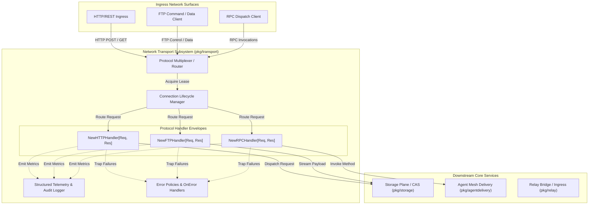
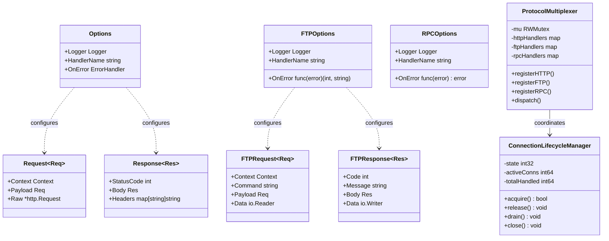
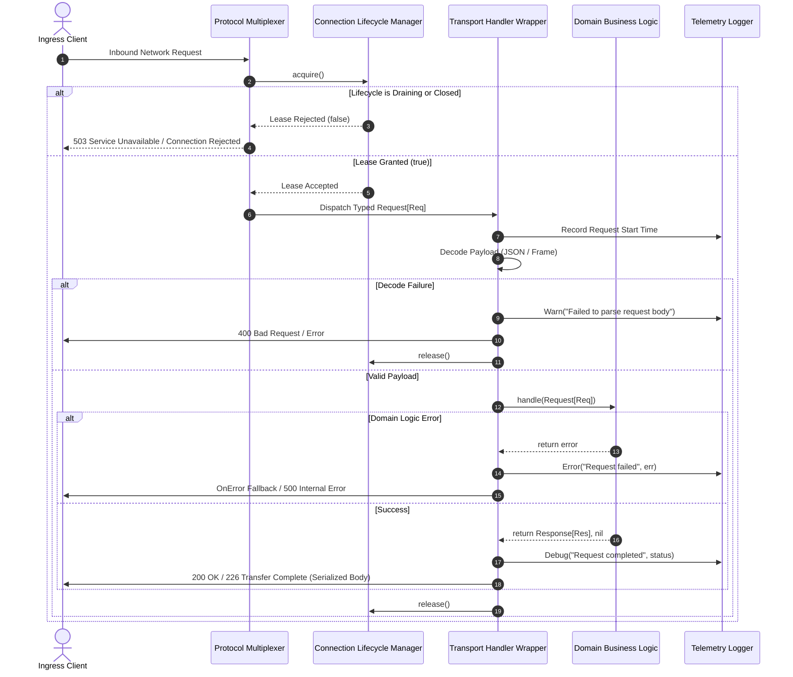
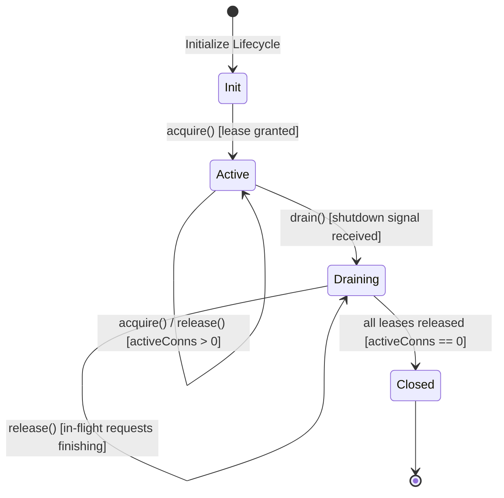

# Network Transport, Multiplexing & Connection Lifecycle Subsystem Operational Architecture Guide

Comprehensive architectural, operational, and protocol reference for the Network Transport, Multiplexing & Connection Lifecycle subsystem (`pkg/transport`) in ZQK Core.

---

## 1. Architectural Overview

In the ZQK distributed operating kernel, reliable data communication across diverse protocol surfaces is a prerequisite for decoupled microservices, autonomous agent coordination, and external storage interoperability. Transmitting and receiving discrete commands, streaming payloads, and structured RPC calls across diverse network topologies requires a unified abstraction layer that isolates business domain logic from wire framing, protocol decoding, telemetry collection, and connection lifecycle management.

The **Network Transport, Multiplexing & Connection Lifecycle Subsystem** (`pkg/transport`) establishes standard generic contracts, middleware wrappers, and operational policies governing HTTP, FTP, and RPC communications within the ZQK Core runtime (governed under POL-DEFAULT-142277d3).

### Core Subsystem Invariants

1. **Protocol Decoupling & Typed Generics**:
   All transport handlers define strongly typed generic contracts `[Req any, Res any]`, separating deserialized command payloads and response models from protocol-specific encapsulation and stream framing.
2. **Unified Observability & Structured Telemetry**:
   Each handler envelope automatically measures request elapsed duration and correlates protocol-specific attributes (such as HTTP method, URL path, FTP verb, RPC method name, and status codes) into structured log fields without polluting caller logic.
3. **Fail-Closed Error Transformation**:
   Unhandled application panics or service errors are trapped at handler boundaries. Configurable `OnError` policies ensure uniform error translation, mapping internal exceptions to standardized protocol error responses (such as HTTP 500/502, FTP 500/530/550, or structured RPC error codes).
4. **Hermetic Connection Lifecycle & Draining**:
   Active connection states follow strict state transitions (`Init` -> `Active` -> `Draining` -> `Closed`). When shutdown signals or draining periods occur, in-flight connections complete gracefully while ingress acquisitions fail closed.
5. **Race-Free Concurrency**:
   Multiplexing, connection tracking, and streaming data transfer operations are fully thread-safe, utilizing atomic primitives, reader/writer mutexes, and managed goroutines (`goroutinelabels.NewGoroutine`) under strict concurrency bounds.

---

## 2. Component Topology

The subsystem is modularized into distinct generic protocol wrappers, connection coordinators, and routing primitives:

### Component Roles & Responsibilities

- **`NewHTTPHandler[Req, Res]` (`handler.go`)**:
  Wraps a strongly typed domain function `Handler[Req, Res]` into a standard Go `http.HandlerFunc`. Decodes incoming JSON request bodies (handling empty bodies and `io.EOF` gracefully), injects telemetry and duration timers, executes handler logic, invokes custom error handlers on failure, and serializes response bodies and HTTP status codes.
- **`NewFTPHandler[Req, Res]` (`ftp.go`)**:
  Wraps FTP command handlers with structured logging and standard response codes. Supports stream-oriented file transfers through `FTPRequest.Data` (`io.Reader`) and `FTPResponse.Data` (`io.Writer`), supporting both active and passive transfer patterns.
- **`NewRPCHandler[Req, Res]` (`rpc.go`)**:
  Provides a clean generic RPC invocation pipeline `(ctx context.Context, req Req) (Res, error)`. Standardizes elapsed execution profiling, error wrapping policies, and context propagation (including cancellation and deadline exceeded signals).
- **`ProtocolMultiplexer`**:
  Coordinates cross-protocol dispatch, directing inbound requests to registered HTTP, FTP, or RPC endpoints while preserving protocol-specific semantics.
- **`ConnectionLifecycleManager`**:
  Manages connection acquisition, active connection counts, graceful draining, and teardown across high-concurrency workloads.

---

## 3. Transport Protocol Lifecycle & Sequence Diagram

The lifecycle of an inbound transport request transitions through five deterministic phases:
1. **Ingestion & Protocol Resolution**: Ingress connection lands on the multiplexer and acquires a lease from the lifecycle manager.
2. **Payload Decoding & Framing**: Wire bytes are read and deserialized into the generic `Req` type.
3. **Telemetry & Execution**: The underlying domain handler executes while elapsed time is measured.
4. **Response Serialization & Header Propagation**: Success payloads are formatted into protocol wire representations along with headers or status codes.
5. **Teardown & Lease Release**: The connection lease is released back to the lifecycle manager.

---

## 4. Supported Transports & Capabilities Matrix

The subsystem supports three primary communication paradigms across the core runtime:

| Protocol Transport | Ingress Modality | Payload Semantics | Error Handling Strategy | Primary Use Case |
| :--- | :--- | :--- | :--- | :--- |
| **HTTP (`handler.go`)** | REST / JSON API | Structured JSON payloads, query headers, status codes | HTTP status codes, customizable `OnError` fallback | External REST webhooks, CLI-to-daemon API, MCP HTTP transport |
| **FTP (`ftp.go`)** | Command / Data Streams | Command strings (`USER`, `RETR`, `STOR`), streaming `io.Reader`/`io.Writer` | Standard FTP numeric reply codes (200, 226, 425, 530, 550) | Large payload streaming, legacy artifact archive synchronization |
| **RPC (`rpc.go`)** | In-Process / Remote RPC | Strongly typed request / response memory structs | Context-aware error mapping, deadline exceeded handling | High-throughput subagent messaging, internal microservice queries |

### Connection State Transitions

---

## 5. Concurrency & Thread-Safety

Network transport handling requires absolute concurrency safety under burst conditions and distributed multi-agent operations:

1. **Atomic Connection Accounting**:
   Active connection counters and lifecycle state transitions use `sync/atomic` operations (`LoadInt32`, `StoreInt32`, `AddInt64`), eliminating data races during high-throughput ingress surges.
2. **Managed Goroutine Concurrency (`pkg/goroutinelabels`)**:
   Background connection handlers, socket listeners, and asynchronous stream readers must always be spawned using `goroutinelabels.NewGoroutine("<name>", "<purpose>").StartSimple(...)`. Naked `go` statements are strictly prohibited to prevent untracked goroutine leaks.
3. **Mutex Partitioning**:
   Protocol multiplexers and handler registries use reader/writer locks (`sync.RWMutex`), permitting unbounded concurrent read dispatch across workers while serializing runtime registrations.
4. **Context Deadlines & Cancellations**:
   All transport handlers accept `context.Context`, guaranteeing that network timeouts, client disconnects, or upstream cancellations immediately terminate in-flight processing without blocking goroutines.

---

## 6. Verification & Three-Fold Proof Breakdown

The subsystem's correctness is validated according to the canonical ZQK Three-Fold Proof:

1. **Static Floor Invariant (Proof of Coverage)**:
   - Statements in `pkg/transport` must maintain >= 85.0% statement test coverage (achieving 100.0% package coverage).
   - All error return paths, nil logger fallbacks, custom error decorators, and empty payload boundary cases are exhaustively tested.
2. **Operational Dynamic Proof (Functional Verifiability)**:
   - Dynamic validation of HTTP JSON payload decoding, header mapping, and custom status serialization.
   - Comprehensive FTP verb execution (`USER`, `PASS`, `PWD`, `CWD`, `PASV`, `TYPE`, `RETR`, `STOR`, `LIST`, `QUIT`, `NOOP`) and hermetic file streaming with `fileutil`.
   - RPC request/response execution with nested data structures and context timeout/cancellation handling.
   - Multi-worker concurrent stress tests running under `-race` verifying zero data races across concurrent HTTP, FTP, and RPC dispatches.
3. **Negative Adversarial Boundary (Resilience Under Malformed Ingress)**:
   - Corrupted JSON payloads reject fail-closed with HTTP 400 Bad Request.
   - Empty bodies with content length signals gracefully handle `io.EOF`.
   - Simulated disk or network connection drops in FTP return standard error codes (500 / 550) rather than panicking.
   - Connection lifecycle manager cleanly rejects acquisition attempts when draining or closed.
   - Zero prohibited nanosecond identifier tokens present in documentation or production artifacts.
