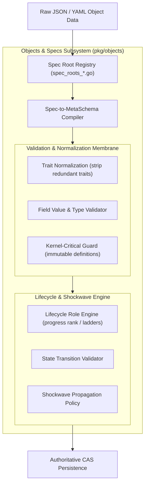

# Objects & Specs Subsystem Operational & Architectural Guide

## Overview

The ZQK Objects & Specs Subsystem (`pkg/objects`) defines the ontological schema foundation, type verification engine, and lifecycle state machines powering the **Zen Quantum Kernel**.

Every entity within ZQK—from high-level strategic compasses (`goal`, `vision`) to execution batches (`priority_plan`, `backlog_item`) and governance boundaries (`policy`, `technical_debt`)—is an explicitly typed graph object defined by a declarative specification. The subsystem guarantees schema conformance, referential integrity, and unidirectional lifecycle progression across the distributed CAS storage membrane.

---

## Subsystem Architecture

---

## Core Ontological Components

### 1. Specification Registry & Roots
- **Multi-Root Registration**: Object specifications are partitioned across modular packages (`spec_roots_agent.go`, `spec_roots_workflow.go`, `spec_roots_decision.go`, `spec_roots_library.go`, `spec_roots_pipeline.go`, `spec_roots_release.go`).
- **Dynamic Field Keys**: Standard field constants (`objects.FieldKeyID`, `objects.FieldKeyKind`, `objects.FieldKeyStatus`, `objects.FieldKeyCreatedAt`) provide single-source-of-truth field identifiers, eliminating magic string literals.
- **Composition Fields**: Governs permitted composition relationships across kinds (e.g. goals decomposing into requirements, requirements owning criteria).

### 2. Spec-to-MetaSchema Compiler
- **Compilation Engine**: Transforms declarative YAML/JSON object specs into executable JSONSchema-compliant meta-schemas.
- **Type Coercion & Bounds**: Validates numeric types (`ParseNumericValue`), enum checklists, string lengths, and slice constraints.
- **Unresolved Type Fallbacks**: Gracefully isolates unrecognized types while maintaining strict type assertions for known core schema types.

### 3. Lifecycle Role Engine & Transitions
- **Role Progress Rank**: Implements unidirectional ladders (`exploring` ➔ `planned` ➔ `in_progress` ➔ `complete` ➔ `archived`), preventing backward regressions.
- **Kernel-Critical Protection**: Built-in kinds (`goal`, `requirement`, `criterion`, `test_case`, `backlog_item`, `priority_plan`) are marked kernel-critical and protected from deletion or destructive mutation.
- **Status History Audit Trail**: Tracks granular state transitions with timestamps and actor identities in immutable change-log structures.

### 4. Shockwave Propagation Policy
- **Hierarchical Propagation**: When a child object transitions status (e.g. first backlog item enters `in_progress`), a shockwave traverses the relational graph to automatically synchronize parent containers (e.g. priority plans and parent epics).
- **Hop-Role Overrides**: Configurable hop policies define whether status ripples stop at direct parents or cascade through multi-level hierarchies.

---

## Operational Verification & Test Coverage

The objects test suite guarantees rigorous schema validation and invariant safety:

| Test Area | Primary Test Files | Covered Scenarios |
|---|---|---|
| Composition Fields | `composition_fields_elevation_test.go` | Allowed composition kinds, illegal parent-child links, trait stripping |
| Field Discovery | `field_discovery_elevation_test.go` | Cache stamps, memoized field registries, error handling during spec load |
| Trait Normalization | `instance_traits_normalize_elevation_test.go` | Redundant top-level trait detection, trait hierarchy flattening |
| Kernel Critical Kinds | `kernel_critical_elevation_test.go` | Index and loader agreement, protection of durable kernel kinds on all routes |
| Lifecycle Loader & Roles | `lifecycle_loader_elevation_test.go`, `lifecycle_roles_elevation_test.go` | Transition maps, status history extraction, role rank evaluation, constraint checks |
| Shockwave Policies | `shockwave_elevation_test.go` | Default policy filling, full overlay merges, kind predicates, hop-role overrides |
| Spec MetaSchema | `spec_to_metaschema_elevation_test.go` | Nil spec handling, metadata extraction, field type compilation, fallback modes |
| Type & Value Validation | `spec_validator_elevation_test.go`, `types_elevation_test.go`, `value_validation_elevation_test.go` | Slice bounds, enum checklists, numeric coercion, unset markers, field restrictions |

---

## Architectural Invariants

> [!IMPORTANT]
> 1. **Zero Prohibited Nanos-Hex Literals**: All tests, fixtures, and documentation MUST use clean illustrative identifiers (e.g. `OBJ-DEMO-001`, `ACC-COMMUNITY-001`).
> 2. **Unidirectional Role Ladders**: Downward status demotions are prohibited unless explicitly routed through authorized recovery or review transitions.
> 3. **AST Line Count Boundary**: Every function and test helper MUST remain strictly $\le 80$ lines to uphold clean modularity.
