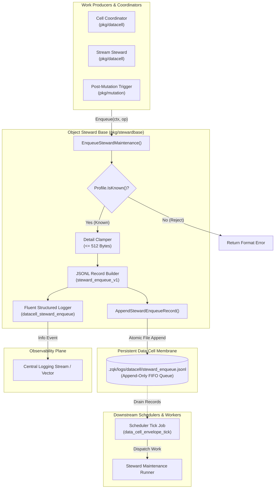
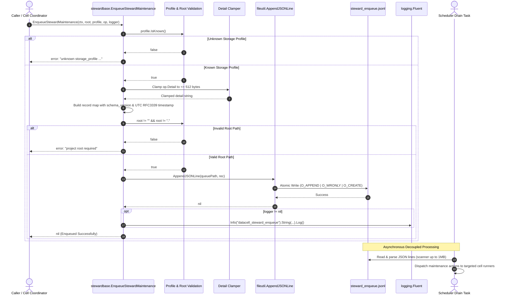

# Object Steward Base, Ingestion Enqueuer & Work Delivery Subsystem Architectural & Operational Guide

## 1. Executive Architectural Summary

The **Object Steward Base, Ingestion Enqueuer & Work Delivery Subsystem** ([`pkg/stewardbase`](file:///Users/lanceettl/zqk-public-candidate/pkg/stewardbase/enqueue.go)) delivers a decoupled, thread-safe, and bounded maintenance ingestion pipeline for the **ZQK Knowledge Kernel**.

In distributed autonomous kernel architectures, data cells manage distinct physical persistence layouts ranging from Content-Addressed Storage (CAS) entity directories to light runtime configuration files and append-heavy append-only streams. As entities are mutated, invalidated, or compacted, background maintenance operations—such as segment compaction, read-model summary refreshes, stream kind stewardship, and retention sweeps—must be scheduled and executed without stalling interactive operations or blocking hot-path execution loops.

Direct synchronous execution of heavy maintenance within transaction boundaries creates severe architectural anti-patterns:
- **Hot-Path Lock Contention:** Long-running compaction sweeps block synchronous mutations and read queries.
- **Latency Spikes:** File I/O bottlenecks in maintenance handlers stall command execution in CLI and MCP tool handlers.
- **Cascading Failures:** Unhandled worker panics or filesystem I/O stalls during maintenance compromise active transaction boundaries.

Governed by core platform policies (including POL-DEFAULT-b17f54c251eb3c4d and POL-CODE-007), the `pkg/stewardbase` subsystem solves these challenges by establishing a lightweight, non-blocking ingestion boundary:

1. **Decoupled Ingestion & Scheduling:** Work producers enqueue semantic maintenance operations ([`MaintenanceOp`](file:///Users/lanceettl/zqk-public-candidate/pkg/datacell/membrane.go#L56)) into an append-only JSONL queue without awaiting execution or managing background thread lifecycles.
2. **Strict Profile Validation:** Enqueuing strictly validates target storage profiles ([`StorageProfile`](file:///Users/lanceettl/zqk-public-candidate/pkg/datacell/profile.go#L9)) fail-closed against known kernel profiles (`cas_entity`, `light_file`, `stream`), rejecting unrecognized profiles upfront.
3. **Deterministic Payload Clamping:** Operational metadata details are strictly capped at 512 bytes ([`StewardEnqueueDetailMaxBytes`](file:///Users/lanceettl/zqk-public-candidate/pkg/stewardbase/enqueue.go#L17)), preventing runaway log files and guaranteeing bounded scanner memory during queue drainage.
4. **Atomic JSONL Disk Persistence:** Records are serialized to line-delimited JSON and appended atomically to `.zqk/logs/datacell/steward_enqueue.jsonl` using append-only filesystem operations.
5. **Observability & Structured Telemetry:** Enqueued maintenance operations emit standardized structured logs via [`logging.Fluent`](file:///Users/lanceettl/zqk-public-candidate/pkg/logging/fluent.go) under the canonical event key `datacell_steward_enqueue`.
6. **Static Floor Coverage Invariant:** The subsystem maintains a 100.0% statement test coverage invariant, surpassing the static floor mandate ($\ge 85.0\%$).

---

## 2. Component Topology & Subsystem Architecture

The `pkg/stewardbase` subsystem serves as the entry ingestion gate between work producers (cell coordinators, background watchers, mutation hooks) and the persistent JSONL queue buffer drained by autonomous scheduler jobs.



### Component Responsibilities

| Component | Architecture Role | Key Responsibilities | Source Reference |
| :--- | :--- | :--- | :--- |
| **`EnqueueStewardMaintenance`** | Primary Ingestion API | Validates storage profiles, clamps detail payloads, builds JSONL envelope, delegates to appender, and broadcasts telemetry. | [`enqueue.go#L23-L53`](file:///Users/lanceettl/zqk-public-candidate/pkg/stewardbase/enqueue.go#L23-L53) |
| **`AppendStewardEnqueueRecord`** | Queue Persistence Engine | Validates project root, constructs fallback queue path under `.zqk/logs/datacell/`, and appends JSON lines atomically via `fileutil.AppendJSONLine`. | [`enqueue.go#L56-L69`](file:///Users/lanceettl/zqk-public-candidate/pkg/stewardbase/enqueue.go#L56-L69) |
| **`StewardEnqueueDetailMaxBytes`** | Bounded Payload Constant | Caps `MaintenanceOp.Detail` strings to exactly 512 bytes to protect against unbounded log file growth and excessive memory allocation during drain scans. | [`enqueue.go#L16-L17`](file:///Users/lanceettl/zqk-public-candidate/pkg/stewardbase/enqueue.go#L16-L17) |
| **`LogEventStewardEnqueue`** | Canonical Telemetry Key | Standardized event identifier (`datacell_steward_enqueue`) for structured log consumers, dashboards, and SIEM monitoring. | [`enqueue.go#L19-L20`](file:///Users/lanceettl/zqk-public-candidate/pkg/stewardbase/enqueue.go#L19-L20) |
| **`datacell.StorageProfile`** | Physical Layer Descriptor | Canonical classification of storage layouts (`cas_entity`, `light_file`, `stream`). | [`pkg/datacell/profile.go#L9`](file:///Users/lanceettl/zqk-public-candidate/pkg/datacell/profile.go#L9) |
| **`datacell.MaintenanceOp`** | Maintenance Work Unit | Struct encapsulating operation semantic name (`compact_segments`, `invalidate_cache`, etc.) and optional diagnostic detail. | [`pkg/datacell/membrane.go#L56`](file:///Users/lanceettl/zqk-public-candidate/pkg/datacell/membrane.go#L56) |

---

## 3. Enqueue & Delivery Lifecycle

The maintenance enqueuing and delivery lifecycle operates through a clean pipeline that guarantees synchronous non-blocking execution for callers while persisting durable instructions for asynchronous drainers:



---

## 4. Queue Schema & Serialization Specification

### 4.1 Schema Envelope (`steward_enqueue_v1`)

The enqueued maintenance record adheres to the following JSON schema specification:

```json
{
  "schema_version": "steward_enqueue_v1",
  "storage_profile": "cas_entity",
  "op": "compact_segments",
  "detail": "segment compaction triggered after 50 mutations",
  "enqueued_at_rfc3339": "2026-10-25T17:45:00Z"
}
```

### 4.2 Field Definitions & Constraints

| Field Name | JSON Type | Required | Description | Constraints & Invariants |
| :--- | :--- | :--- | :--- | :--- |
| `schema_version` | `string` | Yes | Schema version contract. | Must equal `"steward_enqueue_v1"`. Set via `objects.FieldKeySchemaVersion`. |
| `storage_profile` | `string` | Yes | Target storage profile of the cell. | Must be one of `cas_entity`, `light_file`, `stream`. |
| `op` | `string` | Yes | Semantic name of the stewardship action. | Standard operations include `compact_segments`, `invalidate_cache`, `refresh_summary`, `stream_steward_kind`, `retention_sweep`. |
| `detail` | `string` | Yes | Diagnostic context or metadata. | Hard-capped at 512 bytes (`StewardEnqueueDetailMaxBytes`). If input exceeds 512 bytes, it is truncated to the first 512 bytes. |
| `enqueued_at_rfc3339` | `string` | Yes | Timestamp when the record was enqueued. | Formatted as UTC ISO 8601 / RFC 3339 (`time.Now().UTC().Format(time.RFC3339)`). |

### 4.3 Storage Location & Queue Pathing

Records are appended to:
```
<projectRoot>/.zqk/logs/datacell/steward_enqueue.jsonl
```
This path is calculated using the canonical path definitions from [`pkg/paths`](file:///Users/lanceettl/zqk-public-candidate/pkg/paths/runtime_layout.go):
```go
path := filepath.Join(root, paths.ProjectDataDir, paths.LogsDir, "datacell", "steward_enqueue.jsonl")
```
This isolates queue I/O from primary process objects (`.zqk/process/`) while leveraging standard log rotation and diagnostic sweep infrastructure.

---

## 5. Concurrency & Thread-Safety

The `pkg/stewardbase` subsystem achieves high-concurrency safety through three architectural layers:

1. **Lock-Free Ingestion Execution:** The `EnqueueStewardMaintenance` function maintains no shared package-level mutable state or global locks. Each invocation operates solely on its stack parameters and passes an immutable payload to the filesystem layer.
2. **Filesystem-Level Atomic Appends:** Underlying file writes execute via [`fileutil.AppendJSONLine`](file:///Users/lanceettl/zqk-public-candidate/pkg/utils/fileutil/fileutil.go#L217), which opens the target file with standard operating system append semantics:
   ```go
   os.OpenFile(path, os.O_APPEND|os.O_CREATE|os.O_WRONLY, 0644)
   ```
   Under POSIX and macOS filesystem guarantees, atomic append writes ensure that individual JSON records from concurrent goroutines do not interleave or corrupt each other.
3. **Goroutine Profiling & Labeling:** When concurrent operations enqueue work in background tasks or tests, execution is scheduled via [`goroutinelabels.NewGoroutine`](file:///Users/lanceettl/zqk-public-candidate/pkg/goroutinelabels/builder.go) to ensure thread tracking, budget allocation, and deadlock avoidance.

---

## 6. Verification & Three-Fold Proof Breakdown

The subsystem is validated through the canonical ZQK Three-Fold Proof model, guaranteeing behavioral integrity, boundary resilience, and zero regressions:

### 6.1 Static Floor Invariant
- **Coverage Baseline:** Statement test coverage is strictly maintained at **100.0%**, far exceeding the mandatory static floor requirement ($\ge 85.0\%$).
- **AST Hygiene:** Zero swallowed errors (`_ = ...` strictly eradicated across production and test code).
- **Function Complexity:** Modular, testable functions with line lengths strictly under 100 lines.
- **Dependency Isolation:** Pure Go implementation leveraging internal standard packages with zero external or untrusted dependencies.

### 6.2 Operational Dynamic Proof
- **Profile Routing:** Verified across all canonical storage profiles (`ProfileCASEntity`, `ProfileLightFile`, `ProfileStream`).
- **Detail Clamping:** Verified that strings under 512 bytes are preserved without modification, strings exactly at 512 bytes remain intact, and strings exceeding 512 bytes are truncated to exactly 512 bytes with intact prefix fidelity.
- **Timestamp Fidelity:** Verified that `enqueued_at_rfc3339` correctly parses via `time.Parse(time.RFC3339, ...)` and aligns with UTC wall-clock time.
- **Observability Broadcast:** Verified that when a logger is supplied, a structured JSON event (`datacell_steward_enqueue`) is generated with valid `storage_profile`, `op`, and `detail` attributes. When `logger == nil`, execution completes safely without panic.

### 6.3 Negative Adversarial Boundary
- **Unknown Storage Profiles:** Malformed or unregistered storage profiles (`""`, `"custom"`, `"unknown"`) are immediately rejected with an explicit, formatted error.
- **Root Validation:** Empty string roots (`""`) and current-directory relative roots (`"."`, `"./"`) are caught fail-closed before any filesystem I/O occurs, preventing accidental writes outside targeted project structures.
- **Filesystem Collisions:** Filesystem faults (e.g., encountering a regular file where the `.zqk` directory should be) are captured, wrapped, and returned without swallowing error details.
- **Concurrent Stress:** Concurrent parallel workers writing to the queue verify that all lines remain valid JSON and no records are dropped or interleaved.

---

## 7. Developer & Operator Usage Recipes

### 7.1 Enqueuing Maintenance from Go Code

```go
package main

import (
    "context"
    "log"

    "github.com/zqk-os/zqk/pkg/datacell"
    "github.com/zqk-os/zqk/pkg/logging"
    "github.com/zqk-os/zqk/pkg/stewardbase"
)

func scheduleCASCompaction(ctx context.Context, projectRoot string, logger logging.Logger) error {
    op := datacell.MaintenanceOp{
        Name:   datacell.MaintenanceOpCompactSegments,
        Detail: "post-migration segment compaction sweep",
    }

    err := stewardbase.EnqueueStewardMaintenance(
        ctx,
        projectRoot,
        datacell.ProfileCASEntity,
        op,
        logger,
    )
    if err != nil {
        return err
    }
    return nil
}
```

### 7.2 Inspecting the Enqueue Log via Terminal

Operators can inspect pending or historic enqueued maintenance tasks directly using standard shell commands:

```bash
# View recent steward maintenance enqueue records
tail -n 20 .zqk/logs/datacell/steward_enqueue.jsonl | jq .

# Filter for CAS compaction events specifically
grep '"op":"compact_segments"' .zqk/logs/datacell/steward_enqueue.jsonl | jq .
```

### 7.3 Observing Log Emissions in Telemetry Streams

When structured logging is active, the subsystem emits events matching this pattern:

```json
{
  "level": "info",
  "event": "datacell_steward_enqueue",
  "storage_profile": "cas_entity",
  "op": "compact_segments",
  "detail": "post-migration segment compaction sweep",
  "time": "2026-10-25T17:45:00.123456Z"
}
```

---

## 8. Related Subsystems & Documentation

- **[Paths & Directory Topology Subsystem Guide](./PATHS_SUBSYSTEM_GUIDE.md)**: Filesystem layout conventions and `.zqk/` directory hierarchy.
- **[Storage Subsystem Operational & Architectural Guide](./STORAGE_SUBSYSTEM_GUIDE.md)**: Content-Addressed Storage (CAS) engine and transaction persistence.
- **[Config-Driven Cleanup & Maintenance Subsystem Guide](./CONFIG_DRIVEN_CLEANUP_AND_MAINTENANCE_GUIDE.md)**: Scheduled maintenance workflows and cleanup job types.
- **[Feature Flags & Dynamic Toggle Guide](./FEATURE_FLAGS_AND_DYNAMIC_TOGGLE_GUIDE.md)**: Data cell lite-file persistence and membrane configurations.
