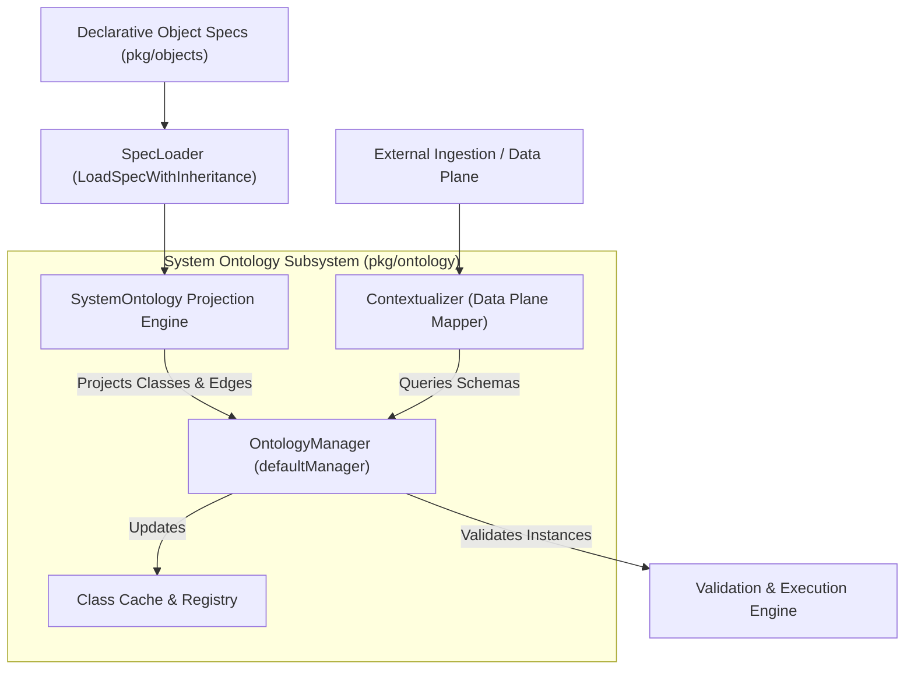
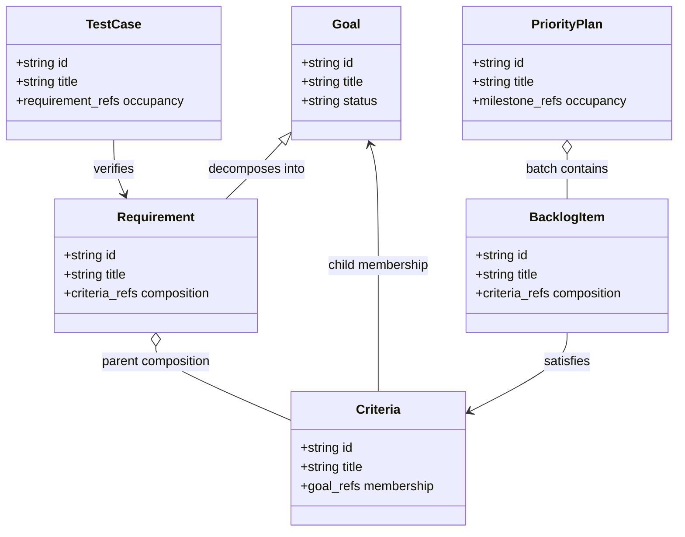
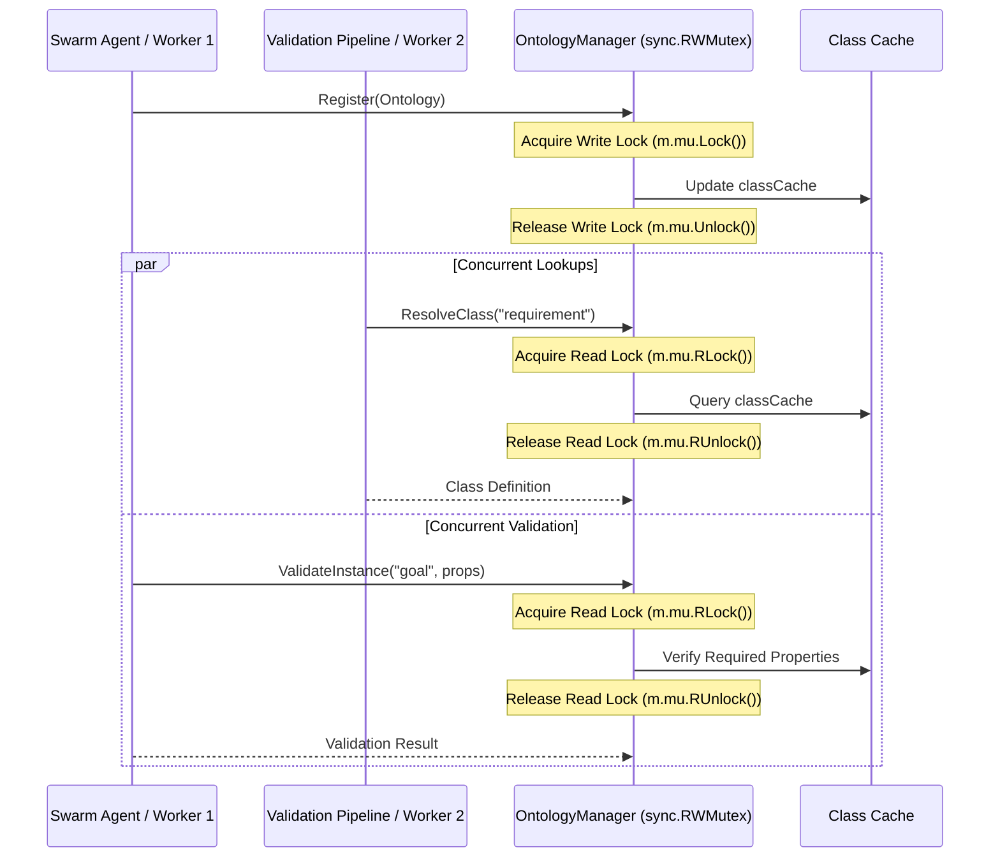

# System Ontology & Object Classification Subsystem Operational & Architectural Guide

## Overview

The **System Ontology & Object Classification Subsystem** (`pkg/ontology`) defines the formal semantic schema, kind projection engine, and instance validation runtime powering the **ZQK Knowledge Kernel**.

While `pkg/objects` serves as the declarative specification origin plane (defining raw YAML schemas, traits, and field-level validation rules), `pkg/ontology` projects these definitions into an executable, queryable semantic schema. It provides typed graph node classification, relationship occupancy definitions, runtime instance validation, and ambient layer contextualization.

---

## Subsystem Architecture & Topology

The subsystem operates as a layered semantic membrane:

---

## Core Components

### 1. System Ontology Projection Engine (`system_ontology.go`)
- **Single-Source Projection**: Rather than maintaining a redundant, drifting duplicate schema, `SystemOntologyFromLoader` walks live object specifications via `objects.SpecLoader`.
- **Primary Planning Kinds**: Projects the 14 core planning and governance entities:
  - `goal`, `milestone`, `workstream`, `priority_plan`, `backlog_item`
  - `requirement`, `criteria`, `test_case`
  - `roadmap`, `mission`, `vision`, `decision`, `component`, `account`
- **Identity Fields**: Invariant identity properties (`id`, `kind`, `title`, `status`) are extracted and bound to every projected class.
- **Typed Graph Edge Extraction**:
  - Distinguishes typed graph edges (`*_ref`, `*_refs`) from arbitrary scalar attributes.
  - Excludes untyped associative edges (`related_object_refs`, `commit_refs`, `document_refs`, `lifecycle_ref`, `lifecycle_refs`, `object_ref`) to preserve strict directional ownership.

### 2. Ontology Manager (`manager.go`)
- **OntologyManager Interface**:
  - `Register(o Ontology) error`: Stores versioned ontology definitions and populates fast lookup caches.
  - `ResolveClass(name string) (Class, error)`: Retrieves class definitions by name; returns `ErrClassNotFound` on misses.
  - `ValidateInstance(className string, properties map[string]any) error`: Validates runtime property maps against class requirements; returns `ErrInvalidInstance` when required properties are absent.
- **Thread Safety**: Protected by `sync.RWMutex`, allowing concurrent reader access across high-throughput validation pipelines without lock contention.

### 3. Contextualizer (`contextualizer.go`)
- **Data Ingestion Mapping**: Contextualizes arbitrary external maps into canonical ZQK ontology layers.
- **Mandatory Identity Verification**: Ensures incoming records declare both `kind` and `id`, rejecting malformed payloads with descriptive error diagnostics.
- **Layer Binding**: Binds records to active execution layers (`objects.FieldKeyLayer`).

---

## 5-Layer Kind Taxonomy & Edge Relationships

The subsystem models relationships according to explicit directional occupancy:

### Edge Ownership Rules
1. **Parent-Owned Composition**: Containers own their sub-components (e.g. `requirement.criteria_refs`, `milestone.criteria_refs`).
2. **Child-Owned Membership**: Child nodes record upward membership (e.g. `criteria.goal_refs`, `test_case.requirement_refs`).
3. **No Redundant Inverses**: Inverse lists are omitted from specs to eliminate write-amplification and circular synchronization hazards.

---

## Concurrency & Thread-Safety Model

The `OntologyManager` coordinates concurrent read and write operations across multi-agent swarms:

All background tasks and concurrent validation workers MUST utilize named goroutines via `goroutinelabels.NewGoroutine(...)` to ensure observability and panic containment.

---

## Verification & Statement Coverage Invariant

The subsystem is validated by a rigorous test suite upholding the static floor coverage invariant:

| Test Area | Primary Test Suite | Scenarios Covered |
|---|---|---|
| Core Ontology & Types | `ontology_coverage_elevation_cycle169_test.go` | Constants, classification tags, error sentinels, schema version headers |
| Spec Projection | `ontology_coverage_elevation_cycle169_test.go` | SpecLoader walks, empty loader fallback, missing resolved fields, raw map conversion |
| Edge Filtering | `ontology_coverage_elevation_cycle169_test.go` | Typed graph refs (`*_ref`, `*_refs`), untyped ref exclusions, property type derivation |
| Schema Resolution | `manager_test.go`, `ontology_coverage_elevation_cycle169_test.go` | Class registration, class cache hits, miss handling (`ErrClassNotFound`) |
| Instance Validation | `manager_test.go`, `ontology_coverage_elevation_cycle169_test.go` | Required properties, optional properties, validation failures (`ErrInvalidInstance`) |
| Thread Safety | `ontology_coverage_elevation_cycle169_test.go` | Concurrent multi-goroutine registration, class resolution, and instance validation |
| Data Contextualization | `contextualizer_test.go`, `ontology_coverage_elevation_cycle169_test.go` | Identity attribute extraction, missing field errors, active layer stamping |

> [!IMPORTANT]
> The subsystem enforces a strict statement coverage floor of **$\ge 85.0\%$**. Current verified test coverage stands at **$100.0\%$**.
