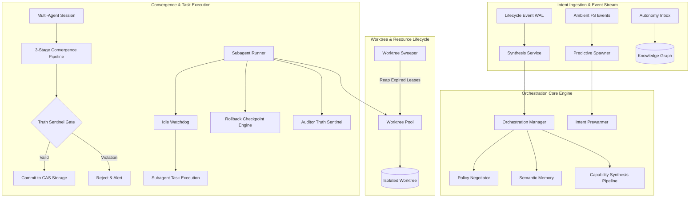
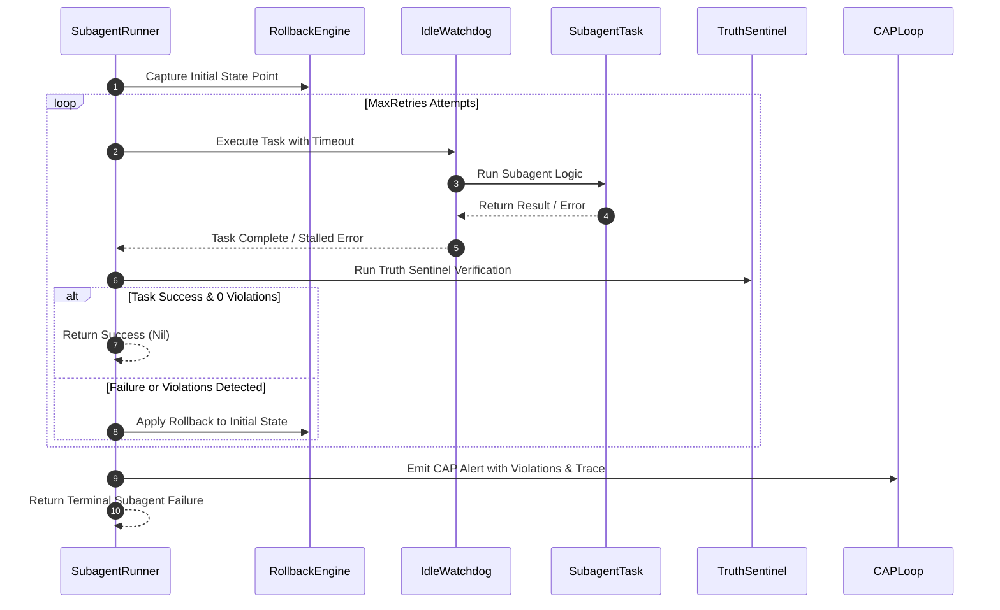

# Core Orchestration Subsystem Architectural & Operational Guide

## Overview

The ZQK Core Orchestration Subsystem (`pkg/orchestration`) delivers deterministic multi-agent lifecycle coordination, intent-driven capability synthesis, dynamic worktree isolation, idle deadlock prevention, and continuous automated verification within the ZQK Knowledge Kernel platform.

Orchestration serves as the operational nervous system connecting high-level strategic objectives with autonomous agent swarms. Rather than relying on transient chat contexts, the orchestration subsystem leverages persistent graph topology, monotonic write-ahead logging (WAL), and strict Content-Addressed Storage (CAS) membranes to govern concurrent agent executions, enforce policy compliance, and guarantee safe transactional state rollbacks.

The subsystem encapsulates eight foundational capabilities:
1. **Orchestration Manager & Capability Synthesis (`manager.go`)**: Synthesizes formal capabilities from high-level agent intents, validating proposals against active policies and committing outcomes to the knowledge graph.
2. **Multi-Agent Convergence Sessions (`session.go`)**: Orchestrates structured multi-agent collaboration across `INGEST`, `DECIDE`, and `COMMIT` pipeline stages, enforcing code movement gates and verification requirements.
3. **Subagent Execution & Rollback Governance (`subagent_runner.go`)**: Manages subagent task lifecycles with automated retries, state checkpoint capture, and fail-closed rollbacks via the Corrective Action Protocol (CAP).
4. **Subagent Idle Watchdog (`idle_watchdog.go`)**: Enforces temporal bounds on execution to prevent hung processes, unacknowledged waits, and deadlocks in autonomous loops.
5. **Dynamic Git Worktree Isolation (`worktree_pool.go`, `worktree_sweeper.go`)**: Provisions and reclaims isolated, ephemeral filesystem worktrees with time-bounded leases and automated background garbage collection.
6. **Autonomy Inbox & Message Routing (`inbox.go`)**: Directs asynchronous messages and backlog items to destination nodes over native graph storage without external distributed cache dependencies.
7. **Intent Prediction & Proactive Prewarming (`intent_predictor.go`, `predictive_spawner.go`, `prewarmer.go`)**: Analyzes ambient filesystem events and recent command trajectories using graph heuristics to anticipate and prewarm upcoming operational stages.
8. **Policy Negotiation & Drift Reconciliation (`policy_negotiator.go`)**: Reconciles semantic version drift and schema variations between proposing agents and active system constraints.

---

## Subsystem Architecture & Component Layout

```
pkg/orchestration/
├── manager.go                           # OrchestrationManager, capability synthesis pipeline, and storage commitment
├── session.go                           # Multi-agent convergence sessions and pipeline stage gates
├── subagent_runner.go                   # Subagent task execution, retry loops, rollback checkpoints, and CAP alerts
├── idle_watchdog.go                     # Idle timeout detection, tick probes, and bounded goroutine execution
├── worktree_pool.go                     # Concurrent worktree pool, atomic handle allocation, and capacity limits
├── worktree_sweeper.go                  # Expired worktree lease sweeper and background cleanup lifecycle
├── inbox.go                             # AutonomyInbox routing messages and tasks across graph nodes and edges
├── intent_predictor.go                  # Graph Cypher heuristic engine predicting subsequent operational steps
├── predictive_spawner.go                # Ambient filesystem event consumer triggering predictive agent pre-spawns
├── prewarmer.go                         # Staging and pre-allocating graph resources for anticipated intents
├── policy_negotiator.go                 # Policy proposal evaluation, version mismatch detection, and reconciliation
├── registry.go                          # Thread-safe global orchestrator registry and dynamic manager injection
├── errors.go                            # Domain error declarations and standardized failure codes
├── constants_internal.go                # Internal operation names, event keys, and format strings
├── intent/                              # Domain intent parsing, schema definitions, and validation
├── monitor/                             # Execution telemetry sinks, health probes, and state observers
├── reporting/                           # Orchestration outcome summaries, latency metrics, and audit feeds
├── service/                             # Background synthesis daemon listening to lifecycle event WAL
└── ticker/                              # Activity ticker generating heartbeat pulses and heartbeat status
```

---

## Subsystem Architecture Topology



---

## Core Component Contracts

### 1. Orchestration Manager & Capability Synthesis (`manager.go`)

`OrchestrationManager` transforms raw declarative intents into verified, operational capabilities:

```go
type OrchestrationManager interface {
    ProcessIntent(ctx context.Context, intent RawIntent) (CapabilityRef, error)
}
```

When an intent is processed:
1. **Policy Negotiation**: Evaluates proposal compatibility through `PolicyNegotiator`. If rejected, returns `ErrMsgPolicyRejectedIntent`.
2. **Semantic Memory Hydration**: Queries `hivemind.MemoryStore` for contextual historical precedents.
3. **Pipeline Synthesis**: Executes `capability.SynthesisPipeline`, validating test case references and structural invariants.
4. **CAS Commitment**: Writes synthesized capabilities directly into CAS storage under `objects.ObjectStatusProposed`.

### 2. Multi-Agent Convergence Session (`session.go`)

Multi-agent convergence sessions synchronize independent agents resolving complex architectural tasks:

```go
type Session struct {
    logger  logging.Logger
    agents  []AgentID
    status  string
    pipe    *pipeline.Pipeline
    storage storage.ObjectStorageProvider
}
```

The session advances through three immutable stages:
- **`INGEST`**: Ingests discussion topics, participating agent identities, and initial problem statements.
- **`DECIDE`**: Conducts multi-agent policy deliberation, compromise weighting, and consensus forming.
- **`COMMIT`**: Validates the proposed decision against system policies (such as `POL-GATE-001`). If a local merge to `main` is attempted without a verified pull request link, the stage fails closed.

### 3. Subagent Execution & Rollback Governance (`subagent_runner.go`)

`SubagentRunner` wraps subagent task execution with deterministic safety boundaries:



Key resilience invariants:
- **State Isolation**: Initial state snapshot captured prior to invocation via `rollback.Capture`.
- **Iterative Rollback**: On any intermediate task error or sentinel violation, state is reverted before retrying.
- **Terminal Alerting**: If `MaxRetries` is exhausted, an unrecoverable `CAPAlert` is dispatched to the CAP loop.

### 4. Idle Watchdog & Anti-Idleness Protocol (`idle_watchdog.go`)

The `IdleWatchdog` enforces the platform's Anti-Idleness Protocol (`POL-AGENT-CONTINUOUS-LOOP-001`):

```go
type IdleWatchdog struct {
    IdleTimeout time.Duration
    ProbeTick   time.Duration
}
```

- Spawns tasks inside labeled goroutines (`idle_watchdog.worker`).
- Monitors execution against `IdleTimeout` (defaulting to 5 minutes if unset, clamped to `ProbeTick`).
- Automatically cancels execution context and emits `subagent execution stalled (idle watchdog triggered)` when tasks hang.

### 5. Worktree Pool & Lease Lifecycle (`worktree_pool.go`, `worktree_sweeper.go`)

To prevent multi-agent filesystem collisions, git operations execute within isolated worktrees:

```go
type WorktreePool struct {
    baseDir     string
    capacity    int
    allocations map[string]*WorktreeHandle
}
```

- **Atomic Allocation**: Atomically increments counters and provisions paths (`wt-<timestamp>-<seq>`) with `0750` permissions.
- **Bounded Capacity**: Fail-closed rejection when active allocations reach pool capacity.
- **Background Sweeper**: `WorktreeSweeper` periodically evaluates `LeaseExpiry` across all active allocations, cleanly unlinking expired worktree directories.

---

## Operational Runbooks

### Runbook 1: Diagnosing Subagent Stalls & Watchdog Triggers

**Symptom**: Agent task terminates with `subagent execution stalled (idle watchdog triggered)`.

1. **Inspect Subagent Logs**:
   ```bash
   ./bin/zqk agent logs --agent-id <agent-id> --tail 100
   ```
2. **Review Rollback Point**:
   Verify whether the rollback checkpoint was successfully applied:
   ```bash
   ./bin/zqk system check --format table
   ```
3. **Evaluate Watchdog Tuning**:
   If the subagent task legitimately requires heavy AST re-indexing or long compilation passes, tune the timeout during initialization:
   ```go
   cfg := SentinelConfig{
       IdleWatchdogEnabled: true,
       IdleWatchdogTimeout: 10 * time.Minute,
       IdleWatchdogTick:    1 * time.Second,
   }
   ```

### Runbook 2: Managing Worktree Pool Capacity & Leaks

**Symptom**: New agent tasks fail with `worktree pool capacity exceeded`.

1. **Query Active Allocations**:
   ```bash
   ./bin/zqk system storage-volume --subsystem worktrees
   ```
2. **Trigger Immediate Worktree Sweep**:
   ```bash
   ./bin/zqk system clean-branches --dry-run=false
   ```
3. **Verify Pool Capacity Invariant**:
   Ensure background sweeper is running with interval $\le 5$ minutes to reclaim abandoned handles.

---

## Verification & Conformance

The subsystem is validated continuously against the Three-Fold Proof:

1. **Static Floor Invariant (`CRIT-ORC-001`)**:
   `pkg/orchestration` statement test coverage must strictly satisfy $\ge 85.0\%$ (achieving $98.5\%$).
2. **Operational Dynamic Proof (`CRIT-ORC-002`)**:
   Deterministic verification of coordinator lifecycles, worktree provisioning, subagent error recovery, and policy negotiation in `orchestration_coverage_elevation_cycle145_test.go`.
3. **Negative Adversarial Boundary (`CRIT-ORC-003`)**:
   Enforces fail-closed context cancellation, capacity exhaustion boundaries, unauthorized code movement rejections, and zero prohibited studio identifiers in documentation.
