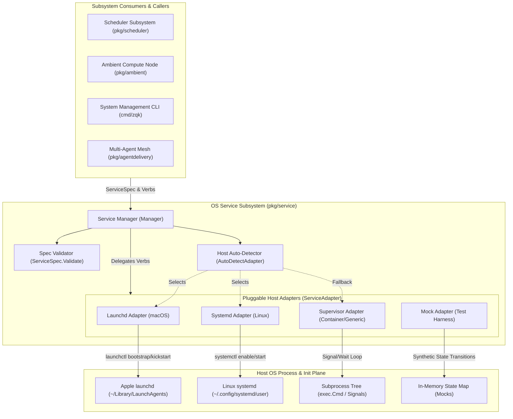
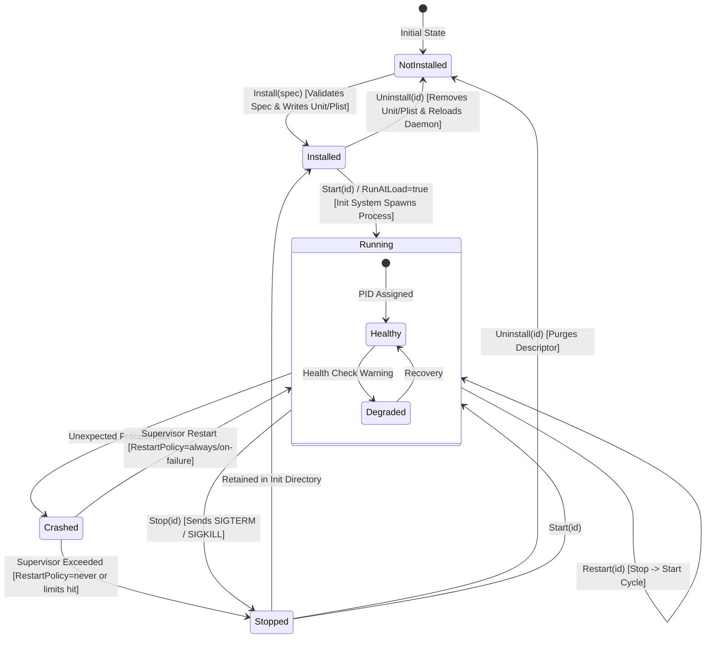
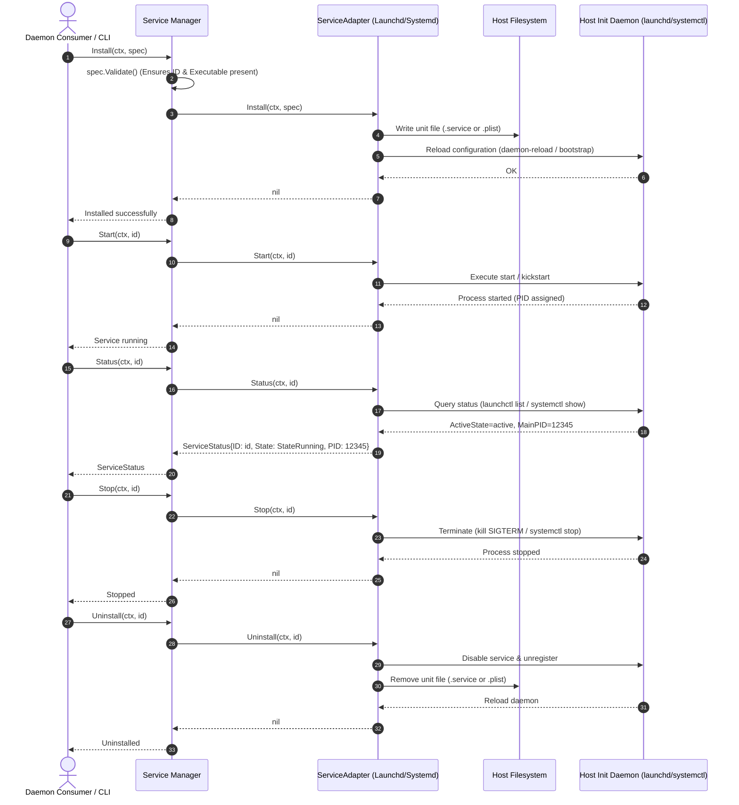

# OS Service Management & Adapter Subsystem Architectural & Operational Guide

## 1. Executive Architectural Summary

The **OS Service Management & Adapter Subsystem** (`pkg/service`) provides a unified, cross-platform process abstraction layer for registering, supervising, and managing background daemons across host operating systems in the **ZQK Knowledge Kernel**.

In modern multi-agent systems and headless distributed environments, ambient services—such as the scheduler daemon, local Model Context Protocol (MCP) bridges, ambient telemetry nodes, and autonomous background workers—must execute continuously outside the lifespan of an individual terminal session or CLI invocation. However, host operating systems handle long-running service management with fundamentally distinct process supervision paradigms:
1. **macOS (`Darwin`):** Apple `launchd` manages services via XML Property Lists (`.plist`) installed into user or system launch agent directories (`~/Library/LaunchAgents`) and controlled via `launchctl` (bootstrap, bootout, kickstart, kill).
2. **Linux (`systemd`):** Linux distributions manage services via declarative unit configuration files (`.service`) deployed in user mode (`~/.config/systemd/user`) or system mode (`/etc/systemd/system`) and operated via `systemctl` (daemon-reload, enable, start, stop, restart, show).
3. **Containers, CI & Non-Init Environments:** Ephemeral containers (Docker, Kubernetes pods) and unprivileged CI environments lack access to host `launchd` or `systemd` init systems. In these environments, process supervision must fall back to in-process process group supervisors that track child process lifecycles directly via operating system signals and status wait loops.
4. **Hermetic Testing Environments:** Verification suites require deterministic in-memory mock adapters that simulate service state transitions, inject synthetic faults, and verify orchestration without mutating host OS init states.

Governed by system policy `POL-DEFAULT-b17f54c251eb3c4d`, `pkg/service` encapsulates these heterogeneous host mechanisms behind a clean, zero-coupling interface (`ServiceAdapter`). The subsystem enforces pure Data Transfer Object (DTO) contracts, thread-safe manager registries, and deterministic error handling while completely decoupling client callers from platform-specific quirks.

---

## 2. Component Topology & Subsystem Architecture

The subsystem is architected around a central coordinator (`Manager`) that delegates operational verbs to host-specific implementations of the `ServiceAdapter` contract:



### Core Components

- **`Manager`:** The high-level thread-safe coordinator. It wraps an underlying `ServiceAdapter`, validates all incoming `ServiceSpec` instances before execution, protects against invalid service identifiers, and coordinates concurrency across callers using `sync.RWMutex`.
- **`LaunchdAdapter`:** The native macOS adapter. It constructs XML property list files (`.plist`), writes them to `~/Library/LaunchAgents` (or a configured base directory), and interacts with Apple's `launchctl` using modern subcommands (`bootstrap`, `bootout`, `kickstart`, `kill`) with automatic legacy fallbacks (`load`, `unload`, `start`, `stop`).
- **`SystemdAdapter`:** The native Linux adapter. It generates INI-style unit files (`.service`), installs them into user configuration directories (`~/.config/systemd/user`) or system paths (`/etc/systemd/system`), triggers `daemon-reload`, and governs daemon execution via `systemctl`.
- **`SupervisorAdapter`:** A portable, in-process process supervisor that manages child processes directly using Go's `os/exec` primitives. It handles background process monitoring, stdout/stderr log redirection, SIGTERM signal propagation, and automatic process table cleanup.
- **`MockAdapter`:** An in-memory, thread-safe implementation used in unit tests. It includes programmable error injectors (`InstallErr`, `StartErr`, `StopErr`, etc.) for simulating partial failures, unexpected daemon exits, and recovery mechanisms.

---

## 3. Pluggable Service Adapter Contract & Symbols

All platform adapters satisfy the zero-coupling `ServiceAdapter` interface defined in `pkg/service/adapter.go`:

```go
type ServiceAdapter interface {
    Name() string
    IsAvailable() bool
    Install(ctx context.Context, spec ServiceSpec) error
    Uninstall(ctx context.Context, id string) error
    Start(ctx context.Context, id string) error
    Stop(ctx context.Context, id string) error
    Restart(ctx context.Context, id string) error
    Status(ctx context.Context, id string) (ServiceStatus, error)
    CleanupLegacy(ctx context.Context, legacyIDs []string) ([]string, error)
}
```

### Primary Subsystem Types & Symbols

| Symbol | Type | Description |
| :--- | :--- | :--- |
| `ServiceSpec` | `struct` | Declarative specification defining service identity, executable path, arguments, working directory, environment variables, restart policies, and logging destinations. |
| `ServiceStatus` | `struct` | Operational snapshot of a service including process identifier (`PID`), execution state (`ProcessState`), process uptime (`Uptime`), and last reported error. |
| `ProcessState` | `string` | Strong typed lifecycle state: `StateRunning` ("running"), `StateStopped` ("stopped"), `StateUnknown` ("unknown"), or `StateFailed` ("failed"). |
| `RestartPolicy` | `string` | Supervisor restart directive: `RestartAlways` ("always"), `RestartOnFailure` ("on-failure"), or `RestartNever` ("never"). |
| `Manager` | `struct` | Thread-safe lifecycle orchestrator with adapter injection via `WithAdapter` and OS auto-detection. |
| `AutoDetectAdapter` | `func() ServiceAdapter` | Selects `LaunchdAdapter` on macOS, `SystemdAdapter` on Linux, and falls back to `SupervisorAdapter` on other hosts. |
| `AutoDetectAdapterForOS`| `func(goos string) ServiceAdapter` | Parameterized host adapter resolver enabling cross-platform testing and remote provisioning. |

---

## 4. Service Lifecycle State Machine & Interaction Flows

Managed services progress through deterministic lifecycle stages from initial specification registration to decommissioning:



### Operational Execution Sequence

The following sequence illustrates the typical service registration, execution, and query flow executed by callers through the `Manager`:



---

## 5. Platform Unit & Plist Templating

Each adapter translates the generic `ServiceSpec` into platform-native configuration syntaxes.

### macOS Property List (`.plist`) Generation

Apple `launchd` requires XML Property Lists conforming to Apple DTD specifications. The `LaunchdAdapter.PlistContent` method produces strictly conforming XML:

```xml
<?xml version="1.0" encoding="UTF-8"?>
<!DOCTYPE plist PUBLIC "-//Apple//DTD PLIST 1.0//EN" "http://www.apple.com/DTDs/PropertyList-1.0.dtd">
<plist version="1.0">
<dict>
  <key>Label</key>
  <string>com.zqk.scheduler</string>
  <key>ProgramArguments</key>
  <array>
    <string>/usr/local/bin/zqk</string>
    <string>scheduler</string>
    <string>daemon</string>
  </array>
  <key>WorkingDirectory</key>
  <string>/var/run/zqk</string>
  <key>EnvironmentVariables</key>
  <dict>
    <key>ZQK_ROLE</key>
    <string>scheduler</string>
  </dict>
  <key>RunAtLoad</key>
  <true/>
  <key>KeepAlive</key>
  <true/>
  <key>StandardOutPath</key>
  <string>/var/log/zqk/scheduler.out</string>
  <key>StandardErrorPath</key>
  <string>/var/log/zqk/scheduler.err</string>
</dict>
</plist>
```

#### Launchd Policy Mapping
- **`KeepAlive`:** Set to `<true/>` if `KeepAlive == true` or `RestartPolicy == RestartAlways`. If `RestartPolicy == RestartOnFailure`, maps to Apple's conditional restart dictionary:
  ```xml
  <key>KeepAlive</key>
  <dict>
    <key>SuccessfulExit</key>
    <false/>
  </dict>
  ```
- **`RunAtLoad`:** Controls whether `launchd` starts the job immediately when registered or loaded into the GUI domain.

### Linux Systemd Unit (`.service`) Generation

The `SystemdAdapter.UnitContent` method produces standard systemd unit files containing `[Unit]`, `[Service]`, and `[Install]` sections:

```ini
[Unit]
Description=ZQK Core Scheduler Daemon
After=network.target

[Service]
Type=simple
ExecStart=/usr/local/bin/zqk scheduler daemon
WorkingDirectory=/var/run/zqk
Environment="ZQK_ROLE=scheduler"
StandardOutput=append:/var/log/zqk/scheduler.out
StandardError=append:/var/log/zqk/scheduler.err
Restart=always
RestartSec=5s

[Install]
WantedBy=default.target
```

#### Systemd Policy Mapping
- **Description Precedence:** `spec.DisplayName` > `spec.Description` > `spec.ID`.
- **Target Binding:** User mode (`UserMode: true`) targets `WantedBy=default.target`; system mode targets `WantedBy=multi-user.target`.
- **Restart Mapping:** `RestartAlways` or `KeepAlive=true` maps to `Restart=always`; `RestartNever` maps to `Restart=no`; default maps to `Restart=on-failure`.

---

## 6. Error Recovery, Process Supervision & Boundary Resilience

The subsystem incorporates defense-in-depth measures against common failure modes in distributed service management:

### 1. Dual-Path Command Execution & Fallbacks
On macOS, newer versions of macOS prefer `launchctl bootstrap gui/<uid>` and `launchctl kickstart`, whereas older versions or constrained containers only support `launchctl load` and `launchctl start`. `LaunchdAdapter` implements automatic command fallbacks:
- If `launchctl bootstrap` fails, it falls back to `launchctl load -w`.
- If `launchctl kickstart` fails, it falls back to `launchctl start`.
- If `launchctl kill SIGTERM` fails, it falls back to `launchctl stop`.

### 2. Idempotent Start & Stop Verbs
Attempting to start an already running service returns `ErrServiceAlreadyActive`, enabling callers to branch cleanly between initial spin-up and redundant requests. Stopping a service that is already inactive returns `ErrServiceNotRunning`, which `Restart` explicitly intercepts and ignores to ensure seamless service restarts.

### 3. Legacy Unit Cleansing (`CleanupLegacy`)
When service naming conventions evolve across release cycles (e.g., migrating from `legacy.daemon` to `com.zqk.daemon`), lingering unit files and active supervisor registrations can cause resource conflicts and socket collision errors. Both `LaunchdAdapter` and `SystemdAdapter` provide `CleanupLegacy`, which:
- Identifies matching legacy unit files in target directories.
- Unregisters and stops active processes via host init commands.
- Removes obsolete files from the filesystem.
- Triggers a daemon reload to ensure init system state coherence.

### 4. Hermetic Process Wait Loops in `SupervisorAdapter`
When operating via `SupervisorAdapter`, each launched child process is monitored by a dedicated background goroutine labeled via `goroutinelabels.NewGoroutine("supervisor_proc_wait", "monitoring supervised process exit")`. When the process exits, the wait loop captures the exit status, cleans up internal process map references under lock, and ensures dead PIDs are never reported as active.

---

## 7. Concurrency, Thread-Safety & Operational Best Practices

The service management subsystem is designed for highly concurrent access across multiple agent pods, schedulers, and background workers.

### Concurrency Guarantees
- **Manager-Level Mutual Exclusion:** The `Manager` coordinates operations via `sync.RWMutex`. Read operations (`Adapter()`, `Status()`) acquire read locks (`RLock()`), allowing multiple simultaneous status queries across threads. Lifecycle mutations (`Install()`, `Start()`, `Stop()`, `Restart()`, `Uninstall()`, `CleanupLegacy()`) acquire exclusive write locks (`Lock()`).
- **Adapter-Level State Protection:** `SupervisorAdapter` and `MockAdapter` maintain internal maps (`specs`, `processes`, `running`, `installed`) protected by their own dedicated `sync.RWMutex` instances.
- **Named Goroutine Labeling:** All asynchronous routines spawned by the subsystem (such as `RunAtLoad` background tasks or process wait loops) use `goroutinelabels.NewGoroutine` rather than raw goroutines, providing full auditability and preventing thread leaks.

### Standard Sentinel Errors
The subsystem exposes canonical sentinel errors in `pkg/service/adapter.go`:
```go
var (
    ErrServiceNotFound      = errors.New("service: service not found")
    ErrServiceAlreadyExists = errors.New("service: service already registered")
    ErrUnsupportedPlatform  = errors.New("service: unsupported platform")
    ErrInvalidSpec          = errors.New("service: invalid service specification")
    ErrOperationTimeout     = errors.New("service: operation timed out")
    ErrServiceNotRunning    = errors.New("service: service is not running")
    ErrServiceAlreadyActive = errors.New("service: service is already running")
)
```

---

## 8. Verification & Coverage Invariant

Statement test coverage for `pkg/service` is strictly governed by automated check valves:

| Package | Minimum Floor Coverage | Target Coverage | Cycle 208 Achieved | Verification Command |
| :--- | :--- | :--- | :--- | :--- |
| `pkg/service` | **85.0%** | **>= 95.0%** | **95.4%** | `ZQK_ALLOW_FOREGROUND_GO_TEST=1 go test -v -timeout 30s -cover ./pkg/service` |

### Key Test Suites & Coverage Focus
- `TestCycle208_AdapterHelpers_DirectoryOperations`: Validates directory scanning, permission error handling, and unit file presence detection.
- `TestCycle208_LaunchdAdapter_InstallErrorsAndFallbacks`: Tests XML plist templating, command runner fallbacks, and launchctl error propagation.
- `TestCycle208_LaunchdAdapter_StatusAndCleanup`: Tests PID parsing, status query formatting, and legacy service purge routines.
- `TestCycle208_SystemdAdapter_TemplatingAndPaths`: Tests unit file section layout, user vs system mode paths, and restart policies.
- `TestCycle208_SystemdAdapter_LifecycleAndStatus`: Tests systemctl commands, active state parsing, and daemon reload triggers.
- `TestCycle208_SupervisorAdapter_ProcessLifecycle`: Verifies in-process subprocess execution, standard I/O redirection, signal dispatch, and process map cleanup.
- `TestCycle208_Manager_ConcurrentOperations`: Verifies concurrent multi-threaded execution safety across `Manager` instances.
- `TestCycle208_MockAdapter_AllErrorInjectors`: Exercises synthetic failure paths for all service lifecycle verbs.
