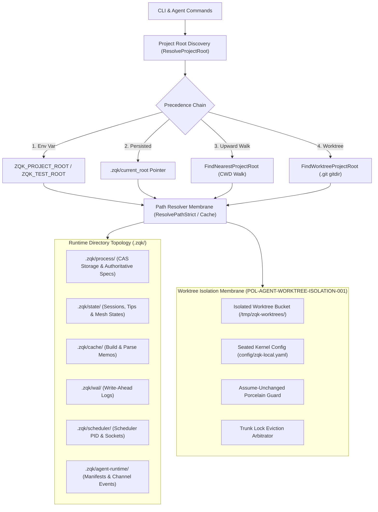
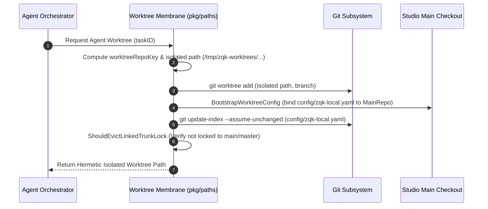

# Paths & Directory Topology Subsystem Operational & Architectural Guide

## Overview

The ZQK Paths & Directory Topology Subsystem (`pkg/paths`) provides the foundational filesystem membrane, path resolution pipeline, directory topology orchestration, and hermetic worktree isolation for the **Zen Quantum Knowledge Kernel**.

Rather than distributing ad-hoc relative path concatenations across dozens of packages, ZQK centralizes all filesystem topology, boundary validations, runtime layout specifications, and workspace-to-worktree mappings within `pkg/paths`. This guarantees that:
- Human operators and autonomous AI agents operate with deterministic, absolute filesystem context.
- Ephemeral agent execution occurs in isolated, non-polluting git worktrees without corrupting porcelain status or locking trunk branches.
- Project roots are strictly non-nested, preventing accidental cross-contamination between parent and child repositories.
- Canonical CLI invocations, brand names, and object namespace identifiers remain modular, white-labelable, and portable.

---

## Subsystem Architecture & Membrane

---

## Project Root Discovery Algorithm

Deterministic root discovery is prerequisite to all knowledge kernel operations. `ResolveProjectRoot(startPath)` enforces a strict 4-tier precedence:

1. **Explicit Production Override (`ZQK_PROJECT_ROOT`)**: When set, bypasses upward traversal. If pointed to an agent worktree, resolves back to the seated main repository.
2. **Explicit Test Override (`ZQK_TEST_ROOT`)**: Dedicated test isolation root for hermetic test suites.
3. **Persisted Workspace Pointer (`.zqk/current_root`)**: In multi-module environments, points to the active designated project root within the workspace.
4. **Upward Traversal (`FindNearestProjectRoot`)**: Walks up from `startPath` toward the filesystem root, locating the topmost non-ignored directory holding a valid `.zqk` directory.
5. **Git Worktree Fallback (`FindWorktreeProjectRoot`)**: Resolves `.git` worktree pointer files (`gitdir:`) to uncover the parent repository when invoked from an ephemeral worktree.

### Project Root Nesting Invariants

To eliminate ambiguous workspace contexts, project roots must never be nested:
- **Ancestor Violations**: A candidate project root cannot be created inside an existing project root.
- **Descendant Violations**: A project root cannot enclose any child directory that contains its own `.zqk` directory.
- **Validation Engine**: `ValidateProjectRootNesting(candidateRoot)` verifies both directions.
- **Purge Mechanics**: `PurgeNestedProjectRoots(projectRoot)` strips rogue subproject `.zqk` directories while preserving the top-level repository marker.

---

## Runtime Directory Topology

All process state, knowledge graph objects, telemetry, and runtime coordinates reside under `.zqk/`:

| Directory / File Path | Constant | Operational Purpose |
|---|---|---|
| `.zqk/process/` | `ProcessDir` | Authoritative CAS store for process YAML objects, schemas, and lifecycles. |
| `.zqk/process/internal/object_specs/` | `ProcessInternalObjectSpecsDir` | Compiled domain object specifications (`dna/`, `kernel/`, `pm/`, etc.). |
| `.zqk/process/personas/` | `ProcessPersonasDir` | Persona definition files and listing indices. |
| `.zqk/state/` | `StateDir` | Ephemeral session state, observer tips, and mesh state. |
| `.zqk/state/mesh/peer_seats.json` | `PathAliasMeshPeerSeats` | Active agent mesh peer seat allocations. |
| `.zqk/state/mesh/peer_ack_awaits.json` | `PathAliasMeshPeerAckAwait` | Cross-agent synchronization and acknowledgment queues. |
| `.zqk/cache/` | `CacheDir` | Path alias caches, AST parser hashes, and trigram index files. |
| `.zqk/wal/` | `WALDir` | Append-only write-ahead logs for transactional object mutations. |
| `.zqk/scheduler/scheduler.pid` | `SchedulerPIDFile` | Process ID file tracking the active scheduler daemon instance. |
| `.zqk/agent-runtime/` | `AgentRuntimeDir` | Agent runtime channel configs, feature flags, and hook profiles. |
| `.zqk/object_drafts/` | `ObjectDraftsDir` | Pre-promotion draft workspace isolating unverified mutations. |

---

## Ephemeral Worktree Isolation

Multi-agent swarms operating in parallel require isolated checkouts to prevent git index contention and file corruption.

### Key Worktree Invariants

1. **Non-Nested Isolation**: Worktrees are placed in a dedicated temporary bucket outside the main repository tree (`/tmp/zqk-worktrees/<repo-key>/<task-id>`), preventing nested git worktree leaks.
2. **Seated Kernel Binding**: `BootstrapWorktreeConfig` automatically writes `config/zqk-local.yaml` inside the worktree, binding `kernel_state.project_root` and `paths.project_root` to the absolute main repository.
3. **Porcelain Protection**: `AssumeUnchangedWorktreeConfig` marks local configuration as assume-unchanged so `git status --porcelain` remains clean.
4. **Trunk Eviction Arbitrator**: `ShouldEvictLinkedTrunkLock` verifies that non-primary worktrees do not hold locks on `main` or `master`, preventing concurrent seats from experiencing detached HEAD fallbacks.

---

## Path Resolver & Alias Membrane

The path resolver provides uniform string-to-path translation supporting multiple protocol schemes:

- `prefix:<alias>`: Resolves via the in-memory, thread-safe `pathAliasCache` (e.g. `prefix:docs` $\rightarrow$ `/repo/docs`).
- `abs:<path>`: Absolute filesystem path passthrough.
- `web:<url>`: Web and URI passthrough for documentation and remote resources.
- Bare path: Defaults to project-root-relative path concatenation.

### Strict Mode vs. Fallback Mode

- `ResolvePathStrict(projectRoot, pathRef)`: Fails closed with `ErrPathAliasNotInCache` if an alias is unregistered, preventing silent bugs.
- `ResolvePath(projectRoot, pathRef)`: Safe fallback returning `projectRoot/alias` for non-critical paths.

### Spec Layout Candidates

`FindObjectSpecFile(specsDir, kind)` and `FindDomainFile(dir, fileName)` search both flat and domain-bucketed paths across all 19 standardized domains:
`dna`, `kernel`, `pm`, `qa`, `agent`, `platform`, `work`, `org`, `decision`, `display`, `evolution`, `interface`, `library`, `metric`, `pipeline`, `release`, `vocabulary`, `workflow`, and `code-eval`.

---

## Verification & Statement Coverage Invariant

To ensure rock-solid stability across automated continuous loops, CI pipelines, and agent swarms, `pkg/paths` adheres to rigorous verification standards:

> [!IMPORTANT]
> 1. **Statement Coverage Floor Invariant**: `pkg/paths` maintains statement coverage $\ge 85.0\%$ across all platform configurations.
> 2. **Three-Fold Proof Model**:
>    - **Static Floor Invariant**: Package constants, default path aliases, domain lists, and porcelain path signatures are validated at startup.
>    - **Operational Dynamic Proof**: End-to-end execution of root discovery, worktree configuration bootstrapping, cache invalidation, and spec candidate resolution.
>    - **Negative Adversarial Boundary**: Traversal out of project root (`ErrPathEscapesProject`), nested root collisions (`ErrNestedProjectRoot`), invalid worktree gitdir pointers, missing module directives, and corrupt YAML file resolution.
> 3. **Zero Swallowed Errors**: Explicit error checking across all test suites; raw `_ = err` discards are strictly prohibited.
> 4. **Hermetic Test Isolation**: All unit and integration tests leverage `t.TempDir()` with zero shared or leaking state.

### Paths Test Matrix Reference

| Test Suite / Area | Focus & Invariants Covered |
|---|---|
| `paths_coverage_elevation_cycle154_test.go` | Comprehensive coverage elevation suite exercising brand executables, YAML index variants, spec layout resolution, module root parsing, brand settings, persisted root readers, worktree lifecycle, nesting validations, and cache staleness. |
| `agent_worktree_test.go` | Worktree path detection, lookup directory resolution, seated project root bootstrapping, and porcelain filters. |
| `project_root_test.go` | Upward project root traversal, workspace discovery, and environment variable precedence. |
| `project_root_nesting_test.go` | Ancestor and descendant nesting prevention, nested root discovery, and purge operations. |
| `resolver_doc_entry_test.go` | Doc entry URI resolution, prefix caching, and strict resolution guards. |
| `runtime_layout_test.go` | Subsystem runtime paths, MCP server argv generation, stable binary candidates, and credentials paths. |
| `worktree_isolation_test.go` | Hermetic worktree directory construction and isolation from main checkout. |
| `worktree_trunk_test.go` | Trunk branch detection and linked trunk lock eviction logic. |

---

## Architectural Invariants & Safety Guardrails

> [!CAUTION]
> - **Zero Project Root Nesting**: Never initialize a `.zqk` directory within an existing project root tree.
> - **Safe Path Concatenation**: Always use `ProjectPath(projectRoot, elem...)` or `safepath.JoinUnderRoot` to prevent directory traversal escapes (`../`).
> - **Thread-Safe Cache Swaps**: The path alias cache uses atomic snapshot replacement under RWMutex (`concurrency.RunInLock`), guaranteeing zero lock contention during background cache refresh.
