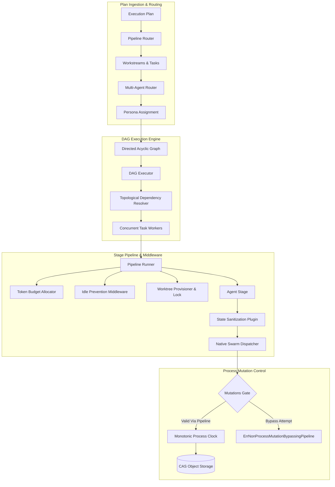
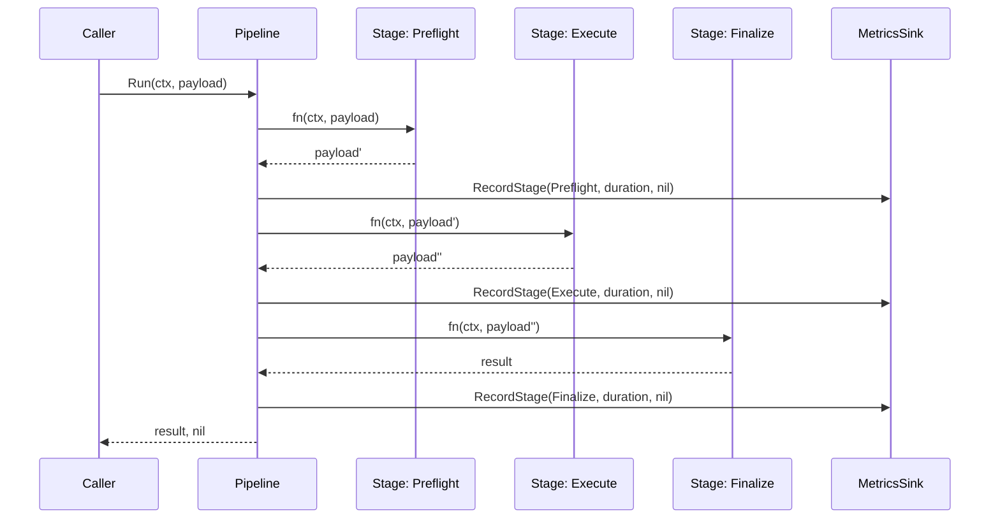
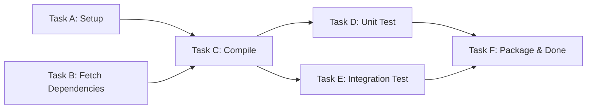
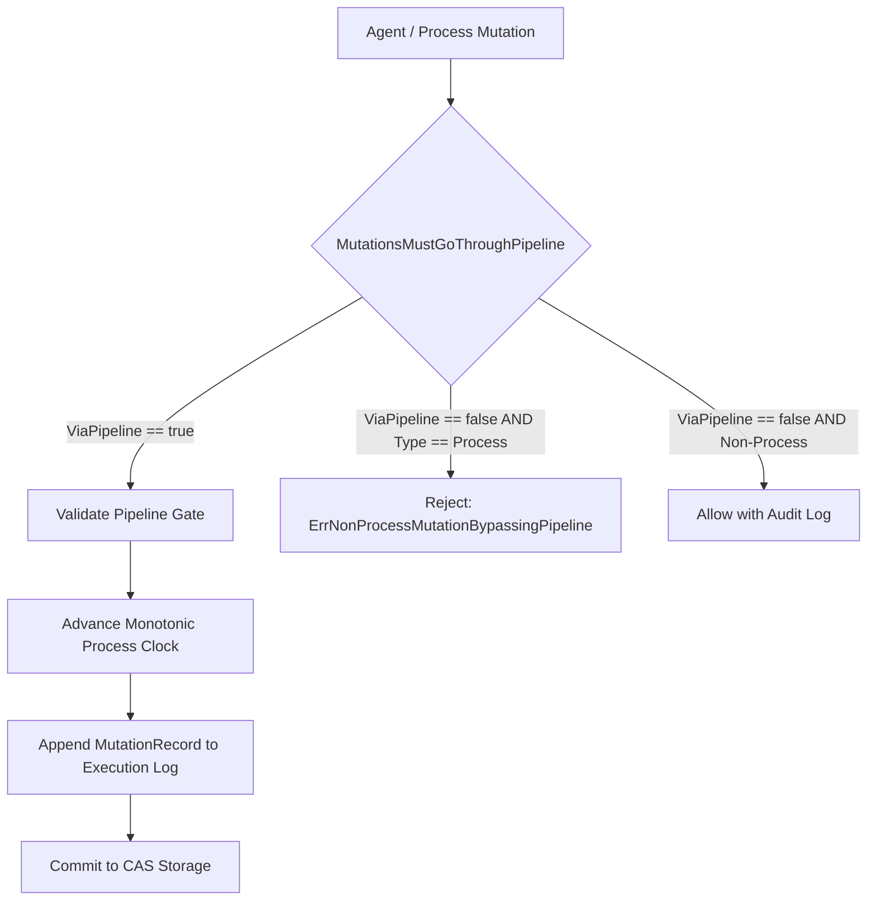
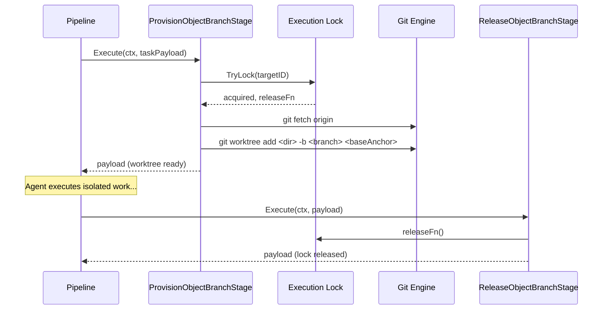

# Pipeline Execution Subsystem Architectural & Operational Guide

## Overview

The ZQK Pipeline Execution Subsystem (`pkg/pipeline`) provides a deterministic, composable, and resilient execution framework for multi-stage workflows, DAG-based task orchestration, autonomous agent dispatching, and process mutation management within the ZQK Knowledge Kernel platform.

Workflows within the platform—ranging from single-command autonomous loops and multi-agent swarm orchestration to Git worktree provisioning and strict CAS object mutations—are orchestrated through pipeline abstractions. The subsystem enforces structural correctness, stage ordering, token budgeting, concurrency limiting, and error resilience without leaking execution state across stages.

The subsystem encapsulates eight foundational capabilities:
1. **Composable Stage Pipelines (`pipeline.go`, `stage_names.go`)**: Fluent stage composition supporting sequential and parallel execution modes, telemetry interception, and stage wrapping.
2. **Directed Acyclic Graph (DAG) Engine (`dag_executor.go`)**: Content-addressed task execution with topological dependency resolution, concurrent worker evaluation, and deterministic artifact hashing.
3. **Pipeline Routing & Task Allocation (`pipeline_router.go`, `router.go`)**: Declarative routing from execution plans into discrete workstreams, assigning tasks to autonomous personas.
4. **Context Hydration & Outcome Registries (`pipeline.go`, `outcome_keys.go`, `outcome_keys_generate.go`)**: Context propagation carrying idempotency keys, partition metadata, and validated outcome maps.
5. **Context Token Budget Allocation (`context_budget.go`)**: Dependency-aware token budgeting for large language models, allocating prompt and reasoning token caps topologically across stage trees.
6. **Graph Ownership & Monotonic Mutation Gates (`graph_ownership.go`, `mutation_pipeline.go`)**: Enforcing that all state modifications traverse verified pipeline gates, versioned by monotonic process clocks.
7. **Native Swarm Dispatching & Idle Prevention (`native_dispatcher.go`, `agent_stage.go`, `idle_prevention.go`)**: Bridging pipeline execution into autonomous agent swarms with state-sanitization barriers and heartbeat-driven idle awakening.
8. **Git Worktree Provisioning & Branch Locks (`provision_object_branch_stage.go`)**: Hermetic branch and worktree lifecycle management with fail-closed execution concurrency locking.

---

## Subsystem Architecture & Component Layout

```
pkg/pipeline/
├── pipeline.go                          # Core Pipeline, Builder, Context, and stage execution loop
├── stage_names.go                       # Canonical stage identifiers and lifecycle labels
├── dag_executor.go                      # Topological DAG task execution engine and worker sessions
├── router.go                            # Multi-agent plan breakdown, persona assignment, and queueing
├── pipeline_router.go                   # Plan-to-workstream parsing and persona tag extraction
├── context_budget.go                    # Tree-aware context token budget allocation
├── context_hydration.go                 # Plugin hydrating context from graph storage
├── graph_ownership.go                   # Hierarchical graph partition ownership registry
├── mutation_pipeline.go                 # Process mutation gates, validation, and monotonic clock
├── native_dispatcher.go                 # Native swarm task dispatching and envelope creation
├── agent_stage.go                       # Agent execution stage with state sanitization checks
├── idle_prevention.go                   # Middleware preventing agent stalling via heartbeat pings
├── provision_object_branch_stage.go     # Git worktree isolation and branch lock coordination
├── metrics_config.go                    # Telemetry sink configuration and bucketing strategies
├── metrics_resolve.go                   # Label normalization and rune truncation preflight
├── outcome_keys.go                      # Generated constants for pipeline outcome maps
├── outcome_keys_generate.go             # Registry loader and Go source generator for outcome keys
├── loader.go                            # Persistence loader hydrating pipelines from storage
├── orchestrator.go                      # State-machine orchestrator driving pipeline execution stages
├── schema.go                            # Object schema mappings for pipeline definitions
└── plugins/                             # Pluggable validators and interceptors
    ├── audit_logging.go                 # Audit event recording for stage transitions
    ├── graph_exclusive_state.go         # Directory and state sanitization enforcement
    ├── performance_metrics.go           # Stage duration and throughput collector
    └── validation.go                    # Object compliance verification
```

---

## Subsystem Architecture Topology



---

## 1. Multi-Stage Pipeline Composition & Stage Lifecycle

The core execution unit is the `Pipeline`, constructed via a fluent `Builder`. Pipelines chain generic stages of type `StageFunc`:

```go
type StageFunc func(*Context, any) (any, error)
```

Each stage takes an execution `*Context` and an arbitrary payload (`any`), transforming it and passing the resulting artifact to the subsequent stage in deterministic order.



### Context & Outcome Registry
The `Context` structure flows through all stages, encapsulating:
- `Ctx context.Context`: Go standard context governing deadlines, timeouts, and cancellation.
- `IdempotencyKey string`: Unique execution identifier preventing duplicate execution.
- `PartitionKey string`: Sharding key for distributed coordination.
- `Outcome map[string]any`: Thread-safe or stage-sequenced map capturing discrete phase results (e.g. `OutcomeKeySummary`, `OutcomeKeyArtifacts`).

---

## 2. Directed Acyclic Graph (DAG) Execution Engine

When tasks exhibit interdependencies rather than linear pipelines, `DAGExecutor` coordinates execution:

### Node & Dependency Topology
Nodes define explicit prerequisite identifiers:
```go
type Node struct {
    ID           string
    Dependencies []string
    Payload      any
}
```

### Execution Lifecycle
1. **NextReady Evaluation**: The engine identifies all nodes whose prerequisite nodes have completed successfully.
2. **Worker Pool Dispatch**: Ready nodes execute concurrently within a `TaskExecutor` pool.
3. **CAS Artifact Hashing**: Upon stage completion, the node's output hash is recorded via `MarkComplete(nodeID, hash)`.
4. **Input Passing**: Downstream nodes retrieve output hashes from completed upstream dependencies via `GetInputs(nodeID)`.
5. **Failure & Retry Reset**: If a node fails, `MarkFailed(nodeID)` releases its in-progress lock so retry sentinels can recover the operation.



---

## 3. Pipeline Router & Task Persona Dispatching

The subsystem separates work planning from execution through two complementary routers:

### Plan Routing (`PipelineRouter`)
Parses incoming execution plans and decomposes them into constituent workstreams:
- Extracts workstream identifiers and nested task arrays.
- Resolves task persona assignments by inspecting `assignee_persona_ref` fields.
- Falls back to tag-based extraction (`persona_ref:PER-...`).
- Defaults unassigned tasks to `objects.ConstPersonaDefaultAgent`.

### Multi-Agent Pipeline Router (`Router`)
A four-stage instrumented pipeline that coordinates:
1. **Breakdown Stage**: Decomposes plan backlog items into cohesive work bundles.
2. **Assign Personas Stage**: Maps specialized autonomous personas (e.g. Architect, Craftsman, Quality Verifier) to each task.
3. **Queueing Stage**: Transitions task states to `pending` in the persistent graph.
4. **Wake Agents Stage**: Emits wake triggers to the agent mesh and schedules watchdog hourglass timers.

---

## 4. Context Hydration & Token Budget Allocation

Autonomous agent tasks require strictly budgeted context windows to prevent token exhaustion and model context degradation.

### Context Budget Allocator (`Allocator`)
- Determines prompt and reasoning token allotments across hierarchical dependency trees.
- Topologically sorts dependencies using Kahn's algorithm or depth-first traversal to allocate upstream context before leaf executions.
- Enforces hard ceiling invariants per cycle to safeguard API token consumption.

### Context Hydration (`ContextHydrationPlugin`)
Hydrates domain graph context (parent goals, acceptance criteria, architectural guidelines, and previous cycle diffs) directly into the execution payload before agent invocation.

---

## 5. Graph Ownership, Mutation Pipelines & Monotonic Process Clock

To guarantee that autonomous agents do not circumvent governance controls or corrupt graph state, state mutations must strictly flow through verified pipeline gates.



### Invariants Enforced
- **Bypass Prohibition**: Direct writes to process state that do not declare `ViaPipeline: true` are rejected with `ErrNonProcessMutationBypassingPipeline`.
- **Monotonic Process Clock**: Each mutation increments the pipeline execution clock sequentially, ensuring total ordering across concurrent sub-agents.
- **Audit Traceability**: Every mutation record retains its initiating mutation type, status class (internal vs. external), and clock sequence.

---

## 6. Native Swarm Dispatcher & Idle Prevention

Autonomous agents are bridged into the pipeline through the `NativeSwarmDispatcher` and `AgentStage`:

### Agent Stage & Sanitization Barrier
`AgentStage` wraps the external agent invocation in a state-sanitizing barrier:
- Intercepts payloads and runs `GraphExclusiveStatePlugin`.
- Rejects tainted payloads containing unauthorized vendor directories (e.g. `.gemini`, `.ide`).
- Transforms task payloads into canonical execution structures.

### Idle Prevention Middleware (`IdlePreventionMiddleware`)
Prevents autonomous agents from stalling or hanging indefinitely in background execution:
- Supervises agent execution with a background watchdog goroutine.
- Interrogates `IdleDetector.IsIdle(ctx, agentID)` at half-threshold intervals.
- When an agent is detected as idle, automatically engages it via `ChatResponder.Engage(ctx, agentID, msg)` and marks it active to prevent spam.

---

## 7. Git Worktree Isolation & Branch Execution Locking

Parallel agent execution requires hermetic filesystem isolation. The `ProvisionObjectBranchStage` provisions dedicated Git worktrees on-demand:



### Preflight Lock Guarantee
- Worktree provisioning requires acquiring a branch execution lock (`opts.TryLock`).
- If another worker holds the lock for the given target object, execution halts immediately, preventing split-brain branch mutations.
- The release closure is stored within the Go context and reliably invoked by `ReleaseObjectBranchStage` or error handlers.

---

## 8. Telemetry, Bucketing & Label Hygiene

Pipelines record fine-grained stage performance metrics through `MetricsConfig` and `BucketingMetricsSink`:
- **Stage Metrics**: Records stage duration, execution status, and pipeline kind.
- **Label Normalization (`NormalizeBucketLabels`)**: Strips forbidden characters, enforces snake_case formatting, drops empty entries, and limits key count.
- **Rune Truncation (`truncateMetricRunes`)**: Enforces maximum rune lengths on label keys and values to prevent cardinality explosion in downstream TSDB collectors.
- **Preflight Stage**: Prepends `metrics_resolve` preflight stage when custom bucketing strategies are declared.

---

## 9. Error Resilience, Retries & Cancellation Propagation

The subsystem implements comprehensive error resilience primitives:

### Transient Error Retries (`AddRetryStage`)
Stages can be wrapped with exponential or fixed backoff retries targeting specific sentinel errors:
- Non-matching errors fail fast immediately without wasting retry budgets.
- Matching sentinel errors retry up to the configured limit before exhausting and returning the underlying error.

### Rate Limiting (`AddTPMStage`)
Integrates token-per-minute (TPM) circuit breakers to pace high-throughput LLM dispatches across multi-agent swarms.

### Context Cancellation
Every stage loop verifies `ctx.Ctx.Err()` before executing subsequent steps. When context cancellation or deadlines trigger, pipelines immediately halt and propagate `context.Canceled` or `context.DeadlineExceeded` upstream.

---

## 10. Verification & Statement Coverage Invariant

To guarantee runtime stability across mission-critical execution loops, the `pkg/pipeline` package is governed by strict continuous verification invariants:

### Statement Coverage Floor
- **Floor Requirement**: Statement test coverage across `pkg/pipeline` must strictly satisfy:
  $$\text{Statement Coverage} \ge 85.0\%$$
- **Verification Command**:
  ```bash
  ZQK_ALLOW_FOREGROUND_GO_TEST=1 go test -v -timeout 30s -cover ./pkg/pipeline/...
  ```

### AST Quality & Coding Standards
- **Zero Swallowed Errors**: Explicit prohibition of `_ = ...` pattern. Every error return must be asserted, wrapped, or handled.
- **Function Length Bounds**: All test and helper functions must remain under 100 lines for modularity and readability.
- **Hermetic Test Isolation**: All filesystem fixtures must use `t.TempDir()` with clean teardown via `t.Cleanup`.
- **Public Release Invariant**: Guides and public documentation must remain completely free of literal nanosecond kernel IDs.
