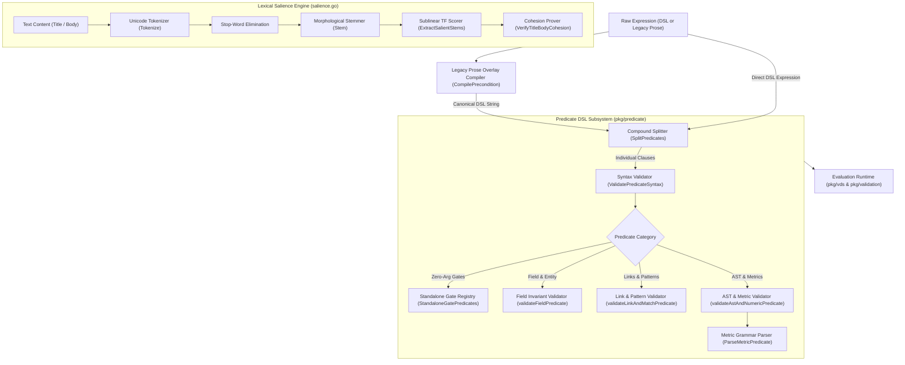
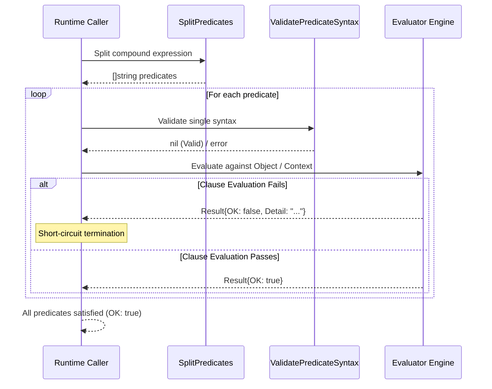

# Predicate DSL & AST Evaluation Engine Subsystem Architectural & Operational Guide

## Overview

The **Predicate DSL & AST Evaluation Engine Subsystem** (`pkg/predicate`) provides the declarative expression grammar, abstract syntax tree (AST) validation pipeline, legacy prose compilation membrane, and lexical salience analysis engine powering the **ZQK Knowledge Kernel**.

In the ZQK architecture, state transitions, lifecycle stage advancements, and verification-driven specification (VDS) gates are governed by verifiable invariants rather than transient prompt assumptions. The Predicate DSL provides a deterministic, machine-checkable language for expressing structural constraints, entity relationships, metrics, filesystem invariants, and lexical cohesion across kernel objects.

---

## Subsystem Architecture & Component Topology

The subsystem operates as a layered verification pipeline:



### Component Breakdown

| Component | Source File | Core Responsibility |
| :--- | :--- | :--- |
| **DSL Syntax Validator** | `dsl.go` | Validates clause structure, identifiers, field paths, regexes, and operators. |
| **Compound Splitter** | `dsl.go` | Splits compound expressions by `;` or `,` while preserving quotes and nested lists. |
| **Precondition Compiler** | `dsl.go` | Deterministically maps natural language preconditions into canonical DSL clauses. |
| **Metric Parser** | `dsl.go` | Parses numerical metric assertions (`name`, `op`, `threshold`). |
| **Lexical Tokenizer & Stemmer** | `salience.go` | Extracts words, eliminates stop-words, and applies Porter-derived stemming. |
| **Salience & Cohesion Prover**| `salience.go` | Computes Szymkiewicz-Simpson overlap and verifies semantic cohesion. |

---

## DSL Grammar Specification

The Predicate DSL conforms to a formal grammar designed for safe, deterministic AST evaluation.

### Formal EBNF Grammar

```ebnf
Expression         ::= CompoundPredicate ;
CompoundPredicate  ::= SinglePredicate ( ( ";" | "," ) SinglePredicate )* ;

SinglePredicate    ::= StandaloneGate
                     | ParameterizedPredicate ;

StandaloneGate     ::= Identifier ;

ParameterizedPredicate ::= FieldPredicate
                         | LinkPredicate
                         | MatchPredicate
                         | MetricPredicate
                         | AstPredicate
                         | CountPredicate ;

FieldPredicate     ::= "object_exists" ":" Identifier
                     | "field_nonempty" ":" [ Identifier ":" ] Identifier
                     | "field_cleared" ":" [ Identifier ":" ] Identifier
                     | "any_nonempty" ":" IdentifierList
                     | "role_is" ":" Identifier
                     | "active_ref" ":" Identifier ;

LinkPredicate      ::= "link_back" ":" Identifier ":" Identifier ;

MatchPredicate     ::= "field_matches" ":" Identifier ":" RegexPattern
                     | "path_exists" ":" FilePath
                     | "content_hash_matches" ":" FilePath
                     | "content_size_positive" ":" FilePath ;

MetricPredicate    ::= "query_metric" ":" Identifier Operator Number ;

AstPredicate       ::= "ast_semantic_match" ":" FilePath ":" Constraint [ ":" Identifier ] ;

CountPredicate     ::= "at_least" ":" NonNegativeInteger ":" Identifier
                     | "title_body_cohesion" ":" NonNegativeInteger ;

Operator           ::= "==" | "!=" | "<=" | "<" | ">=" | ">" ;
IdentifierList     ::= Identifier ( ( "," | ":" ) Identifier )* ;
Identifier         ::= [a-zA-Z0-9_-]+ ;
FilePath           ::= [a-zA-Z0-9_\-\/\.]+ ;
```

### Operator Precedence Rules

1. **Parentheses & Enclosures**: Quoted strings (`'...'`, `"..."`, `` `...` ``) escape delimiters (semicolons and commas).
2. **Compound Conjunction**: Delimiters (`;` and `,`) bind clauses sequentially with logical `AND` semantics.
3. **Disjunction in Lists**: `any_nonempty` accepts comma- or colon-separated fields with logical `OR` semantics.
4. **Relational Operators**: In `query_metric`, relational operators (`==`, `!=`, `<=`, `<`, `>=`, `>`) bind metric names to float64 constants.

---

## Supported Predicate Clauses

### 1. Canonical Zero-Argument Standalone Gates

The subsystem registers 31 canonical gates evaluated without arguments:

| Gate Identifier | Description |
| :--- | :--- |
| `standard_checks_pass` | Standard baseline hygiene checks succeed. |
| `tests_ok_per_customization` | Custom test command suite passes. |
| `lint_ok_per_customization` | Custom linter passes with zero violations. |
| `criteria_linked_or_acceptance_present` | Entity links to valid criteria or defines acceptance considerations. |
| `git_diff_nonempty_or_waiver` | Working tree exhibits git modifications or explicit waiver. |
| `smoke_or_integration_evidence_present` | Automated test or integration execution evidence recorded. |
| `ci_required_checks_green_or_na` | CI check suites report green status. |
| `security_gate_ok_or_na` | Security scanner passes or marked not applicable. |
| `performance_gate_ok_or_na` | Performance benchmark passes or marked not applicable. |
| `publish_ack_present_if_public` | Operator acknowledgment recorded for public release. |
| `path_exists` | Target document exists on filesystem. |
| `content_hash_matches` | Cryptographic SHA-256 matches sealed document. |
| `content_size_positive` | Target file length is greater than zero bytes. |
| `shovel_ready` | Priority plan has met all planning preconditions. |
| `tdd_test_red_phase` | Linked criteria bound to active test case references. |
| `criteria_active_test_case` | Criteria verified by at least one active test case. |
| `ready_backlog_references_plan` | At least one ready backlog item references active plan. |
| `linked_backlog_ready_or_later` | All linked backlog items are in ready or later status. |
| `linked_backlog_all_terminal` | All linked backlog items have reached terminal state. |
| `no_linked_backlog_in_progress_or_complete` | Zero linked backlog items are active or complete. |
| `workflow_constraints_if_set` | Declared workflow state constraints satisfied. |
| `priority_plan_validated` | Plan has been validated against active governance goals. |
| `team_or_persona_dispatch_refs` | Work item assigned to designated persona or team. |
| `git_mutation_evidence_present` | Git commit hash recorded in closure evidence. |
| `branch_is_ancestor_of_trunk` | Integration branch descends from origin trunk. |
| `machine_checkable_closure_evidence` | Machine-verifiable scheduler fingerprint recorded. |
| `linked_criteria_validated_or_complete` | All linked criteria items are verified or complete. |
| `priority_plan_archived_when_set` | Referenced plan archived when linked. |
| `priority_plan_execution_facing` | Plan is currently active or in-progress. |
| `work_done` | Work execution completed. |
| `title_body_cohesion` | Title and body share salient semantic keywords. |

### 2. Parameterized Predicates

- **`object_exists:<id>`**: Proves target object ID exists within kernel CAS.
- **`field_nonempty:[<id>:]<field>`**: Proves field is present, non-nil, and non-empty.
- **`field_cleared:[<id>:]<field>`**: Proves field is absent, nil, or empty string.
- **`any_nonempty:<field1>,<field2>`**: Proves at least one field from list is non-empty.
- **`role_is:<role>`**: Proves entity role matches specified identifier.
- **`active_ref:<ref_field>`**: Proves referenced relationship targets active entity.
- **`link_back:<subject_field>:<target_field>`**: Proves bidirectional graph edge continuity.
- **`field_matches:<field>:<regex>`**: Proves field string matches regular expression.
- **`query_metric:<name><op><value>`**: Evaluates numeric metrics (`coverage>=85`).
- **`ast_semantic_match:<path>:<constraint>[:<symbol>]`**: Inspects Go AST for symbol presence/absence or panic freedom.
- **`at_least:<count>:<field>`**: Asserts collection field contains at least `count` elements.

---

## Evaluation Pipeline & Truth Tables



### Truth Table Evaluation Matrix

| Clause Type | Expression | Object State | Result |
| :--- | :--- | :--- | :--- |
| `field_nonempty` | `field_nonempty:title` | `{"title": "Valid Title"}` | `true` |
| `field_nonempty` | `field_nonempty:title` | `{"title": "   "}` | `false` |
| `field_nonempty` | `field_nonempty:title` | `{}` (key absent) | `false` |
| `field_cleared` | `field_cleared:plan_ref` | `{}` (key absent) | `true` |
| `field_cleared` | `field_cleared:plan_ref` | `{"plan_ref": ""}` | `true` |
| `field_cleared` | `field_cleared:plan_ref` | `{"plan_ref": "REF-1"}` | `false` |
| `query_metric` | `query_metric:coverage>=85` | `{"coverage": 92.5}` | `true` |
| `query_metric` | `query_metric:coverage>=85` | `{"coverage": 84.9}` | `false` |
| `any_nonempty` | `any_nonempty:a,b` | `{"a": "val", "b": ""}` | `true` |
| `any_nonempty` | `any_nonempty:a,b` | `{"a": "", "b": ""}` | `false` |

---

## Lexical Salience & Cohesion Engine

The salience engine (`salience.go`) prevents superficial title-body drift in kernel objects.

### Algorithmic Pipeline

1. **Tokenization**: Extracts alphanumeric tokens and preserves underscores.
2. **Stop-Word Removal**: Strips English grammatical terms and generic process words (`ensure`, `must`, `verify`, `check`).
3. **Morphological Stemming**: Normalizes word forms using a 3-step Porter-style algorithm:
   - Suffix removal for plurals and past tenses (`sses`, `ies`, `eed`, `ing`).
   - Derivational suffix normalization (`ational`, `tional`, `ation`, `tion`, `izer`, `alism`, `ality`, `ment`, `ness`, `able`, `ible`).
   - Trailing vowel cleanup.
4. **Sublinear Term Weighting**: Computes stem salience via:
   $$\text{Score}(t) = 1 + \ln(\text{count}(t))$$
5. **Szymkiewicz–Simpson Overlap**: Measures overlap coefficient between title stems and salient body stems:
   $$\text{Overlap} = \frac{|\text{Stems}_{\text{title}} \cap \text{Stems}_{\text{body}}|}{\min(|\text{Stems}_{\text{title}}|, 1)}$$

---

## Concurrency & Thread-Safety Model

The predicate subsystem is engineered for high-concurrency evaluation across swarm sessions:

- **Stateless Validation**: `ValidatePredicateSyntax`, `SplitPredicates`, `CompilePrecondition`, and `ParseMetricPredicate` are purely functional with zero shared mutable state.
- **Immutable Registries**: Standalone gate maps and alias lookup tables are populated during package `init()` and remain read-only.
- **Managed Concurrency**: In multi-threaded validation loops, concurrent workers are launched using `goroutinelabels.NewGoroutine` to maintain label identity and budget tracking.
- **Race Freedom**: Verified under the Go race detector (`-race`) with parallel goroutines performing simultaneous compile, validate, and salience operations.

---

## Verification & Coverage Invariant

Statement test coverage for `pkg/predicate` is governed by a strict static floor invariant:

$$\text{Statement Test Coverage} \ge 85.0\%$$

Current coverage achieved across the package: **96.3% of statements**.

### Verification Command

To execute the test suite and verify statement coverage:

```bash
ZQK_ALLOW_FOREGROUND_GO_TEST=1 go test -v -timeout 30s -cover ./pkg/predicate
```
