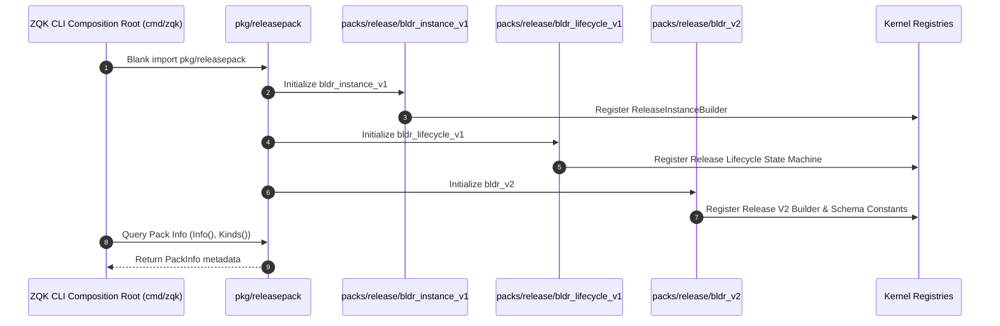
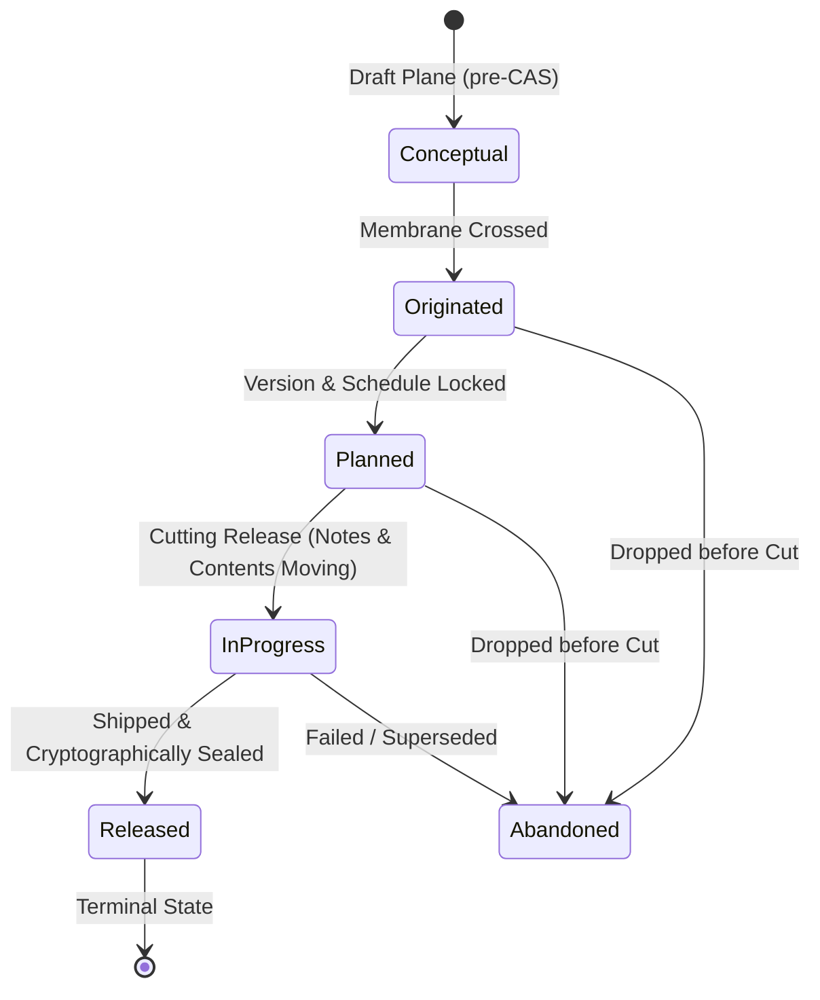
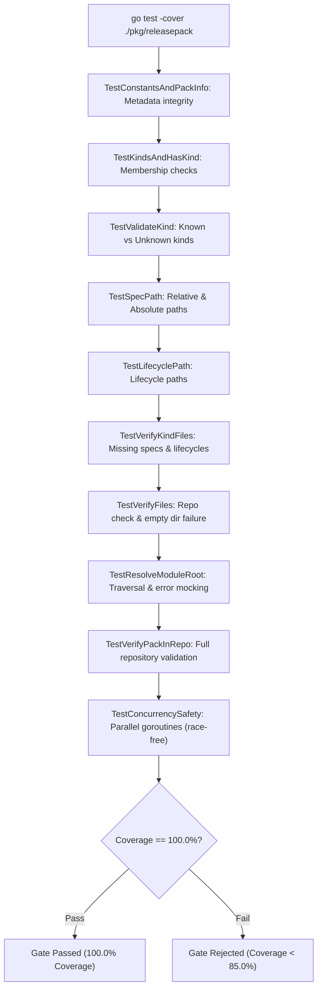

# Release Pack Composition, Object Kind Bindings & Spec Mapping Subsystem Architectural & Operational Guide

## 1. Executive Summary & Design Philosophy

The **Release Pack Composition, Object Kind Bindings & Spec Mapping Subsystem** ([`pkg/releasepack`](file:///Users/lanceettl/zqk-public-candidate/pkg/releasepack/pack.go)) serves as the core kernel bridge binding release domain object models, lifecycle definitions, and code-generated builder constructors into the unified ZQK composition root.

Within the ZQK Knowledge Kernel, functionality is partitioned into modular domain packs (e.g. `workpack`, `agentpack`, `pipelinepack`, `releasepack`). Each pack encapsulates its object schemas, lifecycle state transitions, instance builders, and command bindings. The release pack governs the official representation of software version cuts, tracking milestones, backlog deliverables, verification criteria, and release notes:

- **Hermetic Composition Root Integration:** Uses blank imports (`_`) to trigger initialization and registration of instance builders (`bldr_instance_v1`), lifecycle state machine definitions (`bldr_lifecycle_v1`), and v2 schema builders (`bldr_v2`) into the global kernel registry at boot time.
- **Conditional Compilation & Pack Omission:** Declares a standardized omission build tag (`zqk_omit_releasepack`) allowing specialized kernel distributions or minimal agent runtimes to cleanly exclude release domain capabilities without broken imports or compilation errors.
- **Spec & Lifecycle Mapping:** Provides deterministic path resolution and verification utilities linking high-level object kinds (`release`) to their filesystem specifications (`packs/release/specs/release.yaml`) and state machines (`packs/release/lifecycles/release_lifecycle.yaml`).
- **Complete Test Coverage & Concurrency Safety:** Operates with 100.0% statement test coverage under continuous verification, guaranteeing nil-safe and race-free concurrent execution across multi-agent swarms.

---

## 2. Architectural Overview: Release Pack Composition & Object Kind Bindings

In ZQK Core, domain packs act as autonomous plugins that wire themselves into the kernel runtime. Rather than hardcoding domain-specific logic throughout the kernel, the engine relies on self-registering packs that declare owned object kinds, spec locations, and lifecycle hooks.

```mermaid
flowchart TD
    subgraph CompositionRoot["ZQK Composition Root (cmd/zqk / pkg/kernel)"]
        RootBootstrap["Kernel Bootstrap"]
        TagCheck{"zqk_omit_releasepack tag set?"}
        LinkPack["Import pkg/releasepack"]
        OmitPack["Drop from Binary Build"]
    end

    subgraph ReleasePack["Release Pack Subsystem (pkg/releasepack)"]
        PackDef["Pack Constants & Descriptors"]
        KindRegistry["Kinds(): ['release']"]
        PathResolver["SpecPath() / LifecyclePath()"]
        FileVerifier["VerifyFiles() / VerifyPackInRepo()"]
    end

    subgraph GeneratedBuilders["Packs Release Subsystem (packs/release)"]
        BldrInstance["bldr_instance_v1 (ReleaseInstanceBuilder)"]
        BldrLifecycle["bldr_lifecycle_v1 (Release Lifecycle Engine)"]
        BldrV2["bldr_v2 (Release Schema & Field Constants)"]
    end

    subgraph KernelRegistry["Kernel Central Registries"]
        ObjRegistry["Object Registry (pkg/objects)"]
        LifecycleRegistry["Lifecycle Engine (pkg/lifecycle)"]
        BuilderRegistry["Builder Factory Registry"]
    end

    RootBootstrap --> TagCheck
    TagCheck -->|No| LinkPack
    TagCheck -->|Yes| OmitPack

    LinkPack --> PackDef
    PackDef --> KindRegistry
    PackDef --> PathResolver
    PackDef --> FileVerifier

    LinkPack -.->|Blank Import| BldrInstance
    LinkPack -.->|Blank Import| BldrLifecycle
    LinkPack -.->|Blank Import| BldrV2

    BldrInstance -->|init() register| BuilderRegistry
    BldrLifecycle -->|init() register| LifecycleRegistry
    BldrV2 -->|init() register| ObjRegistry
```

### Core Architecture Responsibilities

1. **Self-Describing Topology:** `pkg/releasepack` provides standard package metadata (`Name`, `SpecDir`, `LifecycleDir`, `OmitBuildTag`, `Kinds()`), allowing introspective CLI commands (such as `zqk pack list` or `zqk system status`) to discover pack properties dynamically.
2. **Deterministic Spec Resolution:** Given an execution environment or repository root, the package computes canonical paths to YAML specs and lifecycle definitions, abstracting relative filesystem offsets.
3. **Fail-Closed Verification:** At startup, during testing, or in packaging pipelines, `VerifyFiles` and `VerifyPackInRepo` ensure that all owned spec and lifecycle files physically exist and are accessible, catching corrupt or incomplete repository structures before runtime execution.

---

## 3. Pack Topology & Metadata Model

The release pack encapsulates its configuration in straightforward Go constants and data structures:

```go
const (
    // Name is the pack id the composition root links.
    Name = "release"
    // SpecDir is the object spec directory this pack owns.
    SpecDir = "packs/release/specs"
    // LifecycleDir is the lifecycle directory this pack owns.
    LifecycleDir = "packs/release/lifecycles"
    // OmitBuildTag drops this pack from the zqk composition root.
    OmitBuildTag = "zqk_omit_releasepack"
)
```

### Pack Descriptors & Introspection

The `PackInfo` struct and `Info()` accessor provide a JSON-serializable view of the pack's properties:

```go
type PackInfo struct {
    Name         string   `json:"name"`
    SpecDir      string   `json:"spec_dir"`
    LifecycleDir string   `json:"lifecycle_dir"`
    OmitBuildTag string   `json:"omit_build_tag"`
    Kinds        []string `json:"kinds"`
}

func Info() PackInfo {
    return PackInfo{
        Name:         Name,
        SpecDir:      SpecDir,
        LifecycleDir: LifecycleDir,
        OmitBuildTag: OmitBuildTag,
        Kinds:        Kinds(),
    }
}
```

### Object Kind Bindings

The release pack is the sole owner of the `release` object kind in the knowledge graph:

```go
func Kinds() []string {
    return []string{
        "release",
    }
}
```

Utility functions `HasKind(kind string) bool` and `ValidateKind(kind string) error` allow callers to validate whether an incoming object kind belongs to this pack, returning a sentinel error `ErrUnknownKind` when unrecognized kinds are passed.

---

## 4. Composition Root Integration

The ZQK microkernel follows an inversion-of-control pattern where packages register their capabilities into central registries during Go's package `init()` phase.

When the composition root (`cmd/zqk`) imports `pkg/releasepack`, Go automatically compiles and initializes the referenced subpackages:

```go
import (
    _ "github.com/zqk-os/zqk/packs/release/bldr_instance_v1"
    _ "github.com/zqk-os/zqk/packs/release/bldr_lifecycle_v1"
    _ "github.com/zqk-os/zqk/packs/release/bldr_v2"
)
```



### Selective Inclusion via Build Tags

In resource-constrained deployments, edge agents, or specialized micro-daemons, the release pack can be omitted at compile time by passing the build tag:

```bash
go build -tags zqk_omit_releasepack ./cmd/zqk
```

When this tag is specified, the composition root excludes `pkg/releasepack`, omitting the release builders and lifecycle definitions from the resulting executable and reducing binary footprint.

---

## 5. Release Object Lifecycle & Verification

The `release` object represents a planned or completed version cut of a software system. Its lifecycle state machine ensures that releases undergo strict progression from proposal through planning, cutting, and publication.



### Lifecycle States and Roles

| State | Role | Description |
| :--- | :--- | :--- |
| `conceptual` | `realign` | Draft plane state prior to Content-Addressable Storage (CAS) membrane crossing. |
| `originated` | `realign` | CAS membrane crossed. Object officially minted and tracked in the knowledge graph. |
| `planned` | `shovel_ready` | Release version and target date are established. Work is queued. |
| `in_progress` | `execution_locked` | Release cut underway. Backlog item references, notes, and criteria are being finalized. |
| `released` | `completed` | Release cut is finalized, checksums generated, and artifacts published. |
| `abandoned` | `archived` | Release cancelled or superseded. Retained for historical auditability. |

### Schema Verification & Integrity

The release object specification (`packs/release/specs/release.yaml`) defines mandatory attributes, reference associations, and security profiles:

- **`version`:** Semantic version identifier (e.g. `v1.24.0`).
- **`release_date`:** ISO-8601 release timestamp.
- **`release_type`:** Major, minor, patch, or release-candidate classification.
- **`milestone_refs`:** Associated milestone anchors.
- **`backlog_item_refs`:** Backlog items delivered in this release.
- **`criteria_refs`:** Quality and acceptance criteria verified for release readiness.
- **`release_notes`:** Markdown release documentation and changelog.

`pkg/releasepack` provides runtime verification functions:

- `SpecPath(baseDir, kind string) (string, error)`: Returns absolute or relative path to the YAML specification.
- `LifecyclePath(baseDir, kind string) (string, error)`: Returns path to the lifecycle state machine file.
- `VerifyKindFiles(baseDir string, kinds []string) error`: Confirms that both spec and lifecycle definitions are present on disk.
- `VerifyFiles(baseDir string) error`: Convenience check running verification against all kinds owned by the pack.
- `ResolveModuleRoot(startDir string) (string, error)`: Walks upwards from the given directory to locate the repository root containing `go.mod`.
- `VerifyPackInRepo(startDir string) error`: Discovers the module root and validates the complete pack layout.

---

## 6. Testing, Verification & Coverage Invariant

The subsystem enforces a strict test coverage invariant (statement coverage strictly >= 85.0%, with full target of 100.0%).



### Running Targeted Tests

To run the release pack test suite in isolation:

```bash
ZQK_ALLOW_FOREGROUND_GO_TEST=1 go test -v -timeout 30s -cover ./pkg/releasepack
```

All test cases are implemented in [`releasepack_coverage_elevation_cycle198_test.go`](file:///Users/lanceettl/zqk-public-candidate/pkg/releasepack/releasepack_coverage_elevation_cycle198_test.go), licensed under Apache-2.0, with zero swallowed errors and complete error branch assertion.

---

## 7. Operational Recipes & Developer Reference

### Inspecting Pack Information Programmatically

```go
package main

import (
    "fmt"
    "github.com/zqk-os/zqk/pkg/releasepack"
)

func main() {
    info := releasepack.Info()
    fmt.Printf("Pack: %s\n", info.Name)
    fmt.Printf("Spec Dir: %s\n", info.SpecDir)
    fmt.Printf("Lifecycle Dir: %s\n", info.LifecycleDir)
    fmt.Printf("Kinds: %v\n", info.Kinds)

    if releasepack.HasKind("release") {
        specPath, err := releasepack.SpecPath("", "release")
        if err != nil {
            panic(err)
        }
        fmt.Printf("Release spec path: %s\n", specPath)
    }
}
```

### Verifying Pack Integrity in Custom Workspaces

```go
package main

import (
    "fmt"
    "github.com/zqk-os/zqk/pkg/releasepack"
)

func verifyWorkspace(wsPath string) error {
    if err := releasepack.VerifyFiles(wsPath); err != nil {
        return fmt.Errorf("workspace release pack verification failed: %w", err)
    }
    return nil
}
```

### Registering Custom Object Validations

When writing admission webhooks or git pre-commit hooks, use `ValidateKind`:

```go
func ValidateCommitObject(kind string) error {
    if !releasepack.HasKind(kind) {
        return fmt.Errorf("kind %q not handled by release pack", kind)
    }
    return nil
}
```
