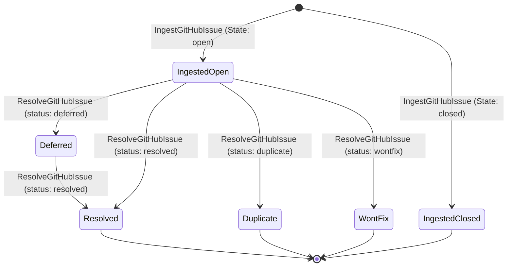
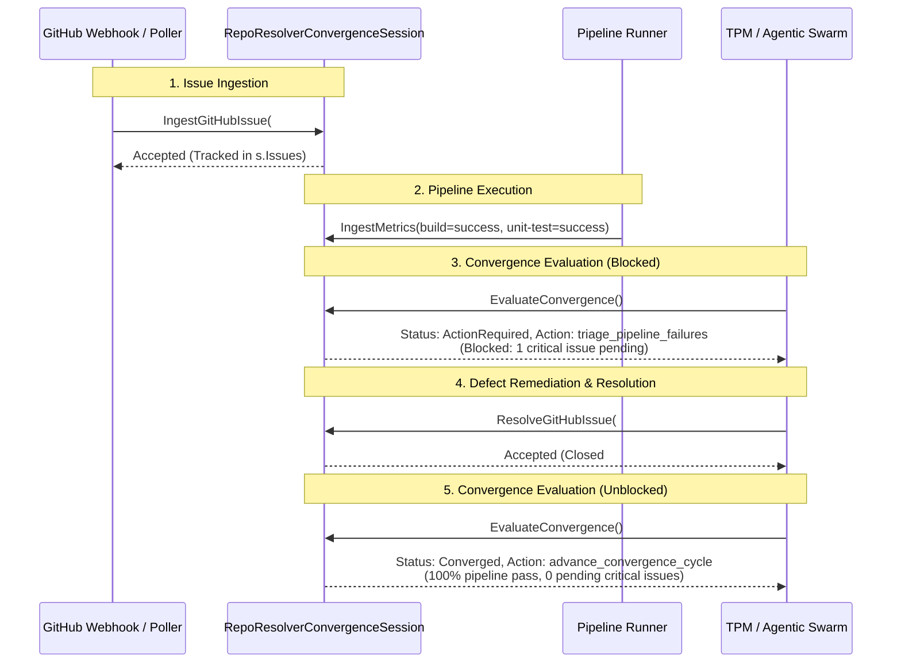

# Community Repo Resolver: GitHub Issue Ingestion, Resolution & Convergence Management (Cycle 35)

## 1. Executive Summary
This architectural specification defines the integration of GitHub issue ingestion, lifecycle management, resolution tracking, and policy-driven convergence steering directly into the community repo resolver subsystem (`pkg/community`).

The repo resolver orchestrates automated repository convergence, validating that code, pipeline telemetry, and external defect tracking align with operational stability invariants. By embedding GitHub issue ingestion and resolution tracking natively into `RepoResolverConvergenceSession`, active critical issues (such as blocking bugs or regressions) directly influence pipeline convergence evaluations, preventing premature cycle advancement while prescribing targeted triage actions.

---

## 2. Component Architecture & Integration Topology

```mermaid
graph TD
    GH["GitHub Repository Issues API"] -->|IngestGitHubIssue(s)| RRCS["RepoResolverConvergenceSession"]
    CI["Pipeline Telemetry Engine"] -->|IngestMetrics| RRCS
    
    subgraph "Repo Resolver Convergence Engine"
        RRCS --> IM["Issue Store & Index (s.Issues)"]
        RRCS --> RM["Resolution Store (s.Resolutions)"]
        RRCS --> TM["Pipeline Tracking Matrix"]
        
        IM --> EV["Convergence Evaluator (EvaluateConvergence)"]
        RM --> EV
        TM --> EV
        
        EV --> PolAdv["PolicyActionAdvanceCycle"]
        EV --> PolTri["PolicyActionTriageFailures"]
        EV --> PolRet["PolicyActionRetryFlaky"]
    end
    
    EV --> Out["Convergence Evaluation & Steering Decision"]
```

### 2.1 Core Architectural Principles
1. **Thread-Safe In-Memory State**: All issue ingestion, resolution lookups, and evaluations are governed by `sync.RWMutex`, providing sub-millisecond retrieval and concurrent mutation safety.
2. **Defect-Aware Convergence Gate**: A 100% successful build or test pipeline does NOT imply release readiness if unresolved critical or blocking defects exist. Pending critical issues actively suppress `PolicyActionAdvanceCycle` and trigger `PolicyActionTriageFailures`.
3. **Audit-Grade Resolution Trajectory**: Resolutions record target commit hashes, outcome classifications (`resolved`, `deferred`, `duplicate`, `wontfix`), and timestamps, ensuring complete lineage from issue intake to code remediation.
4. **Deterministic Ordering**: All listing methods (`ListPendingGitHubIssues`, `ListResolvedGitHubIssues`) return slices sorted deterministically by `IssueNumber` ascending.

---

## 3. GitHub Issue Lifecycle & State Machine



### State Transitions & Convergence Invariants
- **`IngestedOpen`**: An issue ingested with `State == "open"`. If labeled `critical`, `blocker`, `p0`, `p1`, `security`, or `bug`, it immediately registers as a pending critical defect in `CountPendingCriticalIssues()`.
- **`Deferred`**: An issue resolved with `ResolutionStatus == "deferred"`. The resolution is recorded for auditability, but the issue remains pending in `ListPendingGitHubIssues()`.
- **`Resolved` / `Duplicate` / `WontFix`**: Terminal resolutions. Transitions the issue state to `State == "closed"`, populates `ClosedAt`, and immediately unblocks convergence evaluation once all critical issues reach resolution.

---

## 4. End-to-End Sequence Diagram



---

## 5. Three-Fold Verification Proof Matrix

| Proof Dimension | Invariant Guaranteed | Test Fixture |
| :--- | :--- | :--- |
| **Static Floor Invariant** | Non-positive issue numbers rejected with `ErrInvalidIssueNumber`.<br/>Empty/whitespace titles rejected with `ErrEmptyIssueTitle`.<br/>Invalid states rejected with `ErrInvalidIssueState`.<br/>Invalid resolution statuses rejected with `ErrInvalidResolutionStatus`.<br/>Nil receivers on all session methods return clean errors or zero values without panics.<br/>Critical heuristic recognizes `critical`, `blocker`, `p0`, `p1`, `bug`, `security`, and bracketed titles. | `TestRepoResolverIssueManagement_StaticFloorInvariant` |
| **Operational Dynamic Proof** | Ingestion of single and batch issues.<br/>`ListPendingGitHubIssues` filters closed/resolved items with deterministic sorting.<br/>`ResolveGitHubIssue` updates state and timestamps.<br/>`GetIssueResolution` retrieves accurate records.<br/>Active critical issues dynamically suppress `advance_convergence_cycle` and promote `triage_pipeline_failures`.<br/>Resolving all critical issues unblocks convergence to `converged`.<br/>`ExportSessionSummary` provides accurate issue counts. | `TestRepoResolverIssueManagement_OperationalDynamicProof` |
| **Negative Adversarial Boundary** | Resolving un-ingested issue returns `ErrIssueNotFound`.<br/>Invalid resolution payloads fail closed.<br/>Batch ingestion with invalid item fails atomically.<br/>Negative issue lookups return `ErrInvalidIssueNumber`.<br/>High-concurrency stress test with 20 ingestion workers, 20 resolution workers, and 5 reader workers under `POL-CONCURRENCY` with zero race conditions or deadlocks. | `TestRepoResolverIssueManagement_NegativeAdversarialBoundary` |

---

## 6. Concurrency Hygiene & Policy Compliance

All background test workers and asynchronous operations strictly adhere to **`POL-CONCURRENCY`**:
- Zero naked `go func()` calls throughout the codebase.
- All background execution is governed via:
  ```go
  goroutinelabels.NewGoroutine("<worker_name>", "<purpose>").StartSimple(func() {
      // safe worker body
  })
  ```
- Mutex access is strictly bounded, ensuring read-write separation between telemetry metric ingestion, GitHub issue updates, and convergence matrix calculations.
