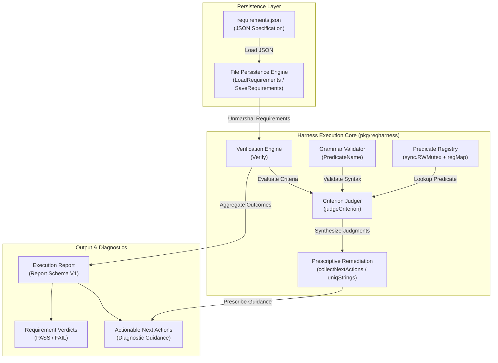
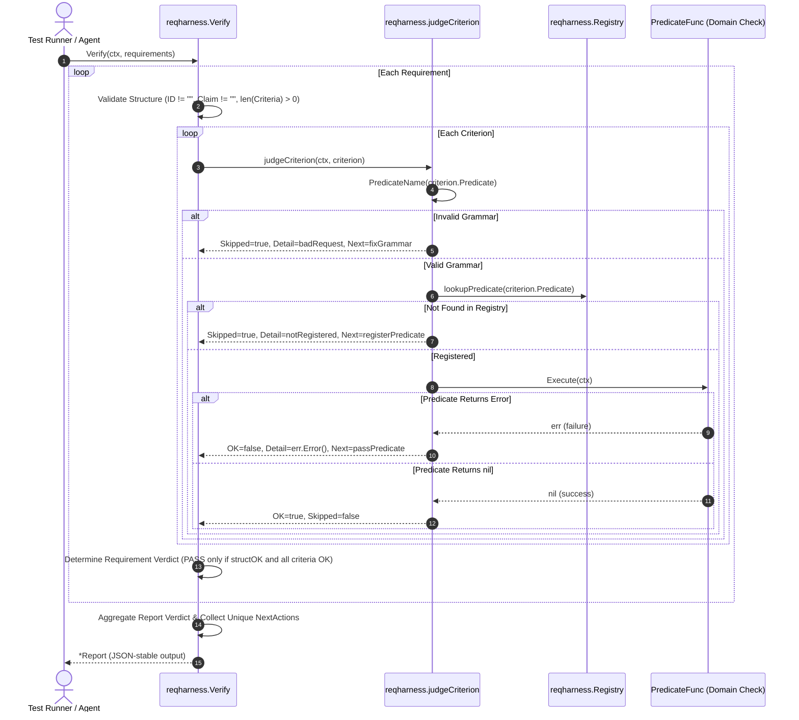
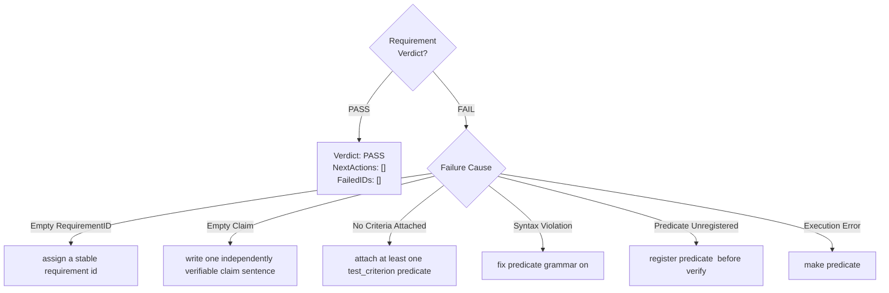

# Test-Requirements Verification Harness & Predicate Evidence Engine Operational Architecture Guide

## 1. Executive Architectural Summary

The **Test-Requirements Verification Harness & Predicate Evidence Engine** (`pkg/reqharness`) provides deterministic, re-runnable verification of architectural and functional requirements across the **ZQK Knowledge Kernel**.

In conventional software development workflows, "done" criteria frequently devolve into narrative explanations, subjective developer assertions, or untracked verbal sign-offs. Within autonomous agent swarms and continuous delivery systems, narrative assertions are unverifiable and vulnerable to hallucination or drift. The Knowledge Kernel enforces **POL-WORKFLOW-VDS**:

> *"Done means re-runnable predicate evidence; narrative is never a gate."*

`pkg/reqharness` operationalizes this mandate by bridging timeless requirement contracts—composed of stable identifiers, single-sentence claims, and machine-verifiable criteria—with executable Go test predicates. A requirement achieves a `PASS` verdict if and only if its relational structure is strictly valid AND every attached predicate executes and returns `nil` within its assigned context deadline.

### Core Architectural Principles

1. **Predicates as Authoritative Truth:** Narrative text on requirements serves purely human-semantic purposes. Only registered, executable predicate functions constitute valid evidence.
2. **Fail-Closed Verification:** Unregistered predicates, malformed predicate identifiers, missing claims, or unassigned identifiers immediately result in an overall `FAIL` verdict. The harness never credits evidence it cannot independently execute.
3. **Prescriptive Remediation (Next Actions Engine):** When a verification fails, the engine generates actionable remediation cues directing agents or human operators toward exact structural or implementation fixes.
4. **Namespace Isolation:** Predicates enforce strict `scope:Name` grammar, preventing global name collisions and ensuring clear domain ownership across kernel subsystems.
5. **Hermetic File Persistence:** Requirement suites serialize and deserialize through deterministic, formatted JSON with fail-safe file permission enforcement (`paths.DirPerm750` and `paths.FilePerm600`).
6. **Static Floor Coverage Invariant:** A strict statement test coverage invariant ($\ge 85.0\%$, maintained at $100.0\%$) guaranteeing zero unverified execution paths or edge cases.

---

## 2. Component Topology & Subsystem Architecture

The harness is structured into modular functional blocks operating across registration, verification, reporting, and persistence layers:



### Component Responsibilities

| Component | Exported Functions / Types | Core Architectural Responsibility |
| :--- | :--- | :--- |
| **Predicate Registry** | `RegisterPredicate`, `MustRegister`, `Names` | Thread-safe in-memory catalogue mapping scoped predicate strings (`scope:Name`) to executable `PredicateFunc` implementations. Rejects duplicates and invalid names. |
| **Predicate Grammar** | `PredicateName` | Regular expression check (`^[A-Za-z0-9_]+(:[A-Za-z0-9_]+)+$`) ensuring predicates follow valid namespacing rules without illicit special characters or missing scopes. |
| **Verification Engine** | `Verify` | Root orchestrator accepting a slice of `Requirement` objects and executing structural audits and criterion predicates against the active context. |
| **Criterion Judger** | `judgeCriterion` | Evaluates a single criterion: validates predicate syntax, checks registry presence, dispatches the check with context propagation, and extracts error details. |
| **Remediation Engine** | `collectNextActions`, `uniqStrings` | Consolidates and deduplicates concrete repair instructions generated across all failing requirements and criteria. |
| **File Persistence** | `LoadRequirements`, `SaveRequirements` | Hermetic filesystem reader and writer validating non-empty requirement arrays and executing formatted JSON I/O with secure directory creation. |

---

## 3. Predicate Grammar & Scope Taxonomy

All predicates registered or referenced in the harness must adhere to canonical namespacing syntax.

### Grammar Specification

Predicates are evaluated against the regular expression:
```
^[A-Za-z0-9_]+(:[A-Za-z0-9_]+)+$
```

- **Scope Segment:** An alphanumeric or underscored prefix denoting the subsystem, package, or domain boundary (e.g., `auth`, `storage_01`, `db_read`).
- **Delimiter:** A single colon (`:`) separating scopes and predicate identifiers. Multiple hierarchical segments (e.g., `pkg:subsystem:Check`) are supported.
- **Name Segment:** An alphanumeric or underscored identifier specifying the dynamic invariant to prove (e.g., `ValidToken`, `QuerySuccess`, `CleanMount`).

### Valid vs. Invalid Predicate Examples

| Predicate String | Status | Reason |
| :--- | :--- | :--- |
| `auth:ValidToken` | **Valid** | Standard single-scope predicate identifier. |
| `db_01:Query_Success` | **Valid** | Alphanumeric with underscores in both scope and name. |
| `kernel:storage:Mounts` | **Valid** | Multi-tier hierarchical scope segments. |
| `no_scope` | **Invalid** | Missing colon delimiter and scope separator. |
| `:name` | **Invalid** | Empty leading scope segment. |
| `scope:` | **Invalid** | Empty trailing name segment. |
| `auth:token-valid` | **Invalid** | Hyphens (`-`) are prohibited; use underscores or CamelCase. |
| `auth:token@2` | **Invalid** | Special characters (`@`) are prohibited. |
| `auth: token` | **Invalid** | Whitespace is strictly forbidden. |

---

## 4. Verification Lifecycle

The verification sequence executes in seven discrete phases to ensure absolute determinism and complete auditability:



### Lifecycle Execution Phases

1. **Ingestion & Initialization:** Allocates a report adhering to schema `zqk_reqharness_report_v1` with an empty failure roster and initialized actions slice.
2. **Structural Invariant Audit:** Inspects each requirement for mandatory non-empty fields:
   - `RequirementID`: Must be populated with a persistent identifier.
   - `Claim`: Must declare an unambiguous, testable claim sentence.
   - `TestCriteria`: Must declare at least one criterion linking to a machine predicate.
3. **Grammar & Lexical Validation:** For each criterion, `PredicateName` evaluates syntax. If malformed, the check is skipped, marked as a structural defect, and prescribed grammar remediation.
4. **Registry Resolution:** Looks up the predicate in the process-lifetime registry under read-lock (`regMu.RLock()`). If missing, the criterion is skipped and diagnostic hints showing registered predicates are generated.
5. **Context-Bounded Execution:** Dispatches the registered `PredicateFunc` passing the caller's `context.Context`. If the context expires or is cancelled, the predicate returns an error, failing the criterion.
6. **Verdict Determination:** A requirement passes if and only if its structural check succeeded and every criterion passed. The overall report passes if and only if all requirements passed.
7. **Actionable Remediation Prescription:** Consolidates all remediation strings across failing requirements, deduplicates them preserving initial order, and attaches the diagnostic brief.

---

## 5. Next Actions Engine & Prescriptive Remediation

The Next Actions engine converts verification failures into unambiguous, automated guidance. When an automated agent or continuous verification pipeline encounters a failure, it consults `rep.NextActions` to remediate the defect without guesswork.



### Remediation Prescription Catalog

| Failure Trigger | Criterion Detail | Next Action Prescription | Remediation Objective |
| :--- | :--- | :--- | :--- |
| Missing `RequirementID` | *N/A (Structural)* | `assign a stable requirement id` | Ensure requirement is tracked with an immutable graph identifier. |
| Missing `Claim` | *N/A (Structural)* | `write one independently verifiable claim sentence` | Formulate clear, single-sentence testable proposition. |
| Empty `TestCriteria` | *N/A (Structural)* | `attach at least one test_criterion predicate` | Bind at least one verifiable predicate to the requirement. |
| Malformed Predicate Syntax | `invalid predicate shape: ...` | `fix predicate grammar on <ID or Predicate>` | Reformat predicate to conform to `scope:Name`. |
| Unregistered (Empty Registry) | `predicate not registered (registry is empty)` | `register predicate <Predicate> before verify` | Register predicates using `RegisterPredicate` prior to running `Verify`. |
| Unregistered (Populated Registry) | `predicate not registered (registered: ...)` | `register predicate <Predicate> before verify` | Fix typo or register the missing check; hints provide known names. |
| Predicate Execution Error | `predicate returned failure` / `<custom error>` | `make predicate <Predicate>` | Debug subsystem code until predicate check passes. |

---

## 6. Concurrency, Thread-Safety & Context Invariants

`pkg/reqharness` is built for multi-agent swarm environments where concurrent testing, dynamic predicate registration, and asynchronous workers operate simultaneously.

### Concurrency Guarantees

- **Registry Read/Write Locking:** The predicate registry protects its internal state map using a package-level `sync.RWMutex`. Lookups (`lookupPredicate`) and introspection (`registeredNames`, `Names`) acquire shared read locks (`regMu.RLock()`), allowing unbounded concurrent evaluations during test suites.
- **Atomic Registration:** Predicate registration (`RegisterPredicate`, `MustRegister`) acquires exclusive write locks (`regMu.Lock()`), ensuring that concurrent additions or duplicate checks never race.
- **No Naked Goroutines:** Internal and test concurrency adheres strictly to kernel guidelines by dispatching goroutines exclusively via `goroutinelabels.NewGoroutine`:
  ```go
  goroutinelabels.NewGoroutine("reqharness_worker", "concurrent predicate evaluation").
      StartSimple(func() {
          // Thread-safe predicate registration or verification
      })
  ```
- **Context Deadline Propagation:** Predicate signatures accept `context.Context`. Long-running checks must respect context cancellation or timeouts (`ctx.Done()`), preventing stranded goroutines or unbounded test hangs.

---

## 7. Verification & Three-Fold Proof Breakdown

Conforming to kernel quality standards, `pkg/reqharness` satisfies the **Three-Fold Proof Formula**:

### 1. Static Floor Invariant (CRIT-1)
- **Statement Test Coverage:** Requires strictly $\ge 85.0\%$ statement coverage. The implementation achieves **100.0% statement coverage** across all routines in `reqharness.go`.
- **AST Hygiene:** Zero swallowed errors (`_ = ...` strictly eradicated). All error returns are verified.
- **Function Complexity:** Modular, decoupled routines under 100 lines each.

### 2. Operational Dynamic Proof (CRIT-2)
- **Lifecycle Verification:** Verifies registration (`RegisterPredicate`, `MustRegister`), grammar validation, execution dispatch, failure detail extraction, and report serialization round-trips.
- **Report Schema Stability:** Asserts that output serialized to JSON stably round-trips back to `Report` matching schema `zqk_reqharness_report_v1`.
- **Persistence Verification:** Asserts that `SaveRequirements` creates valid JSON files and `LoadRequirements` loads them preserving exact criteria ordering.

### 3. Negative Adversarial Boundary (CRIT-3)
- **Syntax Boundaries:** Rejects spaces, hyphens, punctuation, empty strings, missing scopes, and empty names.
- **Registration Boundaries:** Rejects duplicate registrations and nil function pointers.
- **Execution Boundaries:** Captures context timeouts, custom error strings, and canonical predicate errors (`errPredFail`).
- **Filesystem Boundaries:** Rejects empty requirement lists on save, non-existent files on load, malformed JSON, and unwritable/read-only directories.
- **Payload Cleanliness:** Zero literal nanosecond kernel IDs within documentation guides.
