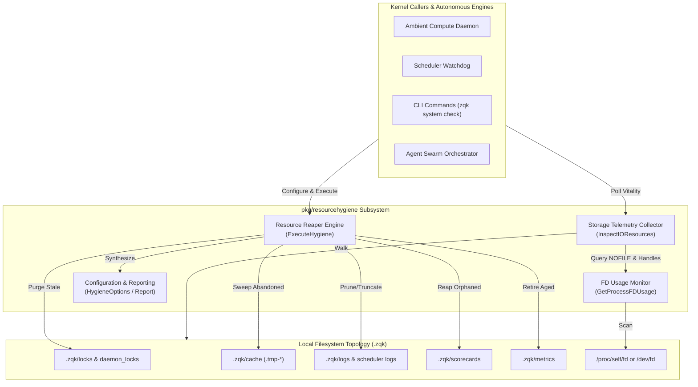
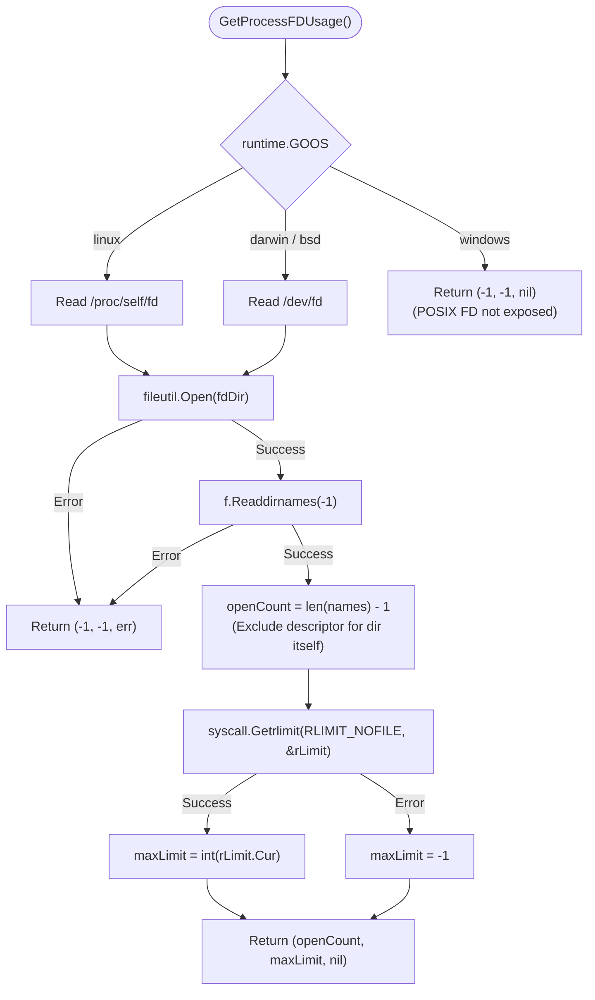
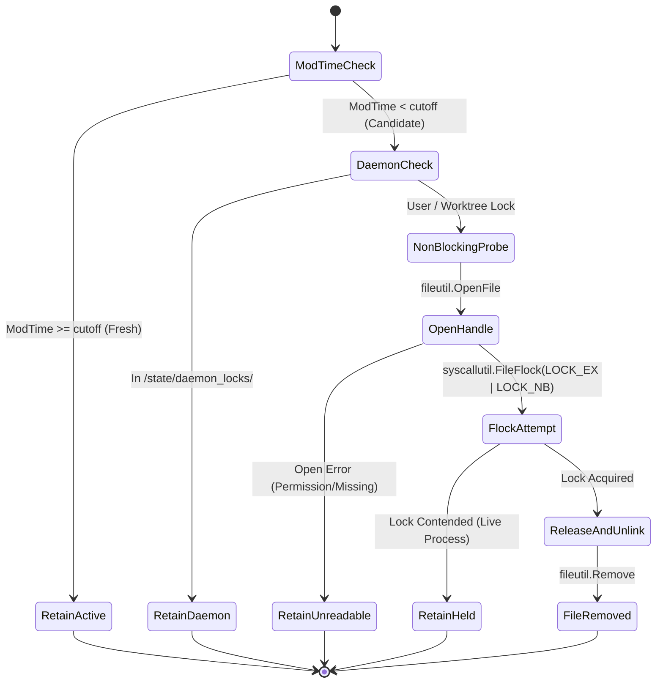

# I/O Resource Hygiene, File Descriptor Leak Detection & Storage Telemetry Subsystem Architectural & Operational Guide

## 1. Executive Architectural Summary

The **I/O Resource Hygiene, File Descriptor Leak Detection & Storage Telemetry Subsystem** ([`pkg/resourcehygiene`](file:///Users/lanceettl/zqk-public-candidate/pkg/resourcehygiene/reaper.go)) provides comprehensive runtime resource protection, storage telemetry, and autonomous garbage collection for the ZQK Knowledge Kernel.

As a high-performance local developer microkernel orchestrating concurrent AI agent swarms, background daemons, scheduled jobs, and ephemeral worktrees, ZQK core operations generate high-velocity filesystem artifacts. These include content-addressed blobs, write-ahead logs (WAL), lock files, temporary staging buffers, execution outputs, and telemetry chunks.

Without automated resource hygiene and continuous monitoring, sustained autonomous execution faces severe failure modes:
1. **File Descriptor Exhaustion:** Open handle accumulation across subprocess pipelines and background workers exhausts the operating system `RLIMIT_NOFILE`, causing cascading system-wide I/O failures.
2. **Ephemeral Disk Bloat:** Stale temporary staging files (`.tmp-*`, `.yaml.tmp`, `pclimits-*`) and unpruned execution logs consume disk capacity and inflate git/cas directory tree scans.
3. **Orphaned Process Drift:** Abandoned background worker processes reparented to `init` (PID 1) after an unexpected termination consume CPU and retain file descriptor locks.
4. **Stale Lock Contention:** Abandoned `.lock` files left by crashed processes prevent downstream worker dispatch.

The `pkg/resourcehygiene` package addresses these concerns through deterministic point-in-time telemetry inspection ([`InspectIOResources`](file:///Users/lanceettl/zqk-public-candidate/pkg/resourcehygiene/telemetry.go#L40)), non-blocking advisory flock probing, cross-platform file descriptor monitoring ([`GetProcessFDUsage`](file:///Users/lanceettl/zqk-public-candidate/pkg/resourcehygiene/fd_usage_unix.go#L14)), and coordinated multi-phase resource reclamation ([`ExecuteHygiene`](file:///Users/lanceettl/zqk-public-candidate/pkg/resourcehygiene/reaper.go#L308)).

---

## 2. Component Topology & Subsystem Architecture

The subsystem is partitioned into four cooperating functional domains:



### Component Roles

- **Resource Reaper Engine ([`reaper.go`](file:///Users/lanceettl/zqk-public-candidate/pkg/resourcehygiene/reaper.go)):** Drives atomic sweeps across lock files, temporary files, logs, orphaned scorecards, aged metric chunks, and reparented child processes.
- **Storage Telemetry Collector ([`telemetry.go`](file:///Users/lanceettl/zqk-public-candidate/pkg/resourcehygiene/telemetry.go)):** Generates aggregated point-in-time snapshots of open file descriptors, directory tree size, storage volume capacity, and hygiene anomaly counts.
- **File Descriptor Usage Monitor ([`fd_usage_unix.go`](file:///Users/lanceettl/zqk-public-candidate/pkg/resourcehygiene/fd_usage_unix.go) / [`fd_usage_windows.go`](file:///Users/lanceettl/zqk-public-candidate/pkg/resourcehygiene/fd_usage_windows.go)):** Provides low-overhead inspection of open file descriptors and soft `NOFILE` limits across Unix and Windows platforms.
- **Configuration & Reporting Contracts ([`types.go`](file:///Users/lanceettl/zqk-public-candidate/pkg/resourcehygiene/types.go)):** Declares [`HygieneOptions`](file:///Users/lanceettl/zqk-public-candidate/pkg/resourcehygiene/types.go#L32), [`DefaultHygieneOptions`](file:///Users/lanceettl/zqk-public-candidate/pkg/resourcehygiene/types.go#L48), [`IOResourceTelemetry`](file:///Users/lanceettl/zqk-public-candidate/pkg/resourcehygiene/types.go#L14), and [`HygieneExecutionReport`](file:///Users/lanceettl/zqk-public-candidate/pkg/resourcehygiene/types.go#L66).

---

## 3. Resource Sweep & Leak Detection Lifecycle

The execution lifecycle of a hygiene sweep is orchestrated deterministically. Sweeps support both dry-run mode (reporting without mutating) and live reclamation.

```mermaid
sequenceDiagram
    autonumber
    participant Caller as Orchestrator / SRE
    participant Reaper as ExecuteHygiene
    participant FD as GetProcessFDUsage
    participant FS as Local Filesystem (.zqk)
    participant PS as Process Sentinel

    Caller->>Reaper: ExecuteHygiene(projectRoot, opts)
    
    alt ReapTemp Enabled
        Reaper->>FS: ReapOrphanedTempFiles(threshold, dryRun)
        FS-->>Reaper: Count, Bytes Reclaimed, Reaped Paths
    end

    alt ReapLocks Enabled
        Reaper->>FS: ReapStaleLocks(threshold, dryRun)
        Note over Reaper,FS: Non-blocking flock probe ensures no active holder
        FS-->>Reaper: Count, Reaped Locks
    end

    alt EnforceRetention Enabled
        Reaper->>FS: EnforceLogRetention(maxAge, maxSize, dryRun)
        Note over Reaper,FS: Prunes aged logs and truncates oversized streams
        FS-->>Reaper: Pruned Count, Bytes Freed, Truncated Paths
    end

    alt ReapScorecards Enabled
        Reaper->>FS: ReapOrphanedScorecards(dryRun)
        Note over Reaper,FS: Unlinks scorecards whose source file was deleted
        FS-->>Reaper: Scorecard Count, Bytes Reclaimed
    end

    alt ReapMetrics Enabled
        Reaper->>FS: ReapAgedMetrics(metricsMaxAge, dryRun)
        Note over Reaper,FS: Unlinks chunk and metric files older than threshold
        FS-->>Reaper: Metrics Count, Bytes Reclaimed
    end

    alt ReapProcesses Enabled
        Reaper->>PS: ReapOrphanedProcesses(dryRun)
        Note over Reaper,PS: Identifies PPID=1 orphaned project processes; sends SIGTERM/SIGKILL
        PS-->>Reaper: Process Count, Terminated PIDs
    end

    Reaper-->>Caller: HygieneExecutionReport{Timestamp, DryRun, Counts, Bytes, Errors}
```

---

## 4. Platform-Specific File Descriptor Inspection

Operating systems manage file descriptors and handle tables using divergent kernel interfaces. The subsystem abstracts these differences behind a unified contract:

```go
func GetProcessFDUsage() (int, int, error)
```



### Invariants:
- **Descriptor Self-Correction:** When scanning `/dev/fd` or `/proc/self/fd`, the directory descriptor opened by `fileutil.Open` is subtracted from `len(names)` to ensure telemetry accurately reflects baseline application consumption.
- **Windows Handle Isolation:** On Windows, file handles are non-numeric kernel objects; `GetProcessFDUsage` returns `(-1, -1, nil)` safely without throwing runtime errors or panicking.

---

## 5. Orphaned Temporary Files & Stale Lock Safety

### Temporary Artifact Detection Pattern
Temporary files created during atomic writes or ephemeral operations follow strict naming conventions verified by [`IsTempFileName`](file:///Users/lanceettl/zqk-public-candidate/pkg/resourcehygiene/telemetry.go#L24):
- Suffix `.tmp` or `.yaml.tmp`
- Infix `.tmp-` or `.tmp.`
- Prefix `.tmp-` or `pclimits-`

Any temporary artifact with modification time strictly older than [`DefaultTempOrphanAge`](file:///Users/lanceettl/zqk-public-candidate/pkg/resourcehygiene/telemetry.go#L21) (30 minutes by default) is categorized as orphaned and queued for reclamation.

### Advisory Flock Probing Protocol
A critical flaw in naive lock file deletion is unlinking a file that is actively held by a running process. In POSIX filesystems, unlinking a locked file causes inode detachment: subsequent callers open a newly created inode, breaking mutual exclusion while the original process is still running.

[`ReapStaleLocks`](file:///Users/lanceettl/zqk-public-candidate/pkg/resourcehygiene/reaper.go#L135) solves this through a non-blocking lock probe:
1. Verify modification time is older than the configured lock stale age (default 15 minutes).
2. Skip any lock inside `.zqk/state/daemon_locks/` (permanent singleton daemon reservations).
3. Open the lock file via `fileutil.OpenFile(path, fileutil.O_RDWR, paths.FilePerm600)`.
4. Attempt non-blocking exclusive flock: `syscallutil.FileFlock(file, syscall.LOCK_EX|syscall.LOCK_NB)`.
5. If the lock probe fails (e.g. `EAGAIN` or `EWOULDBLOCK`), the lock is **actively held by a live process** and must never be touched.
6. If the lock is acquired, release it immediately (`LOCK_UN`), close the handle, and remove the file.



---

## 6. Storage Telemetry, Sizing & Volume Breakdown

The [`InspectIOResources`](file:///Users/lanceettl/zqk-public-candidate/pkg/resourcehygiene/telemetry.go#L40) API aggregates operational storage telemetry across the active project root:

| Telemetry Metric | Field Name | Description |
| :--- | :--- | :--- |
| **Open Descriptors** | `open_file_descriptors` | Current process open descriptor count. |
| **Soft Limit** | `max_file_descriptors` | Configured `RLIMIT_NOFILE` soft limit. |
| **Kernel Files** | `total_zqk_files` | Total count of files under `.zqk/`. |
| **Kernel Bytes** | `total_zqk_bytes` | Total byte footprint under `.zqk/`. |
| **Volume Capacity** | `volume_total_bytes` | Underlying storage volume total capacity. |
| **Volume Available** | `volume_available_bytes` | Underlying storage volume free capacity. |
| **Folder Usage Breakdown** | `zqk_children` | Subdirectory breakdown (e.g., `logs`, `cas`, `blobs`, `metrics`). |
| **Stale Lock Anomaly** | `stale_locks_count` | Number of unheld abandoned locks. |
| **Orphaned Temp Anomaly** | `orphaned_temp_count` | Number of abandoned temporary staging files. |
| **Orphaned Processes** | `orphaned_process_count` | Count of reparented child processes. |

---

## 7. Log Retention, Scorecard Reaping & Aged Metrics Maintenance

### Log Retention & Truncation
Log maintenance enforces both maximum age and maximum size bounds under `.zqk/logs`, `.zqk/mcp/logs`, and `.zqk/scheduler`:
- **Age Pruning:** Files older than `opts.LogMaxAge` (default 48 hours) are deleted.
- **Proportional Size Truncation:** Files exceeding `opts.LogMaxSize` (default 10MB) are truncated to retain the most recent line records:
  - If lines > 10,000: Retains trailing 10,000 lines.
  - If lines > 100: Retains trailing 50% of lines.
  - If lines > 1: Retains the final line.
- **Protected File Exemptions:** State files such as `issues.json`, `*-summary.json`, `.pid`, `.keepalive`, and directories named `state`, `locks`, `triggers`, or `hourglass` are never deleted by log retention sweeps.

### Orphaned Scorecards
Scorecard files located under `.zqk/scorecards/` represent code quality and test coverage results mapped to source code files. When source files are moved, renamed, or deleted, scorecards become orphaned:
- Decodes the source file relative path from the filename (e.g., `pkg__component.go.json` maps to `pkg/component.go`).
- Verifies existence of the source file. If missing, falls back to inspecting the embedded `file_path` JSON attribute.
- Unlinks the orphaned scorecard if the source target no longer exists on disk.

### Aged Metrics
TSDB chunks and operational metric logs stored under `.zqk/metrics/` (`command_metrics`, `object_volume`, `filesystem_snapshot`, `stream_volume`) older than `opts.MetricsMaxAge` (default 14 days) are automatically pruned.

---

## 8. Concurrency, Goroutine Labeling & Thread-Safety Invariants

All file inspection and sweep routines in `pkg/resourcehygiene` are re-entrant and concurrency-safe:
- **Zero Mutex Contention on Inspection:** `InspectIOResources` runs without global locks, relying on filesystem snapshot isolation.
- **Goroutine Labeling Compliance:** Background cleanup loops and async sweepers MUST be dispatched using [`goroutinelabels.NewGoroutine`](file:///Users/lanceettl/zqk-public-candidate/pkg/goroutinelabels/builder.go) to ensure proper categorization, panic containment, and lifecycle tracing:

```go
builder := goroutinelabels.NewGoroutine("resourcehygiene_reaper", "automated periodic storage hygiene sweep")
builder.StartSimple(func() {
    report, err := resourcehygiene.ExecuteHygiene(projectRoot, opts)
    if err != nil {
        // handle or log error
    }
})
```

- **Filesystem Abstraction Invariant:** All filesystem mutations and lookups strictly utilize [`pkg/utils/fileutil`](file:///Users/lanceettl/zqk-public-candidate/pkg/utils/fileutil/fileutil.go), ensuring safe cross-platform descriptor management and preventing file descriptor leaks in test and production environments.

---

## 9. Verification & Test Coverage Invariant

Statement test coverage for `pkg/resourcehygiene` is enforced by CI check-valves and must strictly satisfy the static floor invariant:

$$\text{Statement Test Coverage} \ge 85.0\% \quad (\text{Target: } 95.0\% - 100.0\%)$$

Targeted verification command:

```bash
ZQK_ALLOW_FOREGROUND_GO_TEST=1 go test -v -timeout 30s -cover ./pkg/resourcehygiene
```
