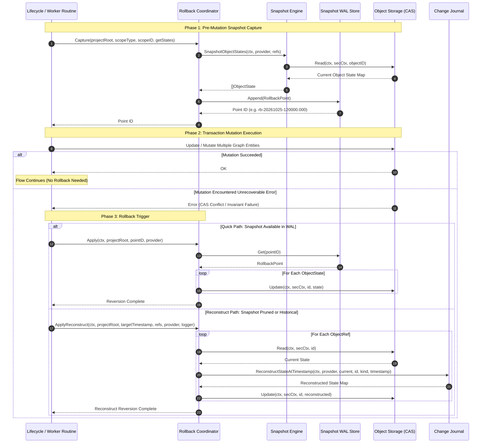
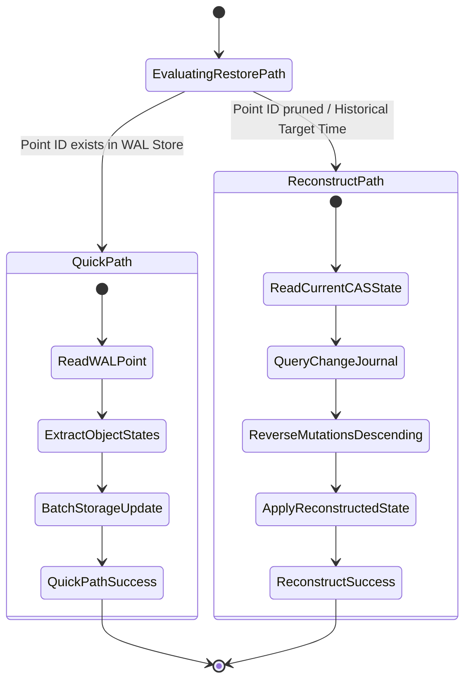
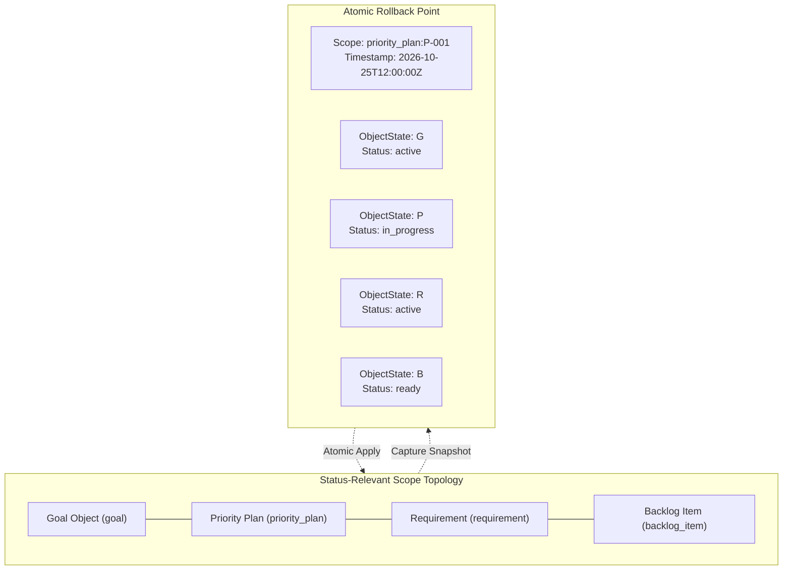

# Lifecycle Rollback, Transaction Boundaries & Snapshot Management Subsystem Architectural & Operational Guide

## 1. Executive Architectural Summary

The **Lifecycle Rollback, Transaction Boundaries & Snapshot Management Subsystem** ([`pkg/rollback`](file:///Users/lanceettl/zqk-public-candidate/pkg/rollback/rollback.go)) provides resilient point-in-time snapshot capture, transactional state isolation, and multi-entity graph state restoration for the ZQK Knowledge Kernel.

Governed by core platform safety policies (including `POL-DEFAULT-b17f54c251eb3c4d`), the Knowledge Kernel operates as a local developer microkernel orchestrating concurrent AI agent swarms, background daemons, and automated workflow pipelines. Operations such as milestone transitions, status cascade recomputations, schema migrations, and batch maintenance tasks mutate multiple inter-dependent graph entities. If an operational failure occurs midway through a multi-stage transition, or if an automated agent makes an unrecoverable error, the system must not leave the graph in a corrupt, half-applied state.

The `pkg/rollback` subsystem eliminates this failure class through a dual-path recovery design:
1. **Fast Point-in-Time Application ([`Apply`](file:///Users/lanceettl/zqk-public-candidate/pkg/rollback/rollback.go#L81)):** Rapidly restores prior object states directly from an append-only write-ahead log (WAL) snapshot point.
2. **Beyond-Threshold Reconstructive Recovery ([`ApplyReconstruct`](file:///Users/lanceettl/zqk-public-candidate/pkg/rollback/rollback.go#L106)):** When a snapshot point has aged past retention ceilings or has been pruned, the system walks backward through the append-only change journal, unwinding subsequent mutations to reconstruct the state as it existed at the target timestamp.

---

## 2. Component Topology & Subsystem Architecture

The subsystem is organized into four core functional components:

```mermaid
flowchart TD
    subgraph RollbackSubsystem["pkg/rollback Subsystem Topology"]
        Coordinator["Rollback Coordinator\n(Capture, List, Get, Apply, ApplyReconstruct, Retain)"]
        SnapshotEngine["Snapshot Engine\n(SnapshotObjectStates)"]
        WALStore["Snapshot WAL Store\n(.zqk/wal/rollback_points)"]
        LockSentinel["Lock Operation Sentinel\n(LockNameRollbackStore*)"]
        ConfigEngine["Configuration Engine\n(DefaultConfig)"]
    end

    subgraph KernelCore["Knowledge Kernel & Storage Layer"]
        StorageProvider["storage.ObjectStorageProvider\n(Read, Update, List)"]
        ChangeJournal["storage.ReconstructStateAtTimestamp\n(Change Journal Unwinder)"]
        ConcurrencyLogger["concurrency.RunInLockWithLogger\nconcurrency.RunInRLockWithLogger"]
        FileUtil["fileutil Filesystem Abstraction\n(Atomic Writes, Flush, Rename)"]
    end

    subgraph WorkflowConsumers["Platform Consumers"]
        LifecycleMachine["Lifecycle Transition Engine"]
        MaintenanceTasks["Maintenance & Migration Tasks"]
        CLIMutate["CLI Mutate & Rollback Commands"]
    end

    WorkflowConsumers -->|Pre-mutation Capture| Coordinator
    WorkflowConsumers -->|Execute Reversion| Coordinator
    Coordinator -->|Collect Target Entity States| SnapshotEngine
    SnapshotEngine -->|Read Current Object State| StorageProvider
    Coordinator -->|Append / Query / Prune| WALStore
    WALStore -->|Thread-Safe Synchronization| ConcurrencyLogger
    ConcurrencyLogger -->|Track Contention by Name| LockSentinel
    WALStore -->|Atomic Disk I/O| FileUtil
    Coordinator -->|Direct State Reversion (Apply)| StorageProvider
    Coordinator -->|Reconstruct From Log (ApplyReconstruct)| ChangeJournal
    ChangeJournal -->|Reversed Delta Application| StorageProvider
    Coordinator -->|Read Retention Policies| ConfigEngine
```

### Component Breakdown

- **Rollback Coordinator ([`rollback.go`](file:///Users/lanceettl/zqk-public-candidate/pkg/rollback/rollback.go)):** The primary facade coordinating snapshot capture, listing, direct rollback application, historical reconstruction, and retention pruning.
- **Snapshot Engine ([`snapshot.go`](file:///Users/lanceettl/zqk-public-candidate/pkg/rollback/snapshot.go)):** Reads current object maps for designated entities from the storage provider, packaging them into immutable [`ObjectState`](file:///Users/lanceettl/zqk-public-candidate/pkg/rollback/types.go#L13) representations.
- **Snapshot Store ([`store.go`](file:///Users/lanceettl/zqk-public-candidate/pkg/rollback/store.go)):** An append-only JSON Lines (JSONL) storage engine located at `.zqk/wal/rollback_points`. Enforces a 2 MiB per-entry payload limit, thread-safe concurrent access, and atomic rewrite on retention pruning.
- **Lock Operation Sentinel ([`lock_op_names.go`](file:///Users/lanceettl/zqk-public-candidate/pkg/rollback/lock_op_names.go)):** Constant-bound operation identifiers (`rollback_store_append`, `rollback_store_get`, `rollback_store_list`, `rollback_store_retain`) integrated with `concurrency.RunInLockWithLogger` and `concurrency.RunInRLockWithLogger` for contention logging and deadlock monitoring.
- **Configuration Engine ([`config.go`](file:///Users/lanceettl/zqk-public-candidate/pkg/rollback/config.go)):** Dynamically resolves retention counts, retention TTLs, and capture enablement toggles from environment flags with fallback to sensible production defaults.

---

## 3. Rollback Execution Lifecycle

The lifecycle of a state mutation guarded by rollback snapshots follows a strict deterministic workflow:



---

## 4. Dual-Path Restoration Architecture

The subsystem supports two complementary restoration pathways depending on the age and availability of the snapshot:



### Path 1: Fast Point-in-Time Application (`Apply`)
- **API:** [`Apply(ctx, projectRoot, pointID, provider)`](file:///Users/lanceettl/zqk-public-candidate/pkg/rollback/rollback.go#L81)
- **Mechanism:** Direct lookup of the [`RollbackPoint`](file:///Users/lanceettl/zqk-public-candidate/pkg/rollback/types.go#L20) in `.zqk/wal/rollback_points`. Iterates over the serialized [`ObjectState`](file:///Users/lanceettl/zqk-public-candidate/pkg/rollback/types.go#L13) records and writes the prior state map back to the storage provider via `provider.Update`.
- **Latency:** Sub-millisecond. Requires no journal scanning or event replay.
- **Precondition:** The snapshot point must exist within the active WAL file.

### Path 2: Change-Journal Deep Reconstruction (`ApplyReconstruct`)
- **API:** [`ApplyReconstruct(ctx, projectRoot, targetTimestamp, refs, provider, logger)`](file:///Users/lanceettl/zqk-public-candidate/pkg/rollback/rollback.go#L106)
- **Mechanism:** Used when snapshots have aged past retention windows or were never explicitly created. For each entity in the scope's status-relevant graph:
  1. Reads the entity's current authoritative state from storage.
  2. Queries `storage.ReconstructStateAtTimestamp` to scan the change journal for mutations committed after `targetTimestamp`.
  3. Reverses mutations in descending chronological order (restoring `previous_state` for updates/deletions).
  4. Commits the reconstructed state via `provider.Update`.
- **Resilience:** Unbounded temporal reach; independent of snapshot WAL retention.

---

## 5. Multi-Entity Consistency & CAS Integrity

When rolling back graph operations, multiple heterogeneous entities must be updated in tight coordination:



### Integrity Invariants

1. **Topological Cohesion:** A rollback point captures the entire subgraph affected by a lifecycle change. If a plan transition cascades status modifications across 5 backlog items, all 5 items plus the plan are bundled into a single [`RollbackPoint`](file:///Users/lanceettl/zqk-public-candidate/pkg/rollback/types.go#L20).
2. **Deterministic Error Propagation:** If `Apply` encounters a failure on any entity update, execution halts immediately and returns an explicit wrapped error ([`errfmt.Errorf`](file:///Users/lanceettl/zqk-public-candidate/pkg/rollback/rollback.go#L97)), logging diagnostic telemetry via `logging.NewEventLogger`.
3. **Empty Reference Safeguards:** In `ApplyReconstruct`, entities with empty kind or ID identifiers are safely skipped, preventing corrupt zero-value writes.

---

## 6. Concurrency, Storage Sanitation & Retention Discipline

The subsystem enforces rigorous concurrency hygiene and storage bounds:

### 1. Concurrency Controls
- **Exclusive Lock Operations (`sync.RWMutex.Lock`):** Required for [`Append`](file:///Users/lanceettl/zqk-public-candidate/pkg/rollback/store.go#L54) and [`Retain`](file:///Users/lanceettl/zqk-public-candidate/pkg/rollback/store.go#L126). Monitored under `LockNameRollbackStoreAppend` and `LockNameRollbackStoreRetain`.
- **Shared Lock Operations (`sync.RWMutex.RLock`):** Utilized by [`List`](file:///Users/lanceettl/zqk-public-candidate/pkg/rollback/store.go#L79) and [`Get`](file:///Users/lanceettl/zqk-public-candidate/pkg/rollback/store.go#L103), allowing concurrent high-throughput inspection without blocking parallel readers.
- **Labelled Goroutines:** Concurrent worker routines employ `goroutinelabels.NewGoroutine` for structured telemetry and panic isolation.

### 2. WAL File Structure & Limits
- **Location:** `.zqk/wal/rollback_points` under the active project root.
- **Format:** Line-delimited JSON (`JSONL`). Each line represents an independent, self-contained [`RollbackPoint`](file:///Users/lanceettl/zqk-public-candidate/pkg/rollback/types.go#L20).
- **Line Size Invariant:** Lines exceeding `maxRollbackLineSize` (2 MiB) are rejected before writing, protecting memory buffers from runaway payload inflation.
- **Corrupt Line Resilience:** The scanner skips corrupted or partially written lines gracefully during `List`, `Get`, and `Retain`, preserving uncorrupted records.

### 3. Retention & Pruning Discipline
- **Two-Dimensional Pruning ([`Retain`](file:///Users/lanceettl/zqk-public-candidate/pkg/rollback/store.go#L126)):** Rollback points are pruned according to both maximum count (`keepCount`) and age ceiling (`keepDuration`).
- **Atomic File Swapping:** Retention rewrites write surviving entries to `.zqk/wal/rollback_points.tmp`, flush and sync to disk, and atomically rename over the active store file.
- **Zero-Allocation Short-Circuit:** If all existing records qualify for retention (`len(keep) >= len(all)`), the rewrite is skipped entirely.

---

## 7. Configuration Reference

The subsystem behavior can be configured programmatically or via environment variables:

| Setting | Type | Default | Environment Variable Override | Description |
| :--- | :--- | :--- | :--- | :--- |
| **`RetainCount`** | `int` | `5` | `ZQK_STORAGE_ROLLBACK_RETAIN_COUNT` | Maximum number of rollback points retained in the WAL file. |
| **`RetainDuration`** | `time.Duration` | `168h` (7 days) | `ZQK_STORAGE_ROLLBACK_RETAIN_DURATION` | Maximum age of rollback points before automatic expiration. |
| **`CaptureEnabled`** | `bool` | `true` | `ZQK_STORAGE_ROLLBACK_CAPTURE_DISABLED` | Global toggle. When disabled, `Capture` returns immediately with an empty ID. |

---

## 8. Verification & Test Coverage Invariant

In conformance with platform engineering invariants, the `pkg/rollback` subsystem enforces:

1. **Statement Coverage Floor:** Minimum 85.0% statement coverage (achieved **94.0%** in the elevation test suite).
2. **Three-Fold Proof Coverage:**
   - **Static Floor Invariant:** Verified via `TestCycle202_Store_Append_BoundaryConditions` and `TestCycle202_DefaultConfig_Variations`.
   - **Operational Dynamic Proof:** Verified via `TestCycle202_Capture_ComprehensiveFlows`, `TestCycle202_Apply_ComprehensivePathways`, and `TestCycle202_ApplyReconstruct_ComprehensivePathways`.
   - **Negative Adversarial Boundary:** Verified via `TestCycle202_Store_List_CorruptedLines`, `TestCycle202_Store_Retain_DurationAndCountPruning`, `TestCycle202_Store_Retain_ErrorConditions`, and `TestCycle202_Concurrency_ThreadSafety`.
3. **Filesystem Hermeticity:** All tests strictly utilize `github.com/zqk-os/zqk/pkg/utils/fileutil` abstractions. Direct `os.*` filesystem calls are strictly forbidden in accordance with pre-commit check-valves.
4. **Zero Error Swallowing:** All error conditions are strictly asserted; zero blank assignments (`_ = ...`) exist in test or implementation suites.
