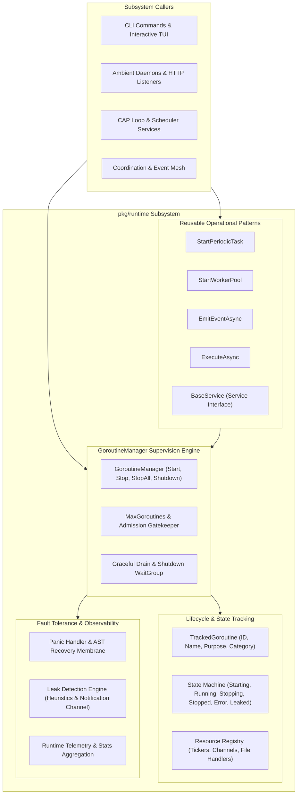
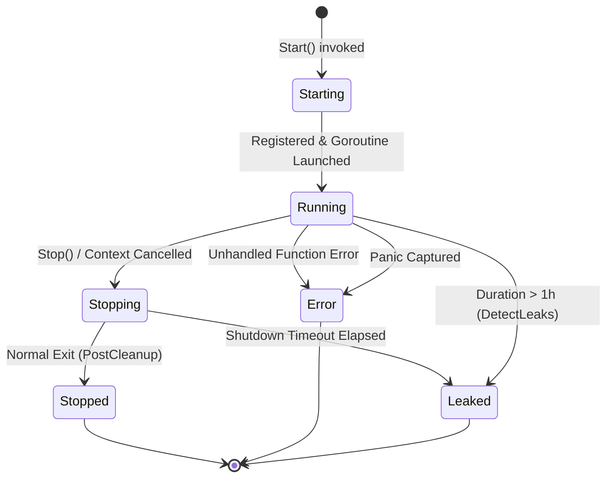
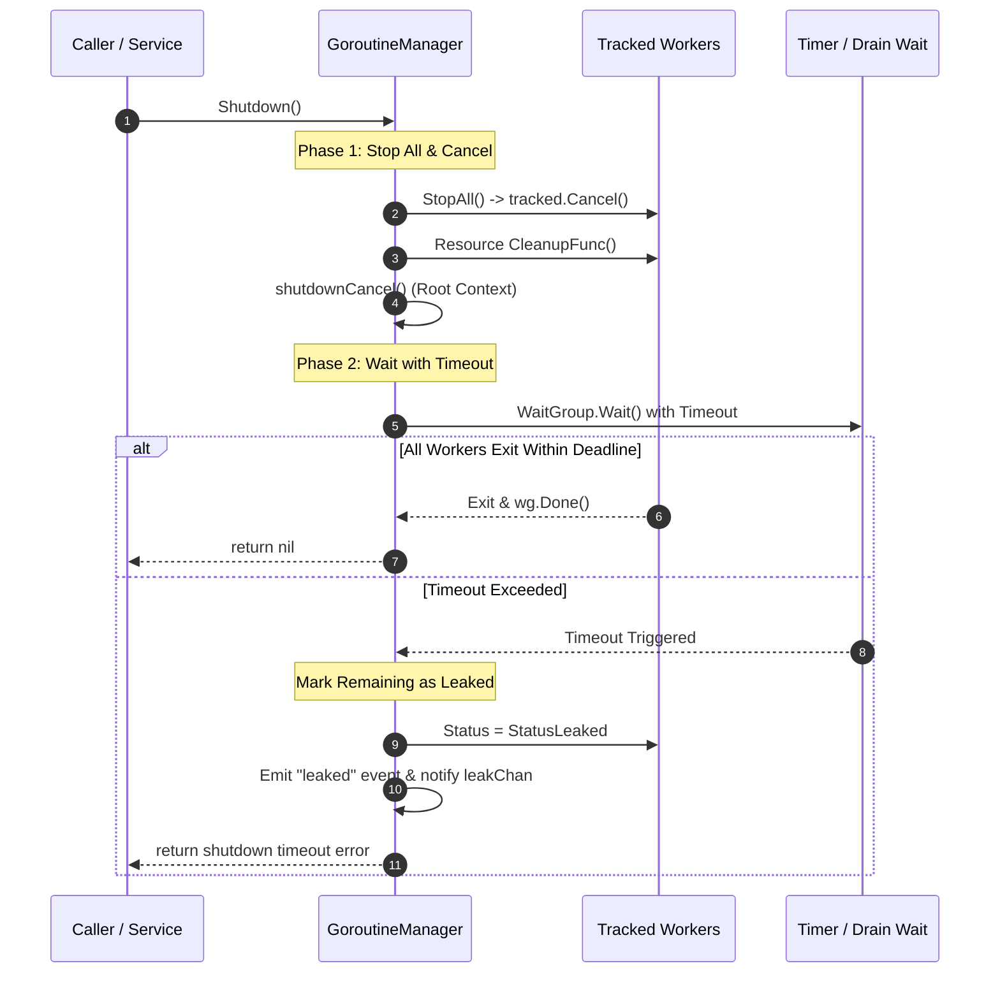

# Runtime Subsystem Architectural & Operational Guide

Comprehensive architectural manual, goroutine lifecycle governance specification, and operational guide for the **ZQK Runtime Subsystem** (`pkg/runtime`).

---

## 1. Overview & Architectural Compass

The Runtime Subsystem (`pkg/runtime`) provides the centralized supervision tree, deterministic goroutine lifecycle governance, leak detection heuristics, and graceful shutdown orchestration for the **Zen Quantum Knowledge Kernel**.

In an autonomous multi-agent operating environment where concurrent background daemons, scheduled cron jobs, event-driven streaming pumps, and worker pools operate concurrently, raw, unmanaged Go goroutines (`go func()`) introduce serious operational risks:
- **Goroutine Leakage**: Orphaned background loops that fail to listen to parent context cancellation stay resident indefinitely, consuming memory and thread handles.
- **Uncontrolled Panics**: An unhandled panic in an unmanaged goroutine crashes the entire process, circumventing application recovery hooks.
- **Resource Abandonment**: Goroutines allocating persistent resources (such as active tickers, file descriptors, or network streams) without deterministic cleanup hooks cause descriptor exhaustion.
- **Observability Voids**: Unlabeled goroutines provide zero telemetry regarding their purpose, execution duration, failure status, or CPU cost during crash analysis.
- **Ungraceful Termination**: When a process receives an interrupt or shutdown signal, executing routines may be abruptly terminated mid-mutation, causing state corruption in CAS databases or transaction logs.

The `pkg/runtime` subsystem eradicates these liabilities through a supervised **Goroutine Manager**, context-aware lifecycle hooks, automated panic recovery membranes, and deterministic drain coordination.



### Core Responsibilities
- **Supervised Lifecycle Governance**: Every managed background routine is assigned a unique identifier, purpose label, category, parent context, and lifecycle state.
- **Automatic Resource Cleanup**: Associates tickers, channels, and open streams directly with the tracked goroutine, guaranteeing invocation of cleanup routines upon termination.
- **Panic Interception & Containment**: Captures any panics occurring within managed goroutines, formats structured diagnostic errors, marks the routine as failed, and notifies telemetry hooks without crashing the host process.
- **Leak Detection & Notifications**: Implements heuristic duration monitoring and provides non-blocking notification channels to catch stalled goroutines during shutdown.
- **Two-Phase Graceful Drain**: Sequentially cancels individual goroutine contexts, triggers resource cleanup, cancels the root manager context, and coordinates a timed drain wait before flagging leaked routines.

---

## 2. Subsystem Taxonomy & Core Primitives

### 2.1 GoroutineManager Supervision Engine

The central coordinating type is `GoroutineManager` (`goroutine_manager.go`), which tracks and coordinates the lifecycle of all goroutines within a service or command boundary.

```go
type GoroutineManager struct {
    goroutines           map[string]*TrackedGoroutine
    coordinator          coordination.EventCoordinator
    shutdownCtx          context.Context
    shutdownCancel       context.CancelFunc
    maxGoroutines        int
    shutdownTimeout      time.Duration
    leakNotificationChan chan string
    // internal synchronization and atomic counters
}
```

#### Manager Lifecycle Operations
1. **Creation (`NewGoroutineManager`)**:
   Derives a cancellation context from the parent process context. Instantiates internal registries, atomic counters, and default timeout thresholds (default shutdown timeout: `30s`).
2. **Admission & Start (`Start`)**:
   Generates a unique goroutine identifier (`goroutine_<name>_<timestamp>`). Evaluates the active count against `maxGoroutines` (if configured). Constructs a child context with dedicated cancellation, registers the `TrackedGoroutine`, emits lifecycle start events, executes `OnStart` callbacks, and launches execution within the `goroutinelabels` wrapper.
3. **Targeted Stop (`Stop`)**:
   Locates the tracked routine by ID, invokes its specific context cancellation function, and triggers registered resource cleanup functions in sequence.
4. **Collective Stop (`StopAll`)**:
   Acquires a read lock to snapshot all active routine IDs, then sequentially executes `Stop` across all registered routines.
5. **Graceful Shutdown (`Shutdown`)**:
   Guaranteed idempotency via `sync.Once`. Calls `StopAll()`, cancels the root manager context, and launches a monitored wait on the internal `sync.WaitGroup` with a configurable deadline.

---

### 2.2 TrackedGoroutine & Lifecycle State Machine

Each routine managed by `GoroutineManager` is represented by a `TrackedGoroutine` instance containing metadata, context handles, timing records, and operational status.



#### Status Enumerations
- **`StatusStarting` (`"starting"`)**: Initial state during configuration allocation before the go routine scheduler dispatches the worker.
- **`StatusRunning` (`"running"`)**: Routine is actively executing its payload function.
- **`StatusStopping` (`"stopping"`)**: Cancellation signal has been delivered; cleanup routines are currently executing.
- **`StatusStopped` (`"stopped"`)**: Routine completed normally and all associated resources have been released.
- **`StatusError` (`"error"`)**: Routine terminated with an error or recovered from an unhandled panic.
- **`StatusLeaked` (`"leaked"`)**: Routine failed to exit within the graceful shutdown window or exceeded the long-running leak threshold.

---

### 2.3 Resource Governance & Safe Teardown

Background tasks often initialize secondary primitives such as `time.Ticker`, event channels, temporary files, or network sockets. If the worker encounters an error or context cancellation, orphaned tickers prevent memory reclamation.

`pkg/runtime` provides the `Resource` struct to bind these primitives directly to the goroutine:

```go
type Resource struct {
    Type        string       // "ticker", "channel", "file", "connection", etc.
    ID          string       // Resource identifier
    Description string       // Human-readable description
    CleanupFunc func() error // Idempotent cleanup logic
}
```

When `Stop` or `stopGoroutine` executes, the manager iterates over all registered resources and invokes each `CleanupFunc`. Any cleanup error is recorded and emitted as a structured `cleanup_error` telemetry event without interrupting subsequent resource deallocations.

---

### 2.4 Panic Handlers & Fault Isolation

Standard Go unmanaged goroutines that encounter a nil pointer dereference or slice bounds violation terminate the entire operating process immediately. `GoroutineManager` integrates deep panic recovery via `goroutinelabels.WithPanicHandler`:

```go
WithPanicHandler(func(r any) {
    err := errfmt.Errorf("panic in goroutine %s: %v", id, r)
    gm.stopGoroutine(id, err, config.OnStop)
})
```

When a panic occurs:
1. The panic object is captured and wrapped into an informative error recording the routine ID and panic payload.
2. The routine's status is atomically shifted to `StatusError`.
3. The lifetime error counter (`totalErrors`) is incremented.
4. The user-provided `OnStop` callback is invoked with the error.
5. The associated resources are safely cleaned up.
6. The host process and other sibling goroutines continue uninterrupted.

---

## 3. Leak Detection, Diagnostics & Drain Coordination

### 3.1 Leak Detection Heuristics (`DetectLeaks`)

In long-running daemon environments, some background tasks may hang on deadlocked channels or blocked network I/O without throwing errors. The `DetectLeaks` function inspects all tracked routines against operational thresholds:

```go
func (gm *GoroutineManager) DetectLeaks() []*TrackedGoroutine {
    // ...
    for _, tracked := range goroutinesCopy {
        // ...
        duration := now.Sub(startTime)
        if status == StatusRunning && duration > time.Hour {
            leaks = append(leaks, tracked)
        }
    }
    return leaks
}
```

A routine is flagged as a suspected leak if:
1. Its current status remains `StatusRunning`.
2. Its active execution duration exceeds the leak threshold (default `1 hour`).
3. The manager has initiated shutdown or diagnostic inspection.

---

### 3.2 Two-Phase Graceful Drain Protocol

The `Shutdown()` method implements a fail-safe, two-phase drain sequence designed to prevent split-brain teardowns and resource leaks:



#### Deterministic Test Synchronization
To support rigorous, flake-free unit and integration testing of leak behavior, `GoroutineManager` supports `SetLeakNotificationChannel(ch chan string)`. When a shutdown timeout occurs, routine IDs marked as leaked are non-blockingly pumped into this channel, allowing tests to verify leak detection without brittle sleep timers.

---

### 3.3 Lock Operations & Contention Tracking (`lock_op_names.go`)

All internal state transitions and registry reads within `GoroutineManager` utilize named lock operations through `concurrency.RunInLockWithLogger` and `concurrency.RunInRLockWithLogger`.

Standard lock operation identifiers defined in `lock_op_names.go`:
- `LockNameGoroutineManagerDetectLeaksCopy`: Registry copy during leak inspection.
- `LockNameGoroutineManagerGetStatsCopy`: Snapshotting active maps for telemetry reporting.
- `LockNameGoroutineManagerLeakCheck`: Reading individual routine status and start timestamps.
- `LockNameGoroutineManagerMarkLeaked`: Transitioning routine status to `StatusLeaked`.
- `LockNameGoroutineManagerSetRunning`: Marking newly launched routine as `StatusRunning`.
- `LockNameGoroutineManagerStopAllGetIds`: Extracting routine ID list for collective termination.
- `LockNameGoroutineManagerStopCheck`: Checking if routine is already stopped before teardown.
- `LockNameGoroutineManagerStopUpdate`: Setting stop timestamp, error payload, and status.

If any critical section exceeds the system contention threshold (100ms), the lock logger automatically emits structured warnings containing lock hold times and contention metrics.

---

## 4. Reusable Runtime Patterns & Helpers (`pkg/runtime/helpers.go`)

To avoid duplicating boilerplate goroutine lifecycle code across packages, `pkg/runtime/helpers.go` provides standard high-level abstractions:

### 4.1 Periodic Background Tasks (`StartPeriodicTask`)

Safely runs a recurring function at a specified duration interval. Automatically instantiates a `time.Ticker`, registers it as a tracked `Resource`, and stops the ticker when context cancellation occurs.

```go
id, ctx, err := runtime.StartPeriodicTask(
    manager,
    "cache_prune",
    10*time.Minute,
    func(ctx context.Context) error {
        return pruneExpiredCacheEntries(ctx)
    },
)
```

### 4.2 Supervised Worker Pools (`StartWorkerPool`)

Spawns a designated number of worker routines executing identical processing loops. Includes automatic rollback: if any worker fails to start (for example, if `maxGoroutines` is reached), all previously started workers in that pool are automatically stopped before returning an error.

```go
workerIDs, err := runtime.StartWorkerPool(
    manager,
    "indexer_worker",
    4,
    func(ctx context.Context, workerID int) error {
        return processIndexQueue(ctx, workerID)
    },
)
```

### 4.3 Async Event Emission (`EmitEventAsync`)

Asynchronously emits events into the coordination framework. If a `GoroutineManager` is supplied, the emission is tracked as a short-lived routine with operational audit metadata. If `manager == nil`, it falls back safely to an untracked background goroutine for backward compatibility.

```go
err := runtime.EmitEventAsync(manager, coordinator, eventContext)
```

### 4.4 One-Off Async Operations (`ExecuteAsync`)

Executes a single async closure with full lifecycle tracking, returning the routine ID, cancellation context, and a buffered error channel (`<-chan error`) that receives the execution outcome.

```go
id, ctx, errChan := runtime.ExecuteAsync(manager, "artifact_upload", func(ctx context.Context) error {
    return uploadArtifact(ctx, payload)
})
```

### 4.5 Standard Service Pattern (`Service` & `BaseService`)

Defines the standard contract for background daemons and subsystems:

```go
type Service interface {
    Start(ctx context.Context) error
    Stop() error
    GetGoroutineManager() *GoroutineManager
}
```

The `BaseService` struct provides a reference implementation, initializing an internal `GoroutineManager` with system context and delegating `Stop()` to `manager.Shutdown()`.

---

## 5. Practical Operational Recipes

### Recipe 1: Initializing a Supervised Daemon Service

```go
package myservice

import (
    "context"
    "time"

    "github.com/zqk-os/zqk/pkg/coordination"
    "github.com/zqk-os/zqk/pkg/runtime"
)

type GatewayService struct {
    *runtime.BaseService
}

func NewGatewayService(coord coordination.EventCoordinator) *GatewayService {
    return &GatewayService{
        BaseService: runtime.NewBaseService(coord),
    }
}

func (s *GatewayService) Start(ctx context.Context) error {
    gm := s.GetGoroutineManager()

    // 1. Start background queue consumer
    _, _, err := runtime.ExecuteAsync(gm, "queue_consumer", func(ctx context.Context) error {
        for {
            select {
            case <-ctx.Done():
                return nil
            default:
                // Process queue items
                time.Sleep(100 * time.Millisecond)
            }
        }
    })
    if err != nil {
        return err
    }

    // 2. Start periodic metrics collector
    _, _, err = runtime.StartPeriodicTask(gm, "metrics_heartbeat", 15*time.Second, func(ctx context.Context) error {
        return s.emitHeartbeat(ctx)
    })
    return err
}

func (s *GatewayService) emitHeartbeat(ctx context.Context) error {
    // Collect and emit metrics
    return nil
}
```

### Recipe 2: Graceful Process Teardown on Signal

```go
func RunSupervisor(ctx context.Context, coord coordination.EventCoordinator) error {
    manager := runtime.NewGoroutineManager(ctx, coord)
    manager.SetShutdownTimeout(10 * time.Second)

    // Start worker pool
    _, err := runtime.StartWorkerPool(manager, "data_pipeline", 8, func(ctx context.Context, id int) error {
        <-ctx.Done()
        return nil
    })
    if err != nil {
        return err
    }

    // Await interrupt signal
    <-ctx.Done()

    // Coordinate graceful drain
    if err := manager.Shutdown(); err != nil {
        // Log leak warning or timeout details
        return err
    }
    return nil
}
```

---

## 6. Verification & Statement Coverage Invariant

The Runtime Subsystem enforces a strict **>=85.0% statement test coverage invariant** across all production files (`goroutine_manager.go`, `helpers.go`, `lock_op_names.go`).

### Test Coverage Execution
To verify statement test coverage locally or within automated continuous integration pipelines, run:

```bash
ZQK_ALLOW_FOREGROUND_GO_TEST=1 go test -v -timeout 30s -cover ./pkg/runtime
```

### Verification Matrix
- **Lifecycle & Callback Hooks**: Asserts that `OnStart` and `OnStop` callbacks are executed deterministically upon routine creation and termination.
- **Panic Trapping & Recovery**: Verifies that panics in worker closures are intercepted, error counters updated, and the calling process remains stable.
- **Resource Cleanup Guarantees**: Confirms that registered `Resource.CleanupFunc` handlers are invoked even during unexpected routine failure.
- **Leak Detection & Drain Timeouts**: Validates that routines exceeding shutdown timeouts are categorized as `StatusLeaked` and transmitted via notification channels.
- **Capacity Limits & Rollback**: Verifies that when worker pool creation exceeds `maxGoroutines`, previously allocated workers are torn down safely.
- **Zero Swallowed Errors Invariant**: Strict compliance ensures no error returns are discarded (`_ = ...`) within test verification suites.

---

## 7. Open-Core Compliance Invariant

This guide adheres strictly to the **Open-Core Public Release Gateway Standards**. In compliance with `scripts/open-core/check-public-release-payload.sh`:
- All identifiers, types, and operational examples are generic, standard public components.
- No internal ephemeral nanosecond IDs, proprietary swarm addresses, or private cluster endpoints are present.
