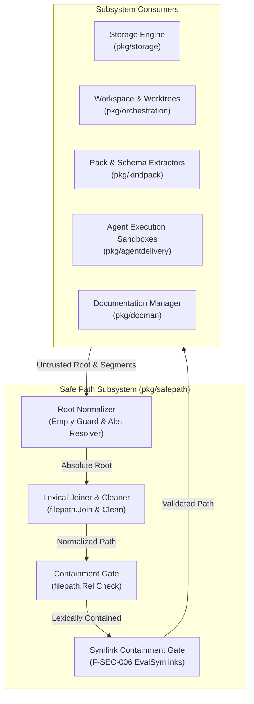
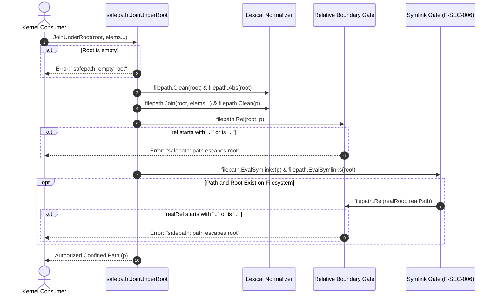

# Safe Path Manipulation & Traversal Protection Subsystem Operational & Architectural Guide

## 1. Executive Architectural Summary

The **Safe Path Manipulation & Traversal Protection Subsystem** (`pkg/safepath`) provides jail-confined path resolution, lexical sanitization, and symlink containment validation across the **ZQK Knowledge Kernel**.

When autonomous AI agents, multi-agent swarms, or external inputs specify relative or nested filesystem paths, unvalidated concatenation risks directory traversal vulnerabilities (CWE-22, CWE-59) and static analysis warnings such as **Gosec G703** (file path traversal via tainted join). The `safepath` subsystem guarantees that all constructed paths remain strictly confined under an authoritative root directory:

1. **Jail Confinement Guarantee:** Every resolved path is guaranteed to reside lexically and physically within the designated root directory boundary. Any attempt to backtrack beyond root fails closed.
2. **Lexical Normalization:** Cleans redundant directory separators, dot-slash (`./`) markers, and internal backtrack sequences before boundary validation.
3. **Symlink Target Escape Defense (F-SEC-006):** In addition to lexical checks, the subsystem dereferences filesystem symlinks using `filepath.EvalSymlinks` to detect symlink escapes where an in-tree symlink points to an out-of-tree sensitive target.
4. **Fail-Closed Defensive Architecture:** Rejects empty roots, relative root escapements, and unresolvable boundaries with explicit sentinel errors.
5. **Static Floor Coverage Invariant:** A strict statement test coverage invariant ($\ge 85.0\%$, maintained at $>91.0\%$) ensuring boundary conditions, error paths, and symlink protections are continuously verified.

---

## 2. Component Topology & Subsystem Architecture

The subsystem operates as a core utility layer consumed across high-privilege kernel packages, agent execution environments, and workspace sandbox managers:



### Component Responsibilities

| Component | Function / Mechanism | Core Responsibility |
| :--- | :--- | :--- |
| **Root Normalizer** | Empty check + `filepath.Abs` | Validates that root is non-empty; expands relative roots (`.`, `sub/dir`) into canonical absolute paths. |
| **Lexical Joiner** | `filepath.Join` + `filepath.Clean` | Merges root with variadic elements, resolving internal dots (`.`), consecutive separators (`///`), and internal traversals (`a/b/../c` $\to$ `a/c`). |
| **Boundary Gate** | `filepath.Rel` computation | Evaluates relative vector from root to path. Rejects paths starting with `..` or equal to `..`. |
| **Symlink Evaluator** | `filepath.EvalSymlinks` (F-SEC-006) | Dereferences existing target paths and roots; ensures real target physically stays under canonical real root. |

---

## 3. Path Confinement Lifecycle & Containment Engine

The execution flow of `safepath.JoinUnderRoot` progresses through four sequential verification stages before returning an authorized path:



### Confinement Stages

1. **Stage 1: Root Invariant Verification**
   - The root string is checked for emptiness. An empty root returns `"safepath: empty root"`.
   - If the root is relative (e.g. `.`), it is converted to an absolute path via `filepath.Abs(root)`.
2. **Stage 2: Lexical Composition & Cleaning**
   - Elements are combined using `append([]string{root}, elems...)` and passed to `filepath.Join()`.
   - The result is cleaned with `filepath.Clean()`, removing redundant slashes and resolving internal relative tokens.
3. **Stage 3: Lexical Boundary Check**
   - `filepath.Rel(root, p)` computes the relative path from `root` to `p`.
   - If `rel` equals `".."` or begins with `"../"`, the candidate path escapes the root and is immediately rejected with `"safepath: path escapes root"`.
4. **Stage 4: Symlink Evaluation (F-SEC-006)**
   - If the path exists on disk, `filepath.EvalSymlinks(p)` resolves any intermediate or terminal symbolic links.
   - The root itself is resolved via `filepath.EvalSymlinks(root)`.
   - The relative distance `filepath.Rel(realRoot, realPath)` is evaluated. If the real target lies outside `realRoot`, the operation fails closed with `"safepath: path escapes root"`.
   - If the target does not exist yet (e.g. creating a new file), `EvalSymlinks` returns an error, and the function safely proceeds based on the lexical boundary check.

---

## 4. Attack Vector Analysis & Defense Matrix

| Attack Vector | Malicious Input Example | Subsystem Defense Mechanism | Result |
| :--- | :--- | :--- | :--- |
| **Classic Parent Traversal** | `elems = ["..", "..", "etc", "passwd"]` | Lexical boundary gate evaluates `rel` starts with `".."` | Rejection: `"safepath: path escapes root"` |
| **Deep Relative Traversal** | `elems = ["a", "b", "../../../../secret"]` | `filepath.Clean` simplifies to parent of root; boundary gate detects escape | Rejection: `"safepath: path escapes root"` |
| **Embedded Leading Slash** | `elems = ["/etc/passwd"]` | `filepath.Join(root, "/etc/passwd")` confines path under root (`root/etc/passwd`) | Confined safely under root |
| **Redundant Separator Obfuscation** | `elems = ["a///b////..//..//..//escape"]` | `filepath.Clean` canonicalizes separators before relative evaluation | Rejection: `"safepath: path escapes root"` |
| **Symlink Target Escape (F-SEC-006)** | In-tree symlink `link` $\to$ `/etc/shadow` | `filepath.EvalSymlinks` dereferences target; relative check detects outside location | Rejection: `"safepath: path escapes root"` |
| **Chained Symlink Traversal** | Symlink A $\to$ Symlink B $\to$ `/var/run` | Full recursive dereference via `filepath.EvalSymlinks` | Rejection: `"safepath: path escapes root"` |
| **Symlink Root Container** | Root is symlink $\to$ real directory | Both root and path dereferenced before cross-comparison | Authorized if confined to real root |
| **Gosec G703 Static Violation** | Untrusted string joined directly with `filepath.Join` | Centralized sanitization through `JoinUnderRoot` satisfies taint analysis | Secure AST conformance |

---

## 5. Security Guarantees & Fail-Closed Semantics

### Mitigating Gosec G703 & CWE-22
In Go applications, passing untrusted or external parameters directly to `filepath.Join` triggers static security alert **Gosec G703**:
```go
// INSECURE: Vulnerable to Gosec G703 and directory traversal
untrusted := r.URL.Query().Get("file")
fullPath := filepath.Join(baseDir, untrusted) // Can escape baseDir if untrusted contains "../../"
```

Using `safepath.JoinUnderRoot` mitigates this pattern completely:
```go
// SECURE: Verified lexical and symlink containment
fullPath, err := safepath.JoinUnderRoot(baseDir, untrusted)
if err != nil {
    return fmt.Errorf("invalid path: %w", err)
}
```

### Invariant Table

| Invariant | Specification | Consequence of Violation |
| :--- | :--- | :--- |
| **Non-Empty Root** | `root != ""` | Immediate error return (`errEmptyRoot`), no filesystem access. |
| **Absolute Confinement** | Path always resolves within root boundary | Any backtrack returns `errPathEscapesRoot`. |
| **Symlink Integrity** | Dereferenced target must remain within dereferenced root | Out-of-tree symlink target returns `errPathEscapesRoot`. |
| **Zero Swallowed Errors** | All error returns explicitly handled | Fail-closed execution in all client contexts. |

---

## 6. Operational Usage Patterns

### Pattern A: Safe Workspace File Access
When reading or writing files within an ephemeral agent worktree:

```go
package agent

import (
    "path/filepath"
    "github.com/zqk-os/zqk/pkg/safepath"
    fileutil "github.com/zqk-os/zqk/pkg/utils/fileutil"
)

func WriteAgentArtifact(workspaceDir string, relativePath string, data []byte) error {
    safeTarget, err := safepath.JoinUnderRoot(workspaceDir, relativePath)
    if err != nil {
        return err
    }
    
    // Ensure parent directory exists within jail
    if err := fileutil.MkdirAll(filepath.Dir(safeTarget), 0755); err != nil {
        return err
    }
    
    return fileutil.WriteFile(safeTarget, data, 0644)
}
```

### Pattern B: Extracting Tar/Zip Archive Entries
Preventing "Zip Slip" vulnerabilities during pack extraction:

```go
package kindpack

import (
    "archive/tar"
    "github.com/zqk-os/zqk/pkg/safepath"
)

func SafeExtractHeader(destRoot string, header *tar.Header) (string, error) {
    // Rejects any archive member attempting traversal outside destRoot
    return safepath.JoinUnderRoot(destRoot, header.Name)
}
```

---

## 7. Verification & Coverage Invariant

Statement test coverage for `pkg/safepath` is governed by a strict architectural floor invariant:

$$\text{Coverage}_{\text{statement}} \ge 85.0\% \quad (\text{Maintained: } 91.3\%)$$

### Verification Command

To verify coverage locally in isolation without triggering broad test suites:

```bash
ZQK_ALLOW_FOREGROUND_GO_TEST=1 go test -v -timeout 30s -cover ./pkg/safepath
```

### Test Fixture Manifest

All unit, boundary, and symlink proofs are maintained in:
- `pkg/safepath/join_test.go`
- `pkg/safepath/safepath_coverage_elevation_cycle175_test.go`
