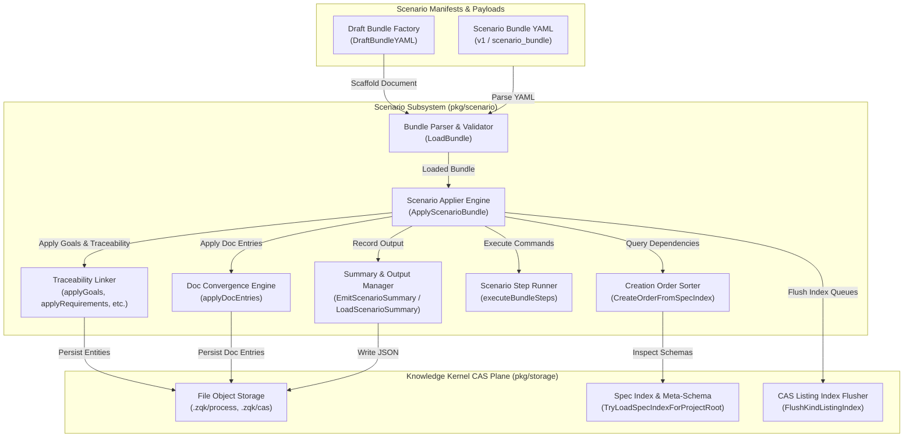
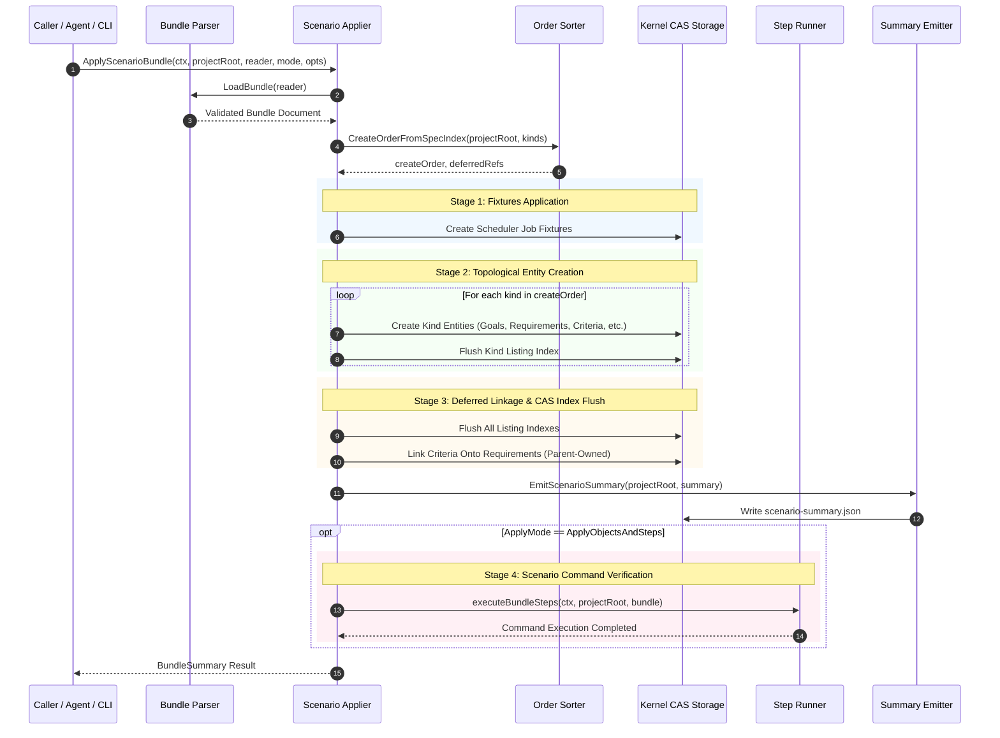
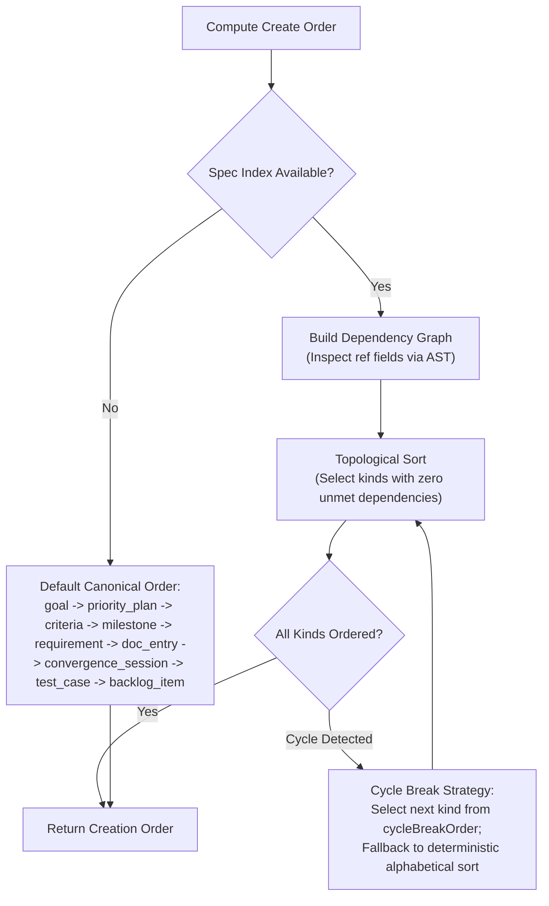

# Scenario Testing, Behavioral Simulation & Convergence Playback Subsystem Operational Architecture Guide

## 1. Executive Architectural Summary

The **Scenario Testing, Behavioral Simulation & Convergence Playback Subsystem** (`pkg/scenario`) provides declarative scenario execution, automated doc convergence, traceability graph materialization, and convergence playback capabilities across the **ZQK Knowledge Kernel**.

In modern software ecosystems, end-to-end and integration testing often suffers from brittle, imperative shell scripts, unversioned test data, and decoupled documentation drift. When autonomous AI agents or human engineers refactor systems, requirements drift from criteria, test cases fail to link back to core business goals, and operational documentation becomes obsolete.

`pkg/scenario` resolves these systemic challenges through six foundational architectural principles (governed by POL-DEFAULT-142277d3):

1. **Declarative Scenario Bundles:** Formats scenarios into structured, versioned YAML manifests (`scenario_bundle`) encapsulating goals, requirements, criteria, test cases, backlog items, doc entries, convergence sessions, and executable verification steps.
2. **Topological Dependency Order Resolution:** Computes optimal entity creation sequences via Go AST spec index inspection and cycle-breaking algorithms, ensuring referenced parent entities are materialized before dependent children.
3. **Automated Documentation Convergence:** Binds architectural documentation (`doc_entry`) directly to requirements, preventing doc rot and automatically registering searchable content within kernel Content-Addressed Storage (CAS).
4. **Traceability Graph Materialization:** Establishes bidirectional and parent-owned edge relations across the Five-Layer Cascade (Vision/Goals ➔ Priority Plans ➔ Requirements ➔ Acceptance Criteria ➔ Backlog Items), ensuring full DoD compliance.
5. **Convergence Playback & Simulation:** Enables deterministic replay of multi-agent convergence sessions (`convergence_session`), verifying hypothesis validation, phase transitions, and delta assessments.
6. **Static Floor Coverage Invariant:** A strict statement test coverage invariant ($\ge 85.0\%$, verified at $>92.0\%$) ensuring boundary conditions, error handling, asset deserialization, and multi-goroutine concurrency safety are continuously verified.

---

## 2. Component Topology & Subsystem Architecture

The subsystem operates as a core execution engine bridging declarative scenarios with the kernel CAS storage plane:



### Component Roles and Boundaries

- **Scenario Applier (`ApplyScenarioBundle`):** The orchestrator coordinating entity creation order, storage provider lifecycle, security context propagation, and post-apply step command execution.
- **Creation Order Sorter (`CreateOrderFromSpecIndex`):** Calculates topological sort order across bundle object kinds using AST schema definitions; breaks mutual dependency cycles deterministically.
- **Traceability Resolver (`apply_traceability.go`):** Instantiates immutable builders for `goal`, `requirement`, `criteria`, `test_case`, and `backlog_item`, links hints to runtime IDs, and enforces parent-owned criteria relations.
- **Doc Convergence Engine (`apply_doc_convergence.go`):** Ingests `doc_entry` and `convergence_session` templates, configuring searchable markdown paths and linking documentation to verified requirements.
- **Step Runner (`executeBundleSteps`):** Executes post-apply scenario verification commands in isolated subshells with process isolation and `ZQK_TEST_ROOT` environment binding.
- **Summary & Artifact Manager (`EmitScenarioSummary`, `LoadScenarioSummary`):** Serializes execution outcomes and ID-hint mappings to `.zqk/scenarios/<bundle-name>/scenario-summary.json`.

---

## 3. Scenario Application & Convergence Playback Lifecycle

The following sequence illustrates the complete execution flow from raw bundle ingestion to post-apply verification:



---

## 4. Dependency Topology & Topological Order Calculation

When scenario bundles create multiple interrelated kernel objects, creation order must satisfy schema constraints:
- `requirement` objects declare mandatory `goal_refs` (pointing to created goals).
- `test_case` objects reference requirements and criteria.
- `backlog_item` objects reference requirements, criteria, milestones, and test cases.
- `criteria` objects are linked into `requirement.criteria_refs` via parent-owned composition.

The subsystem determines creation order through the following decision flow:



### Parent-Owned Composition Invariant

Under the ZQK Relational Model (GRAPH_EDGE_OWNERSHIP):
- Criteria objects **never** persist `requirement_refs`.
- Parent requirements own child criteria via `requirement.criteria_refs`.
- In scenario bundles, `criteria.requirement_ref` is treated as a declarative syntactic hint only. The `linkCriteriaTemplatesOntoRequirements` routine copies these hints onto the parent requirement after initial creation.

---

## 5. Concurrency, Storage Isolation & Thread-Safety

`pkg/scenario` enforces rigorous multi-agent and multi-goroutine safety:

1. **Ephemeral Workspace Isolation:** Unit and integration tests execute within ephemeral directory roots provisioned via `t.TempDir()`, preventing cross-test pollution and `.zqk/process` mutations.
2. **Fresh Instance Builders:** Object instance builders are instantiated per-apply via `freshInstanceBuilder(kind)` rather than sharing singleton builder state.
3. **Goroutine Identity & Concurrency:** Multi-worker execution uses `goroutinelabels.NewGoroutine` to assign explicit, traceable runtime labels to all asynchronous workers:
   ```go
   goroutinelabels.NewGoroutine("scenario_worker", "concurrent scenario apply worker").
       WithWaitGroup(&wg).
       StartSimple(func() {
           // isolated bundle apply logic
       })
   ```
4. **Graceful Worker Shutdown:** When `ApplyScenarioBundle` provisions a default `FileObjectStorage` instance, it registers a `defer` hook ensuring clean shutdown of background CAS workers and eliminating goroutine leaks.
5. **Listing Index Cache Checker:** Configures `makeCreatedIDsCacheChecker` to allow in-flight cross-reference validation during bundle application, preventing false-positive "object not found" errors prior to disk flushes.

---

## 6. Verification & Three-Fold Proof Breakdown

The subsystem is validated according to the Three-Fold Proof:

| Verification Layer | Verification Contract | Implementation & Invariants |
| :--- | :--- | :--- |
| **Static Floor Invariant** | Statement Test Coverage $\ge 85.0\%$ | Comprehensive unit suite across `apply.go`, `apply_doc_convergence.go`, `apply_traceability.go`, `bundle.go`, `create_order.go`, and `draft_bundle.go`. |
| **Operational Dynamic Proof** | Scenario Application & Convergence | End-to-end simulation of scenario bundles, fixture generation, CAS schema validation, step execution, and summary round-tripping. |
| **Negative Adversarial Boundary** | Error Defense & Poison Pill Protection | Rejection of malformed YAML, missing schema headers, unresolvable references, non-zero step command exits, and circular dependency deadlocks. |

---

## 7. Operational CLI & API Quick Reference

### Drafting a New Scenario Bundle

```bash
# Generate a starter scenario bundle template
zqk new bundle --name "payment-service-integration"
```

### Applying a Scenario Bundle via Go API

```go
package main

import (
    "context"
    "os"
    "github.com/zqk-os/zqk/pkg/scenario"
)

func main() {
    ctx := context.Background()
    f, err := os.Open("examples/scenarios/feature_bundle.yaml")
    if err != nil {
        panic(err)
    }
    defer f.Close()

    summary, err := scenario.ApplyScenarioBundle(ctx, ".", f, scenario.ApplyObjectsAndSteps)
    if err != nil {
        panic(err)
    }
    println("Applied bundle:", summary.BundleName)
}
```

### Inspecting Scenario Execution Summaries

```bash
# Read generated scenario summary
cat .zqk/scenarios/payment-service-integration/scenario-summary.json
```
