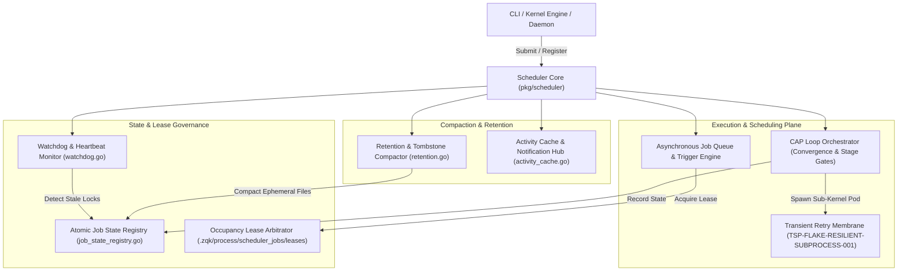

# Scheduler Subsystem Operational & Architectural Guide

## Overview

The ZQK Scheduler Subsystem (`pkg/scheduler`) is an embedded, resilient job scheduling and orchestration engine powering the **Zen Quantum Knowledge Kernel**. It governs autonomous background execution, continuous convergence loops (CAP orchestrator), periodic system maintenance, stream compaction, watchdog telemetry, and multi-agent workload dispatch.

Built upon ZQK's file-first Content-Addressable Storage (CAS) and Write-Ahead Log (WAL) architecture, the scheduler requires no external brokers, databases, or daemon dependencies. It delivers deterministic execution, process lease isolation, crash recovery replay, and self-healing resilience against transient operating system failures.

---

## Subsystem Architecture

The following diagram illustrates the core components and flow of execution through the Scheduler subsystem:



---

## Core Components

### 1. Asynchronous Job Queue & Trigger Engine
The scheduler continuously monitors job definitions registered in `.zqk/process/scheduler_jobs/`. Jobs specify execution triggers through flexible configurations:
- **Interval Expressions**: Periodic execution at fixed durations (e.g., `@every 5m`, `@every 30s`).
- **Cron Expressions**: Calendar-aligned execution using 5-field cron syntax (e.g., `0 */2 * * *`).
- **One-Time Triggers**: Ephemeral run-to-completion tasks triggered by external events or CLI invocations.
- **Skip Windows**: Configurable quiet periods during which job runs are deferred to prevent interference with critical operations.
- **Concurrency & Skip Policies**: Prevents overlapping execution by enforcing strict concurrency limits and skip-if-running policies.

### 2. CAP Loop Orchestrator & Convergence Engine
The Continuous Autonomous Program (CAP) orchestrator coordinates continuous delivery and autonomous software engineering loops:
- **Multi-Stage Pipeline**: Manages progression through distinct lifecycle stages: `planning`, `design`, `grooming`, `orchestrating`, `verifying`, and `merging`.
- **Sub-Kernel Team Pods**: Automatically provisions ephemeral sub-kernels with isolated worktrees and persona seating, enabling multi-agent swarms to collaborate concurrently.
- **Stage Gates & Verification**: Transitions require rigorous verification proofs against acceptance criteria before promoting work to subsequent stages.
- **Fail-Closed Quarantine**: If stage failures exceed configured retry limits, the orchestrator quarantines the session, emitting diagnostic alerts rather than entering runaway execution loops.

### 3. Transient Retry Membrane (`TSP-FLAKE-RESILIENT-SUBPROCESS-001`)
Subprocesses executing inside ephemeral worktrees or CI pipelines face transient OS-level anomalies (such as `ETXTBSY`, filesystem lock latency, memory pressure, or timing flakes). The scheduler embeds a resilience membrane:
- **Bounded Exponential Backoff**: Retries failed command dispatches with progressive backoff and randomized jitter to avoid thundering-herd contention.
- **Transient vs. Terminal Classification**: Inspects exit codes and stderr streams to distinguish recoverable transient flakes from deterministic code errors.
- **Envelope Budgeting**: Limits total retry consumption per job execution to guarantee deterministic termination.

### 4. Atomic Job State Registry & Lease Arbitration
Multi-process coordination operates without centralized lock managers:
- **File-Based Leases**: Active jobs acquire occupancy leases under `.zqk/process/scheduler_jobs/leases/`. Leases record job ID, execution ID, PID, acquisition timestamp, and TTL.
- **Monotonic Sequence Replay**: Leverages CAS storage and WAL records to rebuild active job state across process restarts without double-execution risks.
- **Process Liveness Probes**: Leases are tied to OS process IDs (`os.FindProcess` / signal 0 verification) to promptly reclaim leases left by crashed or terminated workers.

### 5. Watchdog Monitoring & Self-Healing Pipeline
The scheduler maintains system health through proactive background audits:
- **Heartbeat Verification**: Running tasks periodically pulse heartbeats. If a task becomes unresponsive beyond its maximum timeout threshold, the watchdog triggers automated recovery.
- **Stale Lock Reconciliation**: Scans for orphaned lock files and abandoned worktrees, releasing resources and restoring queues to clean state.
- **Dead Process Reclamation**: Automatically marks jobs from deceased parent processes as failed or deferred, ensuring subsequent schedule ticks continue uninterrupted.

### 6. Retention, Tombstones & Activity Compaction
High-frequency scheduler runs generate execution history and audit logs that require disciplined lifecycle governance:
- **Configurable Retention Windows**: Prunes completed job states, session logs, and event streams past their time-to-live (`TTL`) threshold.
- **Tombstone Compaction**: Consolidates deleted job markers and ephemeral index files to minimize disk footprint and keep filesystem directory traversals fast.
- **High-Volume Event Caching**: Implements bounded in-memory activity caches with automated disk flushing to ensure high-throughput telemetry without memory ballooning.

---

## Operational Guide & Administration

### Managing Scheduler Jobs via CLI

#### Subsystem Commands

| Operation | CLI Command | Description |
| :--- | :--- | :--- |
| **Inspect Status** | `zqk system status` | Check scheduler daemon health, active leases, and upcoming triggers. |
| **Trigger Immediate Run** | `zqk scheduler trigger <job-id>` | Force immediate execution of a registered job outside its schedule. |
| **Check Active Leases** | `zqk scheduler leases` | List all active job execution leases, PIDs, and expiration times. |
| **Run System Diagnostics** | `zqk system check --auto-remedy` | Scan for orphaned locks, expired leases, or stalled CAP stages. |
| **Drain & Maintenance** | `zqk scheduler drain` | Gracefully drain active jobs before system maintenance or restarts. |

---

## Verification & Statement Coverage Invariant

The scheduler subsystem is a Tier-0 mission-critical engine. Corrupt execution states, runaway loops, or unhandled errors can compromise autonomous swarm operations.

### Quality Invariants

1. **Statement Coverage Target**: Statement coverage across `pkg/scheduler` MUST be maintained at **>= 85.0%**. Any PR dropping coverage below this floor is blocked by automated CI gates.
2. **Zero Swallowed Errors**: Explicit error checking is mandatory on all I/O, storage, and subprocess calls (`if err != nil` or `require.NoError(t, err)`). Blank identifier error assignments (`_ = ...`) are prohibited in production and test code.
3. **Function Length Constraint**: In compliance with microkernel architecture standards, individual functions MUST NOT exceed **100 lines**. Complex routines must be broken into modular, single-responsibility helpers.
4. **Hermetic Test Isolation**: Tests must never mutate live user directories. All tests must execute against isolated temporary environments created via `t.TempDir()`, overriding project roots (`ZQK_PROJECT_ROOT`, `ZQK_TEST_ROOT`).

### Running Scheduler Tests & Verifying Coverage

Execute bounded, non-destructive test runs targeting only the scheduler package:

```bash
# Run Cycle 126 coverage elevation suite
ZQK_ALLOW_FOREGROUND_GO_TEST=1 go test -v -timeout 30s ./pkg/scheduler -run 'TestCycle126'

# Measure statement coverage across the scheduler subsystem
ZQK_ALLOW_FOREGROUND_GO_TEST=1 go test -short -cover ./pkg/scheduler
```
