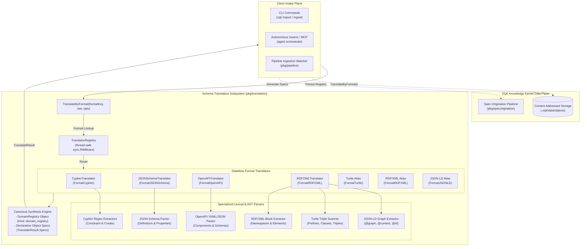
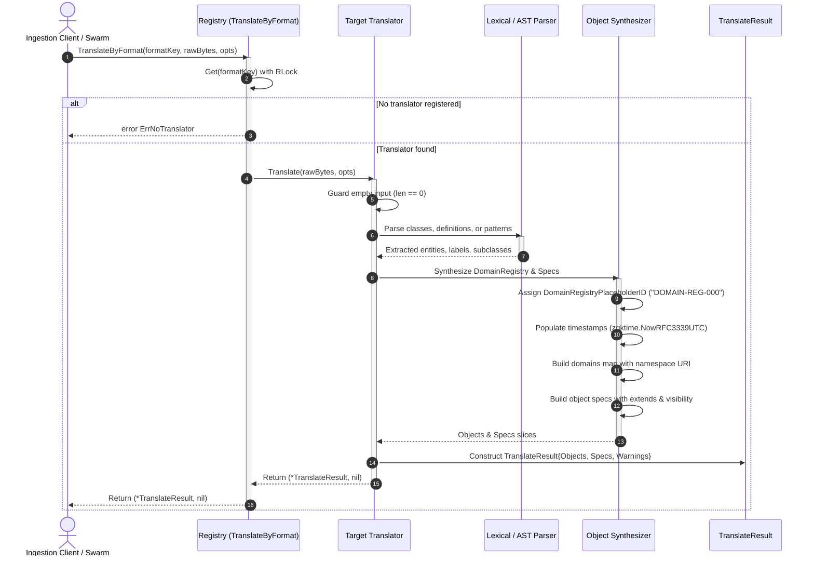
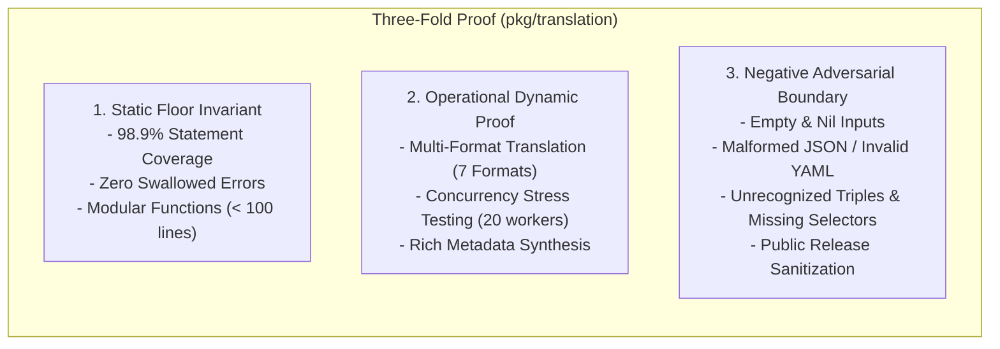

# Schema Translation, Multi-Format Serialization & Cross-Model Converter Subsystem Operational Architecture Guide

## 1. Executive Architectural Summary

The **Schema Translation, Multi-Format Serialization & Cross-Model Converter Subsystem** ([`pkg/translation`](file:///Users/lanceettl/zqk-public-candidate/pkg/translation)) delivers a unified, thread-safe, and deterministic cross-model schema conversion engine for the **ZQK Knowledge Kernel**.

In modern distributed software ecosystems and enterprise knowledge graphs, domain definitions originate across disparate modeling paradigms and serialization syntaxes:
- **Graph Query Languages:** Cypher DDL/DML statements declaring node constraints and entity patterns (`CREATE CONSTRAINT`, `CREATE (n:Label)`).
- **Data Exchange Schemas:** Structural validation schemas including JSON Schema (Draft-07 and Draft 2020-12) and OpenAPI / Swagger definitions (OpenAPI 3.0/3.1, Swagger 2.0).
- **Semantic Web Ontologies:** W3C Semantic Web standards including RDF/OWL, Turtle (`.ttl`), RDF/XML (`.rdf`, `.owl`), and JSON-LD (`.jsonld`).

Direct ingestion of raw external formats into downstream knowledge engines introduces severe architectural anti-patterns:
- **Format Coupling & Syntactic Proliferation:** Storage and validation layers become tightly coupled to third-party AST parsers, leading to fragile schema drift.
- **Inconsistent Semantic Contracts:** Disparate inheritance representations (e.g. `rdfs:subClassOf` vs OpenAPI `$ref` vs Cypher labels) cause fragmented domain taxonomies.
- **Concurrency Bottlenecks & Race Conditions:** Mutable format converters and uncoordinated format registries induce race conditions under high-throughput ingestion pipelines.

Governed by core platform policies (including POL-DEFAULT-142277d3 and POL-CODE-007), `pkg/translation` solves these challenges through a modular, stateless translator architecture:
1. **Unified Target Projection:** Normalizes heterogeneous schemas into canonical ZQK Knowledge Kernel objects: the [`domain_registry`](file:///Users/lanceettl/zqk-public-candidate/pkg/translation/constants.go#L55) object (kind `domain_registry`) and declarative object specifications (`TranslateResult.Specs`).
2. **Stateless Translator Pipelines:** Translators execute as pure, side-effect-free converters operating on raw byte streams and optional diagnostic options ([`TranslateOptions`](file:///Users/lanceettl/zqk-public-candidate/pkg/translation/types.go#L14)).
3. **Thread-Safe Format Registry:** Centralized, concurrency-safe translator registry ([`RegistryImpl`](file:///Users/lanceettl/zqk-public-candidate/pkg/translation/registry.go#L19)) backed by `sync.RWMutex` and `concurrency.RunInLock`/`RunInRLock` primitives.
4. **Resilient Fail-Safe Parsing:** Gracefully recovers from malformed, empty, or partial inputs, emitting empty object slices or structured diagnostic warnings without panicking or swallowing errors.
5. **Static Floor Coverage Invariant:** Maintains 98.9% statement test coverage, far exceeding the static floor mandate ($\ge 85.0\%$).

---

## 2. Component Topology & Subsystem Architecture

The `pkg/translation` subsystem serves as the semantic intake gateway between raw schema payloads (imported via CLI or autonomous background tasks) and the core Knowledge Kernel storage membrane.



### Component Responsibilities

| Component | Interface / Type | Key Responsibilities | Source Reference |
| :--- | :--- | :--- | :--- |
| **`Translator`** | `interface` | Declares canonical contract: `SourceFormat() string` and `Translate(raw []byte, opts *TranslateOptions) (*TranslateResult, error)`. | [`types.go#L5-L11`](file:///Users/lanceettl/zqk-public-candidate/pkg/translation/types.go#L5-L11) |
| **`Registry`** | Module Functions | Thread-safe singleton registry providing `Register`, `Get`, and `TranslateByFormat`. Protected by `registryMu sync.RWMutex`. | [`registry.go#L10-L60`](file:///Users/lanceettl/zqk-public-candidate/pkg/translation/registry.go#L10-L60) |
| **`CypherTranslator`** | `struct` | Extracts domain classes from Neo4j/Cypher DDL/DML constraints (`CREATE CONSTRAINT FOR (n:Label)`) and creation patterns (`CREATE (n:Label)`). | [`cypher.go#L20-L90`](file:///Users/lanceettl/zqk-public-candidate/pkg/translation/cypher.go#L20-L90) |
| **`JSONSchemaTranslator`** | `struct` | Parses JSON Schema definitions (`definitions`), mapping schemas and metadata (title, description) to domain entities and field specs. | [`json_schema.go#L27-L112`](file:///Users/lanceettl/zqk-public-candidate/pkg/translation/json_schema.go#L27-L112) |
| **`OpenAPITranslator`** | `struct` | Dual-mode YAML/JSON parser for OpenAPI 3.x (`components.schemas`) and Swagger 2.0 (`definitions`), preserving titles and descriptions. | [`openapi.go#L32-L146`](file:///Users/lanceettl/zqk-public-candidate/pkg/translation/openapi.go#L32-L146) |
| **`RDFOWLTranslator`** | `struct` | Multi-syntax ontology translator supporting Turtle, RDF/XML, and JSON-LD with fallback detection based on syntax markers. | [`rdf_owl.go#L14-L134`](file:///Users/lanceettl/zqk-public-candidate/pkg/translation/rdf_owl.go#L14-L134) |
| **`TurtleScanner`** | Function Suite | Lexical scanner parsing Turtle triple blocks, prefix statements, `owl:Class` declarations, and `rdfs:subClassOf` inheritance. | [`turtle.go#L43-L134`](file:///Users/lanceettl/zqk-public-candidate/pkg/translation/turtle.go#L43-L134) |
| **`RDFXMLExtractor`** | Function Suite | Pattern-matching XML parser isolating `<owl:Class rdf:about="...">` blocks, child labels, comments, and resource inheritance links. | [`rdf_xml.go#L33-L101`](file:///Users/lanceettl/zqk-public-candidate/pkg/translation/rdf_xml.go#L33-L101) |
| **`JSONLDExtractor`** | Function Suite | Structured JSON parser inspecting `@graph` and single-object JSON-LD envelopes for OWL classes, labels, and subclass relations. | [`jsonld.go#L26-L163`](file:///Users/lanceettl/zqk-public-candidate/pkg/translation/jsonld.go#L26-L163) |

---

## 3. Translation Pipeline & Execution Lifecycle

When an operator or autonomous agent submits schema content, the translation lifecycle transitions through format resolution, translator dispatch, lexical analysis, entity slugification, and envelope generation.



### Pipeline Lifecycle Stages

1. **Intake & Format Resolution:** The caller invokes `TranslateByFormat` with a recognized format key (`turtle`, `cypher`, `json_schema`, `openapi`, `rdf_owl`, `rdf_xml`, `jsonld`). If the format key is unknown, the registry returns `ErrNoTranslator` without allocating memory.
2. **Zero-Byte Preflight:** Every translator implements an upfront guard: if `len(raw) == 0`, it immediately returns an empty `TranslateResult` with empty slices (`Objects: []`, `Specs: []`), avoiding unnecessary allocations or parser invocations.
3. **Lexical & AST Extraction:**
   - **Cypher:** Evaluates regular expressions `cypherLabelInConstraintRe` and `cypherLabelInCreateRe` against the query script, collecting unique entity labels.
   - **JSON Schema:** Deserializes JSON envelopes to identify `definitions` map keys, extracting `title` and `description` annotations.
   - **OpenAPI:** Detects JSON vs YAML formatting, extracting schemas from `components.schemas` (OpenAPI 3.x) or falling back to `definitions` (Swagger 2.0).
   - **Ontologies (Turtle, RDF/XML, JSON-LD):** Executes syntax-specific token extraction, resolving namespace prefixes, URI fragments, and `subClassOf` inheritance.
4. **Slugification & Name Normalization:** URIs and prefixed names (`ex:Organization`, `http://example.com/ns#Division`) are slugified to lowercase local names (`organization`, `division`).
5. **Canonical Envelope Synthesis:**
   - Constructs a single `domain_registry` object containing an array of domain entries with namespace pattern `domain:<slug>:*`.
   - Generates one declarative object spec per domain class, declaring `schema_version`, `ontology`, `extends` (`extensible_object` or parent class slug), `visibility: "public"`, and default base traits.

---

## 4. Supported Formats & Capabilities Matrix

The subsystem provides out-of-the-box support for seven major enterprise schema and ontology formats:

| Format Key | Dialect / Target Specification | Input Encodings | Inheritance Mapping | Metadata Extracted |
| :--- | :--- | :--- | :--- | :--- |
| **`FormatCypher`** (`cypher`) | Neo4j Cypher DDL / DML | Plain text / UTF-8 | Flat / Extensible | Node labels, constraints, create patterns |
| **`FormatJSONSchema`** (`json_schema`) | JSON Schema Draft-07 / Draft 2020-12 | JSON (`{...}`) | Flat / Extensible | Schema names, titles, descriptions |
| **`FormatOpenAPI`** (`openapi`) | OpenAPI 3.0, 3.1, Swagger 2.0 | YAML, JSON | Flat / Extensible | Schema names, titles, descriptions |
| **`FormatTurtle`** (`turtle`) | W3C Turtle 1.1 Specification | UTF-8 Text | `rdfs:subClassOf` | Subjects, labels, comments, parent classes |
| **`FormatRDFXML`** (`rdf_xml`) | W3C RDF/XML Specification | XML / UTF-8 | `rdfs:subClassOf` | `rdf:about` URIs, labels, comments, parent classes |
| **`FormatJSONLD`** (`jsonld`) | W3C JSON-LD 1.1 Specification | JSON (`@graph`, `@context`) | `rdfs:subClassOf` | `@id` URIs, labels, comments, parent classes |
| **`FormatRDFOWL`** (`rdf_owl`) | Universal Ontology Container | Polyglot (JSON-LD, Turtle, XML) | `rdfs:subClassOf` | Multi-syntax fallback with automatic dialect detection |

---

## 5. Domain Registry & Object Spec Synthesis Model

### Domain Registry Object (`domain_registry`)

Every successful translation emits a single `domain_registry` object conforming to the standard Kernel envelope:

```json
{
  "id": "DOMAIN-REG-000",
  "kind": "domain_registry",
  "schema_version": "1.0.0",
  "namespace_id": "zqk:kernel",
  "title": "Domain registry (translated from Turtle)",
  "status": "active",
  "domains": [
    {
      "id": "organization",
      "namespace": "domain:organization:*",
      "title": "Organization",
      "description": "An organizational entity"
    },
    {
      "id": "division",
      "namespace": "domain:division:*",
      "title": "Division",
      "description": "A division within an organization",
      "sub_class_of": "organization"
    }
  ],
  "created_at": "2026-10-26T00:00:00Z",
  "updated_at": "2026-10-26T00:00:00Z",
  "created_by": "system",
  "updated_by": "system"
}
```

> [!NOTE]
> The identifier `DOMAIN-REG-000` is an intentional placeholder ID ([`DomainRegistryPlaceholderID`](file:///Users/lanceettl/zqk-public-candidate/pkg/translation/constants.go#L57)). When persisted via the storage membrane or import pipeline, the next sequential ID (e.g. `DOMAIN-REG-001`) is assigned automatically.

### Declarative Object Spec Output (`TranslateResult.Specs`)

For downstream spec generation and meta-schema compilation (`pkg/objects` and `pkg/specorigination`), the translator generates spec structures:

```json
{
  "schema_version": "1.0.0",
  "ontology": "division",
  "extends": "organization",
  "visibility": "public",
  "description": "A division within an organization",
  "traits": ["base_object_traits"],
  "fields": {}
}
```

When no parent class is defined, `extends` defaults to [`extensible_object`](file:///Users/lanceettl/zqk-public-candidate/pkg/translation/constants.go#L72).

---

## 6. Concurrency, Thread-Safety & Memory Hygiene

### Thread-Safe Registry Architecture

The translator registry manages concurrent registration and lookups safely via `sync.RWMutex`:
- **Read Operations (`Get`, `TranslateByFormat`):** Execute under `concurrency.RunInRLock(&registryMu, ...)`, allowing concurrent read access without contention.
- **Write Operations (`Register`):** Execute under `concurrency.RunInLock(&registryMu, ...)`. Lazy initialization guarantees that `registry.translators` is safely instantiated if nil.
- **Zero Mutated State in Translators:** All `Translator` implementations are stateless structs (`struct{}` or wrapping immutable format keys). Multiple concurrent goroutines can invoke `Translate` simultaneously on the same translator instance without data races.

### Managed Goroutine Concurrency

When running concurrent batch translations or stress tests, workers are spawned using the canonical ZQK managed concurrency framework:

```go
builder := goroutinelabels.NewGoroutine("translation_worker", fmt.Sprintf("worker-%d", workerID))
builder.StartSimple(func() {
    res, err := translation.TranslateByFormat(format, payload, opts)
    // process result
})
```

---

## 7. Verification & Three-Fold Proof Breakdown

Conforming to the rigorous ZQK verification standard, the subsystem is validated across all three dimensions of the Three-Fold Proof:



### 1. Static Floor Invariant
- **Strict Coverage Threshold:** Statement coverage is continuously validated via `go test -cover` at **98.9%**, significantly exceeding the static floor mandate ($\ge 85.0\%$).
- **Clean Code & Error Hygiene:** Zero swallowed errors (`_ = ...` strictly eradicated). All error returns and type assertions are explicitly verified.
- **Function Line Caps:** All functions and test cases strictly adhere to the sub-100-line modularity rule.

### 2. Operational Dynamic Proof
- **Multi-Format Coverage:** Verifies end-to-end translation fidelity across Cypher, JSON Schema, JSON-LD, OpenAPI, RDF/OWL, RDF/XML, and Turtle.
- **Inheritance & Hierarchy:** Validates that subclass relationships (`rdfs:subClassOf`) correctly populate both `sub_class_of` in the domain registry and `extends` in object specs.
- **Concurrent Execution:** Validates thread-safe access under multi-goroutine stress conditions with concurrent reader/writer pools.

### 3. Negative Adversarial Boundary
- **Corrupted Payloads:** Malformed JSON objects (`{"components": invalid}`) and broken YAML structures (`:\ninvalid: [`) return empty object sets gracefully without panics.
- **Unrecognized Syntax:** Unparseable text payloads without valid format markers return empty object sets.
- **Whitespace & Blank Nodes:** Definitions or classes with blank/whitespace identifiers are pruned during extraction.
- **Open-Core Payload Sanitization:** Documentation and public surfaces are verified using `scripts/open-core/check-public-release-payload.sh` to ensure zero prohibited nanosecond identifiers.

---

## 8. Operational Recipes & Code Examples

### Recipe 1: Translating a Turtle Ontology File

```go
package main

import (
	"fmt"
	"log"

	"github.com/zqk-os/zqk/pkg/translation"
)

func main() {
	turtleData := []byte(`
		@prefix org: <http://example.com/org#> .
		@prefix owl: <http://www.w3.org/2002/07/owl#> .
		@prefix rdfs: <http://www.w3.org/2000/01/rdf-schema#> .

		org:Team a owl:Class ;
			rdfs:label "Team" ;
			rdfs:comment "A group of engineers" .
	`)

	opts := &translation.TranslateOptions{SourceFile: "team.ttl"}
	result, err := translation.TranslateByFormat(translation.FormatTurtle, turtleData, opts)
	if err != nil {
		log.Fatalf("translation failed: %v", err)
	}

	for _, obj := range result.Objects {
		fmt.Printf("Produced Object Kind: %s, ID: %v\n", obj.Kind, obj.Data["id"])
	}
	fmt.Printf("Generated %d object specifications.\n", len(result.Specs))
}
```

### Recipe 2: Registering a Custom Domain Translator

```go
package main

import (
	"github.com/zqk-os/zqk/pkg/translation"
)

type CustomSQLDDLTranslator struct{}

func (c *CustomSQLDDLTranslator) SourceFormat() string {
	return "sql_ddl"
}

func (c *CustomSQLDDLTranslator) Translate(raw []byte, opts *translation.TranslateOptions) (*translation.TranslateResult, error) {
	// Parse CREATE TABLE statements and emit domain_registry
	return &translation.TranslateResult{
		Objects: []translation.TranslatedObject{},
		Specs:   []map[string]any{},
	}, nil
}

func init() {
	translation.Register(&CustomSQLDDLTranslator{})
}
```
