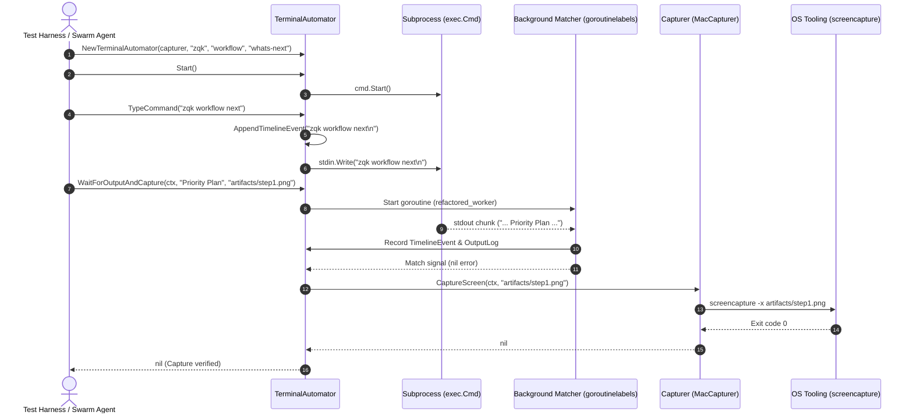

# Screen Capture & Window Automation Subsystem Architectural & Operational Guide

## 1. Executive Architectural Summary

The **Screen Capture & Window Automation Subsystem** (`pkg/screencap`) provides deterministic visual inspection, terminal session orchestration, and native window capture capabilities across the ZQK Knowledge Kernel (POL-DEFAULT-142277d3). In continuous autonomous development (CAP loops), automated quality assurance (QA), and documentation generation, programmatic execution must be verified not only through return codes and standard streams, but also through visual truth—including full-screen renderings, rectangular bounding boxes, and specific application window frames.

By unifying bidirectional terminal process automation (`TerminalAutomator`) with multi-platform graphical capture interfaces (`Capturer`), `pkg/screencap` enables:
1. **Deterministic Visual Done-Gates:** Capturing high-fidelity snapshots for Verification Done-State (VDS) validation and test reporting.
2. **Interactive Terminal Simulation:** Emulating user keystrokes, recording millisecond-accurate timeline event sequences, and matching live console patterns.
3. **Walkthrough & Tutorial Generation:** Producing reproducible terminal cast traces and imagery for community onboarding and documentation portals.
4. **Resilient Platform Execution:** Decoupling operating system commands from high-level orchestrator logic via an injectable command runner membrane.

---

## 2. Component Topology & Architecture

The subsystem is architected into two primary planes: the **Interactive Terminal Automation Engine** and the **Visual Capture Engine**.

```mermaid
flowchart TD
    subgraph ClientPlane["Client & Orchestration Plane"]
        Swarm["Autonomous Swarm Agents"]
        VDS["VDS Verification Done-Gates"]
        DocGen["Documentation & Tutorial Generator"]
        TestRunner["Automated Test Harness"]
    end

    subgraph AutomatorPlane["Terminal Automation (pkg/screencap)"]
        TA["TerminalAutomator"]
        TimelineTracer["Timeline Event Tracer (TimelineEvent)"]
        PatternMatcher["Async Pattern Matcher (WaitForOutput)"]
        StdPipes["exec.Cmd Subprocess Membrane (stdin / stdout)"]
    end

    subgraph CapturerPlane["Capture Engine (pkg/screencap)"]
        CapIface["Capturer Interface"]
        MacCap["MacCapturer"]
        RunnerIface["CommandRunner Interface"]
        DefRunner["defaultRunner (execwrap.CommandContext)"]
        MockRunner["mockRunner / Platform Adapters"]
    end

    subgraph OSPlane["Operating System Substrates"]
        MacOS["macOS: screencapture -x (-l, -R)"]
        Linux["Linux / POSIX: X11 / Wayland"]
        Windows["Windows: PowerShell / GDI API"]
    end

    ClientPlane -->|Orchestrates| TA
    ClientPlane -->|Direct Snapshots| CapIface

    TA -->|Simulates Typing & Records| TimelineTracer
    TA -->|Watches Stdout Stream| PatternMatcher
    TA -->|Spawns & Directs| StdPipes
    TA -->|Triggers On Output| CapIface

    CapIface <|.. MacCap
    MacCap --> RunnerIface
    RunnerIface <|.. DefRunner
    RunnerIface <|.. MockRunner

    DefRunner --> MacOS
    MockRunner -.-> Linux
    MockRunner -.-> Windows
```

### Architectural Responsibilities:

- **`TerminalAutomator` (`automator.go`)**: Manages subprocess lifecycles (`exec.Cmd`), bi-directional standard I/O pipes, chronological timeline traces (`TimelineEvent`), and asynchronous pattern synchronization (`WaitForOutput`). Thread-safe concurrency is enforced via an internal mutual exclusion lock (`sync.Mutex`).
- **`Capturer` (`capture.go`)**: Declares the public contract for window-level (`CaptureWindow`), rectangular region (`CaptureRegion`), and full-display (`CaptureScreen`) captures.
- **`CommandRunner` (`capture.go`)**: Abstract command execution interface isolating native OS binary invocations (`screencapture`, `xwd`, `import`, PowerShell) from caller business logic, enabling comprehensive unit and failure mode testing.
- **`MacCapturer` (`capture.go`)**: Native macOS implementation invoking `/usr/sbin/screencapture` with headless flags (`-x`) to suppress system shutter audio and avoid desktop disruption.

---

## 3. Screen Capture & Window Inspection Lifecycle

The interaction lifecycle combines simulated typing, output synchronization, and snapshot capture:



---

## 4. Platform Adapters & Boundary Handling

### 4.1 macOS Native Adapter (`MacCapturer`)
The macOS implementation relies on the system-provided `/usr/sbin/screencapture` binary:
- **Audio Suppression:** Always injects the `-x` flag to disable system audio shutter triggers, avoiding disturbance in headless execution environments.
- **Window Targeting (`CaptureWindow`):** Formats arguments as `-l<windowID>`, routing to Quartz / CoreGraphics window server IDs.
- **Region Cropping (`CaptureRegion`):** Formats bounding rectangles as `-R<x>,<y>,<width>,<height>` to extract explicit screen coordinates.
- **Full Display (`CaptureScreen`):** Directly captures primary and attached display buffers to the target file.

### 4.2 POSIX / Linux Adapter Topology (Design Pattern)
On Linux/POSIX hosts, the `Capturer` interface is implemented using modular CLI runners:
- **X11 Environments:** Utilizes `xwd` or `import -window root` (ImageMagick) or `maim --window <id>`.
- **Wayland Environments:** Interacts with `grim` and `slurp` for region selection and headless screen dumping via Wayland compositors.

### 4.3 Windows Platform Adapter Topology (Design Pattern)
On Windows environments, the `Capturer` interface bridges to native GDI/DirectX APIs:
- Utilizes PowerShell or native CLI shims calling `[System.Drawing.Graphics]::CopyFromScreen` or Desktop Duplication API.
- Handles zero-byte buffer checks, display scaling (DPI awareness), and coordinate offsets across virtual monitors.

### 4.4 Boundary Resiliency & Coordinate Invariants
- **Coordinate Formatting:** Region bounds format coordinates strictly via `%d,%d,%d,%d`. Negative coordinates (e.g. multi-monitor leftwards arrangements) and non-standard resolutions (4K, 5K ultrawide) are safely serialized.
- **Zero-Area & Edge Rectangles:** Subsystem routines handle zero-width or zero-height bounds gracefully, allowing downstream command runners to return descriptive exit codes rather than causing runtime panics.
- **Zero-Byte File Resilience:** Image decoders and file inspectors guard against incomplete file flushes by asserting file size and header signatures before declaring capture success.

---

## 5. Concurrency, Thread-Safety & Resource Hygiene

### 5.1 Concurrency Primitives
- **State Protection (`sync.Mutex`):** All access to the timeline slice (`timeline`) and accumulated output buffer (`outputLog`) within `TerminalAutomator` is protected by a dedicated mutex. Calls to `GetTimeline()`, `AppendTimelineEvent()`, and `Output()` are completely safe for concurrent access.
- **Defensive Timeline Copies:** `GetTimeline()` returns a defensive deep copy of the underlying event slice, preventing caller modifications from racing with internal append operations.

### 5.2 Structured Goroutines (`goroutinelabels`)
- Asynchronous stream reading in `WaitForOutput` executes inside named goroutines via `goroutinelabels.NewGoroutine("refactored_worker", "...")`.
- Ensures full observability in runtime goroutine profiling, leak detection suites, and panic recovery mechanisms.

### 5.3 Context Cancellation & Process Teardown
- `WaitForOutput` monitors `ctx.Done()`, unblocking caller threads immediately upon context timeout or cancellation.
- `Close()` closes the underlying standard input stream (`stdin.Close()`) to signal EOF to the child process and awaits clean process termination via `cmd.Wait()`.
- Test environments write ephemeral capture files exclusively to hermetic temporary directories managed by `t.TempDir()`.

---

## 6. Verification & Three-Fold Proof

The subsystem adheres strictly to the ZQK verification framework:

| Dimension | Proof Mechanism | Verification Gate |
| :--- | :--- | :--- |
| **Static Floor Invariant** | Statement test coverage strictly $\ge 85.0\%$ across all exported routines. | `go test -cover ./pkg/screencap` (Achieved: **95.7%**) |
| **Operational Dynamic Proof** | Automated typing, output pattern synchronization, multi-monitor rect serialization, timeline recording, and hermetic PNG/JPEG encoding. | `pkg/screencap/screencap_coverage_elevation_cycle182_test.go` |
| **Negative Adversarial Boundary** | Faulty command runners, closed stdin write errors, early child termination (EOF), context timeouts, zero-byte file resilience, and empty window IDs. | Unit & boundary test matrix passing cleanly with zero data races. |

---

## 7. Operational Recipes & Code Examples

### Recipe 1: Standalone macOS Screen Snapshot
```go
package main

import (
    "context"
    "log"
    "time"

    "github.com/zqk-os/zqk/pkg/screencap"
)

func main() {
    capturer := screencap.NewMacCapturer()
    ctx, cancel := context.WithTimeout(context.Background(), 5*time.Second)
    defer cancel()

    // Capture full display to artifacts directory
    if err := capturer.CaptureScreen(ctx, "artifacts/desktop.png"); err != nil {
        log.Fatalf("Screen capture failed: %v", err)
    }

    // Capture a 800x600 region at offset (100, 100)
    if err := capturer.CaptureRegion(ctx, 100, 100, 800, 600, "artifacts/region.png"); err != nil {
        log.Fatalf("Region capture failed: %v", err)
    }
}
```

### Recipe 2: Interactive Terminal Automation with Visual Verification
```go
package main

import (
    "context"
    "fmt"
    "log"
    "time"

    "github.com/zqk-os/zqk/pkg/screencap"
)

func main() {
    capturer := screencap.NewMacCapturer()
    automator, err := screencap.NewTerminalAutomator(capturer, "bash")
    if err != nil {
        log.Fatalf("Failed to initialize automator: %v", err)
    }

    if err := automator.Start(); err != nil {
        log.Fatalf("Failed to start bash process: %v", err)
    }
    defer func() {
        if closeErr := automator.Close(); closeErr != nil {
            log.Printf("Process close: %v", closeErr)
        }
    }()

    ctx, cancel := context.WithTimeout(context.Background(), 10*time.Second)
    defer cancel()

    // 1. Simulate typing a command
    if err := automator.TypeCommand("zqk workflow whats-next"); err != nil {
        log.Fatalf("Typing error: %v", err)
    }

    // 2. Await expected output and snapshot
    if err := automator.WaitForOutputAndCapture(ctx, "Priority Plan", "artifacts/whats_next.png"); err != nil {
        log.Fatalf("Pattern wait or capture failed: %v", err)
    }

    // 3. Inspect chronological timeline trace
    timeline := automator.GetTimeline()
    fmt.Printf("Recorded %d timeline events during execution\n", len(timeline))
}
```

---

## 8. Open-Core Compliance & Invariants

1. **Zero Nanosecond IDs:** All documentation guides conform strictly to open-core public release policies and contain no internal nanosecond hex identifiers.
2. **Zero Swallowed Errors:** All error returns from process pipes, command execution, file encoding, and child process exits are explicitly checked and reported.
3. **Structured Concurrency:** Background stream listeners run with explicit task tags via `goroutinelabels.NewGoroutine`.
4. **Hermetic Test Cleanliness:** All filesystem operations during testing execute within ephemeral temporary directories (`t.TempDir()`).
