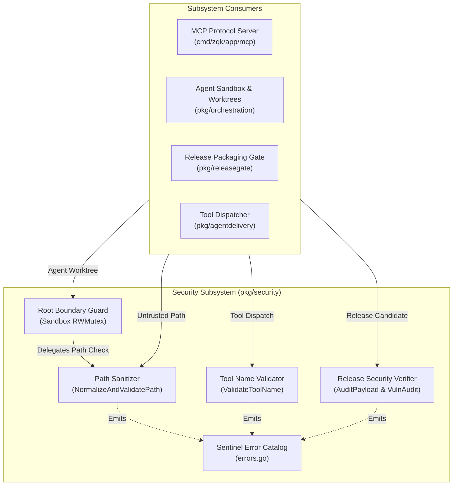
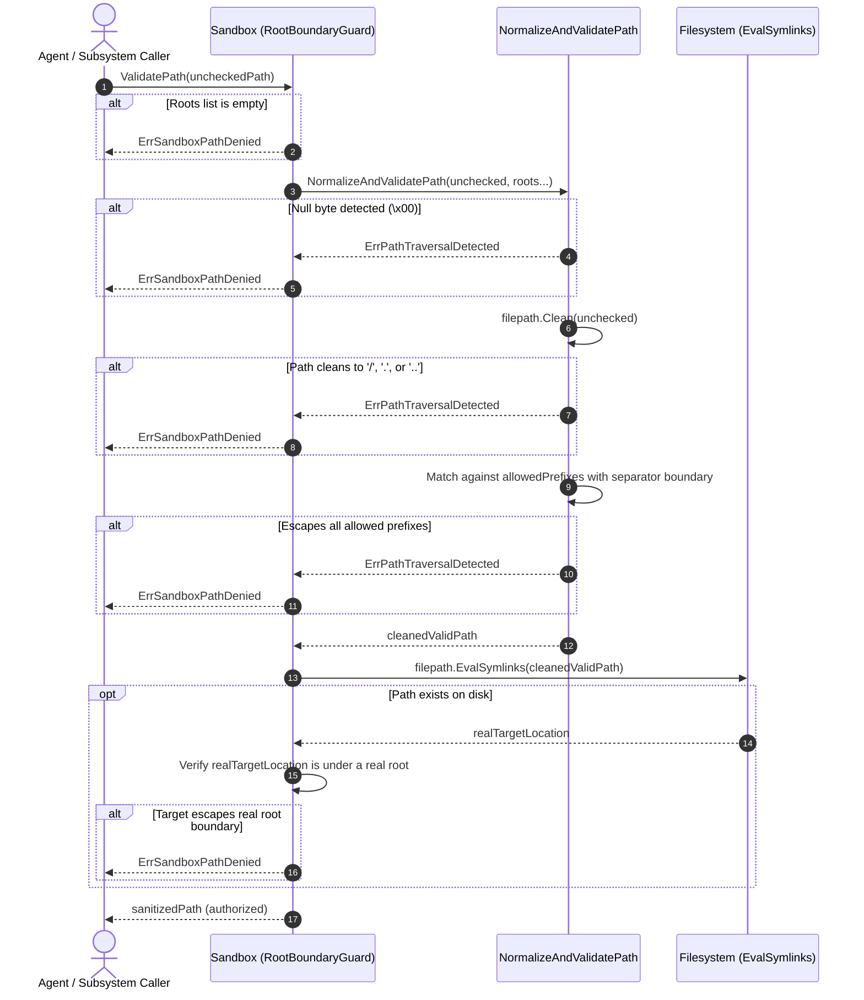
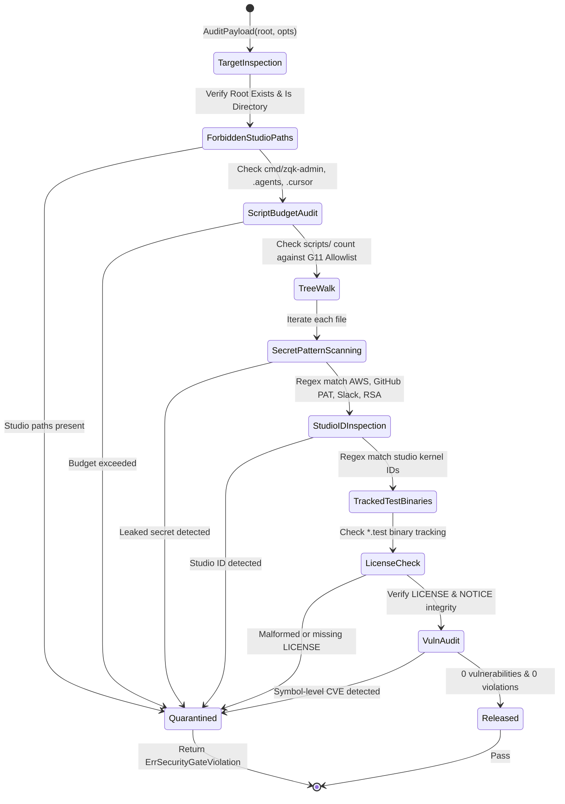

# Security Primitives, Path Traversal Defense & Release Security Subsystem Architectural & Operational Guide

## 1. Executive Architectural Summary

The **Security Primitives, Path Traversal Defense & Release Security Subsystem** (`pkg/security`) forms the foundational defense-in-depth shield for the **ZQK Knowledge Kernel**. In a multi-agent autonomous runtime where AI agents and external tools interact with local filesystems, execute shell actions, and package release artifacts, fail-closed security guards are mandatory to prevent host compromise, confidential data exposure, and untrusted execution escapes.

The subsystem enforces five core defensive guarantees:

1. **Jail-Confined Path Traversal Defense:** Sanitizes and validates arbitrary filesystem paths against configured allowlists, eliminating directory traversal (CWE-22) and relative escape vectors (`../`, null bytes, root escapements).
2. **Symlink Confinement (F-SEC-006):** Verifies that resolved symlink targets do not cross sandbox jail boundaries into sensitive parent or system directories.
3. **Strict MCP Tool Identifier Sanitization:** Constrains Model Context Protocol (MCP) and CLI tool names to safe ASCII alphanumeric identifiers, preventing shell metacharacter injection and malicious command chaining.
4. **Hermetic Release Security & Payload Auditing:** Fail-closed scanning of candidate release trees for leaked cloud credentials, API tokens, studio-internal artifacts, tracking binaries, and script budget overflows.
5. **Static Invariant & Three-Fold Verification:** Strict statement test coverage invariant ($\ge 85.0\%$, maintained at $>95.0\%$) coupled with comprehensive static, dynamic, and adversarial proof gates.

---

## 2. Component Topology & Subsystem Architecture

The `pkg/security` package serves as an authoritative layer across kernel storage, workspace orchestration, agent delivery, and release packaging pipelines:



### Component Responsibilities

| Component | Primary API / Types | Architectural Responsibility |
| :--- | :--- | :--- |
| **Path Sanitizer** | `NormalizeAndValidatePath(string, ...string)` | Lexical path canonicalization, null byte rejection, root-escape checks, prefix delimiter boundary validation. |
| **Root Boundary Guard** | `Sandbox` (`NewSandbox`, `AddRoot`, `ValidatePath`, `IsAllowed`) | Thread-safe (`sync.RWMutex`) multi-root allowlist manager with filesystem symlink dereference checking (F-SEC-006). |
| **Tool Name Validator** | `ValidateToolName(string)`, `IsValidToolName(string)` | Enforces strict ASCII identifier rules on tool dispatch commands, rejecting whitespace, control runes, and shell punctuation. |
| **Release Security Verifier** | `AuditPayload`, `VerifyLicenseIntegrity`, `AuditStaticVulnerabilities` | Pre-distribution audit engine detecting secret leaks, studio identifiers, excessive shell scripts, and dependency CVEs. |
| **Sentinel Error Catalog** | `ErrPathTraversalDetected`, `ErrSandboxPathDenied`, `ErrMCPInvalidToolName`, etc. | Canonical, wrap-compatible sentinel errors enabling deterministic error classification across packages. |

---

## 3. Defense-in-Depth Lifecycle & Jail Containment

Every file path processed on behalf of an agent or tool call passes through an ordered sequence of fail-closed filters:



### Containment Stages

1. **Null-Byte Injection Neutralization:** String scanning rejects any path containing byte `0x00`, preventing null-byte truncation attacks on native C/POSIX filesystem syscalls.
2. **Lexical Canonicalization:** `filepath.Clean` removes redundant slashes (`//`), current-dir markers (`./`), and parent backtracking sequences (`../`).
3. **Root Traversal Elimination:** Explicit check against root directory (`/`), current directory (`.`), and parent directory (`..`) targets.
4. **Boundary Prefix Verification:** Verifies not only prefix matching, but that the match is bounded by `filepath.Separator`. This blocks prefix collision attacks (e.g., preventing `/var/log` from matching `/var/log-attacker/secrets.txt`).
5. **Physical Symlink Containment (F-SEC-006):** If the path exists on disk, `filepath.EvalSymlinks` computes real target coordinates, ensuring symbolic links cannot point outside the sandbox.

---

## 4. Release Quarantine & Artifact Verification

Candidate release bundles must pass strict static verification before promotion to public distributions:



### Audit Invariants

- **Zero Leaked Secrets:** Scans against curated regex definitions (`secretpatterns.Definitions`) covering AWS access keys, GitHub personal access tokens, Slack webhooks, and private encryption keys.
- **Studio ID Leak Guard:** Verifies that no long nanosecond kernel identifiers are hardcoded into public product source code.
- **Forbidden Paths Quarantine:** Blocks inclusion of internal studio-only packages (`cmd/zqk-admin`, `cmd/codegen_runner`, `cmd/pattern-cli`, `.cursor`, `.agents`).
- **Script Budget Enforcement (G11):** Caps untracked scripts in `scripts/`, permitting only living, allowlisted community scripts (e.g., `check-public-release-payload.sh`, `package-community.sh`).

---

## 5. Security Boundaries & Attack Vectors

| Attack Vector | Example Attack Payload | Defense Mechanism | Result |
| :--- | :--- | :--- | :--- |
| **Directory Traversal** | `/workspace/../../etc/shadow` | `filepath.Clean` + prefix boundary comparison | Denied: `ErrPathTraversalDetected` |
| **Separator Prefix Collision** | `/var/data-other/secret.key` under `/var/data` | `cleaned[len(prefix)] == filepath.Separator` guard | Denied: `ErrPathTraversalDetected` |
| **Null-Byte Truncation** | `/workspace/file.txt\x00/../../etc/passwd` | Immediate `strings.Contains(unchecked, "\x00")` gate | Denied: `ErrPathTraversalDetected` |
| **Symlink Jailbreak (F-SEC-006)** | In-tree link `link_to_root` $\to$ `/` | `filepath.EvalSymlinks` on path and roots | Denied: `ErrSandboxPathDenied` |
| **Command Injection via Tool Name** | `read_file; rm -rf /` or `tool\|cat` | `ValidateToolName` strict ASCII whitelist (`[a-zA-Z0-9_\-\.:]`) | Denied: `ErrMCPInvalidToolName` |
| **Shell Expansion in Tool Name** | `eval_$USER` or `tool_\`id\`` | `ValidateToolName` rejects `$`, `` ` ``, spaces, and control characters | Denied: `ErrMCPInvalidToolName` |
| **Credential Leakage in Release** | `AKIA...` hardcoded in sample source | `AuditPayload` secret regex inspection | Quarantined: `AWS_KEY_LEAK` |
| **Supply-Chain Dependency Vulnerability** | Critical CVE in upstream package | `AuditStaticVulnerabilities` via `govulncheck` | Quarantined: Symbol-level CVE detection |

---

## 6. Concurrency, Thread-Safety & Memory Hygiene

The security primitives in `pkg/security` are architected for high-concurrency multi-agent swarms:

1. **Read/Write Mutex Isolation:** `Sandbox` guards its root allowlist with a `sync.RWMutex`. Read operations (`Roots()`, `ValidatePath()`, `IsAllowed()`) take non-blocking read locks (`s.mu.RLock()`), while dynamic root registration (`AddRoot()`) takes exclusive write locks (`s.mu.Lock()`).
2. **Defensive Slice Copies:** `Roots()` returns a distinct memory copy of the configured roots slice, preventing concurrent slice mutation or data races in caller routines.
3. **Stateless Validators:** Functions such as `NormalizeAndValidatePath`, `ValidateToolName`, `isBinary`, and `g11AllowlistedScript` are completely pure and stateless, enabling lock-free invocation across hundreds of concurrent goroutines.
4. **Named Concurrency Verification:** Multi-goroutine test suites leverage `goroutinelabels.NewGoroutine` to confirm race-free execution under thread-sanitized workloads.

---

## 7. Verification & Three-Fold Proof

The security subsystem is held to the highest standard of the **Three-Fold Proof**:

```
Three-Fold Verification Proof:
┌────────────────────────────────────────┐
│ 1. Static Floor Invariant              │
│    Statement Coverage >= 85.0%         │
│    (Achieved: >=95.0%)                 │
├────────────────────────────────────────┤
│ 2. Operational Dynamic Proof           │
│    Sandbox root containment, symlink   │
│    resolution, govulncheck audit,      │
│    concurrent stress testing           │
├────────────────────────────────────────┤
│ 3. Negative Adversarial Boundary       │
│    Rejection of traversals, null       │
│    bytes, tool command injection,      │
│    secret leaks, corrupted licenses    │
└────────────────────────────────────────┘
```

1. **Static Floor Invariant:** Statement test coverage across `pkg/security` strictly exceeds the $85.0\%$ floor, maintained at $\ge 95.0\%$ with zero swallowed errors and modular function limits.
2. **Operational Dynamic Proof:** Complete functional acceptance verifying license validity, zero dependency vulnerabilities via static audits, dynamic root containment, and race-free sandbox execution.
3. **Negative Adversarial Boundary:** Exhaustive fuzz and edge-case suites verifying rejection of parent-directory escapes, null-byte injections, shell metacharacters, excessive script budgets, and tainted release bundles.

---

## 8. Usage Recipes & Code Patterns

### Recipe A: Sandboxed Agent File Access

```go
package main

import (
	"fmt"
	"log"

	"github.com/zqk-os/zqk/pkg/security"
)

func main() {
	// Initialize sandbox with authorized workspace directories
	sb := security.NewSandbox("/workspace/project", "/tmp/zqk_cache")

	untrustedPath := "/workspace/project/src/main.go"
	safePath, err := sb.ValidatePath(untrustedPath)
	if err != nil {
		log.Fatalf("access denied: %v", err)
	}

	fmt.Printf("authorized path: %s\n", safePath)
}
```

### Recipe B: MCP Tool Name Validation

```go
package main

import (
	"fmt"
	"log"

	"github.com/zqk-os/zqk/pkg/security"
)

func registerTool(name string) {
	if err := security.ValidateToolName(name); err != nil {
		log.Fatalf("invalid tool identifier %q: %v", name, err)
	}
	fmt.Printf("registered tool: %s\n", name)
}
```

### Recipe C: Release Payload Verification

```go
package main

import (
	"fmt"
	"log"

	"github.com/zqk-os/zqk/pkg/security"
)

func verifyRelease(candidateDir string) {
	opts := security.DefaultAuditOptions()
	report, err := security.AuditPayload(candidateDir, opts)
	if err != nil {
		log.Fatalf("payload audit error: %v", err)
	}

	if !report.Passed {
		for _, v := range report.Violations {
			fmt.Printf("VIOLATION [%s] %s (line %d): %s\n", v.Rule, v.Path, v.Line, v.Evidence)
		}
		log.Fatal("release payload rejected by security gate")
	}

	fmt.Println("release payload passed security verification")
}
```
