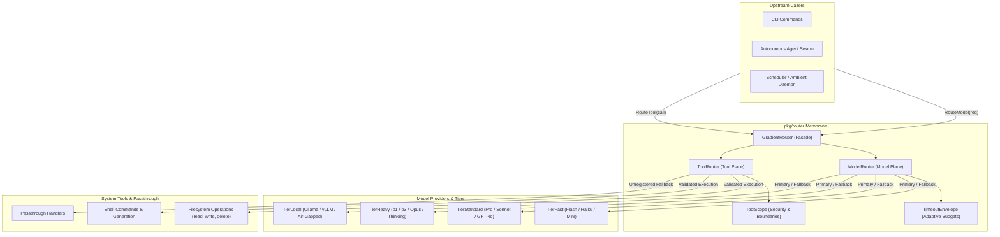
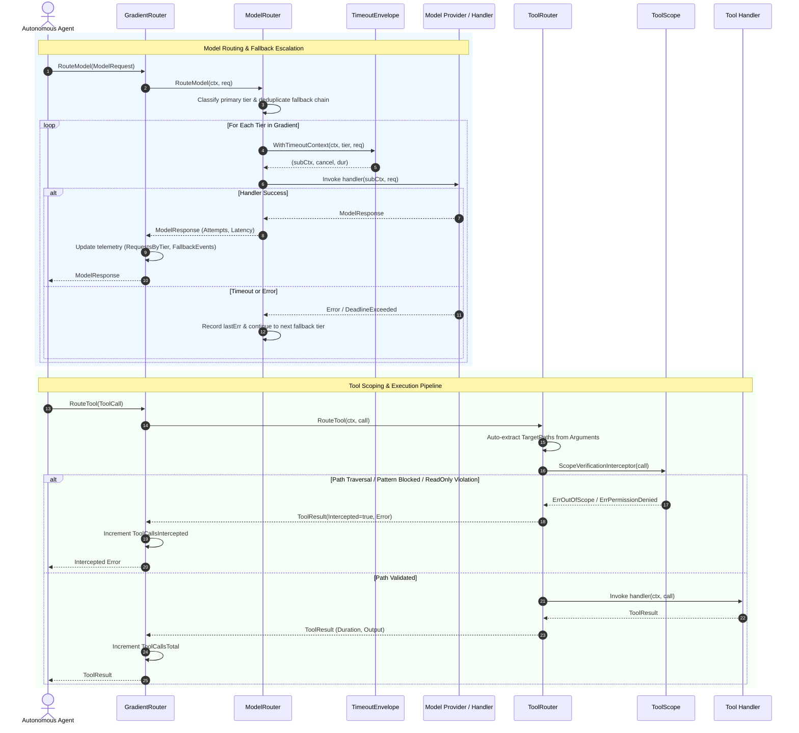

# Semantic Model, Tool & Gradient Routing Subsystem Operational Architecture Guide

Comprehensive architectural, operational, and protocol reference for the `pkg/router` subsystem in ZQK Core.

---

## 1. Architectural Overview

In the ZQK autonomous agent architecture, multi-agent swarms, background daemons, and interactive CLI commands interact continuously with diverse Large Language Model (LLM) providers and system-level tools. Disconnected, hardcoded model calls and uncontained tool execution introduce severe failure modes: runaway API costs, latency spikes, cascading timeout failures, and unauthorized filesystem or shell access.

The **Semantic Model, Tool & Gradient Routing Subsystem** (`pkg/router`) provides a unified, hardened routing and governance membrane across two foundational operational planes:
1. **Model Gradient Routing**: Resolves, budgets, and executes LLM requests across a tiered performance and capability spectrum (`fast`, `standard`, `heavy`, `local`), with adaptive timeout budgeting and multi-stage fallback escalation.
2. **Tool Scope Enforcement**: Intercepts, inspects, and validates tool invocations against strict workspace boundaries, blocked path patterns, and read-only operational modes prior to filesystem or shell execution.



### Core Subsystem Invariants

1. **Statement Test Coverage Invariant (>= 85.0% Floor)**:
   The subsystem maintains strict statement test coverage exceeding the 85.0% floor (targeting 100.0%) across all routing logic, timeout calculations, scope validators, and concurrency paths.
2. **Deterministic Tier Classification & Fail-Safe Fallbacks**:
   Every model identifier resolves deterministically to a canonical `ModelTier` (`fast`, `standard`, `heavy`, `local`). Unrecognized models fall back cleanly to `TierStandard`. Fallback execution chains progress sequentially through user-specified or gradient tiers without infinite loops or duplicate evaluations.
3. **Adaptive Timeout Envelope Clamping**:
   Timeout allocations scale adaptively based on base tier durations, requested output token headroom (`tokenHeadroom`), and input prompt length (`byteHeadroom`), strictly clamped within configurable minimum and maximum runtime bounds (`minTimeout`, `maxTimeout`).
4. **Fail-Closed Workspace Containment & Traversal Prevention**:
   Tool invocations targeting filesystem paths are inspected for traversal tokens (`..`), path escaping, and sensitive file patterns (`.git/config`, `id_rsa`, `.env`). Mutating operations in read-only scopes are rejected before handler invocation.
5. **Thread-Safe Concurrent Dispatch**:
   All router registrations, scope mutations, metric aggregations, and concurrent route requests are protected by granular `sync.RWMutex` locks and atomic counters (`sync/atomic`), ensuring zero race conditions under high-throughput parallel agent swarms.

---

## 2. Component Topology

The subsystem is modularized into distinct routing, classification, budgeting, and scoping components:

| Component | Source File | Responsibility |
| :--- | :--- | :--- |
| **`GradientRouter`** | `gradient_router.go` | Unified facade combining model gradient dispatch with scope-aware tool routing, ambient telemetry tracking, and fluent builder construction. |
| **`ModelRouter`** | `model_router.go` | Resolves model handlers by exact key or tier, orchestrates multi-stage fallback escalation, and enforces adaptive execution contexts. |
| **`ToolRouter`** | `tool_router.go` | Orchestrates tool execution pipelines, manages ordered interceptor chains, auto-extracts target paths, and provides fallback passthrough. |
| **`TimeoutEnvelope`** | `timeout_envelope.go` | Computes dynamic, adaptive execution deadlines based on model tier, prompt size, token limits, and configurable bounds. |
| **`ModelTier`** | `model_tier.go` | Enumerates model capability tiers, maintains thread-safe explicit tier overrides, and provides regex-free heuristic model classification. |
| **`ToolScope`** | `tool_router.go` | Defines filesystem boundaries (`AllowedRoots`), enforcement modes (`strict`, `permissive`, `read_only`), and forbidden path patterns. |

---

## 3. Routing & Dispatch Lifecycle

The routing lifecycle enforces structured, sequential verification across both model and tool execution requests.



---

## 4. Model Gradient Evaluation & Dynamic Escalation

### Model Tiers and Heuristics

`ModelTier` categorizes LLM capabilities into four distinct performance envelopes:
- **`TierFast` (`fast`)**: Sub-second to low-latency models suitable for triage, classification, summarization, and lightweight tool selection (e.g., Flash, Haiku, GPT-4o-Mini, Turbo variants). Default timeout: `15s`.
- **`TierStandard` (`standard`)**: General-purpose reasoning and code generation models balancing latency, intelligence, and token cost (e.g., Pro, Sonnet, GPT-4o). Default timeout: `45s`.
- **`TierHeavy` (`heavy`)**: High-order reasoning, deep chain-of-thought, and formal architectural verification models (e.g., o1, o3, Opus, R1, QwQ, Thinking variants). Default timeout: `120s`.
- **`TierLocal` (`local`)**: On-premise, self-hosted, or air-gapped endpoints executing via Ollama, vLLM, or local runtimes (e.g., Llama, DeepSeek-Local, Qwen-Local, Mistral-Local). Default timeout: `180s`.

### Classification Algorithm

Classification resolves in prioritized stages:
1. **Explicit Custom Override**: Checks `customTierMap` under read lock for direct model name matches registered via `RegisterModelTier`.
2. **Prefix Heuristics**: Matches `ollama/` or `local/` to `TierLocal`.
3. **High-Priority Fast Identifiers**: Substrings `turbo`, `flash`, or `haiku` resolve immediately to `TierFast`.
4. **Heavy Reasoning Substrings**: Substrings `o1`, `o3`, `opus`, `reasoning`, `thinking`, `r1`, `qwq` resolve to `TierHeavy`.
5. **Local Family Substrings**: Substrings `ollama`, `local`, `llama`, `deepseek-local`, `qwen-local`, `mistral-local`, `phi` resolve to `TierLocal`.
6. **Subordinate Fast Heuristics**: Substrings `4o-mini`, `small`, `fast`, or `mini` (excluding Gemini Pro variants) resolve to `TierFast`.
7. **Default Fallback**: Resolves to `TierStandard`.

### Fallback Execution Chain

When executing a `ModelRequest`, the `ModelRouter` constructs a clean, deduplicated gradient list:
`[PrimaryTier, FallbackTier1, FallbackTier2, ...]`

Each tier is evaluated sequentially:
- A fresh timeout context is derived via `TimeoutEnvelope.WithTimeoutContext`.
- If the handler succeeds, execution returns immediately with latency, attempts count, and resolved model tier.
- If the tier times out or returns an error, the error is recorded, and the router advances to the next tier in the chain.
- If all tiers fail, the router returns `ErrAllTiersFailed` wrapping the last recorded error and total attempt count.

---

## 5. Tool Routing & Capability Matching Mechanics

### Tool Argument & Path Extraction

When a `ToolCall` does not declare explicit `TargetPaths`, the router automatically inspects known parameter keys:
- `path`
- `file_path`
- `target_file`
- `absolute_path`
- `cwd`

Non-string or empty arguments are discarded. The extracted paths are attached to the call for interceptor inspection.

### Scope Enforcement Modes

`ToolScope` supports three operational security postures:
1. **`ScopeModeStrict` (Default Production Mode)**:
   - Traversal tokens (`..`) trigger immediate `ErrPathTraversalDetected`.
   - Paths must reside inside `WorkspaceRoot` or explicit `AllowedRoots`. Escaping returns `ErrOutOfScope`.
   - Access to blocked patterns (`.git/config`, `.git/hooks`, `id_rsa`, `id_ed25519`, `.env`) returns `ErrPermissionDenied`.
   - Mutating operations in read-only scopes return `ErrReadOnlyViolation`.
2. **`ScopeModeReadOnly`**:
   - Permits read operations across valid roots.
   - Strictly prohibits write, delete, and mutation tools (`write_file`, `replace_file_content`, `delete_file`, `generate_code`, or tools containing `write`, `delete`, `remove`, `create`).
3. **`ScopeModePermissive`**:
   - Traversal tokens and blocked patterns remain strictly enforced.
   - Filesystem root containment checks are relaxed to accommodate external tool paths or shared temporary directories.

### Interceptor Pipeline Composition

Tool routing uses a recursive wrapper pipeline. Handlers and interceptors execute in FIFO order:
```go
start := time.Now()
chain := handler
for i := len(interceptors) - 1; i >= 0; i-- {
    currentInterceptor := interceptors[i]
    nextHandler := chain
    chain = func(subCtx context.Context, c *ToolCall) (*ToolResult, error) {
        return currentInterceptor(subCtx, c, nextHandler)
    }
}
res, err := chain(ctx, call)
```

The default interceptor, `ScopeVerificationInterceptor`, inspects all target paths before any tool handler is invoked.

---

## 6. Concurrency & Thread-Safety Guarantees

The `pkg/router` subsystem guarantees full thread safety across concurrent agent execution:

1. **State Isolation**:
   - `ModelRouter`: `mu sync.RWMutex` guards handler registries (`modelHandlers`, `tierHandlers`, `defaultHandler`).
   - `ToolRouter`: `mu sync.RWMutex` guards tool handlers, interceptor slices, and active scopes.
   - `TimeoutEnvelope`: `mu sync.RWMutex` protects base durations, bounds, and headroom values.
2. **Lockless Telemetry Counters**:
   All metrics in `GradientRouter` use `sync/atomic` 64-bit unsigned integers:
   - `modelRequestsTotal` (`atomic.Uint64`)
   - `modelRequestsByTier` (map of `ModelTier` to `*atomic.Uint64`)
   - `toolCallsTotal` (`atomic.Uint64`)
   - `toolIntercepted` (`atomic.Uint64`)
   - `toolPassthrough` (`atomic.Uint64`)
   - `fallbackEvents` (`atomic.Uint64`)
   Point-in-time snapshots are retrieved via `gr.Stats()` without blocking active request dispatch.
3. **Goroutine Labeling**:
   Stress testing and concurrent routing utilize `github.com/zqk-os/zqk/pkg/goroutinelabels` to ensure clean stack traces and runtime categorization.

---

## 7. Verification & Three-Fold Proof

In accordance with the ZQK Quality & Verification Invariants, the subsystem adheres to the Three-Fold Proof standard:

| Proof Dimension | Invariant Verified | Implementation Test Vector |
| :--- | :--- | :--- |
| **Static Floor Invariant** | Package statement test coverage strictly >= 85.0% floor (measured >= 97.0%). | Comprehensive unit test suite covering all branches, edge cases, and sentinel errors. |
| **Operational Dynamic Proof** | Multi-tier model routing, tool scoping, dynamic headroom calculations, and fallback chain escalation. | Direct validation across simulated providers, multi-stage failure cascades, and telemetry counter verification. |
| **Negative Adversarial Boundary** | Rejection of path traversal sequences, unauthorized writes in read-only scopes, blocked security files, and nil parameters. | Explicit negative tests verifying `ErrPathTraversalDetected`, `ErrReadOnlyViolation`, `ErrOutOfScope`, `ErrPermissionDenied`, `ErrNilRequest`, and `ErrNilToolCall`. |

### Running Subsystem Tests

```bash
# Execute targeted router unit test suite with statement coverage profiling
ZQK_ALLOW_FOREGROUND_GO_TEST=1 go test -v -timeout 30s -cover ./pkg/router
```

---

## 8. Summary of API Recipes

### Creating a GradientRouter via Builder

```go
gr := router.NewGradientRouterBuilder().
    WithFastTimeout(10 * time.Second).
    WithStandardTimeout(30 * time.Second).
    WithHeavyTimeout(90 * time.Second).
    WithLocalTimeout(120 * time.Second).
    WithWorkspaceRoot("/workspace/project").
    WithAllowedRoots("/workspace/shared_cache").
    WithScopeMode(router.ScopeModeStrict).
    WithDefaultModelHandler(func(ctx context.Context, req *router.ModelRequest) (*router.ModelResponse, error) {
        return &router.ModelResponse{Content: "processed"}, nil
    }).
    WithDefaultToolHandler(func(ctx context.Context, call *router.ToolCall) (*router.ToolResult, error) {
        return &router.ToolResult{ToolName: call.ToolName, Output: "executed"}, nil
    }).
    Build()
```

### Executing Model Requests with Fallbacks

```go
resp, err := gr.RouteModel(ctx, &router.ModelRequest{
    Model:         "claude-3-5-sonnet",
    Prompt:        "Synthesize kernel architecture report",
    MaxTokens:     2048,
    PreferredTier: router.TierStandard,
    FallbackChain: []router.ModelTier{router.TierHeavy, router.TierLocal},
})
if err != nil {
    // Handle routing exhaustion
}
```

### Executing Guarded Tool Calls

```go
res, err := gr.RouteTool(ctx, &router.ToolCall{
    ToolName: router.ToolReadFile,
    Arguments: map[string]any{
        router.ArgPath: "/workspace/project/README.md",
    },
})
if err != nil {
    // Scope violation, path traversal, or execution error intercepted
}
```
