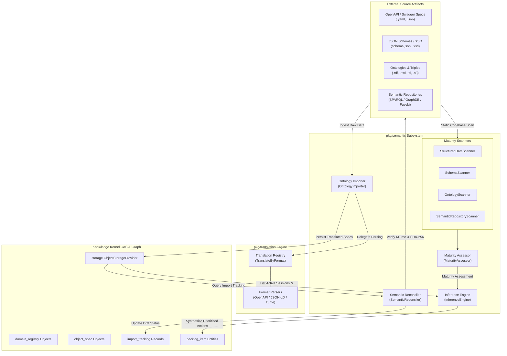
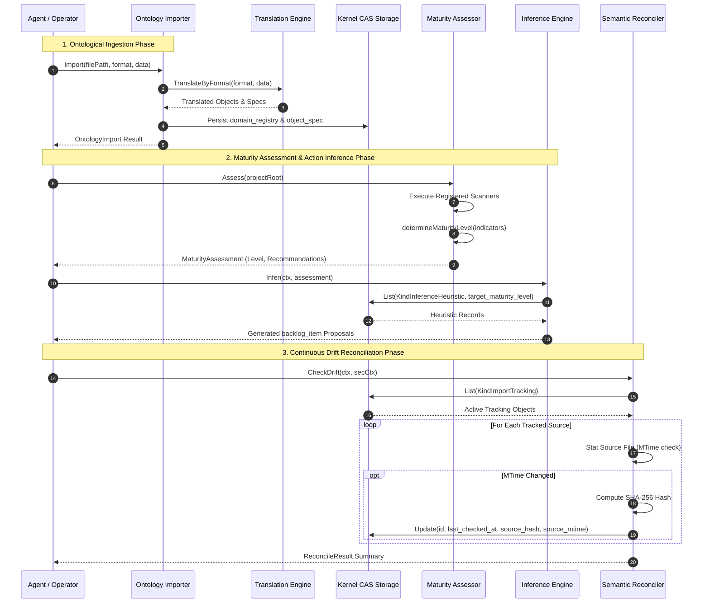
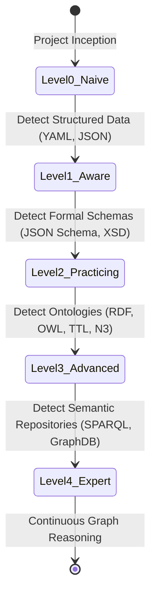

# Semantic Graph, AST Parsing & Inference Engine Subsystem Operational Architecture Guide

## 1. Executive Architectural Summary

The **Semantic Graph, AST Parsing & Inference Engine Subsystem** ([`pkg/semantic`](file:///Users/lanceettl/zqk-public-candidate/pkg/semantic)) provides ontological ingestion, semantic maturity evaluation, dynamic backlog inference, and automated drift reconciliation for the ZQK Knowledge Kernel.

Governed by core platform safety and ontological integrity policies (including `POL-DEFAULT-b17f54c251eb3c4d`), the Knowledge Kernel models complex software architectures not merely as text or relational tables, but as an interconnected semantic graph. External schemas, domain vocabularies, and architectural specifications (such as RDF/OWL, Turtle, JSON Schema, and OpenAPI) are ingested and converted into canonical Knowledge Kernel objects (`domain_registry` and `object_spec`).

The subsystem solves four critical operational challenges in agentic and autonomous systems:
1. **Ontological Translation & Normalization:** Ingests heterogenous external schemas into unified kernel graph representations via [`OntologyImporter`](file:///Users/lanceettl/zqk-public-candidate/pkg/semantic/importer.go#L32).
2. **Maturity Assessment & Heuristics:** Scans source codebases for semantic sophistication (Levels 0 through 4) using modular AST and filesystem scanners via [`MaturityAssessor`](file:///Users/lanceettl/zqk-public-candidate/pkg/semantic/maturity_assessor.go#L33).
3. **Automated Rule Inference:** Synthesizes actionable, prioritized backlog items from maturity gaps and failing convergence sessions using [`InferenceEngine`](file:///Users/lanceettl/zqk-public-candidate/pkg/semantic/inference_engine.go#L14).
4. **Drift Detection & State Reconciliation:** Detects source drift between external files and internal CAS tracking records using MTime-first validation and cryptographic hashing via [`SemanticReconciler`](file:///Users/lanceettl/zqk-public-candidate/pkg/semantic/reconciler.go#L17).

---

## 2. Component Topology & Subsystem Architecture

The subsystem comprises five core building blocks operating cooperatively across the translation engine and CAS storage provider:



### Component Breakdown

- **Ontology Importer ([`importer.go`](file:///Users/lanceettl/zqk-public-candidate/pkg/semantic/importer.go)):** Translates raw ontology specifications into canonical ZQK graph objects (`domain_registry` and `object_spec`) using the translation subsystem. Handles direct in-memory buffers as well as filesystem paths.
- **Inference Engine ([`inference_engine.go`](file:///Users/lanceettl/zqk-public-candidate/pkg/semantic/inference_engine.go)):** Evaluates current maturity levels against static rules and dynamic stored heuristics (`inference_heuristic`). Also monitors active convergence sessions (`convergence_session`) to produce remediation backlog items when trajectories trend away from desired states.
- **Maturity Assessor ([`maturity_assessor.go`](file:///Users/lanceettl/zqk-public-candidate/pkg/semantic/maturity_assessor.go)):** Aggregates indicators discovered by registered scanners to categorize the project into one of 5 canonical semantic maturity levels, producing targeted next-step recommendations.
- **Semantic Reconciler ([`reconciler.go`](file:///Users/lanceettl/zqk-public-candidate/pkg/semantic/reconciler.go)):** Evaluates `import_tracking` entities to identify when external source files have changed on disk, applying an MTime-first optimization before executing full SHA-256 hash validation.
- **Filesystem & AST Scanners ([`scanners.go`](file:///Users/lanceettl/zqk-public-candidate/pkg/semantic/scanners.go)):** Hermetic directory traversal routines that detect structured data files, formal schemas, ontology representations, and semantic endpoint definitions while skipping hidden, vendor, and git metadata directories.

---

## 3. Semantic Graph & Inference Lifecycle

The complete lifecycle from source ingestion to continuous drift reconciliation is illustrated below:



---

## 4. Semantic Maturity Model & State Progression

The subsystem models semantic maturity along a five-tier hierarchy, moving from uncurated artifacts to full semantic graph reasoning:



### Maturity Levels and Target Outcomes

| Level | Designation | Required Indicators | Generated Recommendations & Inferences |
| :--- | :--- | :--- | :--- |
| **0** | **Naive** | No structured data detected | Standardize core objects with structured YAML; initialize default organizational ontology. |
| **1** | **Aware** | YAML or JSON data files | Import structured data into ZQK format; create formal schemas for core data structures. |
| **2** | **Practicing** | JSON Schema or XSD definitions | Convert formal schemas to RDF/OWL ontologies; configure semantic endpoint. |
| **3** | **Advanced** | RDF, OWL, TTL, or N3 files | Establish semantic repository for advanced SPARQL querying; unify multi-ontology mappings. |
| **4** | **Expert** | SPARQL, GraphDB, Fuseki, Virtuoso | Enable automated relationship discovery, bidirectional synchronization, and cross-domain reasoning. |

---

## 5. Rule Inference & Conflict Resolution

### Static Fallback vs. Dynamic Storage Heuristics
When evaluating an assessment, [`InferenceEngine.Infer`](file:///Users/lanceettl/zqk-public-candidate/pkg/semantic/inference_engine.go#L26) executes a two-phase evaluation:
1. **Static Baseline:** For Level 0 (Naive), it emits a foundational backlog item titled `"Standardize Core Objects"` with priority `P1` to guarantee bootstrapping guidance even in cold-start environments without database access.
2. **Dynamic Heuristics:** If storage is available, it queries for objects of kind `inference_heuristic` filtering by `target_maturity_level == assessment.Level`. Each heuristic prescribes a proposed title, description, and priority tier.

### Convergence Drift Remediation
Autonomous agents running iterative convergence loops produce convergence sessions (`convergence_session`). When an active session is marked with `delta_assessment == "trending_away"`, [`InferenceEngine.InferFromConvergence`](file:///Users/lanceettl/zqk-public-candidate/pkg/semantic/inference_engine.go#L64) synthesizes an immediate P1 remediation backlog item:
- **Title:** `Remediate <Session Title>`
- **Description:** Warning that the session is diverging from its target goal, flagging failing fingerprints for operator or agent investigation.
- **Identifier:** Deterministic synthetic ID starting with `BLI-INF-`.

---

## 6. Concurrency & Thread-Safety Discipline

The semantic subsystem enforces strict concurrency invariants:
1. **Stateless Assessors & Scanners:** All scanner implementations ([`StructuredDataScanner`](file:///Users/lanceettl/zqk-public-candidate/pkg/semantic/scanners.go#L61), [`SchemaScanner`](file:///Users/lanceettl/zqk-public-candidate/pkg/semantic/scanners.go#L99), etc.) are stateless and safe for concurrent execution across multiple goroutines.
2. **Managed Goroutines:** Background workers or parallel scan operations must be instantiated via [`goroutinelabels.NewGoroutine`](file:///Users/lanceettl/zqk-public-candidate/pkg/goroutinelabels/builder.go#L161) to guarantee diagnostic label tracing and prevent orphaned goroutine leaks (`POL-CONCURRENCY`).
3. **MTime-First Storage Throttling:** [`SemanticReconciler.CheckDrift`](file:///Users/lanceettl/zqk-public-candidate/pkg/semantic/reconciler.go#L37) performs an initial file metadata check (`ModTime`) and skips SHA-256 calculation whenever the timestamp matches the stored value, minimizing disk I/O and mutex contention on underlying storage.

---

## 7. Verification & Coverage Invariants

In accordance with quality standards:
- **Statement Test Coverage:** The subsystem must maintain statement test coverage strictly **>= 85.0%** (target >= 95.0%).
- **Continuous Coverage Enforcement:** Verified by [`semantic_coverage_elevation_cycle207_test.go`](file:///Users/lanceettl/zqk-public-candidate/pkg/semantic/semantic_coverage_elevation_cycle207_test.go), currently achieving **99.5%** statement coverage.
- **AST Hygiene & Zero Swallowed Errors:** All returned errors must be propagated or asserted. Blank identifier assignments (`_ = ...`) are eradicated in test and production code.
- **Execution Command:**
  ```bash
  ZQK_ALLOW_FOREGROUND_GO_TEST=1 go test -v -timeout 30s -cover ./pkg/semantic
  ```
