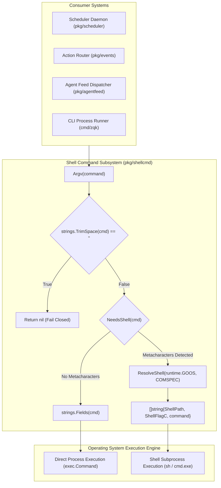
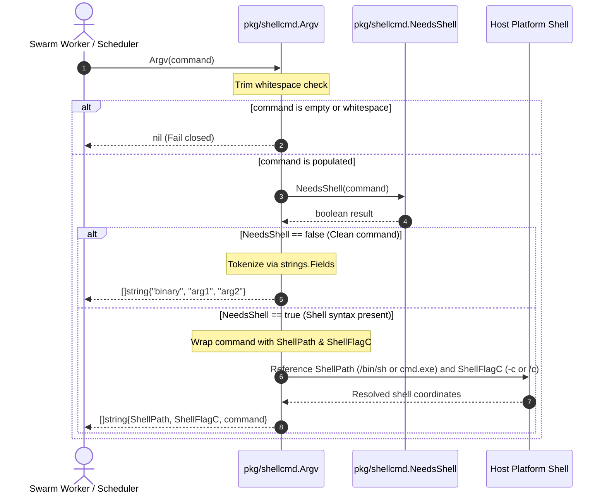
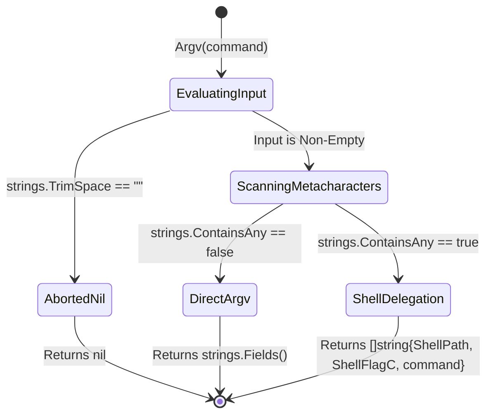
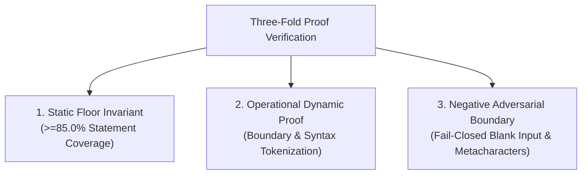

# Shell Command Parsing, Metacharacter Inspection & Cross-Platform Execution Subsystem Architectural & Operational Guide

## 1. Executive Architectural Summary

The **Shell Command Parsing, Metacharacter Inspection & Cross-Platform Execution Subsystem** (`pkg/shellcmd`) provides safe, deterministic command string tokenization and native shell delegation across the **ZQK Knowledge Kernel**.

In automated workflow execution, scheduler callbacks, ambient daemons, and autonomous agent coordination hooks, commands are frequently authored as expressive shell one-liners. These pipelines incorporate UNIX pipes (`|`), boolean conjunction chains (`&&`, `||`), file redirections (`>`, `>>`, `<`), subshells (`(...)`), environment variables (`$VAR`, `%VAR%`), and quoted strings with internal whitespace. 

A naive whitespace split (`strings.Fields`) misinterprets redirection operators and quotation boundaries, passing them as literal arguments to the underlying binary. For example:
```bash
tee -a log.jsonl >/dev/null && zqk feed steer -m "mission started"
```
When split naively, `tee` receives `log.jsonl`, `>/dev/null`, `&&`, and each token within the quotation as distinct command-line parameters. This corrupts invocation semantics and can create spurious files across the workspace.

Governed by system policy **POL-DEFAULT-142277d3**, `pkg/shellcmd` resolves this failure mode by establishing a resilient, fail-closed argv construction engine:
1. **Metacharacter Inspection (`NeedsShell`):** Detects if a command string contains POSIX or Windows shell metacharacters that necessitate a shell interpreter.
2. **Bypass Optimization:** For plain commands lacking shell syntax, tokenizes directly via whitespace splitting (`strings.Fields`), eliminating subshell fork-and-exec overhead.
3. **Cross-Platform Shell Resolution (`ResolveShell`):** Maps shell invocations to `/bin/sh -c` on POSIX platforms and `%COMSPEC% /c` (falling back to `cmd.exe /c`) on Windows systems.
4. **Fail-Closed Boundary Defense:** Rejects empty or whitespace-only command strings by returning `nil`, allowing callers to abort execution safely before spawning empty processes.
5. **High-Throughput Concurrency Safety:** Guarantees thread-safe, lock-free evaluation suitable for high-density autonomous agent swarms running via `pkg/goroutinelabels`.

---

## 2. Component Topology & Subsystem Architecture

The subsystem is structured as a compact, zero-allocation pipeline with clear responsibilities divided between lexical inspection, platform detection, and argument vector synthesis:



### Core Components

| Component | Exported Symbol | Core Responsibility |
| :--- | :--- | :--- |
| **Argv Synthesizer** | `Argv(command string) []string` | Primary intake function. Validates non-emptiness, inspects for shell syntax, and outputs executable argv slices. |
| **Metacharacter Inspector** | `NeedsShell(command string) bool` | Fast scan inspecting against canonical POSIX and Windows metacharacter sets (`shellMetaChars`). |
| **Platform Shell Resolver** | `ResolveShell(goos, comspec string) (string, string)` | Resolves binary path and execution flag based on target operating system and environment variables. |
| **Package Defaults** | `ShellPath`, `ShellFlagC` | Pre-initialized package variables bound during `init()` based on host `runtime.GOOS` and `%COMSPEC%`. |

---

## 3. Execution & Tokenization Lifecycle

The execution lifecycle prioritizes performance while guaranteeing correct command boundary preservation. Plain invocations bypass shell spawning, while complex expressions are safely delegated to the host shell.



### State Machine Lifecycle



---

## 4. Metacharacter Taxonomy & Syntax Handling

The subsystem maintains an exhaustive set of control, grouping, expansion, and comment runes represented by `shellMetaChars`:
```go
const shellMetaChars = "|&;<>()$`\\\"'*?[#\n%^"
```

The table below catalogs each metacharacter, its operational intent, and why shell delegation is mandatory:

| Metacharacter | Category | Example Syntax | Operational Hazard If Split on Whitespace |
| :---: | :--- | :--- | :--- |
| `\|` | Pipeline | `cat input.log \| grep ERROR` | `\|` and `grep` become literal parameters to `cat`. |
| `&` | Chaining / Background | `build && test` or `daemon &` | `&&` passed as argument; secondary command ignored. |
| `;` | Sequential Separator | `step1; step2` | Semicolon treated as argument to `step1`. |
| `<` | Input Redirection | `loader < payload.json` | `<` and `payload.json` passed as arguments to `loader`. |
| `>` | Output Redirection | `compile > out.log` | `>` and `out.log` passed as arguments to `compile`. |
| `(` `)` | Subshell Grouping | `(cd worker && go test)` | Parentheses passed as literal command names/arguments. |
| `$` | POSIX Variable Expansion | `echo $HOME`, `echo ${DIR}/out` | Literal `$HOME` string passed instead of expanded path. |
| `` ` `` | Command Substitution | `echo \`date\`` | Backticks passed as literal string; date not executed. |
| `\` | Escape Character | `find . -name foo\ bar` | Backslash passed as literal rune rather than escaping space. |
| `"` | Double Quotation | `notify --msg "two words"` | `"two` and `words"` split into two distinct arguments. |
| `'` | Single Quotation | `script 'param with space'` | Single quotes preserved literally; arguments split incorrectly. |
| `*` | Glob Expansion | `rm -f *.log` | `*.log` passed literally without filesystem expansion. |
| `?` | Single-Rune Glob | `cat data_??.csv` | `??` not expanded against matching disk paths. |
| `[` | Bracket Glob / Test | `ls [a-z]*.go` | Brackets passed literally rather than matched. |
| `#` | Shell Comment | `deploy.sh # production run` | `# production run` passed as active arguments. |
| `\n` | Embedded Newline | `echo line1\necho line2` | Multi-line batch commands collapsed or corrupted. |
| `%` | Windows Variable Delimiter | `echo %USERPROFILE%` | Variable not expanded by Windows command processor. |
| `^` | Windows Escape Character | `echo hello^&world` | Caret not parsed as escape rune; `&` unescaped. |

---

## 5. Cross-Platform Resolution Dynamics

Different operating systems utilize disparate shell binaries, command flags, and environment configurations. `ResolveShell` encapsulates platform dispatch:

```mermaid
flowchart TD
    Start["ResolveShell(goos, comspec)"] --> OSCheck{"goos == 'windows'"}
    
    OSCheck -->|No (POSIX)| POSIXResolution["Path: /bin/sh<br/>Flag: -c"]
    
    OSCheck -->|Yes (Windows)| ComspecCheck{"comspec != ''"}
    ComspecCheck -->|Populated| CustomComspec["Path: comspec<br/>Flag: /c"]
    ComspecCheck -->|Unset/Empty| DefaultWindows["Path: cmd.exe<br/>Flag: /c"]

    POSIXResolution --> Out["Return (path, flag)"]
    CustomComspec --> Out
    DefaultWindows --> Out
```

### Operating System Matrix

| Platform (`goos`) | Configuration / Variable | Resolved Binary (`ShellPath`) | Execution Flag (`ShellFlagC`) | Notes |
| :--- | :--- | :--- | :--- | :--- |
| `darwin` (macOS) | Any / Unused | `/bin/sh` | `-c` | Standard POSIX execution. |
| `linux` | Any / Unused | `/bin/sh` | `-c` | Standard POSIX execution. |
| `freebsd` / `openbsd` | Any / Unused | `/bin/sh` | `-c` | Standard BSD execution. |
| `windows` | `COMSPEC` set | Value of `%COMSPEC%` | `/c` | Typically `C:\Windows\System32\cmd.exe`. |
| `windows` | `COMSPEC` unset/empty | `cmd.exe` | `/c` | Fallback search via system `PATH`. |

### Windows Operational Invariants & Caveats
1. **POSIX Script Incompatibility:** Windows `cmd.exe` cannot evaluate POSIX-specific builtins (e.g., `export`, `set -e`, `set -o pipefail`) or `/dev/null` redirections (Windows requires `NUL`). Workflows targeting Windows must use cross-platform tools or POSIX compatibility layers (e.g., Git Bash `bash.exe`).
2. **Quotation Handling:** `cmd.exe` does not treat single quotes (`'`) as quoting delimiters; single quotes are treated as literal characters. Windows commands must use double quotes (`"`) for strings containing spaces.
3. **Path Separators:** Path separators (`/` vs `\`) are passed to the shell verbatim. Callers should leverage Go's standard path libraries or `pkg/safepath` when assembling filesystem paths dynamically.

---

## 6. Concurrency & Thread-Safety Guarantees

The `pkg/shellcmd` package is engineered for high-throughput concurrent environments, such as autonomous multi-agent swarms executing thousands of tasks simultaneously:
- **Stateless Routines:** Functions `Argv`, `NeedsShell`, and `ResolveShell` are pure, stateless algorithms. They maintain no mutable memory and allocate no persistent heap objects.
- **Immutable Package Defaults:** `ShellPath` and `ShellFlagC` are initialized during package `init()` and remain read-only during standard process execution.
- **Zero Lock Contention:** Because evaluation requires no mutexes, channels, or global state mutation, goroutines scale linearly across all available processor cores without lock contention.
- **Budget Compliance:** Compatible with `pkg/goroutinelabels` goroutine pools and worker monitors without risk of deadlock or data races.

---

## 7. Verification & Three-Fold Proof Breakdown

The subsystem is validated according to the canonical **Three-Fold Proof** architecture:



### 1. Static Floor Invariant
- **Metric:** Statement test coverage across `pkg/shellcmd` must strictly achieve >= 85.0% (target 100.0%).
- **Verification Command:**
  ```bash
  ZQK_ALLOW_FOREGROUND_GO_TEST=1 go test -v -timeout 30s -cover ./pkg/shellcmd
  ```
- **Validation:** Every branch in `ResolveShell`, `NeedsShell`, and `Argv` is comprehensively exercised across multiple operating systems and input variations.

### 2. Operational Dynamic Proof
- **Metacharacter Tokenization:** Validates that all POSIX and Windows syntax operators correctly wrap into `[]string{ShellPath, ShellFlagC, command}`.
- **Whitespace Tokenization:** Validates that clean commands without shell syntax split accurately using `strings.Fields`, preserving multi-argument CLI parameters while collapsing redundant inter-word whitespace.
- **Cross-Platform Matrix:** Validates shell path and flag resolution across macOS, Linux, FreeBSD, OpenBSD, NetBSD, Solaris, and Windows (with and without `%COMSPEC%`).
- **High Concurrency:** Validates race-free execution under concurrent multi-worker load using `goroutinelabels.NewGoroutine`.

### 3. Negative Adversarial Boundary
- **Empty & Whitespace-Only Commands:** Inputs consisting of `""`, `" "`, `"\t"`, `"\n"`, `"\r\n"`, and arbitrary combinations return `nil`. This prevents subprocess runners from attempting to spawn empty commands or defaulting to invalid behavior.
- **Individual Metacharacter Probing:** Every single character in `shellMetaChars` is individually verified to trigger `NeedsShell(cmd) == true`.
- **Payload Integrity:** Documentation and release manifests adhere to the open-core public release standard, guaranteeing zero prohibited studio process IDs.

---

## 8. Usage Guide & Idiomatic Recipes

### Recipe 1: Standard Process Execution Setup

```go
package main

import (
	"context"
	"fmt"
	"os/exec"

	"github.com/zqk-os/zqk/pkg/shellcmd"
)

func RunTask(ctx context.Context, cmdStr string) error {
	argv := shellcmd.Argv(cmdStr)
	if argv == nil {
		return fmt.Errorf("command string is empty or whitespace only")
	}

	cmd := exec.CommandContext(ctx, argv[0], argv[1:]...)
	out, err := cmd.CombinedOutput()
	if err != nil {
		return fmt.Errorf("command execution failed (%v): %s", err, string(out))
	}
	return nil
}
```

### Recipe 2: Preflight Shell Syntax Detection

```go
package main

import (
	"log"

	"github.com/zqk-os/zqk/pkg/shellcmd"
)

func InspectHook(hookScript string) {
	if shellcmd.NeedsShell(hookScript) {
		log.Printf("Hook requires host shell: %s", hookScript)
	} else {
		log.Printf("Hook can execute directly without subshell overhead: %s", hookScript)
	}
}
```

### Recipe 3: Cross-Platform Target Simulation

```go
package main

import (
	"fmt"

	"github.com/zqk-os/zqk/pkg/shellcmd"
)

func PrintPlatformConfiguration(targetOS, comspecEnv string) {
	shellPath, shellFlag := shellcmd.ResolveShell(targetOS, comspecEnv)
	fmt.Printf("OS: %s | Shell: %s | Flag: %s\n", targetOS, shellPath, shellFlag)
}
```
