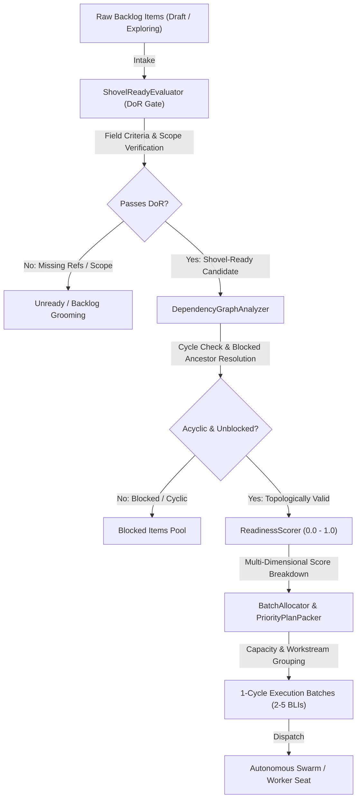
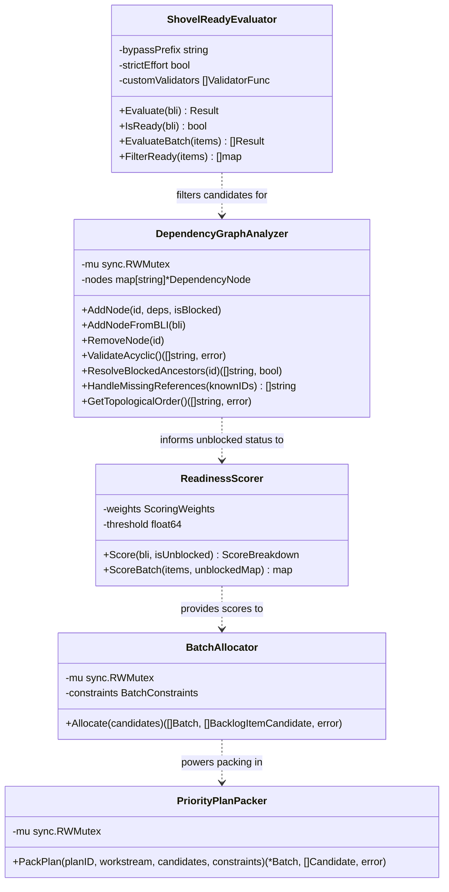
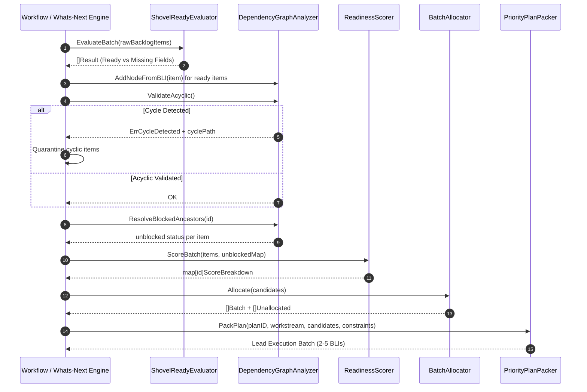
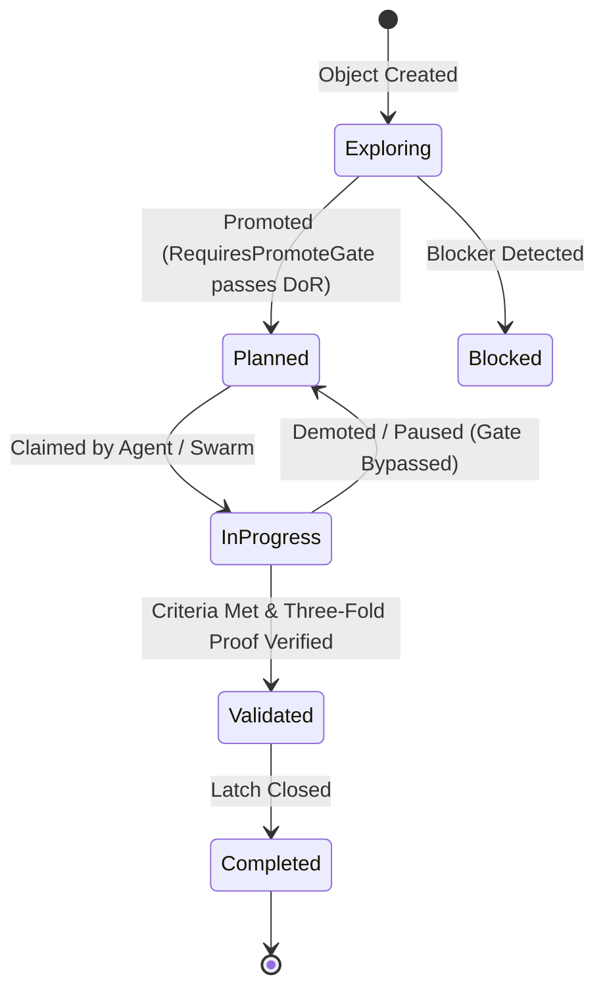

# Shovel-Ready Backlog Evaluation, Dependency Topology & Batching Subsystem Guide (`pkg/shovelready`)

## 1. Architectural Overview

The **Shovel-Ready Backlog Evaluation, Dependency Topology & Batching Subsystem** (`pkg/shovelready`) provides the foundational gatekeeping and dispatch optimization engine within the ZQK Knowledge Kernel. It enforces the **Definition of Ready (DoR)** standard (`CRI-SHOVEL-READY`), evaluates multi-item dependency topologies, computes quantitative execution readiness scores, and packs ready backlog items into execution-ready batches for autonomous swarms and human craftsmen.

In the Continuous Autonomous Programming (CAP) loop and autonomous workflows (`zqk do`, `zqk workflow whats-next`), autonomous agents must never blindly dispatch unshaped, underspecified, or blocked work. The shovel-ready subsystem acts as an automated check-valve preventing scope thrashing, circular deadlock, and dispatching failures.



### Core Responsibilities
- **Definition of Ready Gatekeeping (`ShovelReadyEvaluator`)**: Validates adherence to `CRI-SHOVEL-READY` (and `CRIT-SHOVEL-READY`), ensuring every backlog item declares parent requirements or technical specs, verifiable acceptance criteria, estimated effort or priority tier signal, and explicit persona/stakeholder lane assignments.
- **Dependency Topology Analysis (`DependencyGraphAnalyzer`)**: Constructs directed dependency graphs across backlog items, performs acyclic validation (cycle detection and cycle path reconstruction), resolves transitive blocked ancestors, and flags missing or dangling reference identifiers.
- **Quantitative Execution Scoring (`ReadinessScorer`)**: Computes standardized readiness scores bounded strictly in `[0.0, 1.0]` across five balanced dimensions (requirements, criteria, effort, lane assignment, and dependency unblocked status), triggering threshold gates.
- **Cycle-Bounded Batch Allocation (`BatchAllocator` & `PriorityPlanPacker`)**: Groups and packs candidate items into coherent 1-cycle batches (2 to 5 backlog items, bounded by effort capacity and partitioned by workstream lanes) ready for single-command execution.

---

## 2. Component Topology

The subsystem is modularized into five primary components:



### 2.1 ShovelReadyEvaluator (`evaluator.go`)
Evaluates raw backlog item maps against kernel DoR rules. It inspects:
- **Requirement or Technical Spec Reference**: Requires at least one non-empty reference in `requirement_refs` or `technical_spec_refs`.
- **Criteria References**: Requires at least one non-empty reference in `criteria_refs`.
- **Estimated Scope**: Validates either explicit `estimated_effort` or valid priority tier signals (`p0`, `p1`, `p2`, `p3`, `small`, `medium`, `large`).
- **Lane Assignment**: Validates `persona_ref`, `persona_refs`, `assignee_persona_ref`, `stakeholder_refs`, or `stakeholders`.
- **Blocker Status**: Fails if status is `blocked` or active references exist in `risk_blocker_refs`.
- **Synthetic Grooming Bypass**: Items prefixed with `AUTO-BLI-` bypass DoR to facilitate empty-plan recovery.

### 2.2 DependencyGraphAnalyzer (`dependency.go`)
Constructs an in-memory directed dependency graph supporting:
- **Acyclic Validation**: Depth-first search (DFS) with 3-state node coloring (unvisited, visiting, visited) to detect cycles and reconstruct circular reference chains (`A -> B -> C -> A`).
- **Transitive Blocker Propagation**: Walks upstream dependencies recursively to identify any blocked ancestors. If an ancestor is blocked, child tasks are marked unready.
- **Missing Reference Detection**: Reconciles dependency IDs against known kernel object IDs, exposing unresolvable dependencies before dispatch.
- **Topological Sorting**: Produces a valid execution order ensuring prerequisites run before dependent tasks.

### 2.3 ReadinessScorer (`scorer.go`)
Calculates a multi-dimensional readiness vector normalized to 1.0:
- **Requirement Weight (0.25)**: Satisfied if requirement or technical spec is present.
- **Criteria Weight (0.25)**: Satisfied if criteria references are bound.
- **Effort Weight (0.25)**: Satisfied if effort estimate or scope signal is defined.
- **Persona Weight (0.15)**: Satisfied if assigned to an engineering persona or stakeholder lane.
- **Dependency Weight (0.10)**: Satisfied if completely unblocked and upstream ancestors are healthy.
- **Threshold Gate**: Evaluates `TotalScore >= Threshold` (default 0.80) to qualify for batching.

### 2.4 BatchAllocator & PriorityPlanPacker (`batch.go`)
- **Batch Constraints**: Enforces minimum batch size (2), maximum batch size (5), and maximum estimated hours (e.g. 16.0 hours) per single-cycle batch.
- **Workstream Isolation**: Enforces workstream lane partitioning (`EnforceSingleWorkstream`) to ensure swarm focus remains within a coherent domain.
- **Priority Tier Slicing**: Orders items by priority tier (P0 > P1 > P2 > P3), then by readiness score, ensuring critical shovel-ready items are scheduled first.
- **Priority Plan Packing**: Packs candidate items directly into an execution-ready Priority Plan batch (`PackPlan`), returning excess items to the candidate backlog.

---

## 3. Shovel-Ready Evaluation & Batching Lifecycle

The evaluation and batching lifecycle proceeds through five deterministic phases:



### Backlog Item Gate State Machine



---

## 4. Concurrency & Verification Guarantees

### 4.1 Safe Concurrent Traversal
- **Read/Write Locking (`sync.RWMutex`)**: Both `DependencyGraphAnalyzer` and `BatchAllocator` use read-write mutexes. Concurrent graph queries, cycle checks, and topological sorts acquire read locks (`RLock`), enabling high-throughput parallel inspections without thread contention.
- **Defensive Node Cloning**: `GetNode` returns value-copies of registered `DependencyNode` instances, preventing callers from mutating internal graph edges outside lock boundaries.

### 4.2 Managed Concurrency via `goroutinelabels`
- In multi-agent or background evaluation routines, parallel workers are dispatched using `goroutinelabels.NewGoroutine`:
  ```go
  builder := goroutinelabels.NewGoroutine(
      "shovelready_eval_worker",
      "concurrent evaluation of candidate backlog items",
  )
  builder.StartSimple(func() {
      // evaluate and register candidates
  })
  ```
- Unmanaged `go func()` statements are strictly avoided, adhering to `POL-CONCURRENCY` and enabling panic containment and telemetry instrumentation.

### 4.3 Demote & Recovery Fail-Open Semantics
- `RequiresPromoteGate(from, to)` enforces DoR validation when transitioning into `planned` or `in_progress`.
- However, moving from `in_progress` back to `planned` (recovery pause or demote) does **not** demand DoR validation, ensuring in-flight tasks can be gracefully paused or reassigned without failing validation gates.

---

## 5. Verification & Three-Fold Proof Breakdown

The subsystem is verified according to the Three-Fold Proof:

| Verification Plane | Implementation & Coverage Target | Operational Proof |
| :--- | :--- | :--- |
| **Static Floor Invariant** | Statement test coverage reaches strictly >= 85.0% across all files in `pkg/shovelready` (achieved **98.6%**). | Validated via `go test -coverprofile` with zero untested entry points or branches across evaluator, topology analyzer, scorer, and batch packer. |
| **Operational Dynamic Proof** | Definition of Ready gate evaluation, acyclic dependency validation, blocked ancestor resolution, readiness score calculation, and batch constraints. | Validated in `shovelready_coverage_elevation_cycle210_test.go` via concurrent emissions across `goroutinelabels.NewGoroutine`, linear DAGs, diamond graphs, and capacity partitioning. |
| **Negative Adversarial Boundary** | Rejection of cyclical dependencies, missing reference detection, blocker propagation, strict effort rejection, and invalid batch constraints. | Validated via cycle reconstruction (`A -> B -> C -> A`), unresolvable external reference warnings, blocker propagation across ancestors, and load shedding on invalid limits. |

---

## 6. Practical Usage Examples

### 6.1 Evaluating Backlog Items for Definition of Ready

```go
evaluator := shovelready.NewEvaluator(
    shovelready.WithBypassPrefix("AUTO-BLI-"),
    shovelready.WithStrictEffort(false),
)

item := map[string]any{
    "id":               "BLI-001",
    "requirement_refs": []string{"REQ-CORE-001"},
    "criteria_refs":    []string{"CRIT-CORE-001"},
    "estimated_effort": "2h",
    "priority_tier":    "P1",
    "persona_refs":     []string{"PER-COMMUNITY-SOFTWARE-ENGINEER"},
    "status":           "planned",
}

result := evaluator.Evaluate(item)
if !result.Ready {
    // Inspect missing fields: result.Missing
}
```

### 6.2 Validating Dependency Topologies and Cycles

```go
analyzer := shovelready.NewDependencyGraphAnalyzer()

// Register backlog items with dependencies
analyzer.AddNode("BLI-001", nil, false)
analyzer.AddNode("BLI-002", []string{"BLI-001"}, false)
analyzer.AddNode("BLI-003", []string{"BLI-002"}, false)

// Validate acyclic graph
cyclePath, err := analyzer.ValidateAcyclic()
if err != nil {
    // Cyclical dependency detected: strings.Join(cyclePath, " -> ")
}

// Compute execution order (dependencies first)
order, err := analyzer.GetTopologicalOrder()
// order: ["BLI-001", "BLI-002", "BLI-003"]
```

### 6.3 Computing Readiness Scores and Packing Priority Plans

```go
scorer := shovelready.DefaultReadinessScorer()
scoreBreakdown := scorer.Score(item, true)
// scoreBreakdown.TotalScore >= 0.80 -> PassedThreshold == true

candidate := shovelready.CandidateFromBLI(item, scoreBreakdown.TotalScore, true)

constraints := shovelready.DefaultBatchConstraints()
constraints.MinBatchSize = 2
constraints.MaxBatchSize = 5
constraints.MaxCapacityHours = 16.0

packer := shovelready.NewPriorityPlanPacker()
planBatch, unallocated, err := packer.PackPlan("PRI-CYCLE-001", "ws-core", []shovelready.BacklogItemCandidate{candidate}, constraints)
if err != nil {
    // Handle unallocated candidates or capacity limits
}
```
