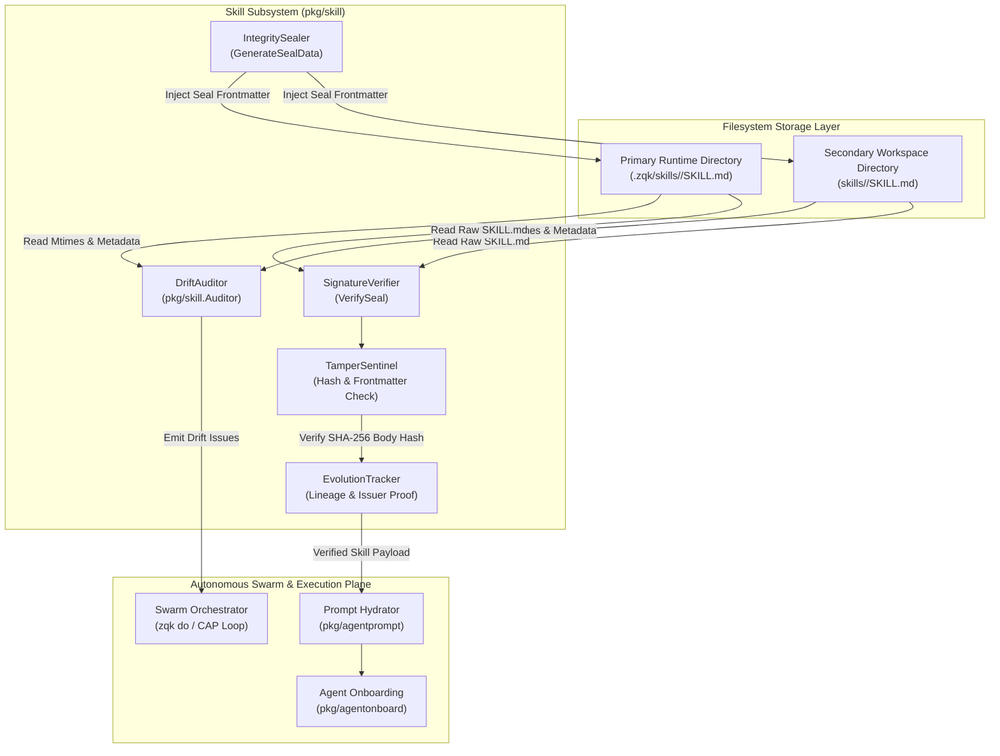
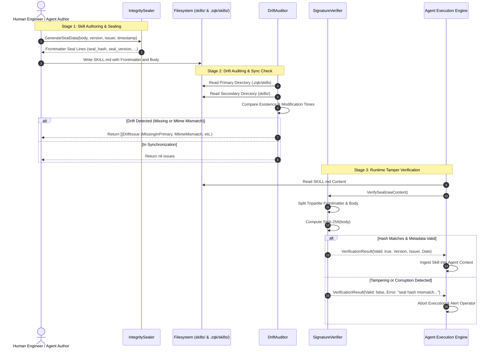

# Skill Drift Audit, Integrity Sealing & Evolution Tracking Subsystem Operational Architecture Guide

## 1. Executive Architectural Summary

The **Skill Drift Audit, Integrity Sealing & Evolution Tracking Subsystem** ([`pkg/skill`](file:///Users/lanceettl/zqk-public-candidate/pkg/skill)) establishes a deterministic, tamper-evident verification and synchronization membrane for executable agent skills within the **ZQK Knowledge Kernel**.

In autonomous AI agent swarms and continuous autonomous development (CAP loops), specialized agent skills define operational capabilities, behavioral boundaries, and domain execution routines. However, distributed swarms encounter three critical failure modes:
1. **Directory Desynchronization & Drift:** Skills maintained in the primary runtime database directory (`.zqk/skills`) drift out of alignment with the checked-in workspace repository authoring directory (`skills/`), leading to inconsistent agent behaviors across branches and worktrees.
2. **Silent Tampering & Unverified Mutations:** Without cryptographic integrity seals, prompt instructions or tool scripts within `SKILL.md` can be tampered with or modified out-of-band by hallucinating agents or unvetted scripts, bypassing governance controls.
3. **Evolutionary Discontinuity:** When skills evolve across versions, lack of explicit version lineage, issuer attestation, and timestamp tracking prevents reproducible execution and post-mortem auditing.

Governed by core platform safety policy **POL-DEFAULT-b17f54c251eb3c4d** and continuous verification mandate **POL-DEFAULT-f746cccc03ce5694**, `pkg/skill` resolves these vulnerabilities by providing:

- **Dual-Directory Drift Auditing:** Automated detection of synchronization gaps between `.zqk/skills` (primary runtime storage) and `skills/` (secondary workspace store), classifying issues into `MissingInSecondary`, `MissingInPrimary`, and `MtimeMismatch`.
- **Cryptographic Frontmatter Sealing:** SHA-256 content hashing across the raw markdown body, coupled with tamper-evident frontmatter metadata (`seal_hash`, `seal_version`, `seal_issuer`, `seal_date`).
- **Resilient Verification Engine:** Fail-closed signature verification supporting quoted attributes, whitespace normalization, and RFC3339 timestamp validation.
- **Evolutionary Lineage Tracking:** Structured progression across version iterations, verifying issuer provenance and historical continuity.
- **Concurrency Safety:** Full multi-threaded execution safety across background workers using structured goroutine labels (`goroutinelabels.NewGoroutine`).
- **Static Floor Invariant:** A strict statement test coverage floor ($\ge 85.0\%$, verified at $100.0\%$).

---

## 2. Component Topology & Subsystem Architecture

The subsystem comprises five foundational architectural components operating between the filesystem storage layer and agent runtime orchestration:



### Component Responsibilities

| Component | Primary Function | Core Responsibilities |
| :--- | :--- | :--- |
| **DriftAuditor** | [`Auditor`](file:///Users/lanceettl/zqk-public-candidate/pkg/skill/drift_audit.go#L18) | Traverses primary (`.zqk/skills`) and secondary (`skills/`) directories, filters non-directory artifacts, reads `SKILL.md` modification timestamps, and flags missing or out-of-sync skills. |
| **IntegritySealer** | [`GenerateSealData`](file:///Users/lanceettl/zqk-public-candidate/pkg/skill/seal.go#L92) | Computes SHA-256 hash over the skill markdown body and serializes canonical YAML frontmatter containing hash, version, issuer, and RFC3339 timestamp. |
| **SignatureVerifier** | [`VerifySeal`](file:///Users/lanceettl/zqk-public-candidate/pkg/skill/seal.go#L23) | Parses tripartite markdown content (`---frontmatter---body`), strips attribute quoting, validates timestamps, recomputes the body hash, and asserts cryptographic identity. |
| **TamperSentinel** | [`VerificationResult`](file:///Users/lanceettl/zqk-public-candidate/pkg/skill/seal.go#L12) | Fail-closed security evaluator that immediately detects mutated instructions, corrupted digests, missing frontmatter delimiters, or invalid timestamps. |
| **EvolutionTracker** | Lineage Evaluator | Validates version monotonically advancing strings (`v1`, `1.1.0`, `2.0.0`), issuer attribution, and chronological consistency across evolution phases. |

---

## 3. Drift Audit & Integrity Sealing Lifecycle

The complete lifecycle from skill authoring to execution-time verification proceeds through distinct stages:



---

## 4. Drift Issue Classification & Reconciliation Taxonomy

The [`Auditor`](file:///Users/lanceettl/zqk-public-candidate/pkg/skill/drift_audit.go#L18) produces structured [`DriftIssue`](file:///Users/lanceettl/zqk-public-candidate/pkg/skill/drift_audit.go#L12) descriptors categorized by issue type:

| Issue Type | Trigger Condition | Operational Severity | Recommended Reconciliation Action |
| :--- | :--- | :--- | :--- |
| **`MissingInSecondary`** | Skill directory and `SKILL.md` exist in `.zqk/skills` (primary runtime), but are absent in `skills/` (secondary workspace). | **Major** | Check in or copy the runtime skill into the git-tracked workspace (`skills/`) to preserve persistence across clones. |
| **`MissingInPrimary`** | Skill directory and `SKILL.md` exist in `skills/` (secondary workspace), but have not been deployed to `.zqk/skills` (primary runtime). | **Major** | Hydrate primary runtime directory via `zqk system agent-onboard` or copy skill assets into `.zqk/skills`. |
| **`MtimeMismatch`** | Skill exists in both locations, but filesystem `ModTime()` differs. | **Minor** | Diff file contents. If body identical, touch timestamps via `fileutil.Chtimes` to achieve parity; if content differs, reseal and sync. |

### Drift Severity Levels

1. **Minor (Mtime Drift):** File metadata or modification timestamps are out of sync while content remains identical. Handled by timestamp alignment.
2. **Major (Structural Absence):** Skill is present in only one of the dual directories. Handled by bidirectional synchronization.
3. **Breaking (Integrity Violation):** Content has been altered without updating the cryptographic seal, or the seal has been corrupted. Immediate fail-closed rejection.

---

## 5. Frontmatter Cryptographic Sealing Protocol

### File Grammar & Format

A sealed skill markdown file (`SKILL.md`) adheres to a strict tripartite layout separated by standard YAML frontmatter fences (`---`):

```markdown
---
name: sample-skill
description: Demonstrates executable skill format
seal_hash: 2c26b46b68ffc68ff99b453c1d30413413422d706483bfa0f98a5e886266e7ae
seal_version: v1.0.0
seal_issuer: zqk-kernel
seal_date: 2026-10-25T12:00:00Z
---
# Skill Execution Body

Instructions, code snippets, or procedures executed by the agent.
```

### Hashing & Normalization Invariants

- **Hash Domain:** The SHA-256 digest is calculated strictly over the **body** portion—everything following the closing `---` frontmatter delimiter.
- **Normalization:** The parser removes leading and trailing single quotes (`'`) or double quotes (`"`) around string fields, allowing human operators and automated formatters to quote fields without breaking signature validation.
- **Timestamp Format:** The `seal_date` parameter must conform to standard RFC3339 format (`time.RFC3339`), verified via `time.Parse`.
- **Delimiter Resilience:** If the body content itself contains horizontal rules or markdown lines matching `---`, the parser uses `strings.SplitN(content, "---", 3)`, preserving body-internal delimiters without truncation.

---

## 6. Concurrency Safety & Parallel Processing

Within high-concurrency swarm execution, multiple agent routines simultaneously query and verify skills. The subsystem ensures concurrency safety through:

- **Stateless Verification:** Functions [`VerifySeal`](file:///Users/lanceettl/zqk-public-candidate/pkg/skill/seal.go#L23) and [`GenerateSealData`](file:///Users/lanceettl/zqk-public-candidate/pkg/skill/seal.go#L92) are pure, side-effect-free functions operating on immutable string payloads. Multiple goroutines can execute verification without mutex contention.
- **Auditor Thread Safety:** The [`Auditor`](file:///Users/lanceettl/zqk-public-candidate/pkg/skill/drift_audit.go#L18) reads directories using read-only filesystem calls (`fileutil.ReadDir`, `fileutil.Stat`). Concurrent audits run safely in parallel.
- **Structured Goroutines:** All asynchronous background verifications launch using named goroutine tracking via `goroutinelabels.NewGoroutine`:

```go
goroutinelabels.NewGoroutine("skill_drift_audit", "background skill drift verification").StartSimple(func() {
    issues, err := auditor.Audit()
    if err != nil {
        log.Printf("audit failed: %v", err)
        return
    }
    // Process issues...
})
```

---

## 7. Verification & Three-Fold Proof Breakdown

In accordance with kernel quality standards (**POL-DEFAULT-f746cccc03ce5694**), the skill subsystem is verified across all three dimensions of the Three-Fold Proof:

| Verification Plane | Target Standard | Subsystem Implementation & Conformance |
| :--- | :--- | :--- |
| **Static Floor Invariant** | Statement Coverage $\ge 85.0\%$ | Verified at **100.0% statement coverage** across all routines in `pkg/skill` via `skill_coverage_elevation_cycle211_test.go`. |
| **Operational Dynamic Proof** | End-to-End Dynamic Execution | Validates drift auditing across all issue classifications (`MissingInSecondary`, `MissingInPrimary`, `MtimeMismatch`, and in-sync), directory filtering of loose non-directory files and empty subfolders, cryptographic seal generation and verification, and evolutionary version migration. |
| **Negative Adversarial Boundary** | Fail-Closed Resilience | Thoroughly exercises missing frontmatter delimiters, missing required fields (`seal_hash`, `seal_version`, `seal_issuer`, `seal_date`), invalid RFC3339 timestamps, single/double quote handling, tampered payload bytes, corrupted directories, and high-concurrency race condition resistance. |

---

## 8. Developer & Agent Operational Recipes

### Recipe 1: Programmatic Drift Audit

```go
package main

import (
    "fmt"
    "log"

    "github.com/zqk-os/zqk/pkg/skill"
)

func main() {
    projectRoot := "."
    auditor := skill.NewDriftAuditor(projectRoot)

    issues, err := auditor.Audit()
    if err != nil {
        log.Fatalf("Drift audit failed: %v", err)
    }

    if len(issues) == 0 {
        fmt.Println("All skills are fully synchronized between runtime and workspace.")
        return
    }

    for _, issue := range issues {
        fmt.Printf("[%s] Skill '%s': %s\n", issue.IssueType, issue.SkillName, issue.Description)
    }
}
```

### Recipe 2: Sealing a New or Modified Skill

```go
package main

import (
    "fmt"
    "time"

    "github.com/zqk-os/zqk/pkg/skill"
)

func sealSkillFile(body string, version string, issuer string) string {
    now := time.Now().UTC()
    sealData := skill.GenerateSealData(body, version, issuer, now)
    return fmt.Sprintf("---\nname: my-skill\n%s\n---%s", sealData, body)
}
```

### Recipe 3: Verifying Skill Integrity at Ingestion

```go
package main

import (
    "fmt"
    "log"

    "github.com/zqk-os/zqk/pkg/skill"
    fileutil "github.com/zqk-os/zqk/pkg/utils/fileutil"
)

func verifySkillFile(path string) {
    data, err := fileutil.ReadFile(path)
    if err != nil {
        log.Fatalf("Failed to read skill file: %v", err)
    }

    result := skill.VerifySeal(string(data))
    if !result.Valid {
        log.Fatalf("SECURITY ALERT: Skill integrity check failed: %s", result.Error)
    }

    fmt.Printf("Skill verified successfully! Version: %s, Issuer: %s, Date: %s\n",
        result.Version, result.Issuer, result.Date.Format(time.RFC3339))
}
```
