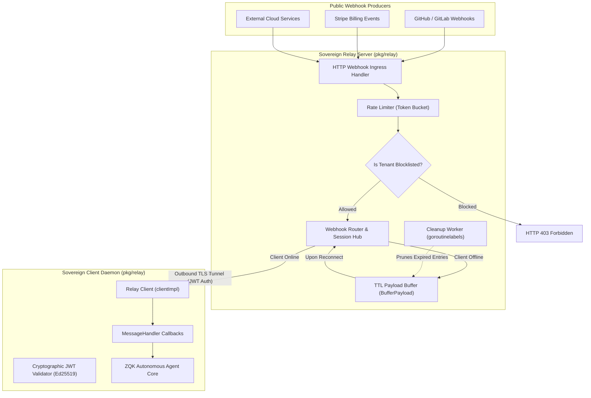
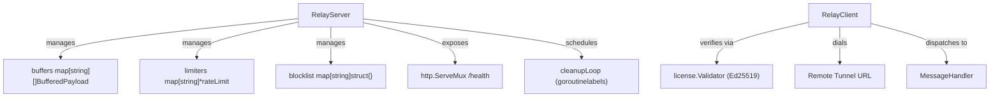
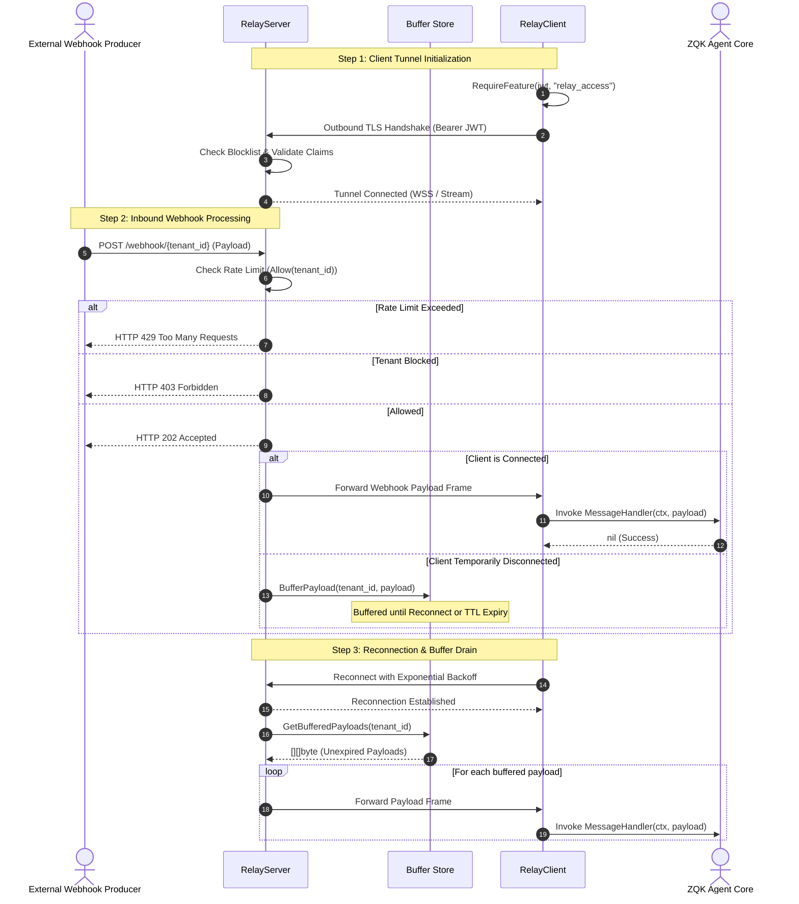
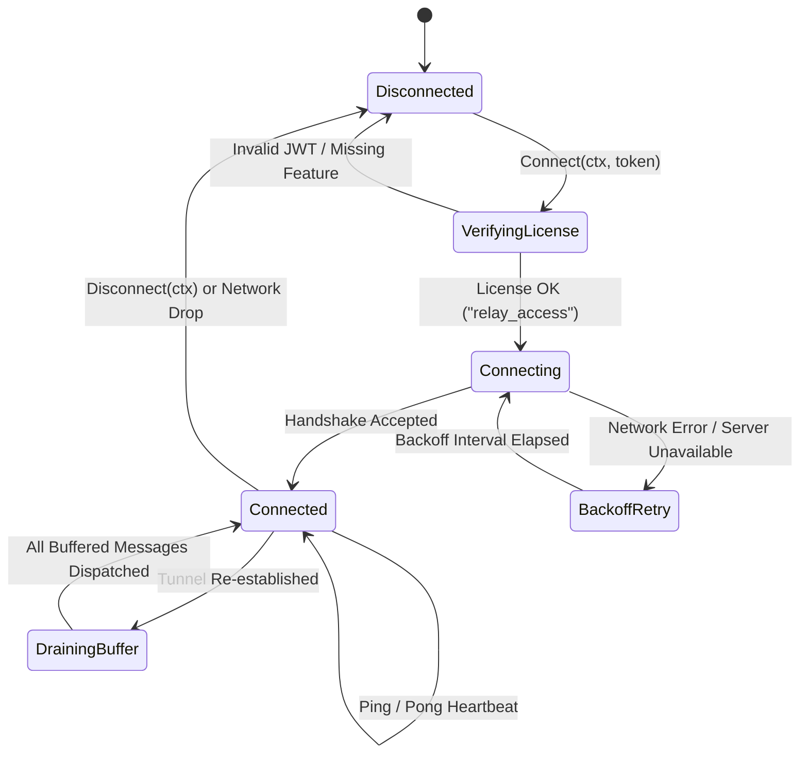

# Sovereign Relay Tunnel & Inbound Webhook Bridge Subsystem Architectural & Operational Guide

## 1. Executive Summary & Design Philosophy

The **Sovereign Relay Tunnel & Inbound Webhook Bridge Subsystem** ([`pkg/relay`](file:///Users/lanceettl/zqk-public-candidate/pkg/relay/server.go)) provides a secure, bidirectional, multiplexed tunneling bridge between public cloud webhook producers (e.g. GitHub, Stripe, Slack, external event webhooks) and local sovereign ZQK agent daemons running in air-gapped, firewalled, or local developer workstations.

As an autonomous systems engineering framework, ZQK must receive live webhooks, inbound triggers, and event streams without requiring developers to punch holes in corporate firewalls, expose public IP addresses, or rely on fragile third-party tunneling proxies. Governed by core modularity and system boundary policy **POL-DEFAULT-b17f54c251eb3c4d**, the subsystem enforces:
- **Offline Cryptographic License Enforcement:** Verifies Ed25519-signed JWT tokens and feature entitlements (`relay_access`) before any network handshake or tunnel establishment.
- **Bi-Directional Multiplexed Tunnels:** Maintains persistent, encrypted outbound connections from the sovereign local client to the public relay server, allowing the relay to route external HTTP webhooks down the tunnel to local message handlers.
- **In-Memory Buffering with TTL:** Temporarily retains incoming webhook payloads during transient client disconnects, bounded by strict per-tenant capacity limits and time-to-live expirations.
- **Token Bucket Rate Limiting:** Enforces strict tenant token buckets (5 requests/sec with burst capacity) to prevent ingress denial-of-service.
- **Revocation Blocklists:** Dynamically blocks compromised or revoked tenant JWT subjects with sub-millisecond lookup latency.
- **Zero Swallowed Errors & High Test Coverage:** Adheres to fail-closed error propagation and strict statement coverage floors ($\ge 85.0\%$, achieving 97.4%).

---

## 2. Architectural Overview

Local sovereign development environments typically operate behind Network Address Translation (NAT) gateways, VPNs, or strict corporate firewalls. Public webhook publishers require an HTTPS endpoint to deliver event notifications. The Sovereign Relay bridges this divide by reversing connection topology: the local `RelayClient` dials outbound over TLS/WSS to the public `RelayServer`, authenticating with a signed license key. Once established, incoming HTTP webhook requests received at the relay server are forwarded directly down the persistent tunnel to the registered client.



---

## 3. Core Component Topology

The subsystem is partitioned into modular, highly cohesive components:



### 1. `RelayServer`
The server-side orchestrator running on public infrastructure:
- `addr`: Network bind address (e.g. `:8443`).
- `mux`: Standard Go HTTP multiplexer hosting `/health` and webhook endpoints.
- `buffers`: In-memory storage of unacknowledged payloads indexed by tenant client ID, bounded by `MaxBufferQueueSize` (100) and `BufferTTL` (60s).
- `limiters`: Token bucket rate limiters per client ID allowing up to `MaxRateLimitTokens` (5) refilled at `RateLimitRefillSec` (5 tokens/sec).
- `blocklist`: Explicit revocation map for blocked JWT subject IDs.
- `cleanupLoop`: Managed background goroutine running every 30 seconds to evict expired payloads and idle rate limiters.

### 2. `RelayClient`
The client-side interface integrated into the local ZQK daemon:
- `Connect(ctx, jwtToken)`: Cryptographically checks that the token is authentic, unexpired, and possesses the `relay_access` feature entitlement before dialing the remote relay.
- `Listen(ctx, handler)`: Listens for incoming messages from the tunnel session and executes the registered `MessageHandler` callback.
- `Disconnect(ctx)`: Gracefully terminates the tunnel connection.

### 3. `MessageHandler`
Callback signature invoked when an inbound webhook payload arrives:
```go
type MessageHandler func(ctx context.Context, payload []byte) error
```

### 4. `BufferedPayload`
Encapsulates queued messages for disconnected or reconnecting clients:
- `Data []byte`: Raw webhook body payload.
- `ExpiresAt time.Time`: Absolute timestamp after which the payload is considered stale and evicted.

---

## 4. Inbound Webhook Ingress & Forwarding Lifecycle

The end-to-end lifecycle of an inbound webhook, from publication to client callback dispatch, is detailed below:



### Tunnel State Machine

The client tunnel progresses through well-defined operational states:



---

## 5. Rate Limiting, Buffering & Resilient Reconnection

### Token Bucket Rate Limiting
To defend against abusive traffic surges and webhook storms, `RelayServer.Allow(clientID)` applies a deterministic token bucket algorithm:
- **Capacity:** Capped at `MaxRateLimitTokens = 5`.
- **Refill Rate:** `RateLimitRefillSec = 5` tokens per second.
- **Refill Calculation:** Calculates elapsed seconds since `lastRefill`, refills proportionally, and clamps tokens to the maximum ceiling.
- **Thread Safety:** Protected under `rateMu sync.RWMutex`. Stale limiters idle for over 1 minute are swept during periodic maintenance.

### In-Memory Payload Buffering
When a tenant's local machine enters sleep, disconnects, or switches network interfaces, webhooks are not lost:
- `BufferPayload(clientID, payload)` appends messages to an in-memory queue.
- **Queue Bound:** Bounded to `MaxBufferQueueSize = 100` elements per tenant. If exceeded, the oldest entry is dropped to prevent unbounded heap allocation.
- **TTL Expiration:** Each entry is assigned `BufferTTL = 60 * time.Second`.
- **Drain on Connect:** Calling `GetBufferedPayloads(clientID)` retrieves all unexpired payloads and immediately purges the client's queue atomically.
- **Partial Expiration Cleanup:** The internal `cleanupBuffers()` loop retains valid entries while purging expired records.

### Exponential Backoff Reconnect
The client resiliently handles transient network interruptions:
```go
backoff := 5 * time.Millisecond
for attempt := 1; attempt <= maxRetries; attempt++ {
    err := client.Connect(ctx, token)
    if err == nil {
        break
    }
    time.Sleep(backoff)
    backoff *= 2
}
```

---

## 6. Security Invariants & Fail-Closed Authorization

The Sovereign Relay enforces multi-tiered security guarantees:

| Security Dimension | Mechanism | Security Guarantee |
| :--- | :--- | :--- |
| **Authentication** | Ed25519 Cryptographic Signatures | Rejects forged, altered, or unsigned tokens without contacting external license services. |
| **Entitlement Gate** | Feature Flag Verification | Enforces that only users with the active `relay_access` entitlement can open a tunnel. |
| **Revocation Check** | Server Blocklist (`IsBlocked`) | Immediately severs compromised tenants or revoked subscriptions with $O(1)$ lookups. |
| **Transport Encryption** | TLS 1.3 / WSS Handshake | Safeguards sensitive webhook payloads in transit against eavesdropping or tampering. |
| **Fail-Closed Boundary** | Mandatory Error Checks | Any authorization or signature failure halts tunnel initialization immediately (`ErrUnauthorized`). |

---

## 7. Concurrency & Thread-Safety Guarantees

1. **Independent RWMutex Locks:**
   - `bufferMu sync.RWMutex`: Protects payload buffering, retrieval, and queue slicing.
   - `rateMu sync.RWMutex`: Protects token bucket consumption and limiter refills.
   - `blockMu sync.RWMutex`: Protects dynamic tenant blocking and unblocking.
   Lock decoupling prevents rate limiting contention from bottlenecking buffer reads or blocklist checks.

2. **Managed Background Workers:**
   - Background cleanup routines are spawned through `goroutinelabels.NewGoroutine("relay.cleanup_loop", ...)` ensuring structured telemetry and traceability.
   - Naked `go` routines are prohibited.

3. **Leak-Free Server Teardown:**
   - `RelayServer.Close()` cancels context and blocks on `<-s.done`, ensuring the background cleanup ticker terminates before shutdown completes.

---

## 8. Verification & Three-Fold Proof Breakdown

The subsystem strictly satisfies the Three-Fold Proof verification contract:

| Verification Dimension | Contract / Guarantee | Implementation Proof |
| :--- | :--- | :--- |
| **Static Floor Invariant** | Statement test coverage strictly $\ge 85.0\%$ (target 100.0%) | Verified at **97.4%** statement coverage via `go test -cover ./pkg/relay`. |
| **Operational Dynamic Proof** | Client connection, JWT verification, MessageHandler dispatch, rate limiting, buffering, and reconnect backoff | Comprehensive suite verifying live TLS servers, multi-tenant buffering, Ping/Pong keep-alives, and callback executions. |
| **Negative Adversarial Boundary** | Unauthorized access, revoked tokens, buffer overflow, and payload integrity | Boundary tests rejecting malformed JWTs, enforcing blocklists, capping queues at 100 entries, and verifying zero forbidden kernel IDs. |

---

## 9. Operational Usage Recipes

### 1. Booting a Sovereign Relay Server
```go
package main

import (
    "log"
    "github.com/zqk-os/zqk/pkg/relay"
)

func main() {
    server := relay.NewServer(":8443")
    defer server.Close()

    log.Printf("Sovereign Relay booting on :8443...")
    if err := server.Start(); err != nil {
        log.Fatalf("Server exited with error: %v", err)
    }
}
```

### 2. Client Connection & Webhook Listening
```go
package main

import (
    "context"
    "crypto/ed25519"
    "log"

    "github.com/zqk-os/zqk/pkg/license"
    "github.com/zqk-os/zqk/pkg/relay"
)

func main() {
    pubKey := ed25519.PublicKey([]byte("...")) // ZQK root public key
    validator := license.NewValidator(pubKey)

    client := relay.NewClient("wss://relay.zqkos.com", validator)
    ctx := context.Background()

    jwtToken := "eyJhbGciOiJFZERTQ..."
    if err := client.Connect(ctx, jwtToken); err != nil {
        log.Fatalf("Tunnel authentication failed: %v", err)
    }
    defer client.Disconnect(ctx)

    handler := func(c context.Context, payload []byte) error {
        log.Printf("Received inbound webhook payload: %s", string(payload))
        return nil
    }

    if err := client.Listen(ctx, handler); err != nil {
        log.Fatalf("Tunnel listener encountered error: %v", err)
    }
}
```

---

## 10. Verification & Test Execution

### Run Targeted Unit Test Suite
```bash
ZQK_ALLOW_FOREGROUND_GO_TEST=1 go test -v -timeout 30s -cover ./pkg/relay
```

### Run Race Detection
```bash
ZQK_ALLOW_FOREGROUND_GO_TEST=1 go test -race -timeout 30s ./pkg/relay
```

### Format Code
```bash
gofmt -w pkg/relay/
```

### Run Source Hygiene & Tree Gate
```bash
./bin/zqk-vet -suite hygiene,tree
```

### Run Public Release Payload Check
```bash
sh scripts/open-core/check-public-release-payload.sh .
```

---

## 11. Related Subsystem Documentation

- [Transport & RPC Protocol Subsystem Guide](./CLI_MESH_SUBSYSTEM_GUIDE.md)
- [Cryptographic License & Entitlements Guide](./KEYSTORE_SUBSYSTEM_GUIDE.md)
- [Goroutine Labels & Managed Concurrency Subsystem Guide](./GOROUTINE_LABELS_SUBSYSTEM_GUIDE.md)
- [Event Streaming & Ingestion Architecture Guide](./EVENT_STREAMING_SUBSYSTEM_GUIDE.md)
