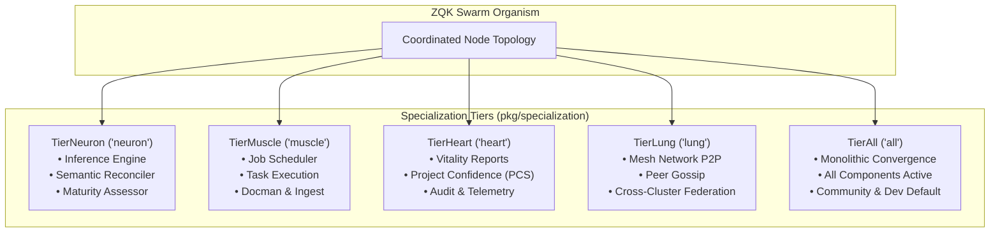
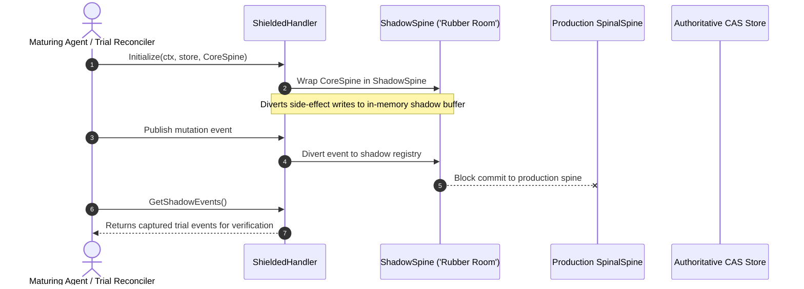
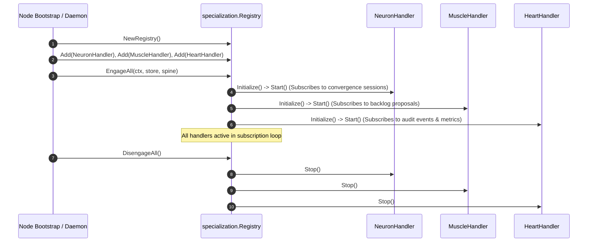
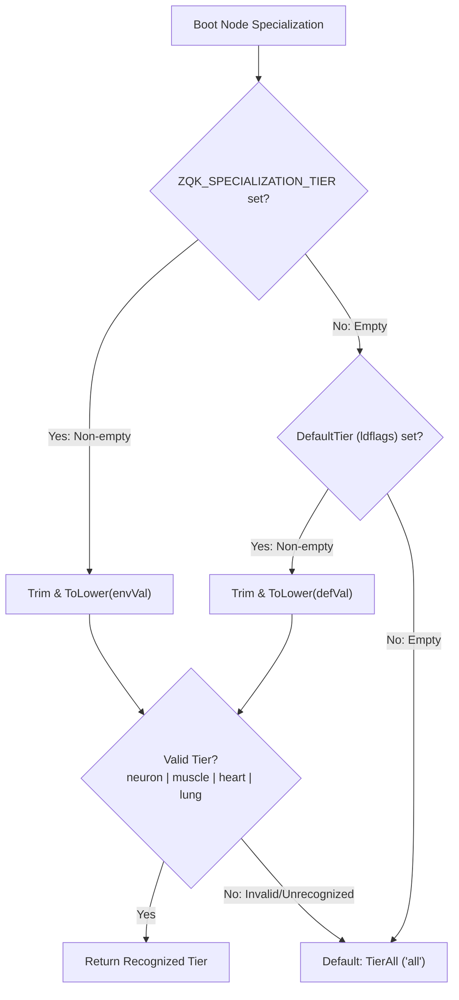

# Cellular Specialization & Organism Roles Subsystem Architectural & Operational Guide

## 1. Executive Architectural Summary

The **Cellular Specialization & Organism Roles Subsystem** (`pkg/specialization`) governs node-level architectural segregation, operational role specialization, component filtering, and side-effect sandboxing across ZQK swarm topologies.

Rather than enforcing a uniform monolithic topology where every node or agent process runs every controller, reconciler, and background daemon, the ZQK Knowledge Kernel models distributed swarm nodes after biological organ systems. Nodes specialize into dedicated functional tiers—**Neuron** (sensing, inference, state reconciliation), **Muscle** (task execution, artifact builds, document management), **Heart** (vitality telemetry, Project Confidence Score computation, audit tracking), and **Lung** (mesh communication, peer gossip, federation)—while retaining a unified **All** tier for single-machine, developer, and community deployments.

Furthermore, `pkg/specialization` introduces sandboxed execution modes (**`ModeNormal`** vs **`ModeShielded`**), enabling speculative reasoning, maturation trials, and untrusted execution inside an isolated "Rubber Room" (`ShadowSpine`) without contaminating the authoritative production kernel graph.

---

## 2. Component Topology & Biological Tier Analogy

The subsystem partitions system responsibilities across four specialized cellular tiers and a monolithic generalist tier:



### Tier Component Matrix

The active tier governs component execution via `Tier.ShouldRun(component)`:

| Tier | Identifier | Designated Components | Operational Purpose & Hardware Profile |
| :--- | :--- | :--- | :--- |
| **All** | `"all"` | *All components* (`reconciler`, `assessor`, `inference`, `scheduler`, `importer`, `docman`, `metrics`, `health`, `mesh`, `federation`, infra) | Default single-node deployment; developer workstations, local CI pipelines, and standalone community servers. |
| **Neuron** | `"neuron"` | `reconciler`, `assessor`, `inference` | High-memory, GPU/LLM-adjacent compute focused on sensing drift, evaluating semantic convergence, and generating task inferences. |
| **Muscle** | `"muscle"` | `scheduler`, `importer`, `docman` | High-CPU compute focused on parallel task execution, AST processing, automated code transformations, and doc generation. |
| **Heart** | `"heart"` | `metrics`, `health` | Low-latency monitoring node computing rolling vitality metrics, tracking system health, and calculating the Project Confidence Score (PCS). |
| **Lung** | `"lung"` | `mesh`, `federation` | Gateway and edge routing node managing inter-cluster transport, peer gossip, and packet distribution. |

*Note: Infrastructure and shared services (e.g. storage adapters, logging, security middleware) always run across all tiers by default.*

---

## 3. Operational Modes: Normal vs Shielded (The Rubber Room)

`pkg/specialization` decouples execution safety through two operational modes:



### 3.1 ModeNormal (`"normal"`)
Standard production mode. All events, mutations, state transitions, and audit records published by handlers commit directly to the primary event spine (`infrastructure.SpinalSpine`) and persist into authoritative Content-Addressed Storage (CAS).

### 3.2 ModeShielded (`"shielded"`)
Sandboxed mode wrapping a `Handler` inside a `ShieldedHandler`. The inner handler is initialized with a `ShadowSpine` (the "Rubber Room"). Mutations and events emitted during speculative execution or exploratory simulation are diverted to an in-memory shadow buffer. This shields the production kernel graph from side-effects while allowing callers to inspect diverted events via `GetShadowEvents()`.

---

## 4. Handler Ecosystem & Lifecycle Coordination

The subsystem defines an extensible `Handler` interface and lifecycle manager (`Registry`):

```go
type Handler interface {
    Initialize(ctx context.Context, store storage.ObjectStorageProvider, spine infrastructure.SpinalSpine) error
    Start(ctx context.Context) error
    Stop() error
}
```



### 4.1 NeuronHandler
- **Subscription:** Subscribes to convergence session state transitions (`objects.KindConvergenceSession`).
- **Drift Detection:** Senses when an active session evaluates to `trending_away`.
- **Inference Pipeline:** Executes `semantic.InferenceEngine.InferFromConvergence` to generate corrective backlog item recommendations.
- **Mesh Publication:** Emits `propose` operational events back onto the spinal mesh for execution by muscle workers.

### 4.2 MuscleHandler
- **Subscription:** Subscribes to backlog item proposal events (`objects.KindBacklogItem`).
- **Execution Fast-Track:** Inspects priority tiers. When a `P1` priority proposal is sensed, validates the workload, updates status to `in_progress`, and emits an `execute` event onto the spine.
- **Service Isolation:** Ignores non-proposal operations and non-urgent proposals, preserving compute headroom for high-priority batches.

### 4.3 HeartHandler & Project Confidence Score (PCS)
The HeartHandler maintains the node's vitality report (`system_vitality`), computing a holistic Project Confidence Score (PCS) scaled from 0 to 100 based on rolling averages:

$$PCS = (SuccessRate \times 60) + ((1.0 - DriftFrequency) \times 20) + ((1.0 - ResourceSaturation) \times 20)$$

- **Success Rate (60% weight):** Exponential moving average updated via audit events (`convergence_success`).
- **Drift Frequency (20% weight):** Inversely weighted frequency of sensed alignment drift (`drift_detected`).
- **Resource Saturation (20% weight):** Maximum of memory saturation (relative to a 2GB soft ceiling) and goroutine saturation (relative to `concurrency.DefaultGoroutineCeiling`).
- **Goroutine Exhaustion Circuit Breaker:** If available goroutine compute drops below 10% of the ceiling, PCS is strictly capped at 49 regardless of current success rate, signaling critical load pressure to swarm orchestrators.
- **Update Throttling:** Vitality reports are rate-limited to prevent hot-loop thrashing on the storage plane.

---

## 5. Tier Configuration & Resolution Hierarchy

Node specialization is resolved deterministically at boot through `GetCurrentTier()`:



### 5.1 Dynamic Environment Variable
```bash
# Specialize a node as a pure execution worker
export ZQK_SPECIALIZATION_TIER=muscle
zqk scheduler daemon
```

### 5.2 Build-Time Ldflags Invariant
For immutable appliance containers or bare-metal edge deployments, the default tier can be baked directly into the binary:
```bash
go build -ldflags "-X github.com/zqk-os/zqk/pkg/specialization.DefaultTier=neuron" -o bin/zqk ./cmd/zqk
```

---

## 6. Concurrency, Mutex Isolation & Process Hygiene

1. **Thread-Safe Metrics Accumulation:** `HeartHandler` protects rolling success rates, drift frequencies, and vitality timestamps behind an internal `sync.Mutex`.
2. **Concurrent Handler Execution:** All handlers operate concurrently within the spinal subscription loop. Handlers handle incoming events asynchronously without cross-handler lock contention.
3. **Structured Disengagement:** `Registry.DisengageAll()` iterates through all registered handlers and invokes `Stop()`, ensuring graceful teardown without leaked goroutines or dangling listeners.

---

## 7. Verification & Three-Fold Proof

The subsystem adheres strictly to the ZQK Three-Fold Proof verification standard:

| Dimension | Proof Mechanism | Verification Method |
| :--- | :--- | :--- |
| **Static Floor Invariant** | Statement test coverage must reach $\ge 85.0\%$ across all exported functions, tier lookups, and handlers. | `ZQK_ALLOW_FOREGROUND_GO_TEST=1 go test -v -timeout 30s -cover ./pkg/specialization` (Achieved: **99.1%**) |
| **Operational Dynamic Proof** | Deterministic end-to-end cellular handshake: Neuron detects drift, generates inferences, publishes proposals; Muscle captures proposals and schedules execution; Heart tracks vitality and computes PCS. | `TestCellularHandshake`, `TestShieldedHandlerLifecycle`, `TestSpecializationConcurrency` |
| **Negative Adversarial Boundary** | Resilient degradation under invalid tiers, corrupted event payloads, failing storage backends, event subscribe errors, and goroutine exhaustion conditions. | `TestHeartHandlerCalculatePCSGoroutineExhaustion`, `TestHeartHandlerVitalityReporting`, `TestNeuronHandlerOperations` |

---

## 8. Operational Commands & Diagnostic Recipes

### 8.1 Verifying Current Node Tier
```bash
# Check active specialization tier in local environment
zqk system status

# Launch dedicated muscle node
ZQK_SPECIALIZATION_TIER=muscle zqk scheduler daemon
```

### 8.2 Inspecting System Vitality & PCS
```bash
# Query the current vitality report generated by the HeartHandler
zqk query "SELECT * FROM system_vitality"
```
