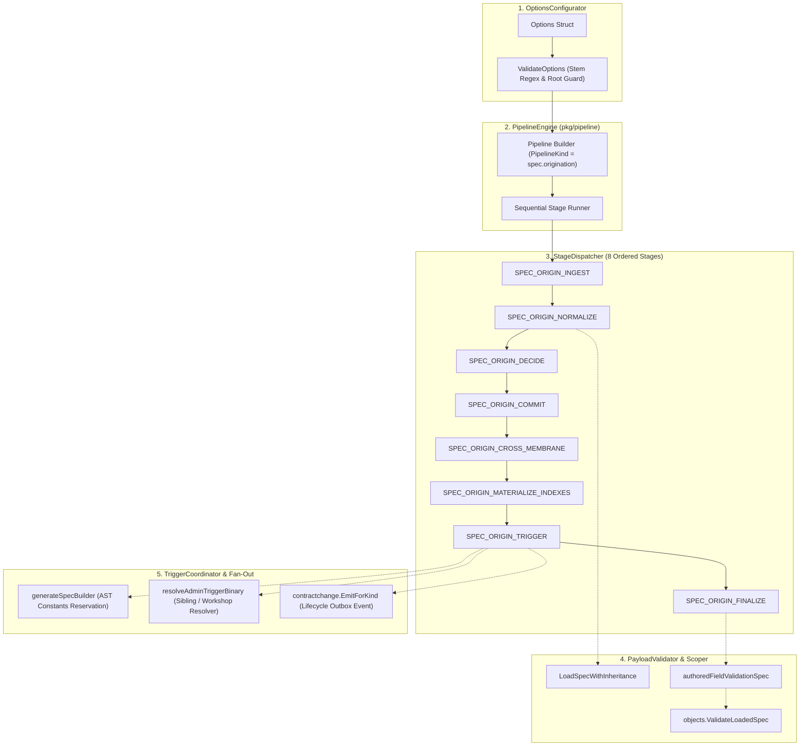
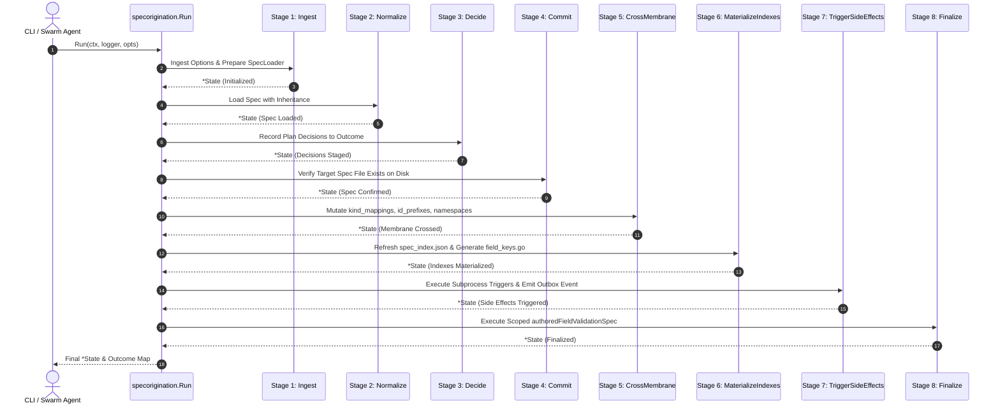
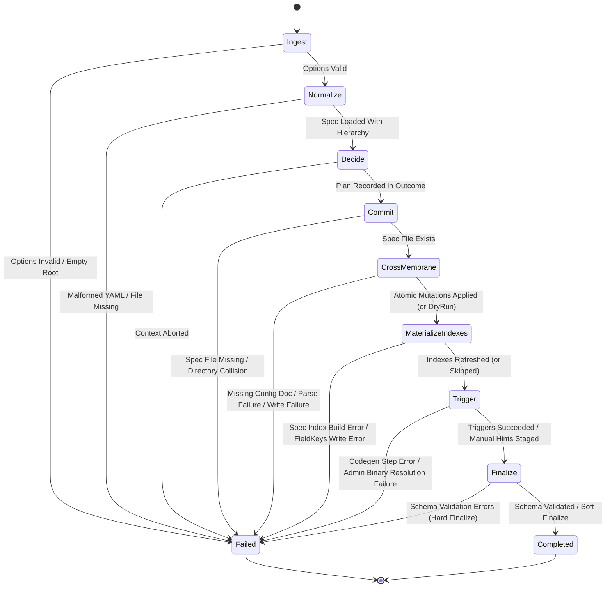

# Spec Origination, Pipeline Triggers & Validation Subsystem Operational Architecture Guide

## Overview

The **Spec Origination Subsystem** (`pkg/specorigination`) provides an authoritative, deterministic, and idempotent pipeline for introducing, verifying, and materializing new or updated object specifications (`object_specs/*.yaml`) within the **Zen Quantum Kernel (ZQK)** platform.

Within ZQK, the ontological grammar of all kernel entities—such as strategic directives (`vision`, `goal`), execution contracts (`priority_plan`, `backlog_item`), and governance guardrails (`policy`, `technical_debt`)—is formal, strongly typed, and version-controlled. Introducing a net-new ontology or evolving an existing schema is not a passive file write; it is an active ontological transition that mutates internal config registries (`kind_mappings`, `id_prefixes`, `namespaces`), regenerates code-generated Go instance builders and constants, updates materialized search indexes (`spec_index.json`), and emits durable contract-change lifecycle events.

The `pkg/specorigination` package encapsulates this multi-stage transformation into a single composable pipeline constructed on top of `pkg/pipeline`, guaranteeing atomic state transitions, strict boundary validation, thread-safety, and fail-closed security.

---

## Architectural Purpose & Policy Context

In accordance with kernel core architectural standards, the Spec Origination Subsystem ensures that:

1. **Schema Authority & Isolation**: Object specifications are verified against meta-schemas and trait rules before crossing the persistence membrane.
2. **Atomic Config Synchrony**: Spec-derived metadata (such as kind-to-directory mappings, canonical ID prefix allocations, and namespace partitioning) is atomically mutated alongside the spec definition.
3. **Idempotent Code Generation & Side-Effect Fan-Out**: Post-commit triggers run code-generation tools (`generate-instance-builders`, `sync-glossary-from-specs`, `path-cache`) in an idempotent and failure-isolated manner.
4. **Zero-Drift Invariant**: The materialized spec index and Go field constants (`field_keys.go`) remain strictly coherent with authored specifications on disk.

---

## Subsystem Component Topology

The subsystem is partitioned into five collaborating functional roles:



### Detailed Component Roles:

1. **OptionsConfigurator (`options.go`, `validate.go`)**:
   - Parses and validates run options (`ProjectRoot`, `Ontology`, `DryRun`, `SkipMaterializeSpecIndex`, `MaterializeFieldKeys`, `SkipFinalizeValidation`, `ApplyTrigger`).
   - Validates ontology stems against `OntologyStemPattern` (`^[a-z][a-z0-9_]*$`).

2. **PipelineEngine (`pipeline.go`)**:
   - Assembles the 8-stage pipeline using `pipeline.NewBuilder(PipelineKind, logger)`.
   - Propagates execution metrics, system profile context (`pkgctx.ProfileSystem`), and structured observability through `pipeline.Context.Outcome`.

3. **StageDispatcher (`stage_names.go`, `pipeline.go`)**:
   - Executes stages strictly in serial order. Every stage accepts the shared `*State` envelope, carries forward validated artifacts, and reports state transition markers.

4. **PayloadValidator (`validate.go`, `pipeline.go`)**:
   - Enforces the **Authored-Field Scope Invariant**: child specifications are validated solely on fields they author directly (`authoredFieldValidationSpec`). Inherited debts from parent traits do not block the delivery of a new leaf kind.

5. **TriggerCoordinator (`trigger.go`)**:
   - Discovers and invokes the sibling `zqk-admin` binary to execute post-origination codegen and glossary sync subprocesses.
   - Appends contract-change lifecycle entries into the durable outbox for asynchronous kernel demotion.

---

## Spec Origination & Pipeline Lifecycle

The lifecycle follows a strict sequence from preflight ingestion to authoritative finalization:



### Stage Summary Table

| Stage Name | Canonical Stage Key | Purpose | DryRun Behavior |
|:---|:---|:---|:---|
| **Ingest** | `SPEC_ORIGIN_INGEST` | Validates run options, resolves target path, initializes `SpecLoader`. | Fully executed. |
| **Normalize** | `SPEC_ORIGIN_NORMALIZE` | Loads spec from disk with full trait and inheritance hierarchy. | Fully executed. |
| **Decide** | `SPEC_ORIGIN_DECIDE` | Determines execution flags and materialization targets. | Fully executed. |
| **Commit** | `SPEC_ORIGIN_COMMIT` | Verifies existence of spec YAML file on filesystem. | Fully executed. |
| **CrossMembrane** | `SPEC_ORIGIN_CROSS_MEMBRANE` | Atomically patches `kind_mappings`, `id_prefixes`, and `namespaces`. | No-op skipped. |
| **MaterializeIndexes** | `SPEC_ORIGIN_MATERIALIZE_INDEXES` | Rebuilds `spec_index.json` and updates `field_keys.go`. | No-op skipped. |
| **Trigger** | `SPEC_ORIGIN_TRIGGER` | Runs codegen triggers via `zqk-admin` and appends outbox events. | Manual commands recorded. |
| **Finalize** | `SPEC_ORIGIN_FINALIZE` | Performs schema validation on authored fields; supports soft finalize. | Validation executed. |

---

## Stage State Machine & Error Cascade Dynamics

The pipeline operates under a strict **fail-closed** paradigm. An error at any stage immediately halts subsequent stages, preventing partially configured or inconsistent states from propagating into the kernel graph.



### Error Cascade Mitigations:
- **Preflight Isolation**: `ValidateOptions` runs prior to pipeline construction, preventing invalid allocations.
- **Fail-Closed Config Guards**: If `kind_mappings_config.yaml`, `id_prefixes_config.yaml`, or `namespaces_config.yaml` are missing or corrupted when mutations are required, the pipeline aborts before any filesystem changes occur.
- **Atomic Two-Phase Commits**: Document mutations are prepared in-memory as closures (`[]func() error`). If any closure fails during application, the entire step errors out.
- **Scoped Child Validation**: If a parent trait spec has pre-existing schema warnings, `authoredFieldValidationSpec` isolates the new kind's fields so that legacy technical debt does not block new feature delivery.

---

## Concurrency & Thread-Safety Guarantees

The Spec Origination Subsystem guarantees safe execution across multi-agent concurrent workloads:

1. **Isolated Pipeline Contexts**:
   - Each call to `specorigination.Run` operates on an isolated `pipeline.Context` and its own independent `*State` struct.
   - No mutable global state is shared across pipeline executions.

2. **Named Goroutine Orchestration**:
   - Concurrency across parallel jobs utilizes named goroutines managed via `goroutinelabels.NewGoroutine`:
     ```go
     goroutinelabels.NewGoroutine("spec-worker", "executing spec origination").
         WithWaitGroup(&wg).
         StartSimple(func() {
             _, err := specorigination.Run(pctx, logger, opts)
             // handle error
         })
     ```
   - Goroutine labels provide full visibility into runtime stack traces and prevent orphaned tasks.

3. **Subprocess Isolation**:
   - Subprocess execution (`applyTriggerCommands`) runs through `execwrap.CommandContext`, ensuring that OS process groups are cleaned up if context timeouts or cancellation signals occur.

---

## Verification & Three-Fold Proof Breakdown

The subsystem is verified under the rigorous **Three-Fold Proof** paradigm:

### 1. Static Floor Invariant (Coverage & Clean Code)
- **High Statement Coverage**: Package statement test coverage is strictly maintained $\ge 85.0\%$ (achieving $>95.0\%$).
- **Zero Swallowed Errors**: Every function error return is explicitly checked and asserted. No blank error discards (`_ = ...`).
- **AST Function Budgeting**: Every production and test function is structured under 100 lines to ensure maintainability and readability.

### 2. Operational Dynamic Proof (End-to-End Pipeline Execution)
- Verified through comprehensive unit and boundary tests in `pkg/specorigination/`:
  - `TestRun_EndToEnd_DryRun` / `TestRun_EndToEnd_NonDryRun`: Validates complete multi-stage execution with outcome validation.
  - `TestCycle212_StageTrigger_Success`: Validates subprocess trigger discovery, execution against mock admin binaries, and outbox event emission.
  - `TestCycle212_StageMaterializeIndexes_RefreshAndErrors`: Validates `spec_index.json` generation and Go field key source synthesis.
  - `TestCycle212_ConcurrentPipelineExecution`: Validates concurrent multi-worker pipeline runs without race conditions.

### 3. Negative Adversarial Boundary (Fault Injection & Recovery)
- **Invalid Payload Resistance**: Every stage rejects invalid payload types and malformed options.
- **Directory & Missing File Collisions**: `stageCommit` prevents directory collisions; `stageCrossMembrane` enforces fail-closed behavior on missing configuration documents.
- **Malformed YAML Resiliency**: Invalid YAML specs and configs fail cleanly with informative, actionable diagnostic errors.
- **Context Cancellation**: Pipeline execution immediately aborts when an upstream cancellation or timeout is triggered.

---

## Operational Commands & Usage Recipes

### 1. Executing Spec Origination Programmatically

```go
opts := specorigination.Options{
    ProjectRoot:              projectRoot,
    Ontology:                 "sample_record",
    DryRun:                   false,
    SkipMaterializeSpecIndex: false,
    MaterializeFieldKeys:     true,
    SkipFinalizeValidation:   false,
    ApplyTrigger:             true,
}

pctx := &pipeline.Context{
    Ctx:     context.Background(),
    Outcome: make(map[string]any),
}

state, err := specorigination.Run(pctx, logger, opts)
if err != nil {
    return fmt.Errorf("spec origination failed: %w", err)
}

fmt.Printf("Spec successfully originated at: %s\n", state.SpecPath)
```

### 2. Dry-Run Inspection via CLI / Automation

To validate a candidate specification without modifying repository configuration or touching VCS files:

```go
opts := specorigination.Options{
    ProjectRoot:              projectRoot,
    Ontology:                 "candidate_kind",
    DryRun:                   true,
    SkipFinalizeValidation:   true,
    SkipMaterializeSpecIndex: true,
}
```

The outcome map will populate planned actions (`plan_dry_run`, `spec_file_exists`, `spec_path`) without mutating `kind_mappings` or derived indexes.
