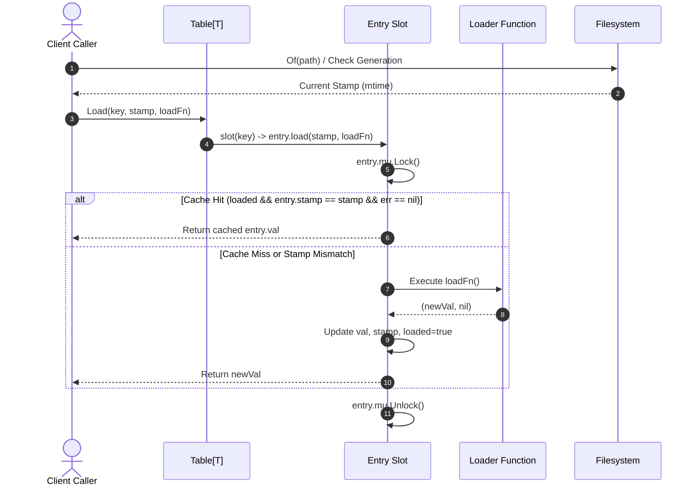
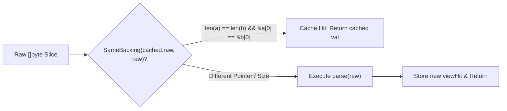

# Stamp Memoization & Generation Tracking Subsystem Operational & Architectural Guide

## 1. Executive Architectural Summary

The **Stamp Memoization & Generation Tracking Subsystem** (`pkg/stampmemo`) provides a high-throughput, stamp-invalidated memoization layer for the **ZQK Knowledge Kernel**. In high-frequency CLI invocations, daemon loops, schema validation runs, and multi-agent workflows, repeatedly loading and parsing project configurations, kind schemas, and specification files directly from the filesystem induces substantial I/O overhead and CPU stalls.

Rather than implementing complex, memory-hungry LRU or TTL cache strategies with background eviction worker threads, `pkg/stampmemo` couples cache lifecycle directly to filesystem generation stamps (nanosecond modification times). 

Key design principles include:
- **Stable Identity Keying:** Keys represent a closed set of domain identities (e.g., project roots, configuration file paths, object kinds, specification roots).
- **Generation-Driven Invalidation:** Cache entries store the generation stamp (`Stamp(mtime.UnixNano())`). When the underlying file's stamp advances, `Load` re-executes the loader function in place without allocating new table slots.
- **Constant Memory Footprint:** The cache map does not grow with generational changes; it only scales with the finite number of registered keys.
- **Non-Blocking Hot Paths:** Through `Peek` and `sync.Mutex.TryLock()`, read-heavy callers can inspect cached values without blocking on concurrent background loads.
- **Zero-Copy Parsed Projections:** Through `View[T]` and pointer-level slice backing evaluation (`SameBacking`), parsed data structures are retained across queries until the source byte slice is reallocated.

---

## 2. Component Topology & Structural Model

The subsystem consists of five modular, highly cohesive primitives:

```mermaid
flowchart TD
    subgraph ClientPlane["Callers & Consumers"]
        SpecLoader["Spec Loader (pkg/objects)"]
        KindRegistry["Kind Registry & Schemas"]
        DocmanEngine["Docman Verification"]
        ConfigResolver["Config & Path Resolvers"]
    end

    subgraph StampMemoSubsystem["pkg/stampmemo Subsystem"]
        TableAPI["Table[T] (Generic Memo Table)"]
        ViewAPI["View[T] (Zero-Copy Projection)"]
        FPAPI["Fingerprints (Side-Effect Cache)"]
        PathUtils["Paths & Stamp Utilities (Of, OfAll, Combine)"]
        YAMLScanner["YAML Directory Scanner (WalkYAML)"]
    end

    subgraph StorageFilesystem["Filesystem & Generation Sources"]
        FSStat["File Stat / Mtime Nanoseconds"]
        DiskYAML["*.yaml Specification Files"]
        MemoryBuffers["In-Memory Byte Slices"]
    end

    ClientPlane -->|Load / Peek / Delete| TableAPI
    ClientPlane -->|Get (Parsed View)| ViewAPI
    ClientPlane -->|Remember / Unchanged| FPAPI
    ClientPlane -->|Evaluate Generations| PathUtils
    ClientPlane -->|Discover Specs| YAMLScanner

    PathUtils -->|Stat Mtime| FSStat
    TableAPI -->|Stamp Invalidation| PathUtils
    YAMLScanner -->|Read & Filter| DiskYAML
    ViewAPI -->|Pointer Identity| MemoryBuffers
```

### Component Breakdown

1. **`Table[T]` (`table.go`):** The primary generic cache table. Maps stable string keys to lazily loaded values `T`. Each key slot is protected by an individual mutex lock, enabling concurrent operations across disjoint keys without lock contention.
2. **`Stamp` & Path Helpers (`paths.go`, `table.go`):** `Stamp` represents an `int64` nanosecond filesystem generation (`Of(path)`). Helper functions `Combine(stamps...)` and `OfAll(paths...)` calculate the aggregate maximum generation across multi-file dependencies, while `FirstExisting(paths)` identifies the highest-precedence existent file.
3. **`View[T]` (`view.go`):** Retains parsed data structures (such as deserialized YAML maps or AST tokens) derived from raw byte slices. Uses `SameBacking(a, b)` to compare memory slice pointers and lengths, bypassing expensive re-parsing when the underlying buffer is reused.
4. **`Fingerprints` (`fingerprint.go`):** A lightweight cache for skipping idempotent side effects. Remembers the payload fingerprint associated with a destination key, enabling callers to short-circuit writes when content remains unchanged.
5. **`WalkYAML` (`yaml.go`):** A targeted directory traversal utility that discovers and reads non-dot `*.yaml` files, skipping directories and dotfiles.

---

## 3. Memoization & Invalidation Lifecycle

The memoization lifecycle ensures that cache hits require minimal synchronization, while stale entries reload cleanly upon generation changes.



### Detailed Execution Steps:

1. **Generation Acquisition:** The caller retrieves the current `Stamp` for the target resource using `stampmemo.Of(path)` or `stampmemo.OfAll(deps...)`.
2. **Slot Retrieval:** `Table[T].Load` accesses `sync.Map` to locate the stable key's `entry[T]` pointer, creating one atomically via `LoadOrStore` if absent.
3. **Per-Entry Mutex Lock:** The caller acquires `entry.mu.Lock()`. Only goroutines requesting the exact same key contend for this lock.
4. **Invariant Validation:** If `e.loaded` is true, `e.stamp == stamp`, and `e.err == nil`, the cached value is returned immediately.
5. **Loader Execution:** If the entry has not been loaded or the stamp has moved forward, `loadFn()` is executed.
   - If `loadFn()` fails, the error is returned to the caller without updating the cached value or marking `loaded=true`, ensuring future requests retry cleanly.
   - If `loadFn()` succeeds, `e.val`, `e.stamp`, and `e.loaded=true` are updated in place.

---

## 4. Concurrency Model & Lock Hierarchy

Concurrency in `pkg/stampmemo` is designed for lock striping and contention minimization:

### Two-Tier Concurrency Architecture

| Layer | Implementation | Scope | Contention Profile |
| :--- | :--- | :--- | :--- |
| **Key Namespace** | `sync.Map` | Table-wide | Near zero (lock-free reads, atomic insertion for new keys) |
| **Entry Serialization** | `sync.Mutex` | Per key | Isolated to concurrent callers requesting the same identity |

### Non-Blocking Hot Path with `Peek`

In performance-critical query paths (such as checking whether schema fields are already resident in memory), blocking on an in-progress load is undesirable. `Table[T].Peek(key, stamp)` provides a completely non-blocking check:

```go
func (t *Table[T]) Peek(key string, stamp Stamp) (T, bool) {
    var zero T
    v, ok := t.m.Load(key)
    if !ok {
        return zero, false
    }
    e := v.(*entry[T])
    if !e.mu.TryLock() {
        return zero, false // In-flight load underway; do not block
    }
    defer e.mu.Unlock()
    if !e.loaded || e.stamp != stamp || e.err != nil {
        return zero, false
    }
    return e.val, true
}
```

If another goroutine is actively running `loadFn()`, `e.mu.TryLock()` returns `false`, causing `Peek` to exit immediately without thread suspension or scheduler delay.

### Invalidation Primitives: `Delete` vs. `Reset`

- **`Delete(key)`:** Explicitly purges the memo for a specific key. This is used after out-of-band writes where file modification times might not advance within low filesystem timer resolutions.
- **`Reset()`:** Purges all keys in the table. This is reserved for environment-level invalidations (such as directory changes during unit tests or global cache clears). It is **not** a capacity valve.

---

## 5. View Projections & Zero-Copy Pointer Identity

In addition to filesystem stamp tracking, the subsystem provides memory-backed projection caching through `View[T]` (`view.go`). When reading immutable specification blocks or schema documents, the source bytes may remain identical across multiple evaluation rounds.



The `SameBacking` predicate inspects slice header invariants:

```go
func SameBacking(a, b []byte) bool {
    if len(a) != len(b) {
        return false
    }
    if len(a) == 0 {
        return true
    }
    return &a[0] == &b[0]
}
```

This guarantees zero-allocation comparison while ensuring that reallocated byte slices trigger re-parsing.

---

## 6. Verification & Test Coverage Invariants

The `pkg/stampmemo` package enforces a strict verification bar:

1. **Statement Coverage Invariant:** Statement test coverage must strictly satisfy **>= 85.0%** across the entire package. The test suite achieves **100.0%** coverage across all functions.
2. **Race Safety Invariant:** All concurrent read, write, peek, reset, and delete operations must pass the Go race detector with zero race warnings.
3. **Error Retention & Non-Poisoning:** Loader and parser errors must propagate cleanly without corrupting subsequent valid operations.

### Verification Execution Recipe

```bash
# Run unit and boundary test suite with coverage
ZQK_ALLOW_FOREGROUND_GO_TEST=1 go test -v -timeout 30s -cover ./pkg/stampmemo

# Run with race detection enabled
ZQK_ALLOW_FOREGROUND_GO_TEST=1 go test -v -race -timeout 30s ./pkg/stampmemo

# Inspect per-function coverage breakdown
ZQK_ALLOW_FOREGROUND_GO_TEST=1 go test -coverprofile=coverage.out ./pkg/stampmemo
go tool cover -func=coverage.out
```

---

## 7. Operational Guidelines & Anti-Patterns

### Anti-Patterns to Avoid

- **Unbounded Key Cardinality:** Never key `Table[T]` by unbounded dimensions such as request UUIDs, ephemeral object IDs, or arbitrary directory walk paths. Because the table does not implement LRU eviction, unbounded keys will leak memory over process lifetimes.
- **Using `Reset()` as a Memory Management Valve:** `Reset()` drops all cached entries regardless of whether their backing files have changed. Do not use `Reset()` on a timer to limit memory usage. Instead, ensure the key cardinality remains closed.
- **Ignoring Error Returns in Loaders:** Always return explicit errors from `loadFn()`. Do not swallow parsing errors or return partial zero values with `nil` errors, as this would cache corrupt state.

### Best Practices

- **Compose Multi-File Dependencies:** Use `OfAll(paths...)` when a cached value depends on multiple files (e.g., a base configuration and an override layer). `Combine` ensures the newest stamp invalidates the cache.
- **Prefer `Peek` for Diagnostic Hot Paths:** If a component only needs to inspect whether metadata is already available in memory, use `Peek` to avoid triggering synchronous disk I/O.
- **Synchronize Out-of-Band Writes:** If writing a file and immediately needing to reload it within the same millisecond, call `tab.Delete(key)` to prevent stale reads on systems with coarse filesystem timestamp granularity.
