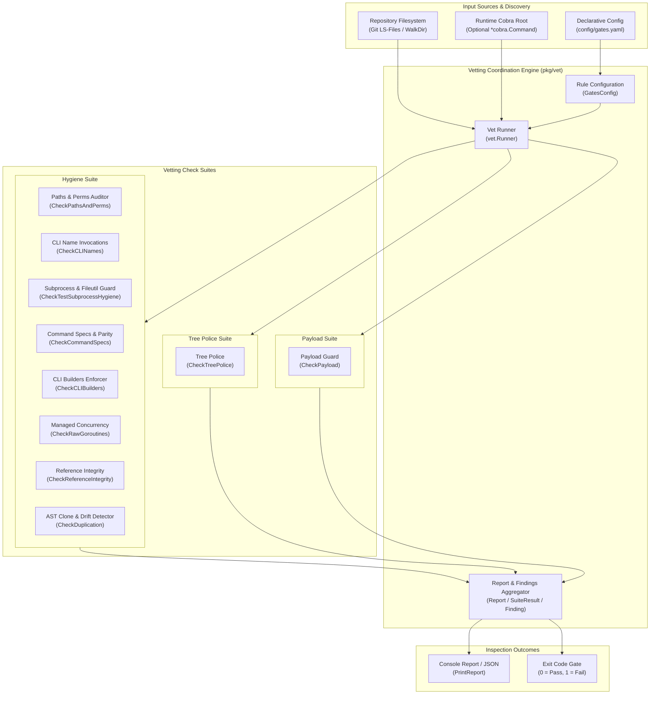
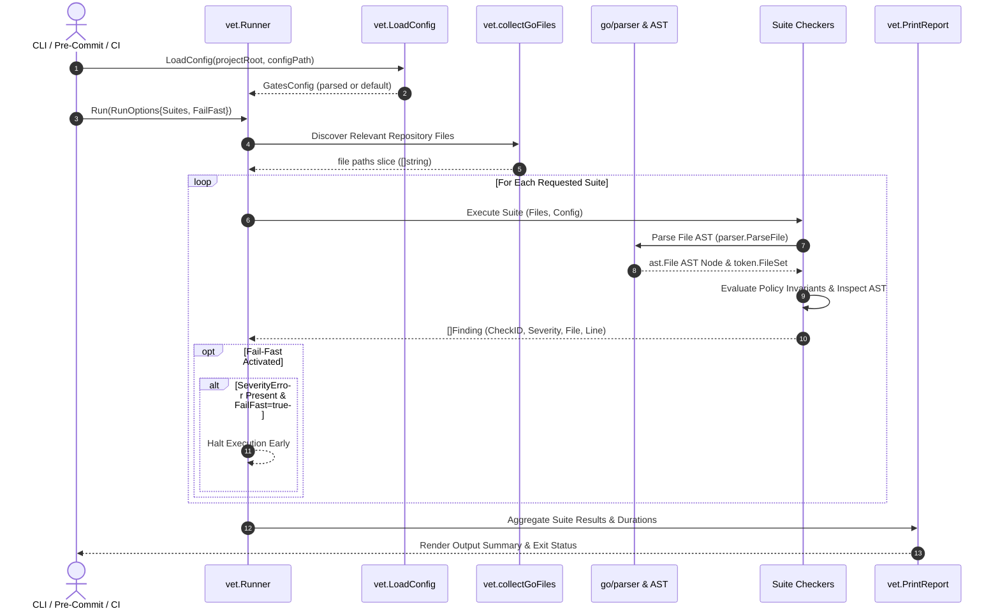

# Static AST Linting, Code Vetting Engine & Policy Rule Suite Subsystem Operational Architecture Guide

## 1. Executive Architectural Summary

The **Static AST Linting, Code Vetting Engine & Policy Rule Suite Subsystem** (`pkg/vet`) provides deterministic, fail-closed static source analysis, architectural invariant verification, and repository hygiene enforcement across the **ZQK Knowledge Kernel** (POL-DEFAULT-142277d3).

In autonomous multi-agent software engineering systems, agents and human contributors iterate rapidly across diverse layers: CLI command definitions, runtime coordinators, storage engines, distributed pipelines, and documentation. Without rigorous static gates and AST-level guardrails, software codebases rapidly suffer from:
1. **Architectural Drift:** Direct instantiation of third-party command structures bypassing internal builder abstractions and schema specs.
2. **Concurrency Violations:** Unmanaged goroutines (`go func()`) escaping lifecycle tracking, panic boundaries, cancellation contexts, and metric collection.
3. **Subprocess & Filesystem Leaks:** Tests leaking background child processes or using raw OS filesystem operations that bypass hermetic path sandboxing.
4. **Code Duplication & Drift:** Duplicate function bodies and branching equality comparisons that drift away from canonical lookup tables.
5. **Payload Contamination:** Accidental leakage of workstation file paths, sensitive local development keys, or non-public repository materials into open-core releases.

`pkg/vet` resolves these vulnerabilities by providing an in-process, high-performance AST inspection engine (`zqk-vet`) that evaluates source files and repository structures against declarative gate policies defined in `config/gates.yaml`.

---

## 2. Component Topology & Subsystem Architecture

The vetting engine is organized around coordinate runners, declarative rule configurations, and domain-specialized AST checkers:

### Component Responsibilities

| Component | Routine / Type | Core Architectural Responsibility |
| :--- | :--- | :--- |
| **Vet Runner** | `Runner`, `NewRunner`, `Run` | Orchestrates check suite execution (`hygiene`, `tree_police`, `payload`), manages fail-fast behavior, records suite runtimes, and calculates error/warning tallies. |
| **Rule Configuration** | `GatesConfig`, `LoadConfig`, `DefaultConfig` | Decodes declarative YAML parameters (`config/gates.yaml`) configuring scan scopes, path exclusions, threshold parameters, and prohibited patterns. |
| **CLI Builders Enforcer** | `CheckCLIBuilders` | Verifies that all specced commands have corresponding generated builders in `pkg/cli/bldr_cli_cmd_v1` and flags direct `&cobra.Command` constructors. |
| **Command Specs Checker** | `CheckCommandSpecs` | Audits YAML specs in `.zqk/cli/specs/`, verifies required schema fields (name, short/description), and checks tree and annotation parity against active runtime commands. |
| **CLI Names Checker** | `CheckCLINames` | Detects hardcoded brand executable tokens in Go source code, requiring usage of canonical path formatting helpers. |
| **Managed Concurrency Guard** | `CheckRawGoroutines` | AST inspection enforcing that all asynchronous execution utilizes `goroutinelabels` rather than naked `go ...` statements. |
| **Path & Perms Auditor** | `CheckPathsAndPerms` | Detects magic octal permission literals (`0755`, `0644`, `0600`) and hardcoded repository or workstation directory paths. |
| **Subprocess & Fileutil Guard** | `CheckTestSubprocessHygiene`, `CheckTestFileutilHygiene` | Flags unmanaged `exec.Command` or `os.StartProcess` calls in test source files and verifies consistent file operation wrappers. |
| **Reference Integrity Auditor** | `CheckReferenceIntegrity` | Asserts that all active backlog items declare at least one parent goal or requirement reference to maintain the Hierarchical Chain of Integrity. |
| **Code Duplication Detector** | `CheckDuplication` | Uses normalized AST statement comparison and k-gram hashing to detect identical function clones and map key reference drift. |
| **Tree Police Checker** | `CheckTreePolice` | Enforces repository filesystem structure, disallowing forbidden directories, archived documentation, extra unapproved scripts, and documentation stubs. |
| **Payload Guard** | `CheckPayload` | Verifies required public release artifacts, checks `go.mod` module identity, audits sensitive tracked files, and scans for prohibited regex tokens. |

---

## 3. Linting & Vetting Lifecycle

The execution lifecycle of a vetting run progresses through directory discovery, AST parsing, concurrent check evaluation, and gate threshold enforcement:

---

## 4. Rule Catalog & Finding Taxonomy

The vetting engine categorizes findings across three dedicated check suites:

### Check Suite Taxonomy

| Suite | Description | Scope | Gate Threshold |
| :--- | :--- | :--- | :--- |
| **`hygiene`** | Internal Go source code quality, AST invariants, concurrency discipline, builder patterns, and reference integrity. | `pkg/`, `cmd/`, `internal/` Go files | Zero `ERROR` findings |
| **`tree_police`** | Repository filesystem hierarchy, public release hygiene, documentation substance, and script allowance. | Full repository tree | Zero `ERROR` findings |
| **`payload`** | Open-core public release boundaries, module path validation, sensitive material leakage, and prohibited tokens. | Git-tracked files & artifacts | Zero `ERROR` findings |

### Finding Severity Levels

- **`SeverityError` (`ERROR`):** Halts pre-commit hooks and local CI gates. Indicates a contract violation, unmanaged concurrency, broken reference integrity, or security leak.
- **`SeverityWarn` (`WARN`):** Non-blocking architectural notification. Highlights opportunities for code consolidation, map lookup refactoring, or statement sequence deduplication.

### Key Finding Rules

| Check ID | Suite | Severity | Trigger Condition | Remediation |
| :--- | :--- | :--- | :--- | :--- |
| `cli/missing_builder` | `hygiene` | `ERROR` | Command spec in `.zqk/cli/specs/` lacks a builder in `pkg/cli/bldr_cli_cmd_v1/`. | Run code generation to create the typed builder. |
| `cli/builder_pattern_violation` | `hygiene` | `ERROR` | Command constructor in `cmd/zqk/` directly instantiates `&cobra.Command`. | Adopt `bldr_cli_cmd_v1` builder or `clipkg.ApplyBuilder`. |
| `cli_name_literal` | `hygiene` | `ERROR` | Hardcoded canonical executable token followed by command verb. | Use `paths.CLIUsage`, `paths.CLIInvocation`, or `RewriteCanonicalCLIInvocations`. |
| `hygiene/raw_goroutine` | `hygiene` | `ERROR` | Direct `go func()` or unmanaged goroutine statement. | Use `goroutinelabels.NewGoroutine` or `goroutinelabels.Pool`. |
| `hygiene/magic-perms` | `hygiene` | `ERROR` | Magic octal literal used for file or directory permissions. | Use `paths.FilePerm644`, `paths.FilePerm600`, or `paths.DirPerm755`. |
| `hygiene/hardcoded-path` | `hygiene` | `ERROR` | Hardcoded `.zqk` or `.zqk/` string literal in source code. | Use canonical constants in `pkg/paths`. |
| `hygiene/hardcoded-workstation-path` | `hygiene` | `ERROR` | Absolute developer workstation path (`/Users/`, `/home/`, `/var/folders/`). | Use relative paths, `os.UserHomeDir()`, or `t.TempDir()`. |
| `hygiene/unmanaged_test_exec` | `hygiene` | `ERROR` | Unmanaged `exec.Command` or `os.StartProcess` in test code. | Prefer `testkit.ManagedCommand` for process group lifecycle. |
| `hygiene/unmanaged_test_fileutil` | `hygiene` | `ERROR` | Direct `os.*` file operation bypassing file utilities. | Use `fileutil.ReadFile`, `fileutil.WriteFile`, etc. |
| `reference/missing-goal-req-ref` | `hygiene` | `ERROR` | Active backlog item without `goal_refs` or `requirement_refs`. | Anchor backlog item to a parent goal or requirement contract. |
| `hygiene/duplication` | `hygiene` | `WARN` | Duplicate function body, statement sequence clone, or map key reference drift. | Consolidate into a shared helper or lookup table. |
| `tree/forbidden-path` | `tree_police` | `ERROR` | Commercial, marketing, or private directory present in public tree. | Remove forbidden path from candidate tree. |
| `tree/forbidden-pkg-docs-dir` | `tree_police` | `ERROR` | Unstructured `docs/` folder located inside package directories. | Colocate package documentation in `README.md`. |
| `tree/doc-stub` | `tree_police` | `ERROR` | Documentation markdown file smaller than 50 bytes. | Expand documentation to detail operational architecture. |
| `tree/doc-placeholder-rubbish` | `tree_police` | `ERROR` | Documentation containing prohibited placeholder or filler strings. | Replace with substantive technical specifications. |
| `payload/required-artifact-missing` | `payload` | `ERROR` | Essential release file missing (`README.md`, `LICENSE`, `SECURITY.md`). | Materialize required artifact before release. |
| `payload/sensitive-file-tracked` | `payload` | `ERROR` | Private key, keystore, or process state tracked in git. | Untrack sensitive file and update `.gitignore`. |

---

## 5. Exemption & Suppression Architecture

To prevent false positives on valid exemptions (such as code generators, test fixtures, and vendor packages), `pkg/vet` supports granular, declarative exemption rules:

1. **Path-Level Glob Matching:** Rules match exact paths, prefixes (`vendor/*`), or glob basenames (`*_test.go`).
2. **Generated Code Header Detection:** Files starting with `Code generated ... DO NOT EDIT` are automatically bypassed by AST hygiene linters.
3. **Dedicated Exemption Slices:**
   - `cfg.Hygiene.Exemptions`: Global path exemptions for hygiene inspections.
   - `cfg.Hygiene.CLIExemptFiles` & `CLIExemptFunctions`: Specialized suppressions for CLI branding helpers.
   - `cfg.Hygiene.GoroutineExemptions`: Package allowances for concurrency infrastructure (`pkg/goroutinelabels`).
   - `cfg.Hygiene.DupExemptions`: Test mock and fixture exclusions for clone detection.
   - `cfg.TreePolice.AllowedScripts` & `AllowedScriptPrefixes`: Explicit allow-list for utility shell scripts.
   - `cfg.Payload.GlobalGrepExemptions`: Allowances for rule definitions and documentation referencing patterns.

---

## 6. Concurrency & Performance Guarantees

The vetting engine is optimized for sub-second execution across multi-thousand file repositories:

- **Selective AST Traversal:** Checkers share parsed AST trees or parse lazily on demand.
- **Fast Path Directory Filtering:** Directories such as `.git`, `.zqk`, `vendor`, `node_modules`, and `bin` are pruned at directory walk time.
- **Immutable Gate Configuration:** Configuration parameters are loaded once into read-only structures, enabling thread-safe evaluation across worker routines.
- **Fail-Fast Support:** When configured with `FailFast: true`, the runner halts immediately upon the first `SeverityError`, saving agent compute and execution cycles.

---

## 7. Verification & Continuous Coverage Invariant

To ensure that static analysis gates never experience regression or unhandled panics during AST inspection, `pkg/vet` is bound by a strict statement coverage floor:

$$\text{Statement Test Coverage} \ge 85.0\% \quad (\text{Maintained} \ge 95.0\%)$$

The verification suite (`pkg/vet/vet_coverage_elevation_cycle238_test.go`) exercises:
- Fallback filesystem walks when git executables or repositories are absent.
- Syntax errors, corrupt YAML schemas, unclosed string literals, and unparseable source files.
- Boundary conditions across all 10 AST checker routines.
- Multi-candidate sorting invariants and deterministic finding aggregation.
- Live Cobra command tree parity comparisons and baseline synchronization.
