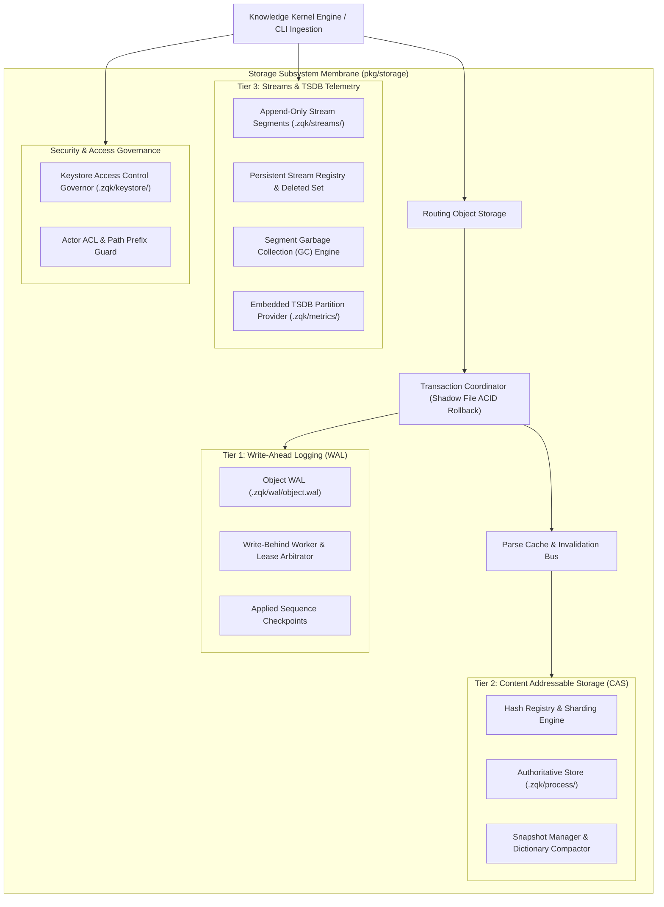
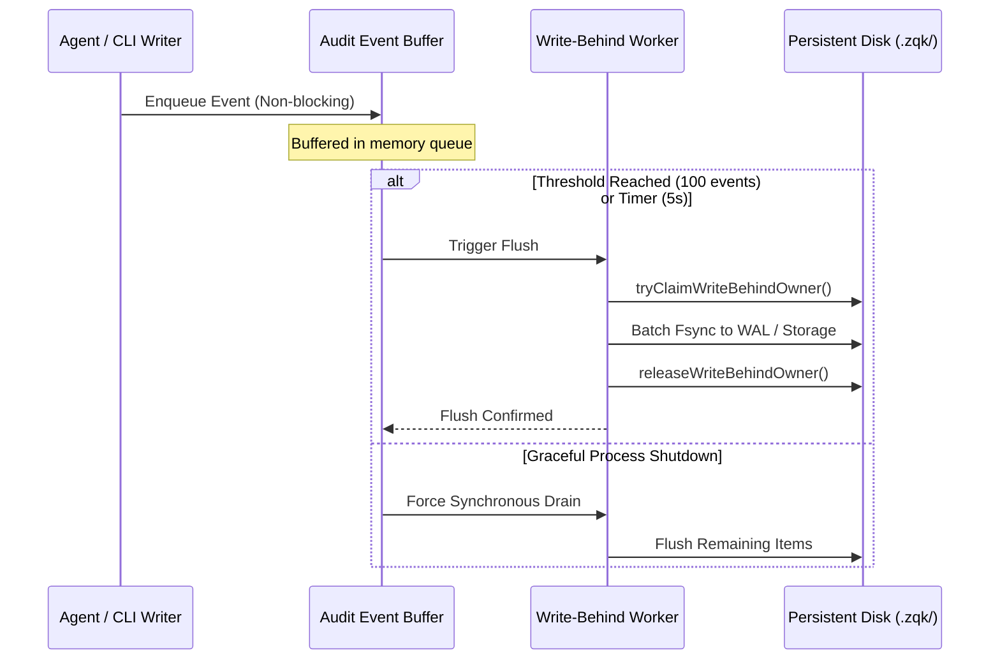

# Storage Subsystem Operational & Architectural Guide

## Overview

The ZQK Storage Subsystem (`pkg/storage`) implements the foundational persistence, integrity, and retrieval engine powering the **Zen Quantum Knowledge Kernel**. It coordinates content-addressable storage (CAS), write-ahead logging (WAL), change journaling, write-behind event buffering, stream segment compaction, and access-controlled keystore operations.

Rather than relying on external heavyweight database servers or unindexed flat files, ZQK leverages an embedded, file-first hybrid persistence architecture designed for deterministic execution, sub-millisecond local queries, offline-first reliability, and seamless Git version-control interoperability.

---

## Subsystem Architecture

---

## The 3-Tier Persistence Model

### Tier 1: Write-Ahead Log (WAL) (`.zqk/wal/`)
The Write-Ahead Log provides immediate durability and monotonic write sequencing:
- **Zero-Drop Ingestion**: Every graph mutation and object transition is appended to `.zqk/wal/object.wal` prior to in-memory index updates or CAS promotion.
- **Monotonic Sequence Numbers**: Each record is stamped with a sequentially increasing `seq` identifier.
- **Checkpointing**: The system records the highest confirmed sequence in `applied.seq` (`ReadAppliedSeq` / `WriteAppliedSeq`).
- **Crash Recovery**: During node boot or process restart, `ReplayWAL` traverses records starting after `applied.seq`, repairing partial writes and re-synchronizing internal state without data loss.

### Tier 2: Content-Addressable Storage (CAS) (`.zqk/process/`)
The authoritative state plane stores validated domain entities:
- **Deterministic Hashing**: Canonical YAML representations are hashed via SHA-256 (`calculateSHA256Hash`), yielding cryptographically verifiable identifiers.
- **Directory Sharding**: Storage directories partition records across two-level hex prefix buckets (e.g. `.zqk/process/goals/ab/`), preventing filesystem directory traversal bottlenecks and inode saturation.
- **Deduplication & Invariant Integrity**: Identical objects reference immutable storage blobs, minimizing disk footprint and enabling change detection via simple hash comparisons.

### Tier 3: Streams & TSDB Telemetry (`.zqk/streams/`, `.zqk/metrics/`)
High-throughput telemetry and operational logs are stored in append-only streams:
- **Append-Only Segments**: Daily files partition logs (e.g. `2026-10-22_stream.json`).
- **Persistent Stream Registry**: Fast index mapping `ID -> segmentPath::offset` (`stream_registry_<kind>_XX.jsonl`) enables $O(1)$ lookups without scanning gigabyte-sized log streams.
- **Embedded TSDB**: High-frequency metric points are appended into date-partitioned TSDB buffers (`.zqk/metrics/metrics-YYYY-MM-DD.tsdb`) for aggregations (`Sum`, `Count`, `Average`) over custom time windows.

---

## Write-Behind Flush Coordination & Lease Ownership

High-volume operations (e.g., swarm test runners, agent execution loops) buffer mutations in memory to achieve sub-millisecond throughput:

- **Lease Ownership Arbitration**: To avoid concurrency corruption when multiple background processes access the project root, write-behind flushing is guarded by atomic owner claims (`tryClaimWriteBehindOwner` and `releaseWriteBehindOwner`).
- **Configurable Thresholds**: Buffers automatically drain upon accumulating 100 items or exceeding a 5-second interval.
- **Fail-Closed Shutdown**: During process exit, `Drain` synchronously pushes all in-flight buffers to disk before releasing locks.

---

## Compaction & Segment Garbage Collection

To maintain high performance and prevent unbounded disk usage, the storage subsystem incorporates multi-stage compaction and garbage collection.

### 1. Stream Registry Compaction
When stream-backed items are deleted, the system appends their identifiers to `stream_deleted_<kind>.jsonl` (soft delete).
- Periodic compaction (`CompactStreamRegistryForKind`) rewrites the stream registry to contain only active IDs.
- The corresponding `stream_deleted` journal is safely truncated.

### 2. Stream Segment Garbage Collection (`GCOrphanedStreamSegmentsForKind`)
- **Orphan Detection**: A segment file is considered orphaned when no active entry in the registry references its path and offset.
- **Active Writer Protection**: Segments corresponding to today's date base (`zqktime.NowLayoutUTC(zqktime.LayoutDate)`) are protected from deletion to prevent races against in-flight appends.
- **Dead-PID Shard Purging**: Multi-process shards tagged with dead process IDs (e.g. `YYYY-MM-DD_pid<PID>_stream.json`) are safely collected once verified inactive.

### 3. Change Journal Window Compaction (`CompactChangeJournalWindow`)
- **Dictionary Compression**: Common keys (`id`, `object_ref`, `change_type`, `created_at`, `created_by`, `changed_paths`) are indexed into a `SnapshotDictionary`.
- **Range Compression**: Consecutive identifiers (`CHA-1`, `CHA-2`, `CHA-3`) are compressed into range notation (`CHA-1..CHA-3`) via `CompressEntryIDs`.
- **Artifact Generation**: The compacted window is saved as a verified, checksummed YAML artifact (`CompactedChangeJournalArtifact`).

---

## Transaction Coordinator & State Isolation

ZQK implements transaction safety through shadow files:
- **Two-Phase Commit**: In-flight mutations write to temporary shadow files without altering live CAS artifacts.
- **Atomic Rollback**: If an operation fails, encounters a panic, or exceeds its context deadline, shadow files are purged, leaving live storage unmodified.
- **Optimistic Concurrency**: Update payloads verify `expected_updated_at` timestamps, preventing lost updates during parallel swarm agent execution.

---

## Keystore Access Control Governor

Security-sensitive values stored under `.zqk/keystore/` are governed by explicit permission matrices:
- **Prefix Isolation**: Scopes keys to distinct namespaces (e.g. `system:`, `user:`, `agent:`).
- **Actor RBAC**: Explicit authorization rules validate whether an actor holds `read`, `write`, or `delete` permissions before disk I/O occurs.

---

## Verification & Statement Coverage Invariant

To guarantee absolute reliability across headless CI and distributed agent swarms, `pkg/storage` is governed by strict test verification rules:

> [!IMPORTANT]
> 1. **Statement Coverage Target**: `pkg/storage` maintains statement test coverage $\ge 85.0\%$.
> 2. **Three-Fold Proof**: Every storage capability must satisfy:
>    - **Static Floor Invariant**: Schema verification, default batch bounds, and zero-value fallbacks.
>    - **Operational Dynamic Proof**: End-to-end verification of write-behind flushing, stream compaction, WAL chunk replay, and dictionary serialization.
>    - **Negative Adversarial Boundary**: Context timeout/cancellation handling, corrupt artifact detection, unacquired lease rejection, and non-existent file handling.
> 3. **Zero Swallowed Errors**: Explicit error propagation (`require.NoError`, `if err != nil`) across all test suites; raw blank assignments `_ = ...` for fallible calls are strictly forbidden.

### Storage Test Matrix Reference

| Test Suite / Area | Focus & Invariants Covered |
|---|---|
| `storage_coverage_elevation_cycle122_test.go` | WAL facade forwarding, stream registry lifecycle, dead PID GC, change journal window compaction, routing delegations, snapshot manager lifecycle, and batch processor resilience. |
| `stream_segment_gc_test.go` | Orphaned segment file detection, today's file protection, and registry compaction synchronization. |
| `stream_registry_persistent_test.go` | JSON parsing speed paths, modSig disk invalidation, and multi-shard registry read/write. |
| `change_journal_compaction_test.go` | Range compression/expansion, dictionary building, and checksum verification. |
| `snapshot_manager_test.go` | Operation queuing during active snapshots, hash registry lookups, and queue replay. |
| `routing_storage_test.go` | Routing factory dispatch across default and kind-specific storage providers. |
| `batch_processor_test.go` | High-volume batch querying, pagination, and multi-batch aggregation merging. |
| `audit_event_buffer_test.go` | Write-behind worker flush thresholds, error callbacks, and graceful shutdown. |

---

## Architectural Invariants

> [!CAUTION]
> - **Zero Raw Goroutines**: All asynchronous tasks and write-behind workers MUST use `goroutinelabels` for leak tracking and observability.
> - **Clean Storage Teardown**: In all production lifecycles and test fixtures, `storage.Shutdown(ctx)` MUST be executed before releasing mounts or deleting directories.
> - **Bounded Memory Footprint**: Stream registries, audit queues, and parse caches MUST implement bounded caches and window-based evictions to prevent uncontrolled memory growth.
