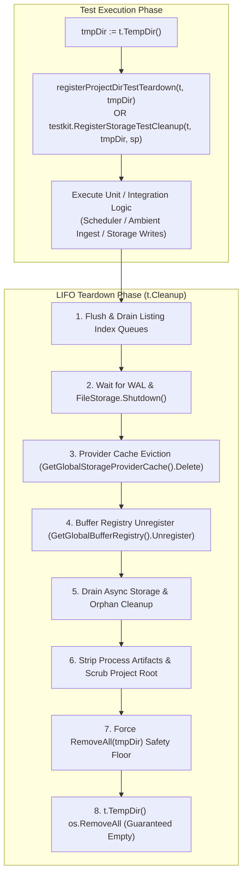

# Scheduler & Ambient TempDir Teardown Lifecycle Determinism Guide

## 1. Executive Summary & Problem Statement

In high-concurrency, race-detected test suites across [`pkg/scheduler`](../../pkg/scheduler) and [`pkg/ambient`](../../pkg/ambient), test suites that manipulate `.zqk/` or initialize subsystem storage inside temporary project roots (`t.TempDir()`) historically exhibited intermittent flakes:

```
testing.go:1234: TempDir RemoveAll cleanup: unlinkat /var/folders/.../001/.zqk/scheduler: directory not empty
```

These errors stem from two systemic lifecycle hazards:
1. **Asynchronous Storage & Buffer Persistence:** Subsystems instantiate or dynamically resolve storage providers (e.g. via [`storage.GetGlobalStorageProviderCache()`](../../pkg/storage/resource_cache.go#L196) and [`storage.GetGlobalBufferRegistry()`](../../pkg/storage/audit_events_helper_create.go#L152)) without registering an explicit teardown pipeline. As a consequence, background WAL flushers, listing index queues, and audit event buffers continue dispatching filesystem writes after the test function returns.
2. **Unjoined Ambient Daemons & Stream Writers:** Background stream writers, event mesh cancel-forwarders, and ambient ingest holons remain active when tests complete without deterministic joins, racing with Go's built-in `testing.TB.TempDir()` cleanup (`os.RemoveAll`).

This guide documents the core invariants, registration patterns, and lifecycle contracts required to ensure 100% deterministic test cleanup across all packages.

---

## 2. Core Teardown Architecture & Pipeline

Deterministic teardown is achieved by integrating test temporary directories into the [`StandardProjectTestTeardownPipeline`](../../pkg/storage/project_test_teardown.go#L115) via [`pkg/testkit`](../../pkg/testkit/register.go).



### 2.1 The Standard Teardown Pipeline Stages

When [`testkit.RegisterStorageTestCleanup`](../../pkg/testkit/register.go#L60) is registered:
- **Global Listing Index & Write Queue Flush:** Flushes any queued listing updates to disk and shuts down background worker channels.
- **WAL Draining & FileStorage Shutdown:** Halts the WAL write loop within a bounded timeout (45s max, fast exit when empty) and invokes [`storage.FileObjectStorage.Shutdown()`](../../pkg/storage/project_test_teardown.go#L368).
- **Global Storage Provider Cache Eviction:** Calls `Shutdown()` on the cached provider registered under `projectRoot` and removes it from [`GetGlobalStorageProviderCache()`](../../pkg/storage/resource_cache.go#L196).
- **Audit Buffer Unregistration:** Unregisters and flushes any active in-memory audit buffers from [`GetGlobalBufferRegistry()`](../../pkg/storage/project_test_teardown.go#L380).
- **Process Artifact Stripping & Root Scrubbing:** Strips temporary files and scrubs the project tree before directory deletion.

---

## 3. Mandatory Implementation Patterns

### Pattern A: Tests Creating Files in `.zqk/` Without a Storage Instance

For tests exercising helpers that touch `.zqk/` or `.zqk/scheduler/` (such as `ReportIssue`, `SaveJobTypeViewCacheAtomic`, `WriteNoAutoRestartFile`, `EmitHumanInTheLoomInterrupt`, `WriteLockMetadata`, `writeKeepAlive`):

```go
func TestSchedulerIssues_Example(t *testing.T) {
	t.Parallel()
	tmpDir := t.TempDir()
	registerProjectDirTestTeardown(t, tmpDir)

	ReportIssue(tmpDir, "SCH-TEST-ERR", "validation", "simulated job failure")
	// ... assertions ...
}
```

Where [`registerProjectDirTestTeardown`](../../pkg/scheduler/helpers_storage_teardown_test.go#L24) is defined as:

```go
func registerProjectDirTestTeardown(t *testing.T, projectRoot string) {
	t.Helper()
	t.Cleanup(func() {
		if err := fileutil.RemoveAll(projectRoot); err != nil {
			t.Logf("cleanup: %v", err)
		}
	})
	testkit.RegisterStorageTestCleanup(t, projectRoot, nil)
}
```

Because `t.Cleanup` functions execute in Last-In First-Out (LIFO) order:
1. `testkit.RegisterStorageTestCleanup` runs first, ensuring all caches, buffers, and async components are stopped and flushed.
2. The `RemoveAll` closure runs second, wiping the directory tree cleanly.
3. The underlying `t.TempDir()` cleanup runs last and encounters an already-deleted or empty directory, preventing `unlinkat ENOTEMPTY`.

### Pattern B: Tests Instantiating `FileObjectStorage`

```go
func TestSchedulerWithStorage_Example(t *testing.T) {
	t.Parallel()
	tmpDir := t.TempDir()
	sp, err := storagepkg.NewFileObjectStorageForTest(tmpDir)
	require.NoError(t, err)
	registerFileStorageTestTeardown(t, tmpDir, sp)

	// ... test logic ...
}
```

### Pattern C: Ambient Ingest & Background Event Streams

For ambient event services and daemons:
1. **Join Forwarder Goroutines:** Ensure all cancel-forwarders and stream consumers are registered in the service's `sync.WaitGroup` (`loopWg.Add(1)`).
2. **Track In-Flight Ingests:** Ensure all ingest entry points (`Ingest`, `IngestAmbientEvent`) increment and decrement `inFlight` atomic counters.
3. **Explicit Stop in Defer / Cleanup:** Always call `defer svc.Stop()` or `t.Cleanup(func() { svc.Stop() })`, followed by `hub.WaitForAudits()`.

```go
t.Run("BindToHub event delivery", func(t *testing.T) {
	tempDir := t.TempDir()
	testkit.RegisterStorageTestCleanup(t, tempDir, nil)
	defer storage.ScrubProjectRootForTempCleanup(tempDir, 10, 10*time.Millisecond)

	secCtx := pkgctx.NewSystemSecurityContext()
	svc := NewAmbientIngestService(tempDir, secCtx)
	defer svc.Stop()

	hub := NewEventHub()
	defer hub.WaitForAudits()

	svc.BindToHub(hub)
	// ... test logic ...
})
```

---

## 4. Verification & Race Detection

All test suites touching filesystem storage or background goroutines must pass with `-race` and repeated executions:

```bash
go test -race -count=2 ./pkg/scheduler/...
go test -race -count=2 ./pkg/ambient/...
```

Adherence to these contracts guarantees zero resource leaks, zero unjoined goroutines, and deterministic TempDir removal across all environments.
