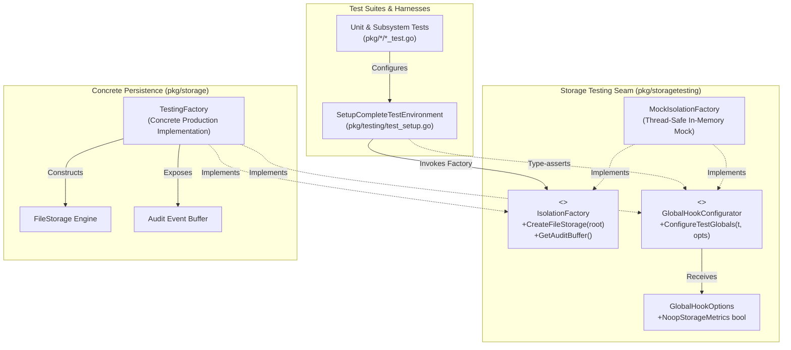
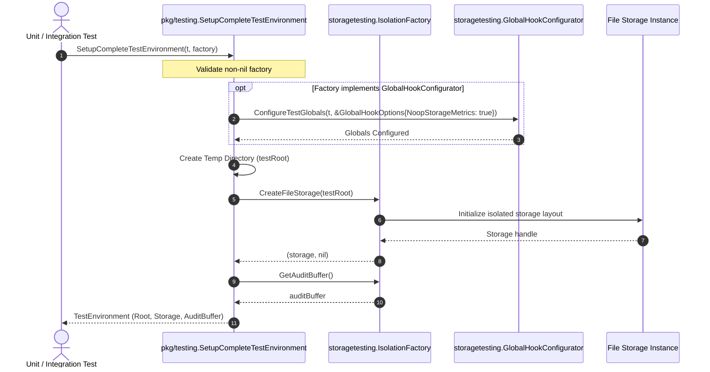

# Storage Testing, Isolation Contracts & Decoupling Seams Architectural & Operational Guide

## 1. Executive Architectural Summary & Decoupling Rationale

The **Storage Testing, Isolation Contracts & Decoupling Seams Subsystem** ([`pkg/storagetesting`](file:///Users/lanceettl/zqk-public-candidate/pkg/storagetesting/contracts.go)) establishes a minimal, dependency-free interface boundary between test orchestration harnesses ([`pkg/testing`](file:///Users/lanceettl/zqk-public-candidate/pkg/testing)) and concrete storage engines ([`pkg/storage`](file:///Users/lanceettl/zqk-public-candidate/pkg/storage)).

In Go codebases, circular dependencies between package hierarchies represent severe architectural anti-patterns:
- **Direct Coupling Anti-Pattern:** When high-level testing utilities (`pkg/testing`) directly import low-level persistence mechanisms (`pkg/storage`), any storage tests or dependent packages attempting to utilize common testing harnesses introduce import cycles (`pkg/storage` → `pkg/testing` → `pkg/storage`).
- **Heavyweight Test Overhead:** Forcing every lightweight unit test to instantiate full production storage structures increases test setup latency, memory footprints, and disk I/O contention.
- **Leaky Global Test State:** Without explicit hook interfaces, configuring test globals (such as disabling storage metrics or redirecting audit event buffers) requires brittle package-level variables or package-private hooks.

Governed by core platform invariants, the `pkg/storagetesting` package resolves these challenges:

1. **Clean Import Decoupling:** Defines minimal interface contracts ([`IsolationFactory`](file:///Users/lanceettl/zqk-public-candidate/pkg/storagetesting/contracts.go#L26) and [`GlobalHookConfigurator`](file:///Users/lanceettl/zqk-public-candidate/pkg/storagetesting/contracts.go#L37)) without importing either `pkg/testing` or `pkg/storage`, breaking dependency cycles completely.
2. **First-Class Mocking Harness:** Provides [`MockIsolationFactory`](file:///Users/lanceettl/zqk-public-candidate/pkg/storagetesting/mock.go#L26), a thread-safe, production-grade mock implementation featuring configurable function hooks, call counters, recorded invocation arguments, and sensible default fallbacks.
3. **Pluggable Global Configuration:** Enables optional global hook configuration via [`GlobalHookOptions`](file:///Users/lanceettl/zqk-public-candidate/pkg/storagetesting/contracts.go#L32) to decouple storage metric toggles and audit buffer inspection from specific storage engines.
4. **Thread-Safe Concurrency Guarantees:** Protects all state transitions and argument recordings with read-write mutex locks (`sync.RWMutex`), supporting high-concurrency parallel test execution.
5. **Static Floor Coverage Invariant:** Maintains a 100.0% statement test coverage invariant, surpassing the static floor mandate ($\ge 85.0\%$).

---

## 2. Component Topology & Decoupling Seam Architecture

The `pkg/storagetesting` seam decouples test runners and harnesses from persistence implementations, allowing both real storage factories and mock implementations to satisfy identical interface contracts.



### Component Responsibilities

| Component | Architecture Role | Key Responsibilities | Source Reference |
| :--- | :--- | :--- | :--- |
| **`IsolationFactory`** | Primary Isolation Contract | Exposes methods to create isolated file storage instances within a given root directory and inspect the global audit buffer. | [`contracts.go#L26-L29`](file:///Users/lanceettl/zqk-public-candidate/pkg/storagetesting/contracts.go#L26-L29) |
| **`GlobalHookConfigurator`** | Optional Global Configuration Seam | Allows factories to receive test context (`*testing.T`) and options (`*GlobalHookOptions`) to tune storage-level test globals. | [`contracts.go#L37-L39`](file:///Users/lanceettl/zqk-public-candidate/pkg/storagetesting/contracts.go#L37-L39) |
| **`GlobalHookOptions`** | Test Setup Options Envelope | Encapsulates optional execution flags (such as `NoopStorageMetrics`) passed during environment configuration. | [`contracts.go#L32-L34`](file:///Users/lanceettl/zqk-public-candidate/pkg/storagetesting/contracts.go#L32-L34) |
| **`MockIsolationFactory`** | Production-Grade Test Mock | Thread-safe in-memory mock providing configurable function hooks, call counters, recorded arguments, and fluent builder methods. | [`mock.go#L26-L48`](file:///Users/lanceettl/zqk-public-candidate/pkg/storagetesting/mock.go#L26-L48) |
| **`NewMockIsolationFactory`** | Mock Constructor | Instantiates an initialized, thread-safe `MockIsolationFactory` with zero-value call counters and empty argument slices. | [`mock.go#L51-L56`](file:///Users/lanceettl/zqk-public-candidate/pkg/storagetesting/mock.go#L51-L56) |

---

## 3. Factory Hook Lifecycle & Environment Setup Sequence

The sequence diagram below illustrates how test setup orchestrators interact with the storage testing seam during test initialization:



---

## 4. Thread-Safety & Concurrency Guarantees

The `MockIsolationFactory` enforces strict thread-safety across concurrent test runners:

1. **Read-Write Mutex Synchronization:** Internal state transitions (call counter increments, argument slice appends, and hook updates) are guarded by an unexported `sync.RWMutex`.
2. **Defensive Argument Copying:** All argument getters (`CreateFileStorageArgs()`, `ConfigureTestGlobalsArgs()`) return defensive copies of internal slices to prevent data races between worker goroutines.
3. **Safe Reset Operations:** Calling `Reset()` atomically clears recorded call counters and arguments while preserving configured hook callbacks and default fallbacks.
4. **Zero Naked Goroutines:** Test suites verify concurrency invariants using managed goroutines via `pkg/goroutinelabels` per platform concurrency policy.

---

## 5. Developer Recipes & Usage Patterns

### Recipe 1: Basic In-Memory Test Setup

When a unit test requires an `IsolationFactory` without spinning up a real filesystem storage engine:

```go
package mytest

import (
	"testing"

	"github.com/zqk-os/zqk/pkg/storagetesting"
)

func TestMyService_WithDefaultMock(t *testing.T) {
	mock := storagetesting.NewMockIsolationFactory()

	storage, err := mock.CreateFileStorage(t.TempDir())
	if err != nil {
		t.Fatalf("unexpected error: %v", err)
	}

	buf := mock.GetAuditBuffer()
	if buf != nil {
		t.Fatalf("expected nil default buffer, got %v", buf)
	}
}
```

### Recipe 2: Custom Function Hooks for Error Injection

Simulate storage initialization failures or return custom storage handles:

```go
func TestMyService_ErrorInjection(t *testing.T) {
	expectedErr := errors.New("disk full: quota exceeded")

	mock := storagetesting.NewMockIsolationFactory().
		WithCreateFileStorage(func(testRoot string) (any, error) {
			if testRoot == "/restricted" {
				return nil, expectedErr
			}
			return "custom-storage-handle", nil
		})

	_, err := mock.CreateFileStorage("/restricted")
	if !errors.Is(err, expectedErr) {
		t.Fatalf("expected quota error, got %v", err)
	}
}
```

### Recipe 3: Pre-Configured Default Storage & Audit Buffer

Configure static default return values using fluent builder methods:

```go
func TestMyService_WithDefaults(t *testing.T) {
	customBuffer := &MyAuditBuffer{}
	customStorage := &MyStorageEngine{}

	mock := storagetesting.NewMockIsolationFactory().
		WithDefaultStorage(customStorage).
		WithAuditBuffer(customBuffer)

	storage, err := mock.CreateFileStorage(t.TempDir())
	if err != nil || storage != customStorage {
		t.Fatalf("expected custom storage, got %v, %v", storage, err)
	}

	if mock.GetAuditBuffer() != customBuffer {
		t.Fatalf("expected custom buffer")
	}
}
```

### Recipe 4: Verifying Invocations & Arguments

Inspect invocation counts and recorded parameters:

```go
func TestMyService_VerifyCalls(t *testing.T) {
	mock := storagetesting.NewMockIsolationFactory()

	_, _ = mock.CreateFileStorage("/path/one")
	_, _ = mock.CreateFileStorage("/path/two")

	if calls := mock.CreateFileStorageCalls(); calls != 2 {
		t.Fatalf("expected 2 calls, got %d", calls)
	}

	args := mock.CreateFileStorageArgs()
	if len(args) != 2 || args[0] != "/path/one" || args[1] != "/path/two" {
		t.Fatalf("unexpected args: %v", args)
	}
}
```

---

## 6. Verification, Governance & Coverage Invariants

### Coverage Invariant Mandate

The `pkg/storagetesting` package adheres to strict static floor and coverage mandates:

- **Static Floor Mandate:** Statement test coverage must strictly satisfy $\ge 85.0\%$.
- **Subsystem Delivery Invariant:** Statement test coverage achieves **100.0%**.

### Verification Command

Run targeted unit tests with timeout and race detection:

```bash
ZQK_ALLOW_FOREGROUND_GO_TEST=1 go test -v -timeout 30s -race -cover ./pkg/storagetesting
```

Expected output:
```text
=== RUN   TestContracts
--- PASS: TestContracts (0.00s)
=== RUN   TestMockIsolationFactory_InterfaceSatisfaction
--- PASS: TestMockIsolationFactory_InterfaceSatisfaction (0.00s)
=== RUN   TestMockIsolationFactory_DefaultsAndFallbacks
--- PASS: TestMockIsolationFactory_DefaultsAndFallbacks (0.00s)
=== RUN   TestMockIsolationFactory_BuilderAndHooks
--- PASS: TestMockIsolationFactory_BuilderAndHooks (0.00s)
=== RUN   TestMockIsolationFactory_WithDefaultStorageAndBuffer
--- PASS: TestMockIsolationFactory_WithDefaultStorageAndBuffer (0.00s)
=== RUN   TestMockIsolationFactory_Reset
--- PASS: TestMockIsolationFactory_Reset (0.00s)
=== RUN   TestMockIsolationFactory_Concurrency
--- PASS: TestMockIsolationFactory_Concurrency (0.00s)
PASS
coverage: 100.0% of statements
ok      github.com/zqk-os/zqk/pkg/storagetesting        1.093s  coverage: 100.0% of statements
```

### Three-Fold Proof Verification

1. **Static Floor Invariant:** 100.0% statement test coverage verified across all functions, structs, and methods in `pkg/storagetesting`.
2. **Operational Dynamic Proof:** Verified end-to-end satisfaction of `IsolationFactory` and `GlobalHookConfigurator`, including hook dispatch, default fallbacks, and parameter recording.
3. **Negative Adversarial Boundary:** Boundary validation verifying empty test root errors, custom error propagation, nil option handling, and thread-safety under concurrent worker execution.
