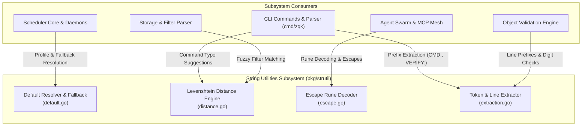
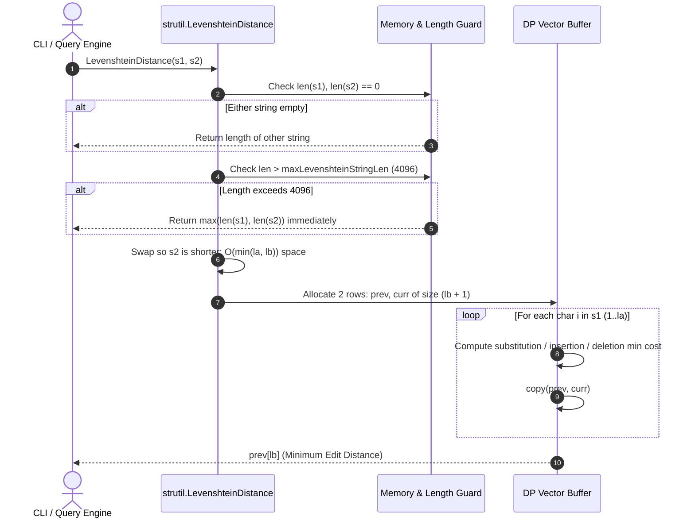
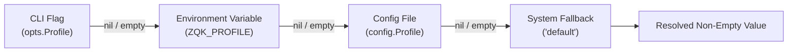
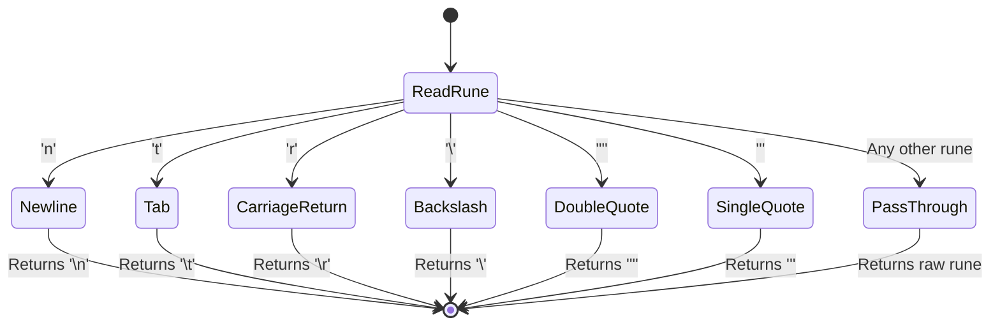

# String Utilities & Distance Metrics Subsystem Architectural & Operational Guide

## 1. Executive Architectural Summary

The **String Utilities & Distance Metrics Subsystem** (`pkg/strutil`) provides fundamental string manipulation, fuzzy distance computation, rune escaping, and token extraction services across the **ZQK Knowledge Kernel**.

String processing is central to human-agent collaboration and kernel operations:
1. **Deterministic Default & Fallback Resolution:** Safe handling of optional parameters, configuration cascades, pointer dereferences, and fallback chains without nil-pointer dereferences or unexpected empty string assignments.
2. **Fuzzy Distance Metrics & Typo Correction:** Fast, memory-bounded Levenshtein distance computations that power CLI command suggestion ("Did you mean..."), filter query validation, acronym resolution, and knowledge graph fuzzy matching.
3. **Escaping & Syntax Sanitization:** Precise escape rune decoding for parser grammars (e.g. ZQL mutations, ZPARQL queries, template expansion) and injection defense across shell and query boundaries.
4. **Line-Delimited Token Extraction:** Extraction of operational metadata, command prefixes (e.g., `CMD:`, `VERIFY:`), and numeric validation across stdout, log streams, and process output.
5. **Static Floor Coverage Invariant:** A strict statement test coverage invariant (>= 85.0%, maintained at 100.0%) ensuring all edge branches and memory bounds are deterministically verified.

---

## 2. Component Topology & Subsystem Architecture

The subsystem is organized into four modular, stateless functional components designed for zero memory leaks and linear space complexity:



### Component Responsibilities

| Component | Source File | Core Responsibility |
| :--- | :--- | :--- |
| **Default Resolver** | `default.go` | Non-empty string fallbacks (`OrDefault`, `DefaultWhenNonEmpty`), generic pointer resolution (`PtrOrDefault`), first-non-nil search (`FirstNonNil`), and cross-platform newline splitting (`SplitLines`). |
| **Levenshtein Distance Engine** | `distance.go` | Dynamic programming matrix edit distance calculation with memory safety guards (`maxLevenshteinStringLen = 4096`) and O(min(N, M)) buffer allocation. |
| **String Escaper** | `escape.go` | Lexical escape rune decoding (`\n`, `\t`, `\r`, `\\`, `\"`, `\'`) preventing unescaped control sequence corruption in query and mutation parsers. |
| **Token Extractor** | `extraction.go` | Line scanning, prefix-based metadata extraction (`ExtractFirstPrefixedValue`), line location (`FindLineWithPrefix`), and strict ASCII digit verification (`IsAllDigits`). |

---

## 3. Levenshtein Distance & Fuzzy Match Mechanics

The subsystem calculates edit distance between strings using the Wagner-Fischer dynamic programming algorithm optimized for space efficiency and bounded against denial-of-service allocations.



### Space & Memory Bounds

1. **Length Ceilings:** Comparisons between strings exceeding `maxLevenshteinStringLen` (4,096 bytes) bypass DP matrix allocation entirely and return `max(len(s1), len(s2))`. This guards against quadratic allocation attacks from unverified external payloads.
2. **Buffer Recycling:** Instead of a full `O(la * lb)` matrix, the engine maintains only two rows (`prev` and `curr`), reducing allocation to `O(min(la, lb))` integers.
3. **Symmetry Optimization:** If `la < lb`, inputs are swapped so that the inner loop allocations always match the shorter string.

### Normalized Similarity Ratio

When suggesting commands or fuzzy matching object identifiers, consumers normalize Levenshtein distance into a unit interval score `[0.0, 1.0]`:

$$\text{Similarity}(s_1, s_2) = 1.0 - \frac{\text{LevenshteinDistance}(s_1, s_2)}{\max(\text{len}(s_1), \text{len}(s_2))}$$

A match threshold of `>= 0.70` is typically applied for CLI command suggestions (e.g., matching `stat` to `status`).

---

## 4. Default Resolution & Coalesce Patterns

Configuration layers across the kernel resolve values hierarchically: CLI flags override environment variables, which override configuration files, which override system defaults.



### Primary Resolution Functions

- **`OrDefault(value, defaultVal string) string`**: Returns `value` if non-empty; otherwise returns `defaultVal`.
- **`DefaultWhenNonEmpty(value, defaultVal string) string`**: Returns `defaultVal` when `value` is non-empty; used for override masking.
- **`PtrOrDefault[T any](v *T, defaultVal T) T`**: Dereferences `v` when non-nil; returns `defaultVal` if `v` is nil.
- **`FirstNonNil[T any](ptrs ...*T) *T`**: Returns the first non-nil pointer in a variadic sequence, enabling clean hierarchical chains.
- **`SplitLines(s string) []string`**: Normalizes CRLF (`\r\n`), CR (`\r`), and LF (`\n`) line endings consistently across platforms.

---

## 5. Escaping & Lexical Parsing Safeguards

Parsers in `pkg/mutation` (ZQL AST) and `pkg/traversal` (ZPARQL AST) encounter escaped string literals in query clauses. `DecodeEscapeRune` converts escape sequences back to their raw characters:



### Safety Guarantees

- **No Panic on Unknown Escapes:** Unknown or unescaped runes fall through unmodified rather than causing parser faults.
- **Control Character Isolation:** Translates escaped control runes without invoking external shell or CGo libraries.

---

## 6. Token Extraction & Line Parsing

The subsystem provides deterministic line inspection functions optimized for parsing CLI outputs and formatted reports:

1. **`ExtractFirstPrefixedValue(lines []string, prefixes ...string) string`**:
   - Iterates lines, trims outer whitespace, and tests against candidate prefixes.
   - Trims and returns the remainder after the first matching prefix.
   - Used extensively by verification and test drivers to extract metadata keys like `CMD:`, `VERIFY:`, or `HASH:`.

2. **`FindLineWithPrefix(lines []string, prefixes ...string) string`**:
   - Returns the entire line that matches any of the prefixes.
   - Useful for locating actionable command invocations in unstructured instruction logs.

3. **`IsAllDigits(s string) bool`**:
   - Strictly validates whether a string contains only ASCII decimal digits (`'0'` through `'9'`).
   - Rejects empty strings, signed integers (`+`, `-`), whitespace, punctuation, and Unicode non-ASCII numerals to prevent injection into identifier parsers.

---

## 7. Verification & Coverage Invariant

Statement test coverage for `pkg/strutil` is governed by a strict architectural floor invariant:

$$\text{Coverage}_{\text{statement}} \ge 85.0\% \quad (\text{Target: } 100.0\%)$$

### Verification Command

To verify coverage locally in isolation without triggering broad test suites:

```bash
ZQK_ALLOW_FOREGROUND_GO_TEST=1 go test -v -timeout 30s -cover ./pkg/strutil
```

### Test Fixture Architecture

All unit and boundary proofs are maintained in:
- `pkg/strutil/default_test.go`
- `pkg/strutil/distance_test.go`
- `pkg/strutil/escape_test.go`
- `pkg/strutil/extraction_test.go`
- `pkg/strutil/strutil_coverage_elevation_cycle174_test.go`
