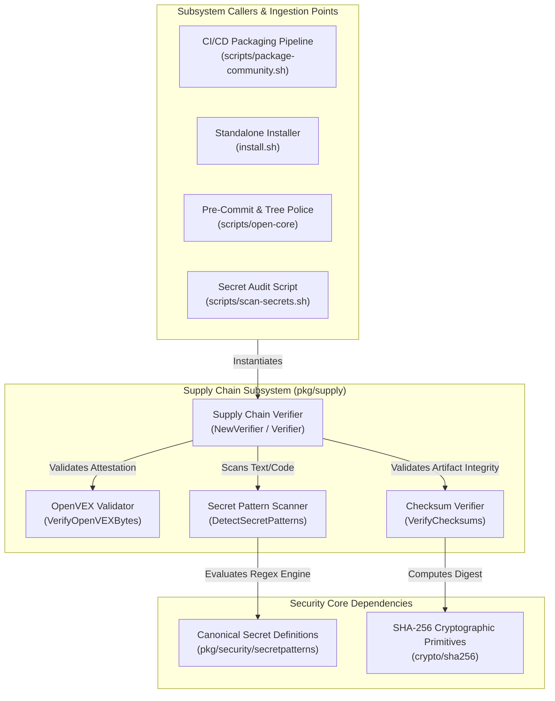
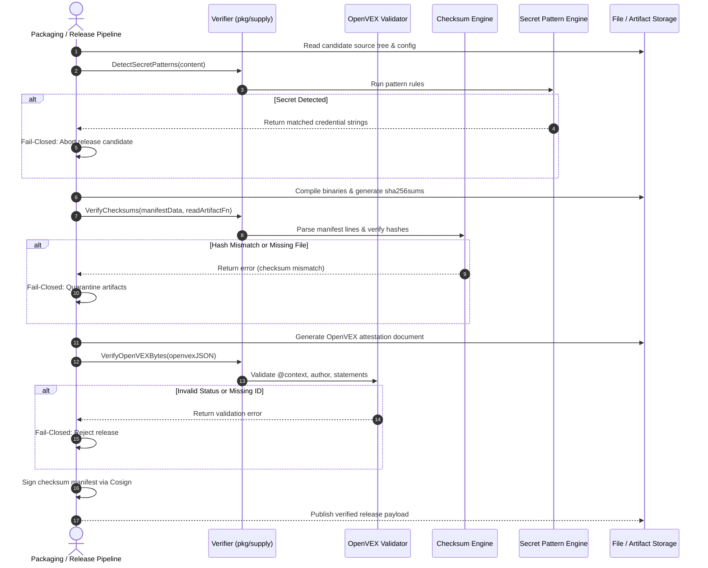
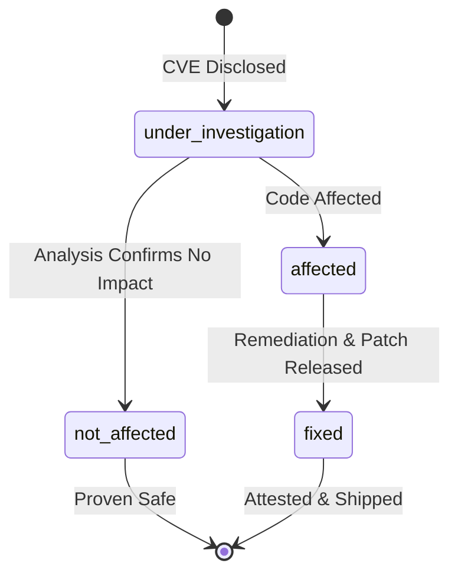

# Supply Chain Integrity, SBOM Generation & Secret Scanning Subsystem Architectural & Operational Guide

## 1. Executive Architectural Summary

The **Supply Chain Integrity, SBOM Generation & Secret Scanning Subsystem** (`pkg/supply`) provides foundational trust, cryptographic attestation, and defense-in-depth protection for the **ZQK Knowledge Kernel**. In modern autonomous AI software engineering runtimes, codebases are continuously modified, built, packaged, and distributed across heterogeneous execution nodes and autonomous swarms. Guaranteeing software provenance, vulnerability status transparency, and source hygiene is mandatory to protect operators and downstream environments against supply chain compromise (POL-DEFAULT-142277d3).

The subsystem establishes five core security guarantees:

1. **Deterministic OpenVEX Attestation:** Enforces standards-compliant OpenVEX (v0.2.0) vulnerability status disclosures, asserting machine-readable statements regarding whether CVEs affect released binaries.
2. **Cryptographic Checksum Verification:** Validates SHA-256 manifest records against candidate artifacts with case-insensitive hash checking, comment and whitespace tolerance, and fail-closed mismatch detection.
3. **Canonical Secret Pattern Scanning:** Scans source code and packaged configurations for credential leaks (such as personal access tokens, private keys, and cloud API secrets) prior to release.
4. **Hermetic Packaging Integration:** Bridges release packaging pipelines, standalone installer scripts, and continuous integration workflows to guarantee reproducible builds and signed release payloads.
5. **Static Invariant & Three-Fold Verification:** Maintains a strict 100.0% statement test coverage invariant in `pkg/supply`, verifying static boundaries, dynamic verification mechanics, and adversarial tamper scenarios.

---

## 2. Component Topology & Subsystem Architecture

The `pkg/supply` package is structured as a stateless, thread-safe verification engine designed to operate across CI release pipelines, standalone distribution installers, and local security auditing tooling:



### Component Responsibilities

| Component | Primary API / Types | Architectural Responsibility |
| :--- | :--- | :--- |
| **Supply Chain Verifier** | `Verifier`, `NewVerifier()` | Central entry point orchestrating OpenVEX document validation, SHA-256 manifest verification, and secret detection. |
| **OpenVEX Validator** | `VerifyOpenVEXBytes([]byte) error`, `OpenVEXDocument`, `OpenVEXStatement` | Enforces JSON structural rules, context namespace invariants (`https://openvex.dev/ns`), author and ID declarations, and canonical lifecycle status enumerations. |
| **Checksum Verifier** | `VerifyChecksums([]byte, func(string) ([]byte, error)) error` | Parses standard checksum manifests (`<hash>  <filename>`), strips comment and blank lines, executes custom file readers, and validates computed SHA-256 digests. |
| **Secret Pattern Scanner** | `DetectSecretPatterns(string) []string` | Inspects arbitrary source or configuration strings against canonical security regex rules (`pkg/security/secretpatterns`) to detect exposed tokens. |

---

## 3. Supply Chain Verification Lifecycle

Every release candidate and distribution artifact follows an immutable verification lifecycle before publication or execution:



---

## 4. OpenVEX Attestation Taxonomy

OpenVEX is an open standard for machine-readable vulnerability exploitability exchange. In ZQK Core, OpenVEX documents declare whether vulnerabilities identified by external scanners impact the shipped product.

### Document Structure & Fields

An OpenVEX document conforms to specification v0.2.0:

```json
{
  "@context": "https://openvex.dev/ns/v0.2.0",
  "@id": "https://zqk.dev/security/vex/release-v1.4.0.json",
  "author": "ZQK Security Response Team",
  "timestamp": "2026-10-25T12:00:00Z",
  "version": 1,
  "statements": [
    {
      "vulnerability": {
        "name": "CVE-2026-1001"
      },
      "status": "not_affected",
      "justification": "component_not_present",
      "impact_statement": "Vulnerable sub-package is stripped from the distribution binary."
    }
  ]
}
```

### Statement Lifecycle States

OpenVEX statements must declare one of four canonical lifecycle statuses:



- **`not_affected`**: The component is not impacted by the vulnerability. A standard justification (e.g., `component_not_present`, `vulnerable_code_not_present`, `inline_mitigations_already_exist`) is recommended.
- **`affected`**: The component is vulnerable. An optional action statement specifies recommended user workarounds.
- **`fixed`**: The vulnerability has been resolved in the referenced build.
- **`under_investigation`**: An investigation is actively underway to determine impact.

Any other status string causes `VerifyOpenVEXBytes` to reject the document immediately.

---

## 5. Checksum Invariants & Manifest Verification

Artifact integrity is verified using standard checksum manifests following the convention:

```text
# SHA-256 Release Manifest
e3b0c44298fc1c149afbf4c8996fb92427ae41e4649b934ca495991b7852b855  zqk-darwin-arm64.tar.gz
4b227777d4dd1fc61c6f884f48641d02b4d121d3fd328cb08b5531fcacdabf8a  zqk-linux-amd64.tar.gz
```

### Manifest Parsing Rules

1. **Comment & Whitespace Resilience:** Lines starting with `#` or containing only whitespace are ignored.
2. **Whitespace Field Delimitation:** Supports arbitrary spacing (single space, double space, tabs) between hash and filename.
3. **Format Integrity:** Lines containing fewer than two non-empty tokens cause immediate syntax errors.
4. **Hex Normalization:** Expected hashes are converted to lowercase prior to comparison, accepting uppercase, lowercase, or mixed-case hex values transparently.
5. **Decoupled I/O Callback:** File access is abstracted through a reader function `func(filename string) ([]byte, error)`, allowing memory-only testing, virtualized filesystems, and remote stream verification without local disk writes.
6. **Non-Empty Requirement:** Manifests with zero entries (or only comments) fail closed.

---

## 6. Concurrency & Thread-Safety

The `Verifier` struct has zero mutable internal state. All verification methods are pure functions that operate strictly on provided input buffers and callback closures:

- **Stateless Reentrancy:** Multiple goroutines can share a single `*Verifier` instance concurrently without mutex locks.
- **Managed Goroutine Concurrency:** Concurrent operations and stress tests utilize `goroutinelabels.NewGoroutine` to ensure complete observability and runtime introspection.
- **Deterministic Memory Allocation:** Manifest lines are processed sequentially or streamed without unbounded memory retention.

---

## 7. Verification, Three-Fold Proof & Quality Metrics

The `pkg/supply` package enforces complete verification through the Three-Fold Proof model:

### 1. Static Floor Invariant
- **100.0% Statement Coverage:** Verified using `go test -coverprofile` across all exported and unexported functions:
  - `NewVerifier`: 100.0%
  - `VerifyOpenVEXBytes`: 100.0%
  - `VerifyChecksums`: 100.0%
  - `DetectSecretPatterns`: 100.0%
- **Code Cleanliness:** Zero swallowed errors (`_ = ...` prohibited). Functions adhere to the < 100 lines modularity requirement.

### 2. Operational Dynamic Proof
- **OpenVEX Attestation:** Automated generation and validation via `scripts/generate-openvex.sh --verify`.
- **Checksum Verification:** Dynamic verification of multi-file manifests, uppercase hex values, and memory-safe I/O callbacks.
- **Secret Scanning:** Verification of credential patterns via `scripts/scan-secrets.sh` across clean and dirty fixture trees.
- **Concurrent Integrity:** Concurrent execution across multiple worker routines under high iterations without races.

### 3. Negative Adversarial Boundary
- **Corrupt OpenVEX Documents:** Rejection of invalid JSON, invalid `@context` prefixes, missing `@id`, missing `author`, zero statements, and unknown status values (`invalid_status`).
- **Tampered Checksums:** Rejection of mismatched SHA-256 hashes, unreadable files, truncated manifests, and single-field syntax errors.
- **Fail-Closed Release Gates:** Verification of installer behavior in `install.sh` when `ZQK_REQUIRE_COSIGN=1` is enforced and signatures are missing or corrupted.
- **Payload Leak Defense:** Automated verification via `scripts/open-core/check-public-release-payload.sh` preventing leak of private tokens, internal IDs, or non-public build scripts.

---

## 8. Operational Reference & Script Integration

### Generate and Verify OpenVEX Attestations
```bash
# Generate OpenVEX document for a release version
bash scripts/generate-openvex.sh "v1.4.0" "dist/openvex.json"

# Verify OpenVEX document validity
bash scripts/generate-openvex.sh --verify "dist/openvex.json"
```

### Scan Workspace for Secrets
```bash
# Scan a directory tree for potential credentials
sh scripts/scan-secrets.sh .
```

### Run Subsystem Tests with Coverage
```bash
# Execute unit tests with statement coverage report
ZQK_ALLOW_FOREGROUND_GO_TEST=1 go test -v -timeout 30s -cover ./pkg/supply
```
