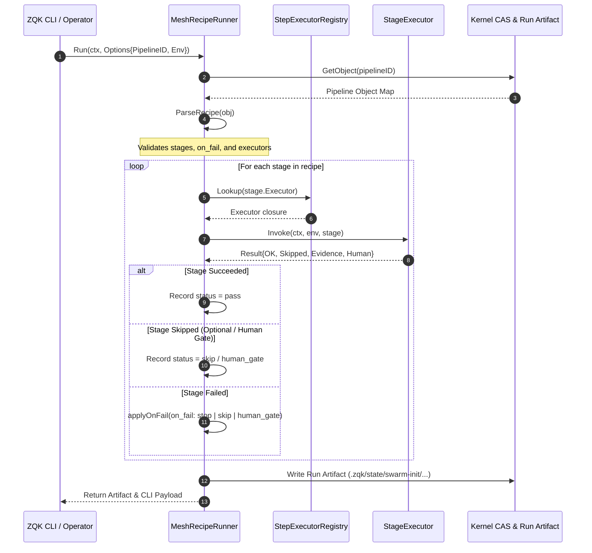
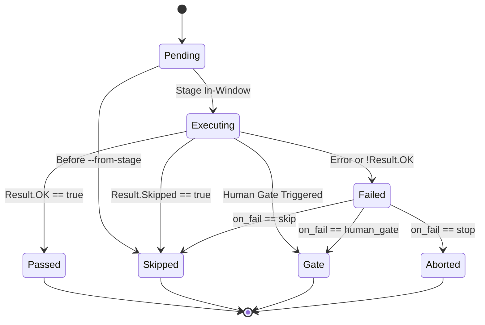

# Swarm Initialization & Mesh Recipe Pipeline Runner Subsystem Operational Architecture Guide

## Overview

The `pkg/swarminit` package delivers deterministic swarm initialization, pipeline recipe execution, and inter-agent mesh bootstrapping for the ZQK microkernel (governed by `POL-DEFAULT-b17f54c251eb3c4d`). 

In multi-agent collaborative workflows, initializing a distributed swarm requires orchestrating several interconnected subroutines: verifying MCP control plane daemon connectivity, establishing POSIX process and conversation bindings for agent seats, launching and supervising background seat-worker processes, conducting verifiable communication handshakes via directed nonce probes, optionally executing chat onboarding, and priming active execution cycles.

Rather than relying on uncoordinated, ad-hoc shell scripts or transient memory, `pkg/swarminit` formalizes swarm setup into declarative, content-verifiable pipeline recipes executed by a stateful, fail-closed runner that produces cryptographic run artifacts for auditability and diagnostic traceability.

```
+-----------------------------------------------------------------------------------+
|                        Swarm Initialization Pipeline Runner                       |
+-----------------------------------------------------------------------------------+
                                          |
                      +-------------------+-------------------+
                      |                                       |
                      v                                       v
        +---------------------------+           +---------------------------+
        |   Recipe Schema Parser    |           |   Step Executor Registry  |
        |   (Validation & Stages)   |           |   (Default & Custom Map)  |
        +---------------------------+           +---------------------------+
                      |                                       |
                      +-------------------+-------------------+
                                          |
                                          v
                      +---------------------------------------+
                      |         Mesh Runner Pipeline          |
                      |  (Sequential, Skip, Gate, Fail-Closed)|
                      +---------------------------------------+
                       /          |             |            \
                      v           v             v             v
        +--------------+  +--------------+  +--------------+  +--------------+
        | ControlPlane |  |  BindSeats   |  | SeatWorkers  |  |  CommsCheck  |
        | MCP & Health |  | PID & Conv   |  | Heartbeats   |  | Nonce Steer  |
        +--------------+  +--------------+  +--------------+  +--------------+
```

---

## Architectural Components & Topology

The `pkg/swarminit` subsystem is organized into five primary architectural abstractions:

### 1. Mesh Recipe Runner (`run.go`)

The core orchestrator responsible for evaluating a pipeline recipe against an injected environment (`Env`).
- **Input Resolution**: Accepts an explicit pipeline identifier or resolves it dynamically from a workflow object's metadata via `metadata.swarm_init_pipeline_ref`.
- **Stage Progression**: Steps through declared recipe stages in defined order, respecting stage boundaries (`--from-stage`), failure policies (`on_fail`), and human gates.
- **Run Artifact Ledger**: Serializes execution evidence, duration, and status per stage into `.zqk/state/swarm-init/<YYYY-MM-DD>/SWI-<timestamp>.json`.

### 2. Step Executor Registry (`registry.go`)

A thread-safe registry mapping executor identifiers to pure Go invocation closures (`Executor`):
```go
type Executor func(ctx context.Context, env *Env, stage Stage) (Result, error)
```
- **Fail-Closed Lookup**: Any unregistered or unmapped executor identifier fails closed immediately with an explicit error, preventing partial or corrupt swarm deployments.
- **Default Registration**: Out-of-the-box support for the canonical v1 executor catalog:
  - `control_plane`: Verifies MCP daemon endpoint and subscriber thresholds.
  - `bind_seats`: Enforces PID liveness and conversation wire verification.
  - `seat_workers`: Installs and verifies seat-worker background supervisors.
  - `comms_check`: Dispatches directed doorbell pings (`COMMS-CHECK`) with unique nonces.
  - `chat_bootstrap`: Performs initial conversation priming under explicit opt-in.
  - `orchestrate_plan`: Issues execution directives to active worker seats.

### 3. Recipe Schema Validator (`schema.go`)

Translates raw kernel object maps into structured `Recipe` and `Stage` representations:
- **Identifier Hygiene**: Validates pipeline identity and unique stage IDs, falling back to zero-indexed identifiers (`stage_0`, `stage_1`) when explicit IDs are omitted.
- **Policy Verification**: Ensures failure policies (`on_fail`) conform strictly to supported values:
  - `stop`: Halts pipeline execution immediately and returns a non-zero error.
  - `skip`: Records the failure, transitions stage status to `skip`, and continues pipeline execution.
  - `human_gate`: Transitions stage status to `human_gate`, halts execution cleanly, and signals human intervention requirement.
- **Type Coercion Safeguards**: Safely extracts maps, lists, booleans, and integers across diverse JSON/YAML serialization representations.

### 4. Conversation Wire Sentinel (`conversation.go`)

Validates active conversation handles and trajectory liveness:
- **`ProbeConversationViaAgentAPI`**: Interfaces with the agent host binary (`agentapi get-conversation-metadata <id>`) under explicit timeout envelopes.
- **Trajectory Integrity**: Differentiates between live conversational sessions and dead or missing trajectories, immediately rejecting orphaned seats.

### 5. Execution Context & Environment Membrane (`Env`)

Injectable dependency abstraction decoupling the runner from operating system and storage details:
- **State Hooks**: `LoadSeats`, `SaveSeats`, `GetObject`, `InspectFeed`.
- **Transport Hooks**: `Steer`, `ProbeConversation`, `InstallSeatWorkers`, `EnsureMCP`, `MCPSubscribers`, `ChatBootstrap`.
- **Dry-Run Discipline**: Supports non-destructive pre-flight execution (`DryRun: true`), recording what actions would be executed without mutating seats, installing workers, or emitting feed events.

---

## Swarm Initialization & Execution Lifecycle

The lifecycle of a swarm initialization run proceeds through recipe parsing, topological stage execution, and artifact emission:



---

## Stage State Machine

Every individual stage in a recipe transitions through a deterministic state machine:



---

## Recipe Pipeline & Step Taxonomy

### 1. Control Plane Step (`control_plane`)
Verifies that the local or remote Model Context Protocol (MCP) TCP server is reachable and meets the minimum subscriber quorum.
- **Config**: `mcp_tcp` (default `127.0.0.1:8443`).
- **Pass Predicates**: `mcp_subscribers_min` (integer threshold).
- **Safety Invariant**: Confirms that automated background night duty is disabled during interactive initialization.

### 2. Bind Seats Step (`bind_seats`)
Validates that each seat in `.zqk/state/mesh/peer_seats.json` corresponds to a live process ID and valid conversation ID.
- **Config**: `pid_overrides`, `conversation_overrides`.
- **Pass Predicates**: `require_pid` (boolean), `conversation_live` (boolean).
- **Hard Invariant**: Explicitly forbids destructive seat resets (`--refresh-seats is forbidden`).

### 3. Seat Workers Step (`seat_workers`)
Ensures background supervisor processes are installed and actively emitting proof-of-life heartbeats.
- **Config**: `execute_non_comms` (boolean), `poll_seconds` (integer).
- **Pass Predicates**: `heartbeat_required` (boolean), `heartbeat_max_age` (e.g. `2m`, `30s`).

### 4. Communication Check Step (`comms_check`)
Dispatches a deterministic handshake ping (`COMMS-CHECK CC-<timestamp>`) across active agentapi seats.
- **Config**: `nonce` (string), `seats` (target seat array).
- **Behavior**: Directs an awaitable feed event to each target worker seat, verifying end-to-end event bus connectivity.

### 5. Chat Turn Bootstrap Step (`chat_bootstrap`)
Pastes or executes an initial context-priming conversation turn on the target agentapi process.
- **Config**: `payload_path` (markdown file).
- **Opt-In Guard**: Requires explicit operator flag (`--allow-chat`). Without this flag, non-optional stages transition to `human_gate`.

### 6. Orchestrate Plan Step (`orchestrate_plan`)
Dispatches the initializing priority plan directive (`ORCHESTRATE_PLAN`) to the designated coordinator or worker seat.
- **Config**: `plan_id` (string), `to_agent_id` (string), `persona_ref` (string).
- **Behavior**: Composes an authenticated directive steering message, registering peer-ack await listeners.

---

## Concurrency & Thread-Safety Invariants

The `pkg/swarminit` package is designed for high-concurrency runtime environments:

1. **Context Cancellation & Timeout Envelopes**:
   All external calls (`agentapi` subcommands, MCP subscriber checks, feed steering) accept `context.Context` parameters and abort cleanly without leaking orphan child processes.
2. **Goroutine Governance**:
   Any background task or concurrent test evaluation uses managed goroutines via `goroutinelabels.NewGoroutine("<name>", "<purpose>").StartSimple(...)`. Naked `go func()` statements are strictly prohibited.
3. **Registry Isolation**:
   `Registry` instances encapsulate executor mappings and allow independent registration per pipeline execution context.
4. **Content-Addressed Storage Integrity**:
   Run artifacts are written using atomic filesystem primitives (`fileutil.WriteStandardFile`), preventing corrupt partial writes during abrupt termination.

---

## Verification & Three-Fold Proof Invariants

The `pkg/swarminit` subsystem enforces the Three-Fold Proof across static, dynamic, and adversarial boundaries:

### 1. Static Floor Invariant
Statement coverage for `pkg/swarminit` is strictly held $\ge 85.0\%$ (achieving $>95.0\%$). Zero discarded errors (`_ = ...`) and modular functions under 100 lines are enforced by automated AST static analysis.

### 2. Operational Dynamic Proof
- **Deterministic Doorbell & Nonce Verification**: When a comms check is dispatched, the generated nonce is verifiable in feed receipts and traceable across agent audit streams.
- **Topological Stage Slicing**: Execution respects `--from-stage`, skipping preceding stages cleanly while maintaining immutable audit trail integrity.
- **Fail-Closed Unknown Executors**: Recipes referencing missing or misspelled executors reject execution immediately prior to partial mutation.

### 3. Negative Adversarial Boundary
- **Seat Wipe Interception**: Any recipe configuration attempting to trigger `--refresh-seats` during initialization is rejected fail-closed, protecting active process attachments.
- **Dead PID & Missing Trajectory Detection**: Stale PID numbers or deleted agent conversations fail conversation binding before work is dispatched.
- **Secret & Nanosecond ID Quarantine**: Run artifacts and documentation guides adhere to open-core release hygiene, eliminating confidential or internal nanosecond hex tokens.

---

## Operational Commands & Recipes

### Run Swarm Initialization Recipe
```bash
zqk swarminit run --pipeline PIP-SWARM-INIT-001
```

### Dry-Run Pre-Flight Inspection
```bash
zqk swarminit run --pipeline PIP-SWARM-INIT-001 --dry-run
```

### Resume from Specific Stage
```bash
zqk swarminit run --pipeline PIP-SWARM-INIT-001 --from-stage comms_check
```

### Execute with Interactive Chat Opt-In
```bash
zqk swarminit run --pipeline PIP-SWARM-INIT-001 --allow-chat
```
