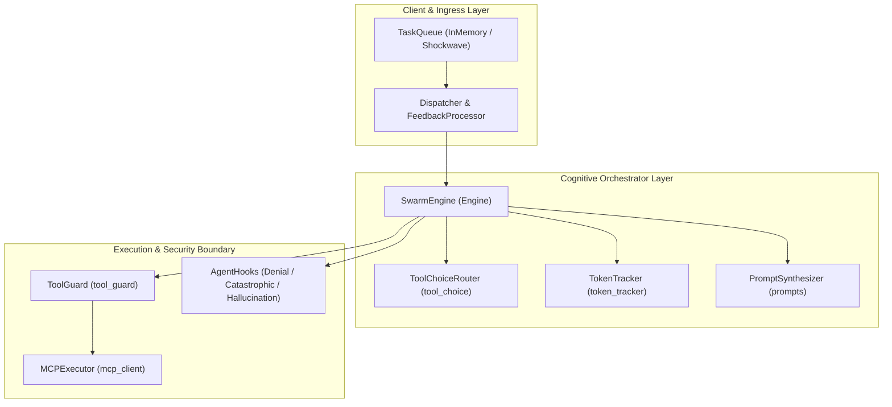
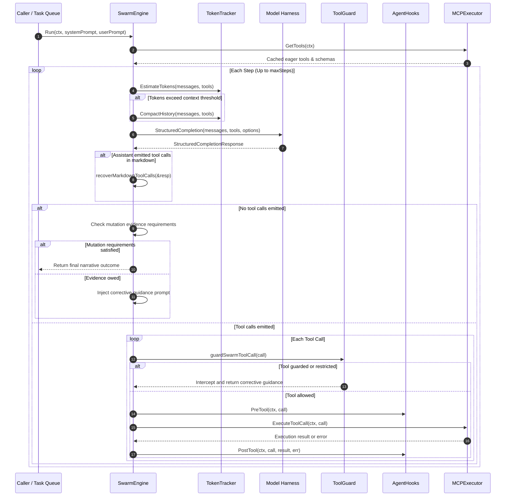
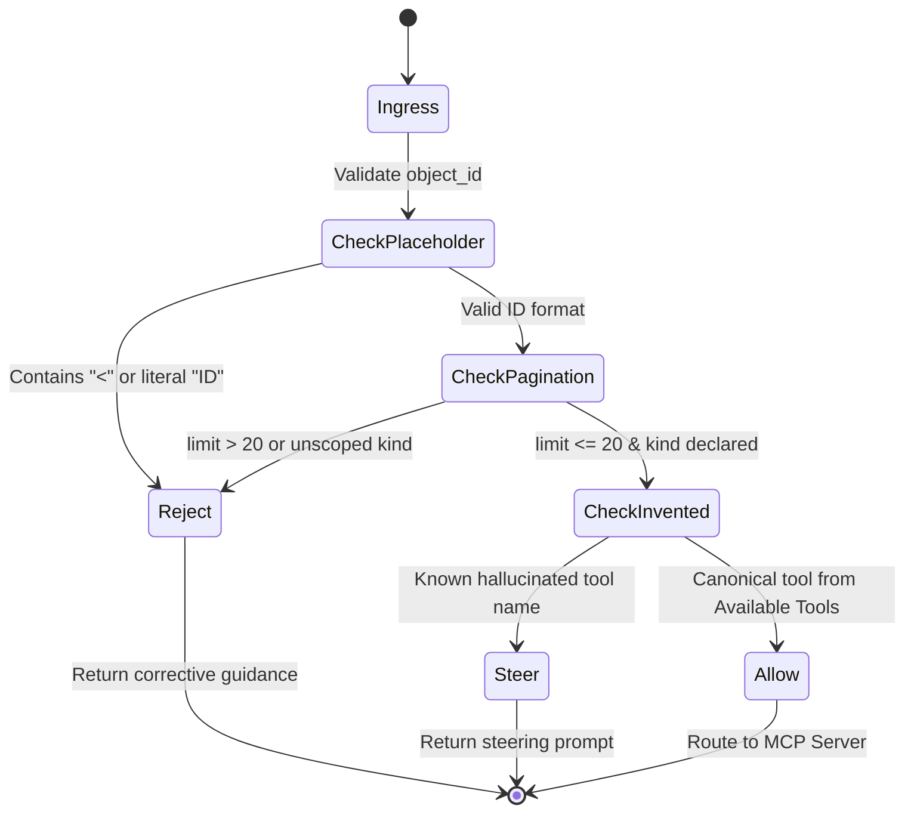

# Swarm Execution Engine & Multi-Agent Orchestration Subsystem Operational Architecture Guide

## 1. Subsystem Overview

The **Swarm Execution Engine & Multi-Agent Orchestration Subsystem** (`pkg/swarm`) is the foundational cognitive execution and multi-agent coordination core of the ZQK platform. It bridges high-level architectural intent and atomic operational execution by managing cognitive loops, task scheduling, intelligent tool routing, context budgeting, and defense-in-depth security sandboxing.

Governed by platform supervisory directives (**POL-DEFAULT-b17f54c251eb3c4d**) and swarm orchestration criteria (**CRI-SWARM-ORCHESTRATE**), `pkg/swarm` coordinates autonomous agents executing within isolated worktrees, dispatching tasks through event-driven neurons, and interacting with local environments strictly via guarded Model Context Protocol (MCP) tool interfaces.

### Core Objectives
1. **Deterministic Cognitive Loop Lifecycle:** Provide robust loop execution (`Engine.Run`) with step budgets, completion verification, and automated hallucination interception.
2. **Context Window & Token Conservation:** Ensure continuous budget estimation, compaction, and provider schema compression (`TokenTracker`) preventing token overrun faults.
3. **Defense-in-Depth Tool Guarding:** Strictly enforce containment boundaries (`guardSwarmToolCall`), preventing path traversal, unmetered pagination, forbidden object updates, and fabricated commands.
4. **Resilient Task Dispatching & Feedback:** Decouple ingress and egress task processing through the Shockwave event-driven protocol, automatically injecting system feedback on recoverable execution flakes.
5. **Fail-Closed Execution Invariant:** Require concrete evidence of execution through successful mutation tool calls before allowing narrative-only task completion.

---

## 2. Component Topology

The subsystem comprises seven cohesive architectural components operating in concert:

### Component Roles & Responsibilities

| Component | Package File(s) | Primary Responsibilities |
| :--- | :--- | :--- |
| **SwarmEngine** | `engine.go`, `engine_identity.go` | Orchestrates the multi-turn cognitive execution loop, manages supervisory hooks, tracks tool call history, enforces mutation evidence gates, and verifies task completion. |
| **TaskQueue** | `task_queue.go` | Thread-safe, bounded, in-memory FIFO task queue supporting context cancellation, backlog draining, and graceful shutdown. |
| **Dispatcher & Feedback** | `dispatcher.go`, `feedback.go` | Bridges task ingestion to execution runners via Shockwave Neurons and orchestrates automatic retries with diagnostic feedback injection. |
| **ToolGuard** | `tool_guard.go`, `mutation_paths.go` | Deep AST and payload inspector enforcing sandboxing rules, pagination ceilings (limit <= 20), placeholder rejection, and forbidden invented tool steering. |
| **MCPClient & Executor** | `mcp_client.go` | Manages external or in-process MCP server processes, implements eager/lazy tool partitioning, dynamically handles tool discovery, and logs telemetry. |
| **TokenTracker** | `token_tracker.go` | Computes token approximations across message transcripts and tool schemas, triggering FIFO history compaction when context thresholds (e.g. 90%) are reached. |
| **PromptSynthesizer** | `prompts.go` | Dynamically renders worker system and task prompts, resolving override templates from kernel storage with graceful fallback to built-ins. |

---

## 3. Orchestration & Execution Lifecycle

The swarm execution loop orchestrates agent intake, prompt assembly, token budgeting, LLM generation, tool execution, and verification:

---

## 4. Tool Guarding, Sandboxing & Defense-in-Depth

The `pkg/swarm` tool guard is a critical check-valve preventing common autonomous agent failure modes:

### 1. Invented Tool & Command Rejection
Autonomous models frequently hallucinate non-existent MCP tools (e.g., `git_commit`, `replace_code`, `status_assign`, `workflow_next`). The tool guard intercepts these attempts and injects explicit steering instructions directing the agent to valid equivalents.

### 2. Large Object Query Throttling
Querying entire tables or collections without strict page limits dumps megabytes of raw JSON into the LLM context, exhausting token budgets and inducing context degradation. The tool guard strictly limits collection queries (`maxSwarmObjectListLimit = 20`) and requires explicit object kinds.

### 3. Placeholder Identifier Interception
Agents often attempt to call update or get tools using template strings like `<id>`, `OBJECT_ID`, or `ID`. The tool guard identifies these placeholder literals and rejects the call, advising the agent to query real identifiers first.

### 4. Direct Mutation Evidence Enforcement
Coding and craftsman seats are prohibited from claiming task completion with only status checks or list probes. The engine tracks mutation tool calls (`write_file`, `write_code`, `patch_file`) and fail-closes any run that attempts to provide a completion narrative without verifiable write evidence.

---

## 5. Concurrency, Token Budgeting & Memory Hygiene

### Thread-Safe Queue Operations
`InMemoryTaskQueue` implements lock-free non-blocking reads where possible, falling back to a thread-safe mutex and channel coordination for concurrent producers and consumers. Shutdowns are coordinated via a closed `done` channel, allowing workers to drain residual tasks gracefully while rejecting new submissions with `errors.New("queue closed")`.

### Atomic Token Tracking & Compaction
`TokenTracker` evaluates token consumption before every turn:
- **Character Approximation:** Approximates tokens using optimized byte-to-token ratios (~4 characters per token).
- **Proactive Compaction:** Dynamically removes the oldest history messages while strictly preserving the initial system prompt and root user intent.
- **Provider Schema Compression:** If the serialized JSON tool schemas exceed provider limits, descriptions are stripped while preserving parameter schemas to minimize payload weight.

### Goroutine Identity & Runtime Discipline
All background operations (ambient workspace priming, dispatcher egress loops, feedback processors) are explicitly registered with the platform runtime using `goroutinelabels.NewGoroutine` or `goroutinelabels.StartNamedGoroutine`. This prevents untracked goroutines and ensures leak detection heuristics remain effective.

---

## 6. Operational Configuration & Diagnostics

The swarm engine behavior is fine-tuned through platform configuration and environment variables:

| Environment Variable / Config Key | Type | Default | Description |
| :--- | :--- | :--- | :--- |
| `ZQK_SWARM_MAX_STEPS` | `int` | `30` | Maximum cognitive loop turns before fail-closed timeout. |
| `ZQK_LLM_CONTEXT_WINDOW_SIZE` | `int` | `32768` | Active LLM context window token ceiling. |
| `ZQK_LLM_TRACE` | `bool` | `false` | Enables full audit tracing of LLM prompts and raw responses. |
| `ZQK_LLM_TRACE_DIR` | `string` | `.zqk/logs/llm` | Custom filesystem directory for detailed turn logs. |
| `AGENT_WORKTREE_ROOT` | `string` | `""` | Ephemeral git worktree directory for isolated tool execution. |

### Diagnostic Tracing
When `LLM_TRACE=1` is active, every turn writes a detailed log entry to `.zqk/logs/llm/llm-trace-<session>.log`. These logs capture:
- The exact prompt transcript submitted to the provider.
- Raw model responses before and after hallucination recovery.
- Tool choices, enforced pins, and dropped native lookup tools.
- Execution durations and telemetry skill tracking results.

---

## 7. Verification & Conformance Invariants

The `pkg/swarm` package adheres to strict operational invariants:

1. **Static Statement Coverage Floor:** Unit and integration test suites must maintain strictly `>= 85.0%` statement test coverage (target `>= 95%`).
2. **Deterministic Hermetic Testing:** Tests must execute in temporary isolated directories (`t.TempDir()`) without modifying the host `.zqk` directory or relying on external running daemons.
3. **AST Quality Standards:**
   - Functions remain strictly under 100 lines.
   - Zero swallowed error returns (`_ = ...` strictly eradicated).
   - Pre-commit check-valves prohibit raw `os.*` filesystem calls in favor of guarded `fileutil.*` abstractions.
4. **Clean Public Artifacts:** Public architecture guides must not leak transient studio nanosecond kernel identifiers.
