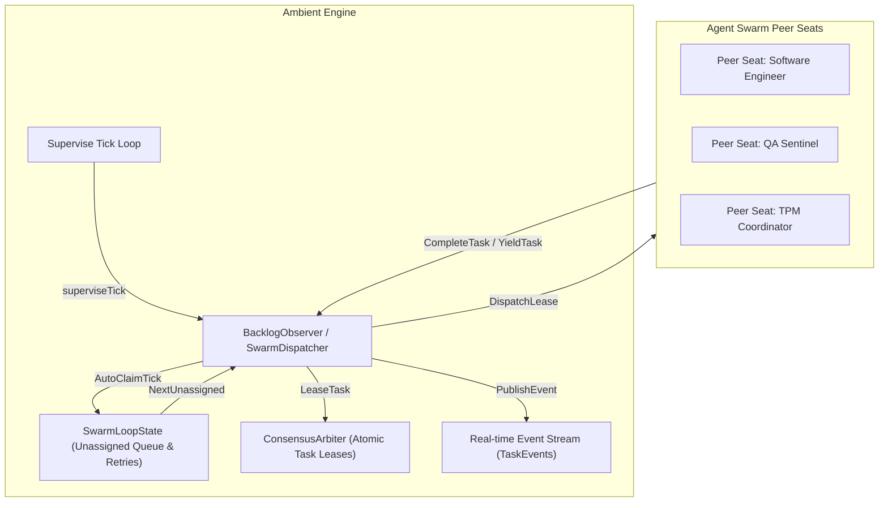

# Ambient Swarm Autonomous Work-Claim Daemon & Real-Time Event Loop Engine

## Overview
The Ambient Swarm Work-Claim Daemon provides continuous autonomous work-claim and dynamic seat dispatch within the ZQK Knowledge Kernel. Operating inside the host `AmbientEngine` supervisor tick loop, the daemon coordinates with `ConsensusArbiter` to ensure safe, race-free, and exclusive task leasing across registered agent peer seats.

## Architecture

## Task Lifecycle & State Transitions

1. **Unassigned / Enqueued:**
   Tasks are enqueued via `EnqueueTask(taskID)`. If not already leased or quarantined, the task enters `SwarmLoopState.unassigned`.

2. **Auto-Claim Dispatch:**
   During each supervisor tick (`superviseTick` / `AutoClaimTick`), the dispatcher iterates healthy peer seats (`HealthySeats()`). If a seat's active lease count is below `MaxClaimsPerSeat`, a lease is atomically requested via `ConsensusArbiter.LeaseTask`. Upon acquisition, a `TaskEventClaimed` event is broadcast to the `TaskEvents` stream.

3. **Task Completion:**
   When a peer seat finishes work, it invokes `CompleteTask(taskID, seatID)`. The dispatcher verifies seat lease ownership, commits the task in `ConsensusArbiter.CommitTask`, evicts the local active lease, and broadcasts `TaskEventCompleted`.

4. **Task Yield & Escalation:**
   If a peer seat encounters an unresolvable obstacle or boundary exception, it calls `YieldTask(taskID, seatID, reason)`. The lease is revoked, and the task's retry count is incremented:
   - If `retryCount <= MaxRetries`, the task is re-queued into `unassigned` for redistribution, emitting `TaskEventYielded`.
   - If `retryCount > MaxRetries`, the task transitions to quarantine status, emitting `TaskEventQuarantined` to prevent infinite thrashing loops.

## Telemetry & Verification
All lifecycle events are streamed non-blockingly over `<-chan SwarmTaskEvent` with payload metadata including `TaskID`, `SeatID`, `EventType`, `RetryCount`, `Reason`, and `Timestamp`.
